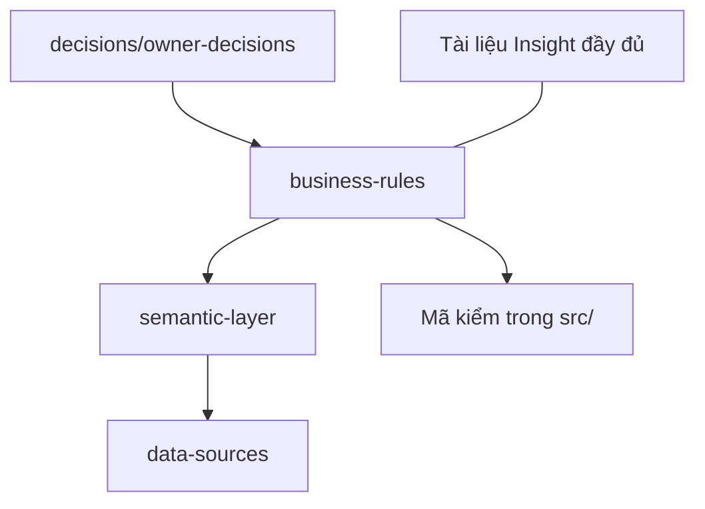

# Business spec: nguồn sự thật cho nghiệp vụ

> Phiên bản 1.2, ngày 21/10/2026.

Thư mục này là nơi duy nhất giữ quy tắc nghiệp vụ của dự án: quy tắc báo cáo, từ điển trường và chỉ số, trạng thái nguồn dữ liệu, quyết định của chủ.

## Mục lục

| File | Nội dung |
| --- | --- |
| [business-rules/market.md](business-rules/market.md) | Quy tắc báo cáo Market (R-M…): 14 quy tắc, quy tắc của cổng, quy tắc đơn vị |
| [business-rules/insight.md](business-rules/insight.md) | Quy tắc báo cáo Insight (R-I…). Từ 1.1: cấu trúc 16 section theo phương pháp insight (mục 8–9) |
| [business-rules/report-language.md](business-rules/report-language.md) | Quy tắc chung cho mọi báo cáo (R-L…) |
| [semantic-layer/fields.md](semantic-layer/fields.md) | Từ điển trường của từng nguồn |
| [semantic-layer/metrics.md](semantic-layer/metrics.md) | Từ điển chỉ số, cách đo, quy tắc so và cộng |
| [semantic-layer/source-methods.md](semantic-layer/source-methods.md) | Cách mỗi nguồn tính ra con số |
| [data-sources/input-standard.md](data-sources/input-standard.md) | Chuẩn dữ liệu đầu vào |
| [data-sources/input-standard-technical.md](data-sources/input-standard-technical.md) | Chuẩn dữ liệu đầu vào, bản kỹ thuật |
| [data-sources/source-status.md](data-sources/source-status.md) | Nhãn trạng thái hiện tại của từng nguồn |
| [decisions/owner-decisions.md](decisions/owner-decisions.md) | Quyết định của chủ, mới nhất ở trên |
| [research/Nghiên cứu phương pháp viết insight.md](<research/Nghiên cứu phương pháp viết insight.md>) | Nghiên cứu cách viết insight (có link nguồn), đối chiếu với I01–I17. Tài liệu nghiên cứu, không phải quy tắc |
| [CHANGELOG.md](CHANGELOG.md) | Nhật ký thay đổi của thư mục này |

Tài liệu Insight đầy đủ (câu hỏi của từng section) vẫn nằm ở [insight-cau-hoi-nghiep-vu.md](../research/ultimate-method/insight-cau-hoi-nghiep-vu.md). Mục 6.2 và Phần 7 của tài liệu đó đã chuyển sang `semantic-layer/`.

## Cách dùng

1. Một chủ đề nằm ở đúng một file.
2. Chỉ đổi bằng PR.
3. Mỗi lần đổi: tăng số phiên bản ở đầu file và thêm một dòng vào [CHANGELOG.md](CHANGELOG.md).
4. Chụp bản cũ vào `docs/outdated/<ngày>/<đường dẫn gốc>` trước khi sửa, và ghi vào `docs/outdated/README.md`.
5. Quy tắc nào có mã kiểm thì ghi file và hàm. Chưa có thì ghi "chưa có mã kiểm".

## Quy tắc khi xung đột

Khi hai tài liệu trong `docs/` nói khác nhau, **business-spec thắng**. Tài liệu kia phải sửa theo. Nếu hai file trong business-spec nói khác nhau, quyết định mới hơn của chủ ở [owner-decisions.md](decisions/owner-decisions.md) thắng, và hai file phải được sửa trong cùng một PR.

Không ghi vào thư mục này: đường dẫn máy, địa chỉ IP, tên máy, tên người dùng, khóa, token, dữ liệu khách thật.