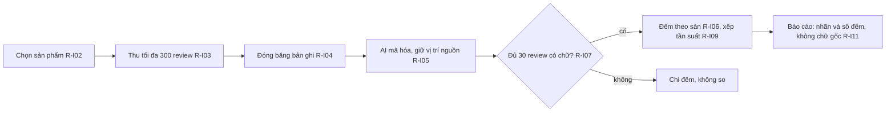
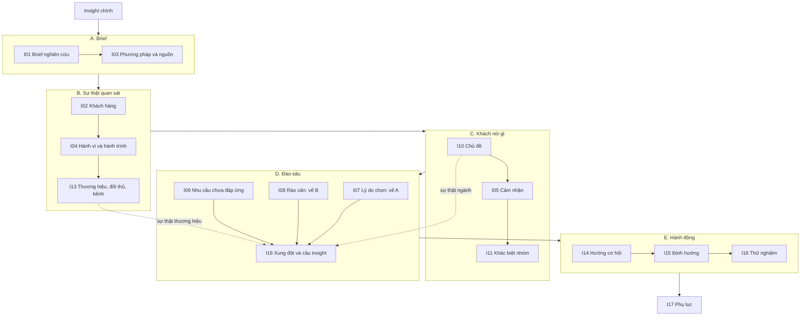

# Quy tắc nghiệp vụ: báo cáo Insight

> Phiên bản 1.1, ngày 21/10/2026. Thư mục gốc: [business-spec](../README.md).

Tài liệu này giữ các quy tắc của Insight. Mỗi quy tắc có mã R-I…. Nội dung đầy đủ từng section Insight nằm ở [tài liệu câu hỏi Insight](../../research/ultimate-method/insight-cau-hoi-nghiep-vu.md). Từ điển trường và từ điển chỉ số đã chuyển sang [fields.md](../semantic-layer/fields.md) và [metrics.md](../semantic-layer/metrics.md).

Insight chờ Market ổn định rồi mới chạy (chủ 17/10, 12/10). Quy tắc chung cho mọi báo cáo nằm ở [report-language.md](report-language.md). Cột "Mã kiểm" ghi "chưa có mã kiểm" khi chưa có hàm trong mã nguồn.

## 1. Đếm và chọn mẫu

| Mã | Quy tắc | Mã kiểm |
| --- | --- | --- |
| R-I01 | Đơn vị đếm là "bản ghi" (một review hay một bình luận). Bản ghi không phải người. | Chưa có mã kiểm |
| R-I02 | Chọn sản phẩm từ nguồn S01: cộng dồn đến ít nhất 50% doanh thu của nhóm lõi (ít nhất 80% khi cần phủ rộng). Cần ít nhất 5 thương hiệu, trải đều giữa các thương hiệu. | Chưa có mã kiểm |
| R-I03 | Mỗi sản phẩm lấy tối đa 300 review. Dừng theo cách A (số cố định) hoặc cách B (lô 25 review có chữ, dừng khi một lô thêm không quá 5% mã chủ đề mới), cách nào tới trước. | Chưa có mã kiểm |
| R-I04 | Đóng băng bộ bản ghi. Ghi ngày thu thập theo giờ Việt Nam. Đánh dấu bản ghi ngoài kỳ và bản ghi trùng nguyên văn. | Chưa có mã kiểm |
| R-I05 | Mã hóa bằng AI dùng bộ mã có phiên bản. Mỗi mã giữ vị trí nguồn (id bản ghi và đoạn chữ). | Chưa có mã kiểm |
| R-I06 | Đếm bản ghi theo từng sàn. Không cộng Shopee với TikTok Shop. Ghi n/N khi mẫu số đầy đủ. | Một phần: cổng `U32_NO_CROSS_PLATFORM_TOTAL` (xem [market.md](market.md)) |

## 2. Cổng so sánh và nhận định

| Mã | Quy tắc | Mã kiểm |
| --- | --- | --- |
| R-I07 | Chỉ so giữa các sản phẩm khi mỗi sản phẩm có ít nhất 30 review có chữ. | Chưa có mã kiểm |
| R-I08 | Gọi một vấn đề là "của ngành hàng" chỉ khi nó xuất hiện ở ít nhất 3 sản phẩm của các thương hiệu khác nhau. Nếu không, gọi là "của sản phẩm". | Chưa có mã kiểm |
| R-I09 | Xếp hạng theo tần suất là chủ đề × khen/chê, theo từng sàn. Một bình luận tính một lần trong mỗi chủ đề. Chủ đề dưới 3 lần nhắc vào "Khác". Nếu "Khác" trên 20%, thu thêm một vòng (tối đa một vòng); vẫn trên 20% thì hiện nguyên. Xếp hạng nghiêm ngặt, không có hạng đồng. (Chủ 11/10, U-11) | Chưa có mã kiểm |
| R-I10 | Tần suất không bằng mức quan trọng. Không thêm lại dòng "Đừng hiểu là: nhắc nhiều ≠ quan trọng". | Chưa có mã kiểm |

## 3. Trình bày bình luận

| Mã | Quy tắc | Mã kiểm |
| --- | --- | --- |
| R-I11 | Báo cáo hiện nhãn đã mã hóa và số đếm. Không hiện bình luận gốc của khách (chủ 19/10). Vị trí nguồn nằm ở I17. Trích dẫn đã mã hóa thì được; đổ nguyên khối chữ gốc thì cấm. | Chưa có mã kiểm |

## 4. Tiếng nói của người bán

| Mã | Quy tắc | Mã kiểm |
| --- | --- | --- |
| R-I12 | Gắn nhãn "người bán nói…" hoặc "người bán nhắm tới…" (L7). Không trộn với tiếng nói khách hàng. | Một phần: cổng `SELLER_VIDEO_NOT_CUSTOMER_OR_TOTAL` (xem [market.md](market.md)) |
| R-I13 | Giới hạn: S14 tối đa 10 video (ưu tiên chú thích có sẵn), S17 tối đa 3 thương hiệu, S15 tối đa 2 thương hiệu. Một video chỉ đủ cho kết luận cấp video. | Chưa có mã kiểm |

## 5. Đơn vị (mục 6.6 của tài liệu Insight)

| Mã | Quy tắc | Mã kiểm |
| --- | --- | --- |
| R-I14 | Mỗi ngành hàng có hồ sơ đơn vị: đơn vị đếm, đơn vị so giá, nhóm quy cách. Làm hồ sơ trước khi so hoặc lập bảng. | Chưa có mã kiểm. Có thể dùng lại `market-unit-prices.ts` |
| R-I15 | Hàng bền chỉ so trong cùng nhóm quy cách. Chưa có hồ sơ thì chỉ đếm, không so giá. | Chưa có mã kiểm |
| R-I16 | Không cộng đơn vị khác nhau. Không đổi giữa các loại đơn vị. | Chưa có mã kiểm |
| R-I17 | Tiêu đề cột ghi đơn vị. Hiện số lượng "chưa quy đổi được". | Chưa có mã kiểm |
| R-I18 | Số review là số bản ghi, không phải số bán. | Chưa có mã kiểm |
| R-I19 | Đọc quy cách từ tên sản phẩm theo R-M30 trong [market.md](market.md). Mục 6.6.2 của tài liệu Insight đang nói ngược (không đoán từ tiêu đề); chủ cần sửa mục đó. | Chưa có mã kiểm |

## 6. Đề xuất hành động (mục 6.5)

| Mã | Quy tắc | Mã kiểm |
| --- | --- | --- |
| R-I20 | Mỗi hành động trỏ tới ít nhất một phát hiện đã đếm. | Chưa có mã kiểm |
| R-I21 | Tối đa 3 đề xuất ở I15 (E6). | Chưa có mã kiểm |
| R-I22 | Không có ý tưởng chiến dịch quảng cáo cảm xúc. Không đưa lời khuyên cho đối thủ. Không đặt đơn thử (L8). | Chưa có mã kiểm |
| R-I23 | Đề xuất về giá hoặc quy cách dùng đơn vị chuẩn. | Chưa có mã kiểm |
| R-I24 | Gắn nhãn "Đề xuất, chờ chủ duyệt". | Một phần: cổng `M12_PROPOSAL_LABEL` chỉ kiểm M12 của Market |

## 7. Chân dung khách hàng (persona)

| Mã | Quy tắc | Mã kiểm |
| --- | --- | --- |
| R-I25 | Persona do AI tổng hợp chỉ được dùng khi có thẻ bằng chứng: ít nhất 3 thẻ và ít nhất 5 nội dung khác nhau (Shopee không có id tác giả). Mỗi thuộc tính trích một câu thật. (Chủ 07/10) | Chưa có mã kiểm |
| R-I26 | Chỉ hiện nhân khẩu khi chính bài viết nói ra. Ghi nhãn "do AI tổng hợp". Chỉ nêu cỡ mẫu dạng số trong mẫu. | Chưa có mã kiểm |
| R-I27 | Cấm trả lời khảo sát do mô hình giả lập, và cấm câu trích ngôi thứ nhất do mô hình tự viết. | Chưa có mã kiểm |
| R-I28 | Thẻ nhân khẩu ở I02 có ba loại số: cả dân số, nhóm quan tâm, lời khách. Cột nhóm quan tâm ghi "Chưa có số" cho đến khi có tài khoản quảng cáo Meta. (Chủ 20/10, F25) | Chưa có mã kiểm |

## 8. Cấu trúc section theo phương pháp insight (chủ 21/10, F74)

Cấu trúc này theo [Nghiên cứu phương pháp viết insight](<../research/Nghiên cứu phương pháp viết insight.md>): Brief → Sự thật quan sát → Khách nói gì → Đào sâu → Câu insight → Hành động. Báo cáo cũ chỉ đi tới bước "khách nói gì". Cấu trúc mới thêm bước đào sâu và câu insight.

Thay đổi so với 17 section cũ:

- **Gộp:** I06 Hành trình vào I04. I12 Điểm tiếp xúc vào I13.
- **Thêm:** I18 Xung đột và câu insight.
- **Đổi vai:** Kết luận chính thành "Insight chính". I01 thành brief có loại câu hỏi.
- **Giữ mã:** I01–I17 giữ mã cũ. I06 và I12 không dùng nữa, không cấp lại cho mục khác. M11 vẫn nhận I08 và I09.

| Thứ tự | Phần | Mã | Section | Bước phương pháp | Trả lời câu hỏi |
| --- | --- | --- | --- | --- | --- |
| 0 | — | — | Insight chính | Câu insight | Câu trả lời cho I01 là gì? Có câu insight nào đủ bằng chứng? |
| 1 | A. Brief | I01 | Brief nghiên cứu | Brief | Quyết định gì? Đối tượng nào? Khám phá hay kiểm chứng? Dừng ở đâu? |
| 2 | A. Brief | I03 | Phương pháp và nguồn | Kiểm tra nguồn | Tin báo cáo tới mức nào? Mỗi nguồn do ai làm, khi nào, cỡ mẫu bao nhiêu? |
| 3 | B. Sự thật quan sát | I02 | Khách hàng và hoàn cảnh | Fact | Ai mua, mua cho dịp gì? |
| 4 | B. Sự thật quan sát | I04 | Hành vi và hành trình | Fact | Khách mua, dùng, mua lại ra sao? Vấp ở bước nào? |
| 5 | B. Sự thật quan sát | I13 | Thương hiệu, đối thủ và kênh | Fact (sự thật thương hiệu của 3C) | Ai bán nhiều? Người bán nói gì, ở kênh nào? |
| 6 | C. Khách nói gì | I10 | Chủ đề và mối quan tâm | Observation (sự thật ngành của 3C) | Khách nói về chuyện gì, bao nhiêu lần, khen hay chê? |
| 7 | C. Khách nói gì | I05 | Cảm nhận và thái độ | Observation | Khách khen gì, chê gì? |
| 8 | C. Khách nói gì | I11 | Khác biệt giữa các nhóm | Observation theo nhóm | Hai nhóm khác nhau ở đâu? |
| 9 | D. Đào sâu | I07 | Lý do lựa chọn | Motivation (vế A) | Khách muốn đạt gì khi mua? |
| 10 | D. Đào sâu | I08 | Rào cản | Tension (vế B) | Khách bị cản bởi gì? |
| 11 | D. Đào sâu | I09 | Nhu cầu chưa được đáp ứng | Khoảng trống | Khách mong gì mà chưa có? |
| 12 | D. Đào sâu | I18 | Xung đột và câu insight | Tại sao ×3, Tension, 3C, câu insight | Khách muốn A nhưng vướng B ở đâu? Vì sao? |
| 13 | E. Hành động | I14 | Hướng cơ hội | Insight → hướng đi | Mỗi câu insight mở ra hướng nào? |
| 14 | E. Hành động | I15 | Định hướng chiến lược | Hành động | Chủ chọn phương án nào? |
| 15 | E. Hành động | I16 | Thử nghiệm và đo lường | Kiểm chứng | Làm sao kiểm phương án và câu hỏi kiểm chứng? |
| 16 | — | I17 | Phụ lục và bằng chứng | Bằng chứng, nhật ký | Ý này lấy từ bản ghi nào? Các vòng thu và mã hóa ra sao? |

Mã nguồn chưa theo cấu trúc này. `insight-template.ts` vẫn dựng 17 section cũ. Sửa mã là việc riêng, sau khi Insight được chạy lại.

## 9. Đào sâu và câu insight

Các ngưỡng có chữ "tạm" là đề xuất. Chủ chốt số cuối cùng.

| Mã | Quy tắc | Mã kiểm |
| --- | --- | --- |
| R-I29 | Câu insight là một câu xung đột: "Trên [sàn], [n] bản ghi khen [A]; trong đó [m] bản ghi cũng chê [B]." A là mã ở I07 hoặc mã khen ở I05. B là mã ở I08 hoặc mã chê ở I05. m đếm bản ghi có cả A và B. Viết ngôi thứ ba (R-I27). Đếm theo từng sàn (R-I06). Chỉ ra câu khi m ≥ 10 bản ghi và các bản ghi đó thuộc ≥ 2 sản phẩm (ngưỡng tạm). | Chưa có mã kiểm |
| R-I30 | Chuỗi "tại sao" có tối đa 3 tầng. Mỗi tầng là một mã lý do do chính khách viết ("vì…", "do…"), gắn với mã tầng trên trong cùng bản ghi, có vị trí nguồn (R-I05). Tầng không có bản ghi thì dừng và ghi "chưa đủ bằng chứng". Không suy nhân quả mà khách không nói. | Chưa có mã kiểm |
| R-I31 | Bảng 3C ở I18 có 3 cột. Sự thật ngành: chỉ chủ đề đạt R-I08 (≥ 3 sản phẩm khác thương hiệu), ghi bằng từ khóa. Sự thật thương hiệu: lời người bán, gắn nhãn R-I12; nếu chủ có sản phẩm thì dùng điểm mạnh chủ khai ở I01. Sự thật khách: mã ở I07 và I08. Mỗi ô trỏ tới bản ghi hoặc nguồn. | Chưa có mã kiểm |
| R-I32 | "Insight chính" hiện tối đa 3 câu đạt R-I29, xếp theo m, mỗi câu trỏ tới I18. Không gọi câu nào là "quan trọng nhất" (R-I10). Không có câu đạt thì ghi "Chưa có insight đủ bằng chứng" và hiện tối đa 4 quan sát, mỗi quan sát gắn nhãn "quan sát, chưa phải insight". | Chưa có mã kiểm |
| R-I33 | Mỗi câu hỏi ở I01 có nhãn "khám phá" hoặc "kiểm chứng". Câu khám phá có điểm dừng (theo R-I03). Câu kiểm chứng có giả thuyết, định nghĩa đo được và kết quả làm chủ đổi quyết định. Câu kiểm chứng mà dữ liệu quan sát không trả lời được thì chuyển sang I16. | Chưa có mã kiểm |
| R-I34 | Mỗi hướng ở I14 trỏ tới ít nhất một câu insight ở I18 hoặc một nhu cầu ở I09 (mở rộng R-I20). | Chưa có mã kiểm |
| R-I35 | I03 ghi bối cảnh của mỗi nguồn: bên làm, ngày thu, nơi (sàn, nước), cỡ mẫu. I17 có nhật ký theo vòng: vòng thu, vòng thu thêm (R-I09), phiên bản bộ mã. | Chưa có mã kiểm |
