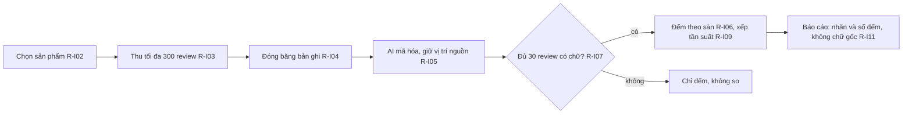

# Quy tắc nghiệp vụ: báo cáo Insight

> Phiên bản 1.0, ngày 21/10/2026. Thư mục gốc: [business-spec](../README.md).

Tài liệu này giữ các quy tắc của Insight. Mỗi quy tắc có mã R-I…. Nội dung đầy đủ từng section Insight nằm ở [tài liệu câu hỏi Insight](../../research/ultimate-method/insight-cau-hoi-nghiep-vu.md). Từ điển trường và từ điển chỉ số đã chuyển sang [fields.md](../semantic-layer/fields.md) và [metrics.md](../semantic-layer/metrics.md).

Insight chờ Market ổn định rồi mới chạy (chủ 17/10, 12/10). Quy tắc chung cho mọi báo cáo nằm ở [report-language.md](report-language.md). Cột "Mã kiểm" ghi "chưa có mã kiểm" khi chưa có hàm trong mã nguồn.

## 1. Đếm và chọn mẫu

| Mã | Quy tắc | Mã kiểm |
| --- | --- | --- |
| R-I01 | Đơn vị đếm là "bản ghi" (một review hay một bình luận). Bản ghi không phải người. | Chưa có mã kiểm |
| R-I02 | Chọn sản phẩm từ nguồn S01: cộng dồn đến ít nhất 50% doanh thu của nhóm lõi (ít nhất 80% khi cần phủ rộng). Cần ít nhất 5 thương hiệu, trải đều giữa các thương hiệu. | Chưa có mã kiểm |
| R-I03 | Mỗi sản phẩm lấy tối đa 300 review. Dừng theo cách A (số cố định) hoặc cách B (lô 25 review có chữ, dừng khi một lô thêm không quá 5% mã chủ đề mới), cách nào tới trước. | Chưa có mã kiểm |
| R-I04 | Đóng băng bộ bản ghi. Ghi ngày thu thập theo giờ Việt Nam. Đánh dấu bản ghi ngoài kỳ và bản ghi trùng nguyên văn. | Chưa có mã kiểm |
| R-I05 | Mã hóa bằng AI dùng bộ mã có phiên bản. Mỗi mã giữ vị trí nguồn (id bản ghi và đoạn chữ). | Chưa có mã kiểm |
| R-I06 | Đếm bản ghi theo từng sàn. Không cộng Shopee với TikTok Shop. Ghi n/N khi mẫu số đầy đủ. | Một phần: cổng `U32_NO_CROSS_PLATFORM_TOTAL` (xem [market.md](market.md)) |

## 2. Cổng so sánh và nhận định

| Mã | Quy tắc | Mã kiểm |
| --- | --- | --- |
| R-I07 | Chỉ so giữa các sản phẩm khi mỗi sản phẩm có ít nhất 30 review có chữ. | Chưa có mã kiểm |
| R-I08 | Gọi một vấn đề là "của ngành hàng" chỉ khi nó xuất hiện ở ít nhất 3 sản phẩm của các thương hiệu khác nhau. Nếu không, gọi là "của sản phẩm". | Chưa có mã kiểm |
| R-I09 | Xếp hạng theo tần suất là chủ đề × khen/chê, theo từng sàn. Một bình luận tính một lần trong mỗi chủ đề. Chủ đề dưới 3 lần nhắc vào "Khác". Nếu "Khác" trên 20%, thu thêm một vòng (tối đa một vòng); vẫn trên 20% thì hiện nguyên. Xếp hạng nghiêm ngặt, không có hạng đồng. (Chủ 11/10, U-11) | Chưa có mã kiểm |
| R-I10 | Tần suất không bằng mức quan trọng. Không thêm lại dòng "Đừng hiểu là: nhắc nhiều ≠ quan trọng". | Chưa có mã kiểm |

## 3. Trình bày bình luận

| Mã | Quy tắc | Mã kiểm |
| --- | --- | --- |
| R-I11 | Báo cáo hiện nhãn đã mã hóa và số đếm. Không hiện bình luận gốc của khách (chủ 19/10). Vị trí nguồn nằm ở I17. Trích dẫn đã mã hóa thì được; đổ nguyên khối chữ gốc thì cấm. | Chưa có mã kiểm |

## 4. Tiếng nói của người bán

| Mã | Quy tắc | Mã kiểm |
| --- | --- | --- |
| R-I12 | Gắn nhãn "người bán nói…" hoặc "người bán nhắm tới…" (L7). Không trộn với tiếng nói khách hàng. | Một phần: cổng `SELLER_VIDEO_NOT_CUSTOMER_OR_TOTAL` (xem [market.md](market.md)) |
| R-I13 | Giới hạn: S14 tối đa 10 video (ưu tiên chú thích có sẵn), S17 tối đa 3 thương hiệu, S15 tối đa 2 thương hiệu. Một video chỉ đủ cho kết luận cấp video. | Chưa có mã kiểm |

## 5. Đơn vị (mục 6.6 của tài liệu Insight)

| Mã | Quy tắc | Mã kiểm |
| --- | --- | --- |
| R-I14 | Mỗi ngành hàng có hồ sơ đơn vị: đơn vị đếm, đơn vị so giá, nhóm quy cách. Làm hồ sơ trước khi so hoặc lập bảng. | Chưa có mã kiểm. Có thể dùng lại `market-unit-prices.ts` |
| R-I15 | Hàng bền chỉ so trong cùng nhóm quy cách. Chưa có hồ sơ thì chỉ đếm, không so giá. | Chưa có mã kiểm |
| R-I16 | Không cộng đơn vị khác nhau. Không đổi giữa các loại đơn vị. | Chưa có mã kiểm |
| R-I17 | Tiêu đề cột ghi đơn vị. Hiện số lượng "chưa quy đổi được". | Chưa có mã kiểm |
| R-I18 | Số review là số bản ghi, không phải số bán. | Chưa có mã kiểm |
| R-I19 | Đọc quy cách từ tên sản phẩm theo R-M30 trong [market.md](market.md). Mục 6.6.2 của tài liệu Insight đang nói ngược (không đoán từ tiêu đề); chủ cần sửa mục đó. | Chưa có mã kiểm |

## 6. Đề xuất hành động (mục 6.5)

| Mã | Quy tắc | Mã kiểm |
| --- | --- | --- |
| R-I20 | Mỗi hành động trỏ tới ít nhất một phát hiện đã đếm. | Chưa có mã kiểm |
| R-I21 | Tối đa 3 đề xuất ở I15 (E6). | Chưa có mã kiểm |
| R-I22 | Không có ý tưởng chiến dịch quảng cáo cảm xúc. Không đưa lời khuyên cho đối thủ. Không đặt đơn thử (L8). | Chưa có mã kiểm |
| R-I23 | Đề xuất về giá hoặc quy cách dùng đơn vị chuẩn. | Chưa có mã kiểm |
| R-I24 | Gắn nhãn "Đề xuất, chờ chủ duyệt". | Một phần: cổng `M12_PROPOSAL_LABEL` chỉ kiểm M12 của Market |

## 7. Chân dung khách hàng (persona)

| Mã | Quy tắc | Mã kiểm |
| --- | --- | --- |
| R-I25 | Persona do AI tổng hợp chỉ được dùng khi có thẻ bằng chứng: ít nhất 3 thẻ và ít nhất 5 nội dung khác nhau (Shopee không có id tác giả). Mỗi thuộc tính trích một câu thật. (Chủ 07/10) | Chưa có mã kiểm |
| R-I26 | Chỉ hiện nhân khẩu khi chính bài viết nói ra. Ghi nhãn "do AI tổng hợp". Chỉ nêu cỡ mẫu dạng số trong mẫu. | Chưa có mã kiểm |
| R-I27 | Cấm trả lời khảo sát do mô hình giả lập, và cấm câu trích ngôi thứ nhất do mô hình tự viết. | Chưa có mã kiểm |
| R-I28 | Thẻ nhân khẩu ở I02 có ba loại số: cả dân số, nhóm quan tâm, lời khách. Cột nhóm quan tâm ghi "Chưa có số" cho đến khi có tài khoản quảng cáo Meta. (Chủ 20/10, F25) | Chưa có mã kiểm |

