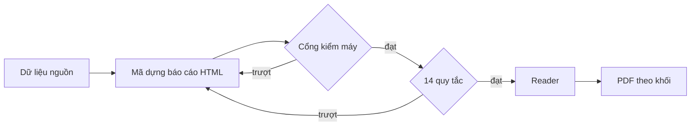
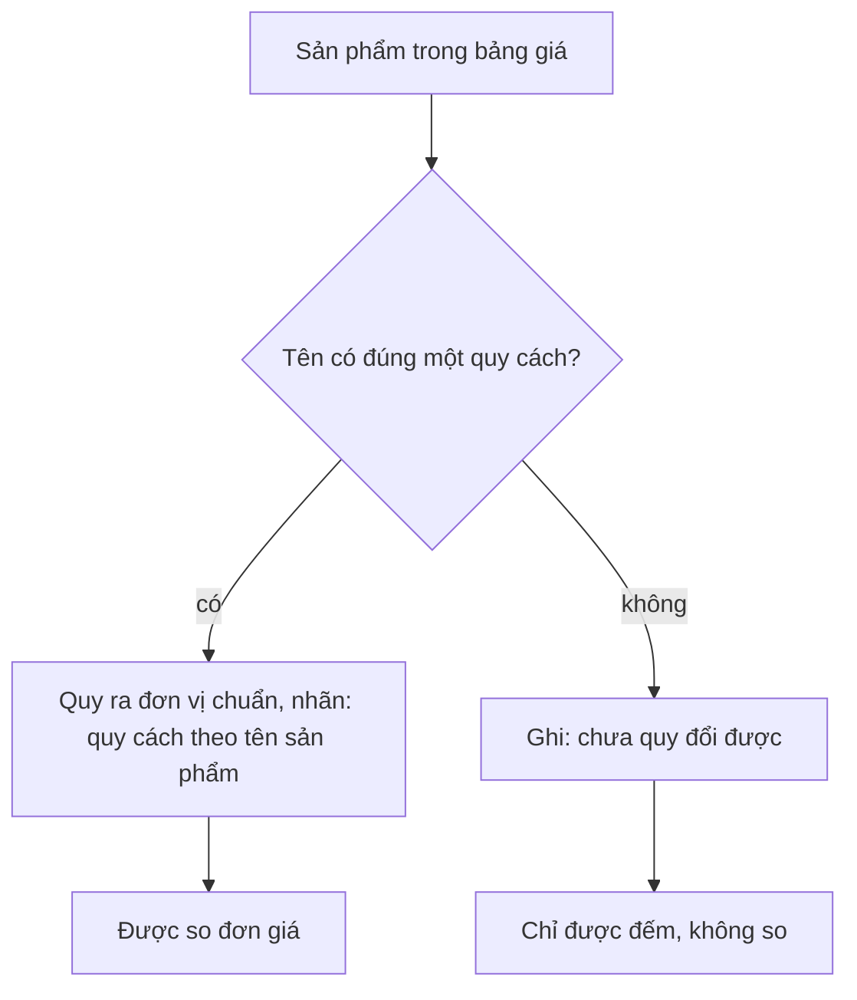

# Quy tắc nghiệp vụ: báo cáo Market

> Phiên bản 1.0, ngày 21/10/2026. Thư mục gốc: [business-spec](../README.md).

Tài liệu này giữ quy tắc của báo cáo Market tự động. Mỗi quy tắc có một mã (R-M…). Cột "Mã kiểm" nêu file và hàm trong mã nguồn kiểm quy tắc đó. Nếu chưa có hàm kiểm, ghi "chưa có mã kiểm".

Quy tắc chung cho cả hai báo cáo nằm ở [report-language.md](report-language.md). Quy tắc Insight nằm ở [insight.md](insight.md).

## 1. Mục tiêu

Báo cáo Market tự động phải đạt 14/14 quy tắc. Máy sinh báo cáo, không ai sửa tay. Sửa tay chỉ để học, rồi đưa vào mã (xem [owner-decisions.md](../decisions/owner-decisions.md)).

## 2. 14 quy tắc sửa tay đã chuyển thành quy tắc tự động

Mã kiểm của 14 quy tắc nằm ở `src/modules/analysis/research-automation/market-14-rules.ts`, hàm `auditMarket14`. Hàm `assertMarket14MachineRules` báo lỗi `MARKET_14_RULES_FAILED:<số quy tắc>` khi một quy tắc máy trượt.

| Mã | Quy tắc | Loại kiểm | Mã kiểm |
| --- | --- | --- | --- |
| R-M01 | Mọi thuật ngữ khó có giải thích bằng tiếng Việt đơn giản (bảng thuật ngữ). | Máy | `market-14-rules.ts`: `GLOSSARY`, `glossaryHtml`. Danh sách thuật ngữ và cách nhận ra thuật ngữ nằm ở một chỗ (`report-language/glossary.ts`), dùng chung cho bộ kiểm tra và bảng thuật ngữ của báo cáo. |
| R-M02 | Nhãn phần dùng "Phần n". Không để mã M trong thân báo cáo. Phụ lục dùng "Bảng PL.x". | Máy | `market-14-rules.ts`: kiểm nhãn |
| R-M03 | Thân báo cáo không có chữ kỹ thuật. Dấu vết kỹ thuật nằm ở file .md riêng. | Máy | `market-14-rules.ts`: `technicalLeaks` |
| R-M04 | Báo cáo không nêu tên nhà cung cấp dữ liệu, mô hình AI hoặc "Google". Chi tiết ở R-L01. | Máy | `market-14-rules.ts` và cổng `G08_PROVIDER_NAME` (mục 3) |
| R-M05 | Giải thích nằm ở dòng "Chú thích:" riêng. Không chèn vào dòng "Nguồn:". | Máy | `market-14-rules.ts`: `noteProblems` |
| R-M06 | Lời văn không rộng hơn con số đứng sau nó. | Bằng chứng (người đọc soát) | `market-14-rules.ts`: `evidenceDetail`. Chưa có mã kiểm tự động |
| R-M07 | Con số là số trong mẫu, có ghi n. Không nêu quy mô thị trường. Không cộng giữa hai sàn. | Máy | `market-14-rules.ts`: `sampleSizeIssues`, `zeroSampleSizeIssues`, `hasSampleStatement`, kiểm chữ "thị phần" và "quy mô thị trường". Cổng `U32_NO_CROSS_PLATFORM_TOTAL` |
| R-M08 | Mỗi nhận định trỏ tới một con số, một hình hoặc một bảng. | Bằng chứng (người đọc soát) | Chưa có mã kiểm tự động |
| R-M09 | Phần M12 có 3 phương án và một việc làm nhanh. Mỗi mục có người phụ trách, hạn dạng dd/mm/yyyy và nhãn "đề xuất, chờ chủ duyệt". | Máy | `market-14-rules.ts`: `hasM12ProposalRows`. Cổng `M12_PROPOSAL_LABEL` |
| R-M10 | Trang bìa có ảnh JPEG do AI tạo, nhúng dạng base64 có giới hạn dung lượng, có chữ thay thế (alt). Không cần bằng chứng giấy phép ảnh (chủ bỏ 13/10). | Máy | `market-14-rules.ts`: `isAiCoverJpeg`, `coverBlock` |
| R-M11 | Có biểu tượng sàn và biểu đồ Flint. Ít nhất 3 biểu đồ, hoặc 2 khi nguồn không ghi gian hàng. | Máy | `market-14-rules.ts`: `chartFragments`, `chartIssues`, `localIconCss`, đếm biểu tượng |
| R-M12 | Mọi bảng ghi rõ Shopee hay TikTok Shop. | Máy | `market-14-rules.ts`: `platformTableIssues` |
| R-M13 | Bốn nhãn nguồn trung tính cho bốn nguồn dữ liệu. | Máy | `market-14-rules.ts`: `sourceCoverage` |
| R-M14 | Link review đa dạng thương hiệu. Mỗi sản phẩm lấy 300 bình luận. | Bằng chứng (người đọc soát) | Chưa có mã kiểm tự động |

Ba quy tắc R-M06, R-M08, R-M14 chỉ có bằng chứng người đọc. Chưa có hàm máy kiểm.

## 3. Quy tắc của cổng (gate) mà mã kiểm

Hàm `auditMarketReportHtml` trong `src/modules/analysis/research-automation/market-business-gate.ts` chạy các quy tắc dưới đây. Chế độ "presentation" thêm hai quy tắc về phần.

| Mã | Quy tắc | Mã cổng | Hàm kiểm |
| --- | --- | --- | --- |
| R-M15 | Không nêu tên nhà cung cấp, công cụ, mô hình AI hay "Google". Tên sàn như Shopee thì được. | `G08_PROVIDER_NAME` | `providerMatches`. Danh sách tên nằm ở `FORBIDDEN_PROVIDER_NAMES`, `CAPTURED_PROVIDER_NAMES` trong `src/modules/analysis/reader-report/lint.ts` |
| R-M16 | Không có tổng giữa Shopee và TikTok Shop. | `U32_NO_CROSS_PLATFORM_TOTAL` | `CROSS_PLATFORM_TOTAL_PHRASES` |
| R-M17 | Không xếp thứ tự theo doanh thu bằng lời "Thứ tự theo doanh thu" hay "top 3". Chữ "xếp hạng" và "thị phần" bị cấm, trừ khi câu đó phủ định. | `E2_NO_REVENUE_ORDER` | `e2Matches` |
| R-M18 | Một tổng có thành viên thiếu thì không được nêu như tổng. | `PARTIAL_TOTAL_FORBIDDEN` | `partialRowTotals`, `partialTotalMatches` |
| R-M19 | Báo cáo không lộ đường dẫn, địa chỉ email, khóa hay địa chỉ mạng nội bộ. | `NO_LEAK` | `noLeakMatches` |
| R-M20 | Mức quan tâm tìm kiếm không phải số đếm. | `SEARCH_INTEREST_NOT_COUNT` | `searchInterestMisuse` |
| R-M21 | Số vĩ mô của World Bank không dùng để tính số học với số mẫu (chỉ kiểm khi khối vĩ mô được vẽ). | `WORLD_BANK_NOT_ARITHMETIC` | `worldBankMisuse` |
| R-M22 | Trích đoạn PDF không thành số thị trường (chỉ kiểm khi khối được vẽ). | `PDF_EXCERPT_NOT_MARKET_NUMBER` | `pdfExcerptMisuse` |
| R-M23 | Video của người bán không thành tiếng nói khách hàng hay tổng (chỉ kiểm khi khối được vẽ). | `SELLER_VIDEO_NOT_CUSTOMER_OR_TOTAL` | `sellerVideoMisuse` |
| R-M24 | Không dùng so sánh cao nhất, ưu tiên hay "số đang chờ" trong chữ nhìn thấy. | `U13_SUPERLATIVE`, `U13_PRIORITY`, `U13_PENDING_NUMBER` | `lintVisibleReportText` trong `src/modules/analysis/research-automation/report-visible-text-lint.ts` |
| R-M25 | Chế độ trình bày: M01 đến M13 mỗi phần đúng một lần. | `SECTIONS_PRESENT` | `market-business-gate.ts` (chỉ chế độ presentation) |
| R-M26 | Chế độ trình bày: chữ đề xuất trong M12 phải có chữ "đề xuất". | `M12_PROPOSAL_LABEL` | `market-business-gate.ts` (chỉ chế độ presentation) |

## 4. Quy tắc đơn vị (chủ chốt 21/10/2026)

Quy tắc này áp dụng cho mọi ngành hàng. Chi tiết cho Insight nằm ở mục 6.6 của [tài liệu Insight](../../research/ultimate-method/insight-cau-hoi-nghiep-vu.md) và ở [metrics.md](../semantic-layer/metrics.md).

| Mã | Quy tắc | Mã kiểm |
| --- | --- | --- |
| R-M27 | Doanh thu (đồng) không có đơn vị đếm. Xếp theo doanh thu và tỷ trọng doanh thu vẫn giữ. | Chưa có mã kiểm riêng |
| R-M28 | Không cộng số lượng đã bán giữa các sản phẩm. | Chưa có mã kiểm |
| R-M29 | Chỉ so giá giữa các sản phẩm bằng đơn giá trong một đơn vị chuẩn: đồng/100g, đồng/100ml, đồng/<từ đếm> hoặc đồng/sản phẩm. | Một phần: `projectMarketUnitPrices` trong `src/modules/analysis/reader-report/market-unit-prices.ts` gắn đơn giá với bằng chứng đã giữ và đòi `contractVersion` 1.4.0. Chưa có mã kiểm cho đơn vị chuẩn |
| R-M30 | Chỉ đọc quy cách từ tên sản phẩm khi tên có đúng một quy cách. Ghi nhãn "quy cách theo tên sản phẩm". | Chưa có mã kiểm (đang làm, việc F67) |
| R-M31 | Khi không đọc được đúng một quy cách, ghi "chưa quy đổi được". Sản phẩm đó được đếm nhưng không đem so. | Chưa có mã kiểm |
| R-M32 | Mọi cột giá ghi đơn vị ngay ở tiêu đề cột. | Chưa có mã kiểm |

## 5. Hai điểm xung đột cần chủ quyết

Hai điểm sau chưa xử lý. Bản này ghi lại, không tự chọn.

1. **Mục 6.6.2 của tài liệu Insight ghi "không đoán quy cách từ tiêu đề".** Quy tắc R-M30 (21/10) cho đọc quy cách từ tên khi tên có đúng một quy cách. Hai điều này mâu thuẫn. Theo quy tắc xung đột của [README](../README.md), quy tắc mới của chủ (R-M30) thắng. Mục 6.6.2 cần sửa ở lần cập nhật sau.
2. **R-M17 (`E2_NO_REVENUE_ORDER`) cấm "Thứ tự theo doanh thu", "top 3", "xếp hạng", "thị phần".** R-M27 giữ xếp theo doanh thu và tỷ trọng. Cần chủ nói rõ câu chữ nào được dùng khi xếp theo doanh thu, để cổng và quy tắc đơn vị không chặn nhau.

Thêm một khoảng trống: kho này không có bản văn gốc của 14 quy tắc ngoài mã. Bảng ở mục 2 được dựng từ mã `market-14-rules.ts` và từ quyết định của chủ. Khi chủ duyệt bản văn, thay bảng này.
