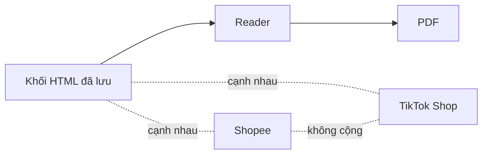

# Quy tắc nghiệp vụ: ngôn ngữ và cách trình bày chung của báo cáo

> Phiên bản 1.0, ngày 21/10/2026. Thư mục gốc: [business-spec](../README.md).

Các quy tắc dưới đây áp dụng cho cả báo cáo Market và báo cáo Insight. Mã quy tắc là R-L…. Quy tắc riêng của từng báo cáo nằm ở [market.md](market.md) và [insight.md](insight.md).

## 1. Tên và nguồn

| Mã | Quy tắc | Mã kiểm |
| --- | --- | --- |
| R-L01 | Báo cáo không nêu tên nhà cung cấp dữ liệu, công cụ, mô hình AI hay "Google". Tên sàn như Shopee và TikTok Shop thì được. Dùng lời trung tính, ví dụ "dữ liệu bán hàng ước tính", "review công khai trên Shopee". File dấu vết kỹ thuật (.md riêng) được nêu tên công cụ. Quy tắc áp dụng cho cả Market và Insight, với cùng một danh sách tên đầy đủ. Tên công cụ thu review công khai bị cấm ở mọi báo cáo. Chữ thường "metric" được phép; "Metric" và "METRIC" bị cấm. Tên trong chữ ẩn cũng tính là lộ tên: thuộc tính hidden, display:none, aria-hidden, alt/title/aria-label, `<title>`, chữ trong SVG. Địa chỉ liên kết (href) không tính. Chữ chép từ nguồn (trích review, tiêu đề web, đoạn PDF, chữ quảng cáo) có tên bị cấm thì chỉ ẩn mục đó. Chữ do hệ thống tự viết có tên bị cấm thì báo cáo dừng. (Chủ 24/10/2026) | Danh sách và cách so khớp: `src/modules/analysis/report-language/hidden-names.ts`. Market: cổng `G08_PROVIDER_NAME` (xem [market.md](market.md), R-M15). Cả hai báo cáo: lint F1 trong `reader-report/lint.ts` |
| R-L02 | Giải thích và chú thích nằm ở dòng "Chú thích:" riêng. Không chèn vào câu chính, không chèn vào dòng "Nguồn:". | `noteProblems` trong `market-14-rules.ts` |
| R-L03 | Báo cáo viết bằng tiếng Việt đơn giản. Thuật ngữ khó có bảng giải thích. Nhãn phần dùng "Phần n". | `market-14-rules.ts` (R-M01, R-M02) |

## 2. Cách dùng con số

| Mã | Quy tắc | Mã kiểm |
| --- | --- | --- |
| R-L04 | Không cộng Shopee với TikTok Shop. Hai sàn đứng cạnh nhau. (Chủ 11/10, U-32) | Cổng `U32_NO_CROSS_PLATFORM_TOTAL` |
| R-L05 | Không cộng các nước đối tác của dữ liệu thương mại. | Chưa có mã kiểm |
| R-L06 | Không trộn số vĩ mô, số thương mại, số chính thức, số video, số quảng cáo với số trong mẫu. | Một phần: cổng `WORLD_BANK_NOT_ARITHMETIC`, `PDF_EXCERPT_NOT_MARKET_NUMBER`, `SELLER_VIDEO_NOT_CUSTOMER_OR_TOTAL` |
| R-L07 | Số thiếu là "thiếu", không bao giờ là 0. Không ghi tổng khi một thành viên thiếu. | Cổng `PARTIAL_TOTAL_FORBIDDEN` |
| R-L08 | Số trong báo cáo do mã tính và lần được về bản gốc. | Chưa có mã kiểm chung |
| R-L09 | Con số là số trong mẫu, có ghi n. Không nêu quy mô thị trường. | `sampleSizeIssues` trong `market-14-rules.ts` (R-M07) |
| R-L10 | Chỉ so hoặc cộng khi cùng thước đo, cùng sàn, cùng kỳ, cùng đơn vị. Số quảng cáo không được trình bày như nguyên nhân của doanh thu. Chi tiết ở [metrics.md](../semantic-layer/metrics.md), mục 7.4. | Chưa có mã kiểm |

## 3. Nội dung được và không được nói

| Mã | Quy tắc | Mã kiểm |
| --- | --- | --- |
| R-L11 | Không hiện bình luận gốc của khách. Chỉ hiện nhãn đã mã hóa và số đếm. (Chủ 19/10) | Chưa có mã kiểm |
| R-L12 | Insight không bịa insight sáng tạo hay cảm xúc về quảng cáo (ví dụ chiến dịch KFC, trà Tết). Chỉ đọc bình luận và video. (Chủ 20/10) | Chưa có mã kiểm |
| R-L13 | Bản ghi không phải người. Tần suất không bằng mức quan trọng. | Chưa có mã kiểm |
| R-L14 | Đề xuất hành động được phép, nhưng phải có người phụ trách, hạn dd/mm/yyyy và nhãn "đề xuất, chờ chủ duyệt". Con số làm căn cứ chỉ là doanh thu quan sát trong mẫu. Không bịa ngân sách hay mức tăng. (Chủ 05/10) | `hasM12ProposalRows` (R-M09) |
| R-L15 | Chân dung khách do AI tổng hợp phải có thẻ bằng chứng và nhãn "do AI tổng hợp". Xem R-I25 đến R-I27 trong [insight.md](insight.md). | Chưa có mã kiểm |

## 4. Hình dạng sản phẩm

| Mã | Quy tắc | Mã kiểm |
| --- | --- | --- |
| R-L16 | Báo cáo là sản phẩm. Báo cáo là các khối HTML đã lưu, qua Reader, ra PDF. Giao diện tổng hợp không phải bảng điều khiển. Hai sàn TikTok và Shopee đứng cạnh nhau. (Chủ 11/10) | Chưa có mã kiểm |
| R-L17 | Giao diện chạy không hiện thanh phần trăm tiến độ. | Chưa có mã kiểm |
| R-L18 | Trạng thái rỗng không được chỉ ghi "0". Phải nói rõ vì sao rỗng (thiếu, chưa lấy, hay đã lấy mà bằng không). | Chưa có mã kiểm |
| R-L19 | Mỗi khối có ba nhãn "Thấy gì / Dùng để / Đừng hiểu là" khi khối đó mang kết luận. | Chưa có mã kiểm |

