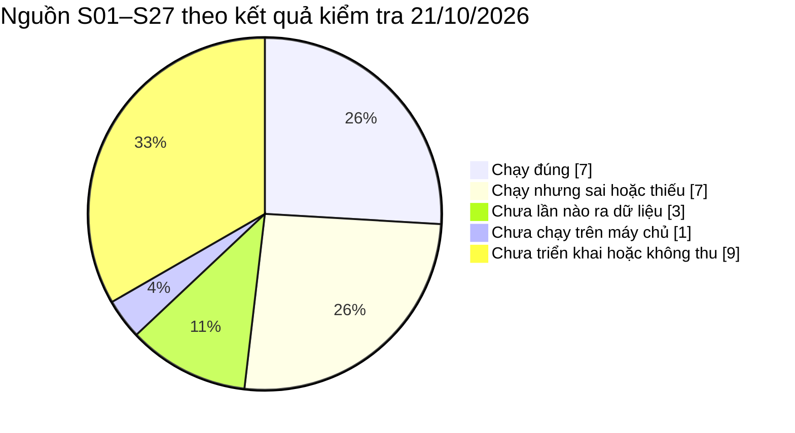
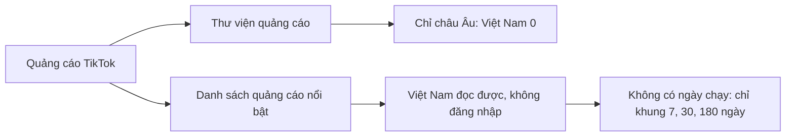
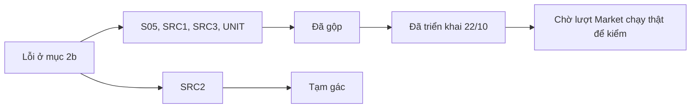

# Trạng thái nguồn dữ liệu

> Bản cập nhật 22/10/2026. Bản trước: [bản 21/10/2026 lần 4](../../outdated/2026-10-22/docs/business-spec/data-sources/source-status.md).

Trạng thái từng nguồn dữ liệu đầu vào và nhật ký đổi trạng thái · cập nhật 21/10/2026 · đi kèm [Input data sources for 30 sections](../../research/ultimate-method/input-data-sources-30-sections.md)

Trang này cho biết mỗi nguồn (mã S) **đang ở trạng thái nào** và **đổi trạng thái khi nào, vì sao**. Trang chỉ để đọc thông tin:
- không có code nào đọc nhãn ở đây;
- nhãn không bật, không tắt việc thu dữ liệu;
- quy tắc dùng nguồn vẫn nằm ở [file Ultimate](../../research/ultimate-method/ultimate-method-30-sections.md).

Chi tiết từng nguồn (công cụ, hạng tin cậy, độ đại diện, chi phí, ràng buộc, ghi chú test) nằm ở [danh mục nguồn](../../research/ultimate-method/input-data-sources-30-sections.md). Lịch sử từng lần thử thu và kiểm định nằm ở [nhật ký test và kiểm định](../../research/ultimate-method/input-data-sources-test-log.md).

Chủ chốt cách làm này ngày 12/10/2026: trang trạng thái chỉ nói lên trạng thái nguồn, không bật tắt gì trong code, và có nhật ký cập nhật đều đặn trên GitHub.

---

## 1. Năm nhãn trạng thái

| Nhãn | Nghĩa |
|---|---|
| **Đã duyệt** | Đang dùng, hoặc chủ đã duyệt |
| **Đã test** | Chạy được, chưa duyệt |
| **Chạy thử** | Đang thử, chưa đưa vào báo cáo thật |
| **Đề xuất** | Mới là ý tưởng |
| **Không thu** | Tạm ngừng, hỏng hoặc chưa có; luôn ghi lý do |

E14 của file Ultimate nói về "nguồn đang dùng hoặc đã duyệt". Ở trang này, cả hai nhóm đó đều mang nhãn **Đã duyệt**. Trang này chỉ ghi lại; muốn biết được làm gì với nguồn thì đọc E14.

---

## 2. Trạng thái hiện tại

"Ngày cập nhật" là ngày trạng thái được ghi lần gần nhất. Danh mục nguồn ghi trạng thái tính tới 08/10/2026; chủ duyệt S07, S15, S21, S22 ngày 12/10/2026 (S15, S21, S22 cập nhật thêm ngày 17/10/2026); S05 và S17 cập nhật ngày 19/10/2026; dòng nào ghi ngày mới hơn thì theo ngày đó.

Ngày 21/10/2026, ghi chú được cập nhật theo kết quả kiểm tra nguồn trên 3 lượt Market chạy thật ngày 20/10/2026 (mục 2b). Nhãn giữ nguyên, trừ S11 (chủ bỏ ngày 17/10/2026). Đổi nhãn khác là việc của chủ.

Ngày 22/10/2026, gói sửa nguồn đã gộp và đã triển khai lên máy chủ (bản `2fc699d1`), chi tiết ở mục 2d. Ghi chú S05, S14, S17, S20, S21–S25 cập nhật theo gói này. Nhãn giữ nguyên. Kết quả thật chỉ có sau lượt Market chạy tiếp theo.

| Mã | Nguồn | Nhãn | Ngày cập nhật | Ghi chú |
|---|---|---|---|---|
| S01 | Dữ liệu bán hàng trên sàn | Đã duyệt | 21/10/2026 | Đang dùng; 3/3 lượt ngày 20/10 có dữ liệu |
| S02 | Dữ liệu video bán hàng TikTok | Đã duyệt | 21/10/2026 | Đang dùng; 3/3 lượt có dữ liệu, khoảng 61 lần gọi trả phí mỗi lượt; hết điểm thì dừng |
| S03 | Dữ liệu xuất nhập khẩu theo doanh nghiệp | Không thu | 08/10/2026 | Chưa có phiên truy cập hợp lệ |
| S04 | Trang bán sản phẩm | Đã duyệt | 21/10/2026 | Đang dùng; 3/3 lượt ngày 20/10 có dữ liệu |
| S05 | Review Shopee | Đã duyệt | 22/10/2026 | Dịch vụ Shopee API mới (gói S, #346), tối đa 300 mỗi sản phẩm. 3/3 lượt ngày 20/10 bị chặn, 0 review, do lỗi phía ứng dụng. Đã sửa (#365) và đã triển khai 22/10; chờ lượt chạy thật để kiểm. Báo cáo Market chỉ đếm, không trích nguyên văn (phương án A) |
| S06 | Review TikTok Shop | Đề xuất | 08/10/2026 | Chưa có bộ thu |
| S07 | Bình luận dưới video TikTok | Đã duyệt | 21/10/2026 | Chủ duyệt 12/10; vào hệ thống qua gói P9. Chưa chạy trên máy chủ: tài khoản thu đã hết tiền, và Insight tạm dừng từ 19/10. Nạp tiền là việc của chủ. Thử bộ thu khác ở gói miễn phí ngày 21/10 (ST-20261021-01): 10 bình luận tiếng Việt đúng chủ đề; gói miễn phí chỉ cho 10 dòng. Lượt đủ mẫu chờ chủ quyết (mục 2c) |
| S08 | Bài viết Facebook công khai | Không thu | 08/10/2026 | Chủ tạm ngừng 08/10 |
| S09 | Instagram | Không thu | 08/10/2026 | Test không đạt: không lấy được nội dung |
| S10 | X (Twitter) | Đã test | 08/10/2026 | Một phần; chỉ nguồn phụ, phải lọc |
| S11 | Bình luận YouTube | Không thu | 21/10/2026 | Chủ bỏ nguồn này ngày 17/10/2026 |
| S12 | Dữ liệu của chính shop chủ | Không thu | 08/10/2026 | Chưa có dữ liệu |
| S13 | Công thức, bài hướng dẫn dùng sản phẩm | Đề xuất | 08/10/2026 | Tìm qua S19 |
| S14 | Nội dung video bán hàng | Chạy thử | 22/10/2026 | Gói P9, đã có checklist. 3/3 lượt ngày 20/10: đọc 2–3 trong 9 video ứng viên, 0 đoạn lên báo cáo. Đã sửa cách chọn video (#367): xếp theo doanh số, bỏ video trùng, rồi mới cắt theo trần; bỏ dòng của sản phẩm chưa xác nhận. Đã triển khai 22/10; chờ lượt chạy thật. Video dài hơn 180 giây hoặc nặng hơn 14 MB bị bỏ |
| S15 | Thư viện quảng cáo Meta | Đã duyệt | 21/10/2026 | Chủ duyệt 12/10; chỉ đọc theo trang, không đăng nhập. Máy tự đọc (cờ TDN_RESEARCH_META_AUTO_ENABLED) chưa lần nào ra dữ liệu: 3/3 lượt dừng ở trang đầu, vì trình duyệt trên máy chủ đang đăng nhập Facebook. Đường đọc qua bộ thu bên ngoài, không đăng nhập, đọc được (ST-20261021-04 đến -13): tối đa 150 quảng cáo mỗi lượt; cần lọc ngày, loại hàng và chủ trang. Chưa đưa vào hệ thống; cách xử lý chờ chủ quyết (mục 2c) |
| S16 | Quảng cáo nổi bật trên TikTok | Chạy thử | 21/10/2026 | Chủ duyệt bộ máy tự đọc 17/10; không đăng nhập (cờ TDN_RESEARCH_TIKTOK_TOPADS_ENABLED). Máy tự đọc chưa lần nào ra dữ liệu: 3/3 lượt dừng, vì trang đòi đăng nhập. Thử bộ thu bên ngoài ngày 21/10 (ST-20261021-14 đến -31): thư viện quảng cáo TikTok chỉ có châu Âu, Việt Nam 0; danh sách quảng cáo nổi bật Việt Nam đọc được, không đăng nhập. 2 bộ tốt nhất: 10/27 và 7/20 là quạt thật, khoảng $0,005 mỗi từ khoá. Không có ngày chạy. Chưa đưa vào hệ thống; hướng đi chờ chủ quyết (mục 2c) |
| S17 | Thư viện quảng cáo công khai của công cụ tìm kiếm | Đã duyệt | 22/10/2026 | Chủ duyệt 17/10 (cờ TDN_RESEARCH_GOOGLE_ADS_ENABLED). 3/3 lượt ngày 20/10 chưa có mẫu quảng cáo: 9 lần tra thì 6 lần không tìm được trang web, 2 lần ra nhiều trang, 1 lần có trang web nhưng 0 quảng cáo. Đã sửa ca "nhiều trang" (#366): chọn 1 tên miền mỗi thương hiệu, ưu tiên .vn, lưu lại lựa chọn. Đã triển khai 22/10; chờ lượt chạy thật. Chưa dùng cho phép kiểm 3 của E5 |
| S18 | Trang thương hiệu Facebook | Đề xuất | 08/10/2026 | — |
| S19 | Kết quả tìm kiếm Google mở rộng | Chạy thử | 21/10/2026 | Chạy trong mọi lượt Market: 3 câu tìm, 9 kết quả mỗi lượt, đúng trần; 3/3 lượt ngày 20/10 có dữ liệu |
| S20 | Mức quan tâm tìm kiếm trên Google (Trends) | Chạy thử | 22/10/2026 | Theo thời gian và theo tỉnh. 2/3 lượt ngày 20/10 bị bỏ qua vì kỳ cũ. Đã sửa (#366): hỏi đúng kỳ báo cáo, bất kỳ ngày nào từ 01/01/2004 đến hôm nay; kỳ sai hoặc ở tương lai bị bỏ qua có lý do, không gọi trả phí; kỳ ngắn ghi rõ "theo ngày". Đã triển khai 22/10; chờ lượt chạy thật |
| S21 | Cục Thống kê | Đã duyệt | 22/10/2026 | Chủ duyệt 12/10; bộ thu tự động (cờ TDN_RESEARCH_OFFICIAL_STATS_ENABLED) có số ở 2/3 lượt ngày 20/10. Lượt thạch dừa có 0 số, vì bước AI chọn nhóm hàng không ra kết quả và không hỏi lại. Gói sửa (SRC2) tạm gác 21/10, chưa sửa. M05 Bảng 5.4 chỉ là bối cảnh cả nước |
| S22 | Cục Thống kê theo tỉnh | Đã duyệt | 22/10/2026 | Chủ duyệt 12/10; đọc bảng chỉ số giá theo tỉnh trong cùng file CPI của S21 (cờ TDN_RESEARCH_OFFICIAL_STATS_PROVINCE_ENABLED, cần cả cờ S21), nên cùng kết quả với S21: 2/3 lượt có số. Gói sửa (SRC2) tạm gác, chưa sửa. M05 Bảng 5.5 chỉ là bối cảnh theo tỉnh |
| S23 | Ngân hàng Thế giới (dữ liệu mở) | Đã duyệt | 22/10/2026 | Duyệt theo E13; bộ thu (cờ TDN_RESEARCH_WORLD_BANK_ENABLED) có số ở 3/3 lượt ngày 20/10. Một lượt thiếu 1 chỉ số: lần gọi quá giờ, và hệ thống không gọi lại. Gói sửa (SRC2) tạm gác, chưa sửa. Bối cảnh cả nước |
| S24 | Cơ sở dữ liệu thương mại của Liên Hợp Quốc | Đã duyệt | 22/10/2026 | Chủ duyệt; bộ thu (cờ TDN_RESEARCH_COMTRADE_ENABLED) có số ở 2/3 lượt ngày 20/10. Một lượt có 0 dòng, vì bước AI xác nhận mã hàng trả lời sai mẫu và không hỏi lại. Gói sửa (SRC2) tạm gác, chưa sửa. M06 là bối cảnh cả nước |
| S25 | Báo cáo ngành, báo cáo thường niên doanh nghiệp | Đã duyệt | 22/10/2026 | Dùng ở M09 (cờ TDN_RESEARCH_PDF_DISCOVERY_ENABLED). 3/3 lượt ngày 20/10 chưa ra trích dẫn: 1 lượt bước tìm lỗi, 1 lượt bộ lọc loại hết, 1 lượt báo cáo dựng trước khi đọc xong tệp. Đã sửa ca cuối (#367): kết quả đọc PDF đã lưu được đưa vào mọi lần dựng lại báo cáo (cả Insight); chờ đọc PDF có một hạn chung. Đã triển khai 22/10; chờ lượt chạy thật. Giới hạn không đổi: tối đa 2 tệp, 60 trang mỗi tệp |
| S26 | Báo chí, tin an toàn thực phẩm | Đề xuất | 08/10/2026 | Tìm qua S19 |
| S27 | Bản quét review của bên thứ ba | Không thu | 08/10/2026 | Thiếu số sao và người viết; đã thay bằng S05 |

### 2b. Kết quả kiểm tra nguồn ngày 21/10/2026

Căn cứ: 3 lượt Market chạy thật trên máy chủ ngày 20/10/2026. Lượt 1 và lượt 3 là quạt điện, kỳ 13/10/2025–12/10/2026. Lượt 2 là thạch dừa, kỳ 21/10/2025–20/10/2026; lượt này bị huỷ trước khi xong báo cáo, nhưng bước thu dữ liệu đã chạy.

| Mã | Lượt 1 | Lượt 2 | Lượt 3 |
|---|---|---|---|
| S01, S04 | Có | Có | Có |
| S02 | Có | Có | Có |
| S19 | Có | Có | Có |
| S23 | Thiếu 1 chỉ số (quá giờ) | Có | Có |
| S21, S22 | Có | Không ghép được nhóm hàng | Có |
| S24 | Có | Có | Không xác nhận được mã hàng |
| S20 (theo thời gian và theo tỉnh) | Bỏ qua (kỳ cũ) | Có | Bỏ qua (kỳ cũ) |
| S17 | Không có dữ liệu | Chạy, 0 quảng cáo | Không có dữ liệu |
| S25 | Bước tìm bị lỗi | Bộ lọc loại hết | Tải 2 tệp, chưa đọc xong |
| S14 | Đọc 3/9 video, 0 lên báo cáo | Đọc 2/9, 0 | Đọc 2/9, 0 |
| S05 | Bị chặn | Bị chặn | Bị chặn |
| S15 | Dừng (trình duyệt đang đăng nhập) | Dừng | Dừng |
| S16 | Dừng (trang đòi đăng nhập) | Dừng | Dừng |

- **Chạy đúng:** S01, S02, S04, S13, S19, S23, S26 (S13 và S26 tìm qua S19).
- **Chạy nhưng sai hoặc thiếu:** S14, S17, S20, S21, S22, S24, S25.
- **Chưa lần nào ra dữ liệu:** S05, S15, S16.
- **Chưa chạy trên máy chủ:** S07.
- **Chưa triển khai hoặc không thu:** S03, S06, S08, S09, S10, S11, S12, S18, S27.

Gói sửa cho nhóm "sai hoặc thiếu" và cho S05 đang chờ chủ duyệt. S15, S16 cần chủ chọn cách xử lý; đường thu bên ngoài ở mục 2c. Trang này chỉ ghi kết quả; nhãn đổi khi chủ quyết.

### 2c. Đường thu bên ngoài cho S07, S15, S16 (21/10/2026)

Máy tự đọc trong hệ thống chưa ra dữ liệu cho S15, S16 (mục 2b). S07 chưa chạy trên máy chủ. Ngày 21/10/2026, các bộ thu bên ngoài được thử trên máy chủ, không đăng nhập. Ca đối chiếu: lượt Market quạt điện ngày 20/10/2026. Chưa đổi gì trong hệ thống.

| Mã | Đã thử | Đọc được | Còn thiếu | Bước tiếp (chủ quyết) |
|---|---|---|---|---|
| S07 | 1 bộ thu bình luận, gói miễn phí (ST-20261021-01), $0 | 10/10 bình luận tiếng Việt, đúng chủ đề; có mã, nội dung, thời gian, lượt thích | Gói miễn phí chỉ cho 10 dòng. Chưa thử đủ mẫu. Có trường cá nhân của người viết: phải bỏ trước khi lưu | Chạy thử trả phí khoảng 300 bình luận, hoặc nạp tiền tài khoản thu cũ |
| S15 | 2 bộ thu, 10 lượt (ST-20261021-04 đến -13), khoảng $0,53 | Tối đa 150 quảng cáo mỗi lượt, có trang, ngày bắt đầu, trạng thái, link đích. "quạt điện": 22/136 là quạt thật. "quạt tuần hoàn": 20/21 | Không có lượt tiếp cận, tiền chi. Bộ lọc ngày của bộ thu không có tác dụng. 0 quảng cáo dẫn về shop trong mẫu. Phần lớn quảng cáo quạt là của đại lý nhỏ | Thêm đường đọc này sau cờ, kèm lọc ngày, lọc loại hàng và lọc chủ trang có bằng chứng |
| S16 | Dò 153 bộ thu quảng cáo TikTok; chạy 14 bộ, 17 lượt (ST-20261021-14 đến -31), khoảng $0,47 | Danh sách quảng cáo nổi bật Việt Nam, khung 7, 30 hoặc 180 ngày. 2 bộ tốt nhất: 10/27 và 7/20 là quạt thật, khoảng $0,005 mỗi từ khoá; 1 trong 2 bộ có link đích 9/20. Gộp 8 lượt: 100 quảng cáo khác nhau, 27 là quạt thật | Thư viện quảng cáo TikTok chỉ có châu Âu: Việt Nam 0. Không có ngày chạy, không có tiền chi. Mỗi bộ chỉ thấy một phần, trùng nhau ít | Thêm 2 bộ tốt nhất sau cờ. Báo cáo ghi rõ "quảng cáo nổi bật", không phải toàn bộ quảng cáo |

Ý tưởng nguồn mới, chưa có mã S: bài của người sáng tạo có nhãn tài trợ, tìm theo tên hãng (ST-20261021-30). Có ngày đăng, lượt xem, người đăng. Chủ quyết có thêm hay không.

### 2d. Gói sửa nguồn ngày 21–22/10/2026

Gói này sửa các lỗi ở mục 2b. Mỗi phần có người viết test riêng và người rà soát riêng; gộp khi rà soát đạt và kiểm tra tự động đạt. Ngày 22/10/2026, bản `2fc699d1` (gồm cả 4 phần đã gộp) được triển khai lên máy chủ theo lời chủ. Không thêm bảng dữ liệu, không đổi cờ. Dữ liệu và tệp đã lưu không đổi sau khi triển khai.

| Phần | Nguồn | Sửa gì | PR | Trạng thái |
|---|---|---|---|---|
| S05 | S05 | Một dòng lạ hoặc hỏng trong danh sách việc thu chung không còn chặn việc thu review. Gọi lại tối đa 1 lần | #365 | Đã gộp, đã triển khai 22/10 |
| SRC1 | S20 (theo thời gian và theo tỉnh) | Hỏi đúng kỳ báo cáo, bất kỳ ngày nào từ 01/01/2004; kỳ ngắn ghi "theo ngày"; kỳ dài giữ mọi điểm | #366 | Đã gộp, đã triển khai 22/10 |
| SRC1 | S17 | Một tên miền mỗi thương hiệu (ưu tiên .vn) thay cho "nhiều trang"; lưu lựa chọn | #366 | Đã gộp, đã triển khai 22/10 |
| SRC3 | S14 | Chọn video: xếp theo doanh số, bỏ trùng, rồi cắt theo trần; bỏ sản phẩm chưa xác nhận; số 0 thật không bị coi là thiếu | #367 | Đã gộp, đã triển khai 22/10 |
| SRC3 | S25 | Kết quả đọc PDF đã lưu vào mọi lần dựng lại báo cáo (cả Insight); chờ đọc PDF có một hạn chung, huỷ được | #367 | Đã gộp, đã triển khai 22/10 |
| SRC3 | Mọi nguồn | Chủ huỷ lượt thì giữ thông tin chẩn đoán; sau khi khởi động lại, lượt đang huỷ kết thúc là "đã huỷ" | #367 | Đã gộp, đã triển khai 22/10 |
| UNIT | S01 (báo cáo Market) | So giá theo quy cách đọc từ tên sản phẩm (đồng/100 g, đồng/100 ml, đồng/gói…); không cộng lượt bán giữa các sản phẩm | #362 | Đã gộp, đã triển khai 22/10 |
| SRC2 | S21, S22, S23, S24 | Gọi lại khi quá giờ hoặc khi bước AI không ra kết quả; ghi lần gọi AI vào sổ | — | Tạm gác (chủ chọn 21/10): cần đổi cấu trúc cơ sở dữ liệu |

S15, S16 không nằm trong gói này: cách xử lý vẫn chờ chủ quyết (mục 2c).

---

## 3. Nhật ký

Dòng mới nhất ở trên cùng. Các dòng cùng ngày không xếp theo giờ. Mã ST là dòng ở [nhật ký test và kiểm định](../../research/ultimate-method/input-data-sources-test-log.md); mã BR, DS là dòng ở [CHANGELOG](../../research/ultimate-method/CHANGELOG.md).

Dòng trước 12/10/2026 ghi lại từ danh mục nguồn, nhật ký test và CHANGELOG, đổi sang 5 nhãn mới. Chữ trong ngoặc là cách ghi cũ. Nhãn có dấu **(suy ra)** không được ghi lại lúc đó: nhãn cũ suy ra từ việc nguồn đang chờ hoặc đang chạy lượt test; nhãn mới suy ra từ kết quả test khi danh mục không ghi nhãn. Căn cứ là mã ST, BR ở cột lý do.

| Ngày | Mã nguồn | Nhãn cũ → nhãn mới | Lý do | Ai quyết |
|---|---|---|---|---|
| 22/10/2026 | S05, S14, S17, S20, S25 | Giữ nhãn (S05, S17, S25 Đã duyệt; S14, S20 Chạy thử) | Gói sửa nguồn (mục 2d): #365, #366, #367 đã gộp; bản `2fc699d1` đã triển khai lên máy chủ 22/10. Chưa có lượt chạy thật sau khi triển khai | Chủ (lời triển khai 22/10) |
| 22/10/2026 | S21, S22, S23, S24 | Giữ nhãn Đã duyệt | Gói sửa SRC2 (gọi lại, sổ ghi lần gọi AI) tạm gác; lỗi ở mục 2b vẫn còn | Chủ (21/10) |
| 21/10/2026 | S07, S15, S16 | Giữ nhãn (S07, S15 Đã duyệt; S16 Chạy thử) | Tổng hợp đường thu bên ngoài ở mục 2c. S16: 17 lượt, khoảng $0,47 (ST-20261021-14 đến -31). Thư viện quảng cáo TikTok chỉ có châu Âu. Danh sách quảng cáo nổi bật Việt Nam đọc được; 2 bộ tốt nhất cho 10/27 và 7/20 quạt thật; không có ngày chạy. S07, S15: không thử thêm. Chưa đổi gì trong hệ thống (DS-20261021-04) | Ghi kết quả; đưa vào hệ thống chờ chủ quyết |
| 21/10/2026 | S15 | Giữ nhãn Đã duyệt | Thử 7 lượt bộ thu trả phí với ca quạt điện, tổng khoảng $0,51 (ST-20261021-07 đến -13). Đọc được khi không đăng nhập, tối đa 150 quảng cáo mỗi lượt. Cụm từ "quạt điện": 22/136 là quạt thật. 0 quảng cáo dẫn về 5 shop trong mẫu. Trang lớn: 150 quảng cáo chỉ phủ khoảng 10 ngày gần nhất. Bộ lọc ngày của bộ thu không có tác dụng, nên code phải tự lọc. Chưa đổi gì trong hệ thống (DS-20261021-03) | Ghi kết quả; đưa vào hệ thống chờ chủ quyết |
| 21/10/2026 | S07, S15, S16 | Giữ nhãn (S07, S15 Đã duyệt; S16 Chạy thử) | Thử 6 lượt bộ thu Apify trên máy chủ, tổng khoảng $0,026 (ST-20261021-01 đến -06). S07: 10 bình luận đúng chủ đề, gói miễn phí giới hạn 10 dòng. S15: 5/10 đúng ngành khi tìm đúng cụm từ, tiếng Việt. S16: 0/10 ở cả 2 bộ. Chưa đổi gì trong hệ thống (DS-20261021-02) | Ghi kết quả; đưa vào hệ thống chờ chủ quyết |
| 21/10/2026 | S11 | Đề xuất → Không thu | Chủ bỏ bình luận YouTube ngày 17/10/2026; trang này chưa ghi lại (DS-20261021-01) | Chủ (17/10) |
| 21/10/2026 | S05, S15, S16 | Giữ nhãn (S05, S15 Đã duyệt; S16 Chạy thử) | Kiểm tra nguồn 21/10 (mục 2b): bộ thu đã chạy 3/3 lượt Market ngày 20/10 nhưng chưa lần nào ra dữ liệu. S05: lỗi phía ứng dụng. S15: trình duyệt trên máy chủ đang đăng nhập. S16: trang đòi đăng nhập (DS-20261021-01) | Ghi kết quả; nhãn chờ chủ quyết |
| 21/10/2026 | S14, S17, S20, S21, S22, S24, S25 | Giữ nhãn | Kiểm tra nguồn 21/10 (mục 2b): bộ thu chạy nhưng kết quả sai hoặc thiếu. S25 chưa lần nào ra trích dẫn; S14 có 0 đoạn video lên báo cáo; S17 có 0 mẫu quảng cáo; S20 bỏ qua kỳ cũ; S21, S22, S24 hỏng 1/3 lượt vì bước AI không hỏi lại (DS-20261021-01) | Ghi kết quả; cách sửa chờ chủ duyệt |
| 21/10/2026 | S01, S02, S04, S19, S23 | Giữ nhãn | Kiểm tra nguồn 21/10 (mục 2b): chạy đúng ở 3/3 lượt; S23 thiếu 1 chỉ số ở 1 lượt vì quá giờ (DS-20261021-01) | Ghi kết quả |
| 21/10/2026 | S07 | Giữ nhãn Đã duyệt | Chưa chạy trên máy chủ: tài khoản thu đã hết tiền; Insight tạm dừng từ 19/10 (DS-20261021-01) | Ghi kết quả |
| 19/10/2026 | S17 | Đã duyệt → Đã duyệt | Thêm bước tự tìm trang web chính thức của thương hiệu (v2, commit `acd42991`); đã triển khai trong `f026acd9`; nhãn không đổi | Chủ (duyệt 17/10) |
| 19/10/2026 | S05 | Đã duyệt → Đã duyệt | Bình luận Shopee chuyển sang dịch vụ Shopee API mới (gói S, #346, đã gộp, chưa triển khai, tối đa 300 mỗi sản phẩm); báo cáo Market chỉ đếm, không trích nguyên văn (phương án A); nhãn không đổi | Chủ (19/10) |
| 17/10/2026 | S25 | Đã duyệt → Đã duyệt | Thêm giới hạn cho tệp tự tải: mặc định tối đa 60 trang mỗi tệp, tệp dài hơn bị bỏ, không lưu; tài liệu chủ gửi được hỏi trước; chỉ tải thêm tệp có chỗ trong kế hoạch hỏi, tính cả tài liệu đã thu; khi chưa bật bộ đọc tài liệu hoặc hết chỗ thì không tự tìm, không tự tải; nhãn không đổi | Chủ (duyệt 17/10) |
| 17/10/2026 | S25 | Đã duyệt → Đã duyệt | Thêm bộ máy tự tìm báo cáo ngành dạng PDF cho báo cáo Market (M09): lấy liên kết PDF trong kết quả tìm của lượt, thêm tối đa 1 lần tìm, tải tối đa 2 tệp qua lớp chặn địa chỉ nội bộ; sau cờ TDN_RESEARCH_PDF_DISCOVERY_ENABLED, mặc định tắt; tệp chủ gửi vẫn dùng được; nhãn không đổi | Chủ (duyệt 17/10) |
| 17/10/2026 | S22 | Đã duyệt → Đã duyệt | Thêm bộ máy tự đọc bảng chỉ số giá theo tỉnh cho báo cáo Market (Bảng 5.5), từ file CPI của S21, sau cờ TDN_RESEARCH_OFFICIAL_STATS_PROVINCE_ENABLED, mặc định tắt; khi bật cờ, file CPI được tải ở mọi lượt Market (tối đa 3 lần gọi), Bảng 5.4 không đổi; nhãn không đổi | Chủ (duyệt 12/10, 17/10) |
| 17/10/2026 | S24 | Đề xuất → Đã duyệt | Sửa dòng cũ: chủ đã duyệt và bộ thu đã vào hệ thống, chạy sau cờ TDN_RESEARCH_COMTRADE_ENABLED, mặc định tắt | Chủ |
| 17/10/2026 | S23 | Đã duyệt → Đã duyệt | Sửa ghi chú cũ "chưa thu cho báo cáo": bộ thu đã vào hệ thống, chạy sau cờ TDN_RESEARCH_WORLD_BANK_ENABLED, mặc định tắt; nhãn không đổi | Chủ (duyệt 08/10) |
| 17/10/2026 | S16 | Không thu → Chạy thử | Thêm bộ máy tự đọc trang quảng cáo nổi bật công khai cho báo cáo Market (Bảng 7.4), sau cờ TDN_RESEARCH_TIKTOK_TOPADS_ENABLED, mặc định tắt; chưa có trang mẫu thật nên lượt chạy thử đầu là bản kiểm chứng | Chủ (duyệt 17/10) |
| 17/10/2026 | S15 | Đã duyệt → Đã duyệt | Thêm bộ máy tự đọc trang công khai cho báo cáo Market (Bảng 7.2), sau cờ TDN_RESEARCH_META_AUTO_ENABLED, mặc định tắt; tải trang chủ gửi vẫn dùng được; nhãn không đổi | Chủ (duyệt 12/10, 17/10) |
| 17/10/2026 | S21 | Đã duyệt → Đã duyệt | Thêm bộ thu tự động cho báo cáo Market, sau cờ TDN_RESEARCH_OFFICIAL_STATS_ENABLED, mặc định tắt; nhãn không đổi | Chủ (duyệt 12/10) |
| 12/10/2026 | Mọi nguồn | Nhiều cách ghi → 5 nhãn | Lập trang này; nhãn chỉ để đọc, không bật tắt gì trong code (DS-20261012-03) | Chủ |
| 12/10/2026 | S22 | Đã test ("đã kiểm 08/10") → Đã duyệt | Chủ duyệt (BR-20261012-01) | Chủ |
| 12/10/2026 | S21 | Đã test ("đã kiểm 08/10") → Đã duyệt | Chủ duyệt (BR-20261012-01) | Chủ |
| 12/10/2026 | S15 | Đã test → Đã duyệt | Chủ duyệt (BR-20261012-01) | Chủ |
| 12/10/2026 | S07 | Đã test ("dùng được") → Đã duyệt | Chủ duyệt (BR-20261012-01) | Chủ |
| 08/10/2026 | S08 | Đã test ("một phần") → Không thu ("tạm ngừng thu") | Bài công khai chủ yếu là bài bán hàng, ít lời khách (BR-20261008-15) | Chủ |
| 08/10/2026 | S15 | Chạy thử (suy ra) → Đã test | Đạt cả 5 tiêu chí khi đọc theo trang (ST-20261008-22, BR-20261008-17) | Theo kết quả test chủ gửi |
| 08/10/2026 | S23 | Đề xuất ("chờ chủ duyệt") → Đã duyệt | Duyệt quy tắc E13; kiểm API được (ST-20261008-20, BR-20261008-08) | Chủ |
| 08/10/2026 | S07 | Chạy thử (suy ra) → Đã test ("dùng được") | Lượt R3, R4 đạt trên mẫu chấm (ST-20261008-18, -19; BR-20261008-05) | Theo kết quả test |
| 08/10/2026 | S10 | Chạy thử (suy ra) → Đã test ("một phần") | Lượt R7: đúng sản phẩm nhưng ít lời khách; chỉ nguồn phụ (ST-20261008-16, BR-20261008-03) | Theo kết quả test |
| 08/10/2026 | S17 | Chạy thử (suy ra) → Đã test ("một phần") | Lượt R6: hai bộ ngày lệch nhau; chưa dùng cho phép kiểm 3 của E5 (ST-20261008-15, BR-20261008-03) | Theo kết quả test |
| 08/10/2026 | S16 | Chạy thử (suy ra) → Không thu ("test không đạt"; danh mục khi đó ghi "Đã test") | Lượt R5 không trả quảng cáo nào (ST-20261008-14, BR-20261008-03) | Theo kết quả test |
| 08/10/2026 | S14 | Đề xuất (suy ra) → Chạy thử ("Gói P9 (đã có checklist)") | Chủ đồng ý gói P9 có checklist (ST-20261008-03, BR-20261008-06) | Chủ |
| 08/10/2026 | S21, S22 | — (chưa vào danh mục) → Đã test ("đã kiểm") | Kiểm định đạt: tải được file, có trạng thái số liệu, bắt buộc ghi nguồn (ST-20261008-08) | Theo kết quả kiểm định |
| 08/10/2026 | S09 | Chạy thử (suy ra) → Không thu ("không dùng được hiện tại") | Thử Instagram không đạt (ST-20261008-05) | Theo kết quả test |
| 08/10/2026 | S27 | Đã duyệt (suy ra: đã dùng cho báo cáo thạch dừa 05–07/10) → Không thu (suy ra: danh mục không ghi nhãn, chỉ ghi "đã dùng trước đây") | Thiếu số sao và người viết; lần thu sau dùng S05 (ST-20261007-01, BR-20261008-02) | Chưa ghi |

---

## 4. Cách cập nhật

- PR nào đổi trạng thái một nguồn thì trong **cùng PR** đó:
  - sửa dòng của nguồn ở bảng mục 2 (nhãn, ngày, ghi chú);
  - thêm một dòng ở mục 3 Nhật ký, trên cùng;
  - sửa ghi chú chi tiết ở cột "Trạng thái" của [danh mục nguồn](../../research/ultimate-method/input-data-sources-30-sections.md), và chữ trong ngoặc ở bảng "section dùng nguồn nào" nếu cần.
- Sau mỗi lần chạy thử (pilot) hoặc chạy báo cáo, người điều phối thêm một dòng ở Nhật ký khi có nguồn hỏng, bị bỏ qua, hoặc lần đầu chạy được. Nếu nhãn không đổi thì ghi "giữ nhãn …" ở cột nhãn.
- Nhãn mới của một nguồn phải là một trong 5 nhãn ở mục 1. Nhãn **Không thu** luôn có lý do ở cột ghi chú.
- Ghi chú ngắn, tối đa một dòng. Không ghi tên nhà cung cấp dữ liệu, khoá, đường dẫn máy hay tên tài khoản.
- Nhật ký chỉ ghi thay đổi có căn cứ: mã ST, mã BR/DS, PR hoặc lời chủ. Không sửa dòng cũ; muốn đính chính thì thêm dòng mới.

### S25 implementation review (PR #282, 17/10/2026)

Automatic collection is limited to Market runs and stays off by default. The extra
search uses ordinal 14 (at most one request); ordinal 15 counts at most two file
download attempts, with at most three checked redirects per file and no retries.
Every HTTPS socket is pinned to a checked DNS answer. Optional captures are
skipped with `BRIDGE_BUDGET_LIMIT` before reader retention if they exceed the
market-method bridge's existing capture budget. Owner uploads keep their current
storage, question cap and package lineage. Discovery-only receipts are technical
records: no kept/quoted PDF means no visible S25 block or provenance addition.
The first live canary remains pending; this review uses synthetic fixtures only.

### S17 website discovery implementation (19/10/2026, local review)

New `search-ads-v2` runs first reuse plain and expanded run search rows. An exact
normalized registrable-name match may nominate an observed host; different exact
registrable domains remain ambiguous. Marketplace, social, news, public-sector,
provider and retailer/aggregator hosts are excluded. Only a brand with no match
gets one deterministic `<brand label> trang chủ chính hãng` search (VN/vi, ten
results, only positions one through five eligible). The lane makes at most three
site searches plus three ads reads, spaces requests by two seconds, and stops on
request failure or cancellation. Recovery never requeues collection calls.

Ads usage retains ordinal 10; site searches use separate ordinals 17–19, one per
selected brand position. The existing SQLite ordinal constraint is nonnegative
with no upper bound; no migration is needed. Each discovery capture is retained
and referenced by its brand. Discovery alone adds no report source row or ads
figure; S17 evidence still requires a rendered ads row. The table is unchanged.
V1 documents keep their original notice and rendering; flag-off reports keep
their original bytes. Verification uses injected synthetic transport only; no
live provider or browser was used.
