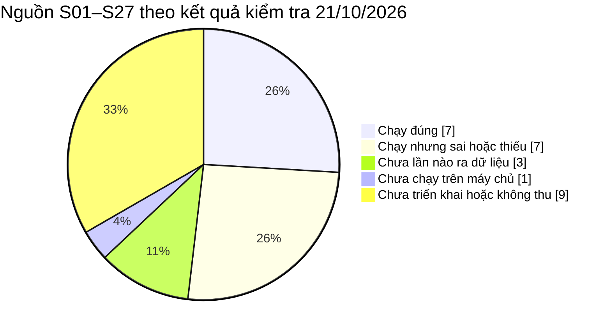
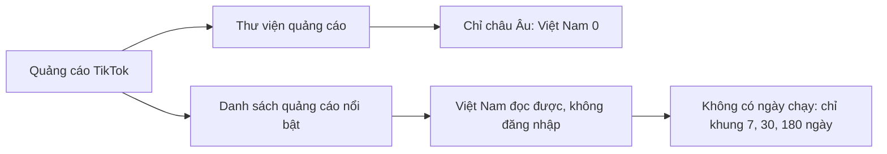
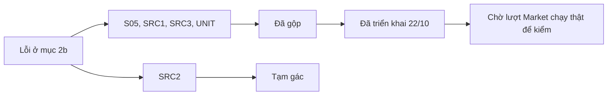
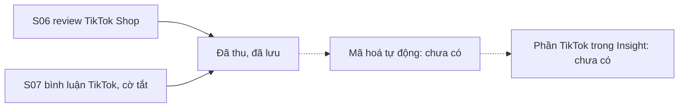

# Trạng thái nguồn dữ liệu

> Bản cập nhật 04/11/2026. Bản trước: [bản 25/10/2026](../../outdated/2026-11-04/docs/business-spec/data-sources/source-status.md).

Trạng thái từng nguồn dữ liệu đầu vào và nhật ký đổi trạng thái · cập nhật 04/11/2026 · đi kèm [Input data sources for 30 sections](../../research/ultimate-method/input-data-sources-30-sections.md)

Trang này cho biết mỗi nguồn (mã S) **đang ở trạng thái nào** và **đổi trạng thái khi nào, vì sao**. Trang chỉ để đọc thông tin:
- không có code nào đọc nhãn ở đây;
- nhãn không bật, không tắt việc thu dữ liệu;
- quy tắc dùng nguồn vẫn nằm ở [file Ultimate](../../research/ultimate-method/ultimate-method-30-sections.md).

Chi tiết từng nguồn (công cụ, hạng tin cậy, độ đại diện, chi phí, ràng buộc, ghi chú test) nằm ở [danh mục nguồn](../../research/ultimate-method/input-data-sources-30-sections.md). Lịch sử từng lần thử thu và kiểm định nằm ở [nhật ký test và kiểm định](../../research/ultimate-method/input-data-sources-test-log.md).

Chủ chốt cách làm này ngày 12/10/2026: trang trạng thái chỉ nói lên trạng thái nguồn, không bật tắt gì trong code, và có nhật ký cập nhật đều đặn trên GitHub.

---

## 1. Năm nhãn trạng thái

| Nhãn | Nghĩa |
|---|---|
| **Đã duyệt** | Đang dùng, hoặc chủ đã duyệt |
| **Đã test** | Chạy được, chưa duyệt |
| **Chạy thử** | Đang thử, chưa đưa vào báo cáo thật |
| **Đề xuất** | Mới là ý tưởng |
| **Không thu** | Tạm ngừng, hỏng hoặc chưa có; luôn ghi lý do |

E14 của file Ultimate nói về "nguồn đang dùng hoặc đã duyệt". Ở trang này, cả hai nhóm đó đều mang nhãn **Đã duyệt**. Trang này chỉ ghi lại; muốn biết được làm gì với nguồn thì đọc E14.

---

## 2. Trạng thái hiện tại

"Ngày cập nhật" là ngày trạng thái được ghi lần gần nhất. Danh mục nguồn ghi trạng thái tính tới 08/10/2026; chủ duyệt S07, S15, S21, S22 ngày 12/10/2026 (S15, S21, S22 cập nhật thêm ngày 17/10/2026); S05 và S17 cập nhật ngày 19/10/2026; dòng nào ghi ngày mới hơn thì theo ngày đó.

Ngày 21/10/2026, ghi chú được cập nhật theo kết quả kiểm tra nguồn trên 3 lượt Market chạy thật ngày 20/10/2026 (mục 2b). Nhãn giữ nguyên, trừ S11 (chủ bỏ ngày 17/10/2026). Đổi nhãn khác là việc của chủ.

Ngày 22/10/2026, gói sửa nguồn đã gộp và đã triển khai lên máy chủ (bản `2fc699d1`), chi tiết ở mục 2d. Ghi chú S05, S14, S17, S20, S21–S25 cập nhật theo gói này. Nhãn giữ nguyên. Kết quả thật chỉ có sau lượt Market chạy tiếp theo.

Ngày 25/10/2026, có thêm 4 lần triển khai (bản `21f843f1`, `852b5b1f`, `af53534a`, `4f874f44`), chi tiết ở mục 2e. Ghi chú S05, S06, S07, S14, S20 cập nhật; thêm dòng S28. S06 và S28 đổi nhãn sang **Chạy thử**, vì chủ bật hai nguồn này trên máy chủ ngày 25/10/2026.

Ngày 04/11/2026, ghi chú được cập nhật theo các lượt chạy sau 25/10/2026 (mục 2g). Bảng có thêm S02b, S19b, S29, nhãn **Chạy thử**, theo lời chủ. Hai điểm cần nhớ:
- Sau 20/10/2026, máy chủ đã mở 20 lượt; 7 lượt ra bản nháp báo cáo.
- Trong 48 lượt tính đến nay, 8 lượt có Insight; 1 lượt ra bản nháp Insight (canxi, 25/10/2026).

| Mã | Nguồn | Nhãn | Ngày cập nhật | Ghi chú |
|---|---|---|---|---|
| S01 | Dữ liệu bán hàng trên sàn | Đã duyệt | 04/11/2026 | Đang dùng; 3/3 lượt ngày 20/10 có dữ liệu. Ngày 04/11 bước thu dừng vì trang nguồn đang ở tiếng Việt; công cụ chỉ đọc nhãn tiếng Anh. Chọn English trong menu thì chạy lại được: 1.621 kết quả «vitamin c» (mục 2g) |
| S02 | Dữ liệu sản phẩm TikTok Shop | Đã duyệt | 04/11/2026 | Đang dùng; 3/3 lượt ngày 20/10 có dữ liệu, khoảng 61 lần gọi trả phí mỗi lượt (58 lần ở lượt 04/11); hết điểm thì dừng. Chủ tách số theo từng video sang S02b ngày 03/11 |
| S02b | Dữ liệu video bán hàng TikTok | Chạy thử | 04/11/2026 | Chủ tách từ S02 ngày 03/11. Chủ duyệt nhãn 04/11. Trong cơ sở dữ liệu app: 60 video (kẽm 30, vitamin c 30). Chưa có báo cáo nào ra với nguồn này |
| S03 | Dữ liệu xuất nhập khẩu theo doanh nghiệp | Không thu | 08/10/2026 | Chưa có phiên truy cập hợp lệ |
| S04 | Trang bán sản phẩm | Đã duyệt | 21/10/2026 | Đang dùng; 3/3 lượt ngày 20/10 có dữ liệu |
| S05 | Review Shopee | Đã duyệt | 04/11/2026 | Dịch vụ Shopee API mới (gói S, #346), tối đa 300 mỗi sản phẩm. Trong cơ sở dữ liệu app: 1.152 review của kẽm (lượt 26/10). Lượt vitamin c 04/11 có 411 lần gọi, nhưng chưa vào cơ sở dữ liệu: bộ nạp cần danh sách sản phẩm của S01 để có tên sản phẩm. Thử riêng 24/10: cả 50 review đều 5 sao, vì dịch vụ xếp 5 sao lên trước. Báo cáo Market chỉ đếm, không trích nguyên văn (phương án A) |
| S06 | Review TikTok Shop | Chạy thử | 04/11/2026 | Có bộ thu từ #382 (cờ TDN_RESEARCH_TIKTOK_SHOP_REVIEWS_ENABLED). Chủ bật trên máy chủ 25/10. Trả phí: tối đa 3 sản phẩm mỗi lượt Insight, khoảng 0,5 điểm mỗi sản phẩm chưa có sẵn. Có dữ liệu ở 4/4 lượt Insight sau 25/10 (mục 2g); 1 lượt chỉ thu được một phần. Trong cơ sở dữ liệu app: 873 review của vitamin c; Jev gán chủ đề cho 247 review có chữ. Chưa có phần báo cáo nào đọc review này |
| S07 | Bình luận dưới video TikTok | Đã duyệt | 04/11/2026 | Chủ duyệt 12/10. Bộ thu tạm ở gói miễn phí (#398, cờ TDN_RESEARCH_TIKTOK_COMMENTS_FREE_ENABLED): 1 lượt mỗi video, 10 bình luận mỗi video, tối đa 5 video. Cờ BẬT từ 04/11; trần phí đặt trên máy chủ là 2 USD mỗi lượt. Gói miễn phí chỉ cho khoảng 4 lượt thật mỗi ngày. Vẫn chưa có lượt nào gọi bộ thu: chỉ chủ chọn video được, nên lượt 04/11 không có dữ liệu S07. Trong cơ sở dữ liệu app: 262 bình luận của kẽm, nạp từ tệp có sẵn. Insight chưa đọc nguồn này |
| S08 | Bài viết Facebook công khai | Không thu | 08/10/2026 | Chủ tạm ngừng 08/10 |
| S09 | Instagram | Không thu | 08/10/2026 | Test không đạt: không lấy được nội dung |
| S10 | X (Twitter) | Đã test | 08/10/2026 | Một phần; chỉ nguồn phụ, phải lọc |
| S11 | Bình luận YouTube | Không thu | 21/10/2026 | Chủ bỏ nguồn này ngày 17/10/2026 |
| S12 | Dữ liệu của chính shop chủ | Không thu | 08/10/2026 | Chưa có dữ liệu |
| S13 | Công thức, bài hướng dẫn dùng sản phẩm | Đề xuất | 08/10/2026 | Tìm qua S19 |
| S14 | Nội dung video bán hàng | Chạy thử | 04/11/2026 | Gói P9, đã có checklist. Đọc phụ đề tiếng Việt có sẵn trước, không có thì xem video (#395). Chủ quyết 03/11: chỉ đọc video chủ chọn và video bán chạy của S02b, tối đa 10 video. Sau 25/10: 5 lượt đọc được 3–6 video (mục 2g). Lượt vitamin c 04/11 đọc 0/10: cả 10 video lỗi DOCUMENT_INVALID, chưa rõ nguyên nhân. Trong cơ sở dữ liệu app: 3 bản đọc, 110 đoạn của kẽm, nạp từ tệp có sẵn. Phụ đề là lời người bán, không phải lời khách. Video dài hơn 180 giây hoặc nặng hơn 14 MB bị bỏ |
| S15 | Thư viện quảng cáo Meta | Đã duyệt | 04/11/2026 | Chủ duyệt 12/10; chỉ đọc theo trang, không đăng nhập. Máy tự đọc (cờ TDN_RESEARCH_META_AUTO_ENABLED) vẫn chưa ra dữ liệu: sau 25/10, 5/6 lượt dừng ở trạng thái BLOCKED, 1 lượt không có thương hiệu để đọc (mục 2g). Đường đọc qua bộ thu bên ngoài, không đăng nhập, đọc được (mục 2c). Chưa đưa vào hệ thống; cách xử lý chờ chủ quyết |
| S16 | Quảng cáo nổi bật trên TikTok | Chạy thử | 04/11/2026 | Chủ duyệt bộ máy tự đọc 17/10; không đăng nhập (cờ TDN_RESEARCH_TIKTOK_TOPADS_ENABLED). Máy tự đọc vẫn chưa ra dữ liệu: sau 25/10, 6/6 lượt dừng vì trang đòi đăng nhập, 0 quảng cáo (mục 2g). Đường đọc qua bộ thu bên ngoài ở mục 2c. Chưa đưa vào hệ thống; hướng đi chờ chủ quyết |
| S17 | Thư viện quảng cáo công khai của công cụ tìm kiếm | Đã duyệt | 04/11/2026 | Chủ duyệt 17/10 (cờ TDN_RESEARCH_GOOGLE_ADS_ENABLED). Đã sửa ca "nhiều trang" (#366). Sau 25/10 lần đầu có dữ liệu: 2/6 lượt (quạt điện 1/3 thương hiệu, son môi 2/3). 3 lượt không tìm được trang web của thương hiệu; 1 lượt không có thương hiệu để đọc (mục 2g). Chưa dùng cho phép kiểm 3 của E5 |
| S18 | Trang thương hiệu Facebook | Đề xuất | 08/10/2026 | — |
| S19 | Kết quả tìm kiếm Google mở rộng | Chạy thử | 21/10/2026 | Chạy trong mọi lượt Market: 3 câu tìm, 9 kết quả mỗi lượt, đúng trần; 3/3 lượt ngày 20/10 có dữ liệu |
| S19b | Gợi ý tìm kiếm Google | Chạy thử | 04/11/2026 | Cờ TDN_RESEARCH_SEARCH_SUGGEST_ENABLED bật từ 04/11. Chủ duyệt nhãn 04/11. Trong cơ sở dữ liệu app: 905 gợi ý (kẽm 665, vitamin c 240). Chưa có báo cáo nào ra với nguồn này |
| S20 | Mức quan tâm tìm kiếm trên Google (Trends) | Chạy thử | 04/11/2026 | Theo thời gian và theo tỉnh. Đã sửa (#366): hỏi đúng kỳ báo cáo. Sau 25/10: 6/6 lượt có dữ liệu, 53 điểm theo thời gian, 35–63 tỉnh (mục 2g) |
| S21 | Cục Thống kê | Đã duyệt | 22/10/2026 | Chủ duyệt 12/10; bộ thu tự động (cờ TDN_RESEARCH_OFFICIAL_STATS_ENABLED) có số ở 2/3 lượt ngày 20/10. Lượt thạch dừa có 0 số, vì bước AI chọn nhóm hàng không ra kết quả và không hỏi lại. Gói sửa (SRC2) tạm gác 21/10, chưa sửa. M05 Bảng 5.4 chỉ là bối cảnh cả nước |
| S22 | Cục Thống kê theo tỉnh | Đã duyệt | 22/10/2026 | Chủ duyệt 12/10; đọc bảng chỉ số giá theo tỉnh trong cùng file CPI của S21 (cờ TDN_RESEARCH_OFFICIAL_STATS_PROVINCE_ENABLED, cần cả cờ S21), nên cùng kết quả với S21: 2/3 lượt có số. Gói sửa (SRC2) tạm gác, chưa sửa. M05 Bảng 5.5 chỉ là bối cảnh theo tỉnh |
| S23 | Ngân hàng Thế giới (dữ liệu mở) | Đã duyệt | 22/10/2026 | Duyệt theo E13; bộ thu (cờ TDN_RESEARCH_WORLD_BANK_ENABLED) có số ở 3/3 lượt ngày 20/10. Một lượt thiếu 1 chỉ số: lần gọi quá giờ, và hệ thống không gọi lại. Gói sửa (SRC2) tạm gác, chưa sửa. Bối cảnh cả nước |
| S24 | Cơ sở dữ liệu thương mại của Liên Hợp Quốc | Đã duyệt | 22/10/2026 | Chủ duyệt; bộ thu (cờ TDN_RESEARCH_COMTRADE_ENABLED) có số ở 2/3 lượt ngày 20/10. Một lượt có 0 dòng, vì bước AI xác nhận mã hàng trả lời sai mẫu và không hỏi lại. Gói sửa (SRC2) tạm gác, chưa sửa. M06 là bối cảnh cả nước |
| S25 | Báo cáo ngành, báo cáo thường niên doanh nghiệp | Đã duyệt | 04/11/2026 | Dùng ở M09 (cờ TDN_RESEARCH_PDF_DISCOVERY_ENABLED). Sau 25/10: 2/6 lượt tải được 1 tệp, nhưng 2 lượt đó dừng trước khi có báo cáo. 2 lượt bị bộ lọc loại, 1 lượt lỗi tải, 1 lượt lỗi tìm (mục 2g). Vẫn chưa thấy trích dẫn nào trong báo cáo. Giới hạn không đổi: tối đa 2 tệp, 60 trang mỗi tệp |
| S26 | Báo chí, tin an toàn thực phẩm | Đề xuất | 08/10/2026 | Tìm qua S19 |
| S27 | Bản quét review của bên thứ ba | Không thu | 08/10/2026 | Thiếu số sao và người viết; đã thay bằng S05 |
| S28 | Dữ liệu dân số mô phỏng (nền so sánh cho chân dung khách) | Chạy thử | 04/11/2026 | Có từ #383 (cờ TDN_RESEARCH_POPULATION_BASELINE_ENABLED và _PATH). Chủ bật trên máy chủ 25/10. Dùng làm nền "toàn dân" trong khối chân dung khách của Insight (I02); không bao giờ ghi tên bộ dữ liệu trong báo cáo. Sau 25/10: 4/4 lượt Insight có tệp nền. Báo cáo Insight canxi 25/10 có khối nền, 0 lần lộ tên (mục 2g) |
| S29 | Google AI Overview (tóm tắt AI trên trang tìm kiếm) | Chạy thử | 04/11/2026 | Cờ TDN_RESEARCH_AI_OVERVIEW_ENABLED bật từ 04/11. Chủ duyệt nhãn 04/11. Trong cơ sở dữ liệu app: 27 khối, 17 nguồn dẫn (kẽm 12 và 7, vitamin c 15 và 10). Chưa có báo cáo nào ra với nguồn này |

### 2b. Kết quả kiểm tra nguồn ngày 21/10/2026

Căn cứ: 3 lượt Market chạy thật trên máy chủ ngày 20/10/2026. Lượt 1 và lượt 3 là quạt điện, kỳ 13/10/2025–12/10/2026. Lượt 2 là thạch dừa, kỳ 21/10/2025–20/10/2026; lượt này bị huỷ trước khi xong báo cáo, nhưng bước thu dữ liệu đã chạy.

| Mã | Lượt 1 | Lượt 2 | Lượt 3 |
|---|---|---|---|
| S01, S04 | Có | Có | Có |
| S02 | Có | Có | Có |
| S19 | Có | Có | Có |
| S23 | Thiếu 1 chỉ số (quá giờ) | Có | Có |
| S21, S22 | Có | Không ghép được nhóm hàng | Có |
| S24 | Có | Có | Không xác nhận được mã hàng |
| S20 (theo thời gian và theo tỉnh) | Bỏ qua (kỳ cũ) | Có | Bỏ qua (kỳ cũ) |
| S17 | Không có dữ liệu | Chạy, 0 quảng cáo | Không có dữ liệu |
| S25 | Bước tìm bị lỗi | Bộ lọc loại hết | Tải 2 tệp, chưa đọc xong |
| S14 | Đọc 3/9 video, 0 lên báo cáo | Đọc 2/9, 0 | Đọc 2/9, 0 |
| S05 | Bị chặn | Bị chặn | Bị chặn |
| S15 | Dừng (trình duyệt đang đăng nhập) | Dừng | Dừng |
| S16 | Dừng (trang đòi đăng nhập) | Dừng | Dừng |

- **Chạy đúng:** S01, S02, S04, S13, S19, S23, S26 (S13 và S26 tìm qua S19).
- **Chạy nhưng sai hoặc thiếu:** S14, S17, S20, S21, S22, S24, S25.
- **Chưa lần nào ra dữ liệu:** S05, S15, S16.
- **Chưa chạy trên máy chủ:** S07.
- **Chưa triển khai hoặc không thu:** S03, S06, S08, S09, S10, S11, S12, S18, S27.

Gói sửa cho nhóm "sai hoặc thiếu" và cho S05 đang chờ chủ duyệt. S15, S16 cần chủ chọn cách xử lý; đường thu bên ngoài ở mục 2c. Trang này chỉ ghi kết quả; nhãn đổi khi chủ quyết.

### 2c. Đường thu bên ngoài cho S07, S15, S16 (21/10/2026)

Máy tự đọc trong hệ thống chưa ra dữ liệu cho S15, S16 (mục 2b). S07 chưa chạy trên máy chủ. Ngày 21/10/2026, các bộ thu bên ngoài được thử trên máy chủ, không đăng nhập. Ca đối chiếu: lượt Market quạt điện ngày 20/10/2026. Chưa đổi gì trong hệ thống.

| Mã | Đã thử | Đọc được | Còn thiếu | Bước tiếp (chủ quyết) |
|---|---|---|---|---|
| S07 | 1 bộ thu bình luận, gói miễn phí (ST-20261021-01), $0 | 10/10 bình luận tiếng Việt, đúng chủ đề; có mã, nội dung, thời gian, lượt thích | Gói miễn phí chỉ cho 10 dòng. Chưa thử đủ mẫu. Có trường cá nhân của người viết: phải bỏ trước khi lưu | Chạy thử trả phí khoảng 300 bình luận, hoặc nạp tiền tài khoản thu cũ |
| S15 | 2 bộ thu, 10 lượt (ST-20261021-04 đến -13), khoảng $0,53 | Tối đa 150 quảng cáo mỗi lượt, có trang, ngày bắt đầu, trạng thái, link đích. "quạt điện": 22/136 là quạt thật. "quạt tuần hoàn": 20/21 | Không có lượt tiếp cận, tiền chi. Bộ lọc ngày của bộ thu không có tác dụng. 0 quảng cáo dẫn về shop trong mẫu. Phần lớn quảng cáo quạt là của đại lý nhỏ | Thêm đường đọc này sau cờ, kèm lọc ngày, lọc loại hàng và lọc chủ trang có bằng chứng |
| S16 | Dò 153 bộ thu quảng cáo TikTok; chạy 14 bộ, 17 lượt (ST-20261021-14 đến -31), khoảng $0,47 | Danh sách quảng cáo nổi bật Việt Nam, khung 7, 30 hoặc 180 ngày. 2 bộ tốt nhất: 10/27 và 7/20 là quạt thật, khoảng $0,005 mỗi từ khoá; 1 trong 2 bộ có link đích 9/20. Gộp 8 lượt: 100 quảng cáo khác nhau, 27 là quạt thật | Thư viện quảng cáo TikTok chỉ có châu Âu: Việt Nam 0. Không có ngày chạy, không có tiền chi. Mỗi bộ chỉ thấy một phần, trùng nhau ít | Thêm 2 bộ tốt nhất sau cờ. Báo cáo ghi rõ "quảng cáo nổi bật", không phải toàn bộ quảng cáo |

Ý tưởng nguồn mới, chưa có mã S: bài của người sáng tạo có nhãn tài trợ, tìm theo tên hãng (ST-20261021-30). Có ngày đăng, lượt xem, người đăng. Chủ quyết có thêm hay không.

### 2d. Gói sửa nguồn ngày 21–22/10/2026

Gói này sửa các lỗi ở mục 2b. Mỗi phần có người viết test riêng và người rà soát riêng; gộp khi rà soát đạt và kiểm tra tự động đạt. Ngày 22/10/2026, bản `2fc699d1` (gồm cả 4 phần đã gộp) được triển khai lên máy chủ theo lời chủ. Không thêm bảng dữ liệu, không đổi cờ. Dữ liệu và tệp đã lưu không đổi sau khi triển khai.

| Phần | Nguồn | Sửa gì | PR | Trạng thái |
|---|---|---|---|---|
| S05 | S05 | Một dòng lạ hoặc hỏng trong danh sách việc thu chung không còn chặn việc thu review. Gọi lại tối đa 1 lần | #365 | Đã gộp, đã triển khai 22/10 |
| SRC1 | S20 (theo thời gian và theo tỉnh) | Hỏi đúng kỳ báo cáo, bất kỳ ngày nào từ 01/01/2004; kỳ ngắn ghi "theo ngày"; kỳ dài giữ mọi điểm | #366 | Đã gộp, đã triển khai 22/10 |
| SRC1 | S17 | Một tên miền mỗi thương hiệu (ưu tiên .vn) thay cho "nhiều trang"; lưu lựa chọn | #366 | Đã gộp, đã triển khai 22/10 |
| SRC3 | S14 | Chọn video: xếp theo doanh số, bỏ trùng, rồi cắt theo trần; bỏ sản phẩm chưa xác nhận; số 0 thật không bị coi là thiếu | #367 | Đã gộp, đã triển khai 22/10 |
| SRC3 | S25 | Kết quả đọc PDF đã lưu vào mọi lần dựng lại báo cáo (cả Insight); chờ đọc PDF có một hạn chung, huỷ được | #367 | Đã gộp, đã triển khai 22/10 |
| SRC3 | Mọi nguồn | Chủ huỷ lượt thì giữ thông tin chẩn đoán; sau khi khởi động lại, lượt đang huỷ kết thúc là "đã huỷ" | #367 | Đã gộp, đã triển khai 22/10 |
| UNIT | S01 (báo cáo Market) | So giá theo quy cách đọc từ tên sản phẩm (đồng/100 g, đồng/100 ml, đồng/gói…); không cộng lượt bán giữa các sản phẩm | #362 | Đã gộp, đã triển khai 22/10 |
| SRC2 | S21, S22, S23, S24 | Gọi lại khi quá giờ hoặc khi bước AI không ra kết quả; ghi lần gọi AI vào sổ | — | Tạm gác (chủ chọn 21/10): cần đổi cấu trúc cơ sở dữ liệu |

S15, S16 không nằm trong gói này: cách xử lý vẫn chờ chủ quyết (mục 2c).

### 2e. Thay đổi ngày 24–25/10/2026

Mỗi gói có người viết code, người viết test và người rà soát riêng. Gói chỉ được gộp khi rà soát đạt và kiểm tra tự động đạt. Gói chỉ lên máy chủ khi có lời triển khai của chủ.

| Gói | Nguồn | Thay đổi | PR | Trạng thái |
|---|---|---|---|---|
| S06 | S06 | Bộ thu review TikTok Shop; trả phí, tối đa 3 sản phẩm mỗi lượt Insight | #382 | Đã gộp; đã triển khai và bật 25/10 (bản `21f843f1`) |
| S28 | S28 | Nền dân số mô phỏng cho khối chân dung khách (I02) | #383 | Đã gộp; đã triển khai và bật 25/10 (bản `21f843f1`) |
| S05 | S05 | Nhận giờ ghi dạng "+00:00" | #384 | Đã gộp; đã triển khai 25/10 (bản `21f843f1`) |
| S14C | S14 | Phụ đề tiếng Việt có sẵn trước; danh sách video bán chạy tự động | #395 | Đã gộp; đã triển khai 25/10 (bản `af53534a`), cờ video bán chạy BẬT |
| S07F | S07 | Bộ thu bình luận tạm ở gói miễn phí, sau cờ | #398 | Đã gộp; đã triển khai 25/10 (bản `4f874f44`), cờ TẮT |

Thử riêng từng nguồn trên máy chủ ngày 24–25/10/2026 (không dựng báo cáo):

| Mã | Kết quả |
|---|---|
| S05 | 50/50 review đúng sản phẩm; cả 50 đều 5 sao |
| S06 | 2 sản phẩm, 452 review, 1 điểm |
| S07 | Gói miễn phí: 4 lượt thật (10 bình luận tiếng Việt mỗi lượt), rồi 2 lượt chỉ có dòng mẫu |
| S14 | 3 video: 2 đọc qua phụ đề, 1 không mở được |
| S20 | Chạy được theo thời gian và theo tỉnh |
| S28 | Tệp nền hợp lệ; khối I02 đúng |

Chỗ còn thiếu:
- Báo cáo Insight tự động chưa đọc nguồn TikTok nào. Review S06 được thu nhưng không lên báo cáo. Bình luận S07 cũng vậy, kể cả khi bật cờ.
- Bước mã hoá bình luận TikTok hiện chỉ chạy khi chủ bấm.
- Quy tắc NH-2 trong spec chỉ số (`openspec/specs/report-metrics/spec.md`) vẫn ghi S07 là "Dừng vì tiền". Muốn đưa S07 vào Insight thì chủ cần quyết lại quy tắc này.

### 2f. Vào cơ sở dữ liệu app (db-v1)

Cập nhật 04/11/2026. Bảng này nói nguồn nào đã có đường vào cơ sở dữ liệu app theo khuôn `db-v1`. Khuôn bảng nằm ở [KHUON-CSDL.md](../../../data/raw-sources/KHUON-CSDL.md). Cách vào và cờ bật của từng nguồn nằm ở [NGUON-VAO-CSDL.md](../../../data/raw-sources/NGUON-VAO-CSDL.md).

- **Đã có bộ nạp:** mã nạp đã gộp vào bản chính `463ce150`. Cần tiến trình có quyền ghi OWNER và cờ `TDN_RAW_DB_AUTOLOAD_ENABLED=true`. App tự nạp khi bước thu (`COLLECTION`) xong với `SUCCEEDED` hoặc `PARTIAL` và lượt chạy sang `RENDERING` (KHUON-CSDL §5.0). Chỉ nạp nguồn có dữ liệu đã lưu của lượt chạy.
- **Chỉ khai báo:** khuôn bảng đã viết trong KHUON-CSDL §4. Chưa có migration, chưa có bộ nạp.
- Nhãn trạng thái ở mục 2 không đổi. Bảng này không bật, không tắt việc thu.

| Mã | Bảng db-v1 | Migration | Trạng thái vào db-v1 |
|---|---|---|---|
| S05 | `raw_capture`, `product`, `product_name_source`, `review`, `run_review`; nhãn ở `codebook`, `review_code` | 0063, 0068, 0069, 0071 | Đã có bộ nạp; cần danh sách sản phẩm của S01 để có tên sản phẩm; gán chủ đề khi đã cấu hình Jev |
| S06 | `raw_capture`, `product`, `product_name_source`, `review`, `run_review`; nhãn ở `codebook`, `review_code` | 0063, 0068, 0069, 0071 | Đã có bộ nạp; tự nạp gán chủ đề khi đã cấu hình Jev; CLI nạp riêng cần chạy thêm `LABELS` |
| S07 | `raw_capture`, `review`, `run_review`, `video` | 0063, 0065, 0071 | Đã có bộ nạp; cần khoá riêng tư |
| S02b | `raw_capture`, `product`, `product_name_source`, `video`, `video_snapshot` | 0063, 0065, 0066, 0071 | Đã có bộ nạp; cần khoá riêng tư; nạp trước S14 |
| S14 | `raw_capture`, `video`, `video_reading`, `video_segment` | 0063, 0065, 0067, 0071 | Đã có bộ nạp; cần khoá riêng tư |
| S19b | `raw_capture`, `search_suggestion` | 0063, 0064, 0071 | Đã có bộ nạp |
| S29 | `raw_capture`, `ai_overview_block`, `ai_overview_reference` | 0063, 0064, 0071 | Đã có bộ nạp |
| S15, S16, S17 | `ad_read`, `ad` | — | Chỉ khai báo (KHUON-CSDL §4.2) |
| S19, S13, S26, S25 | `web_result` | — | Chỉ khai báo (KHUON-CSDL §4.3) |
| S20, S20b | `search_interest` | — | Chỉ khai báo (KHUON-CSDL §4.6) |
| S21, S22, S23 | `official_stat` | — | Chỉ khai báo (KHUON-CSDL §4.7) |
| S24 | `trade_flow` | — | Chỉ khai báo (KHUON-CSDL §4.8) |
| S25 | `document` | — | Chỉ khai báo (KHUON-CSDL §4.9) |
| S28 | `persona_baseline`, `persona_sample` | — | Chỉ khai báo (KHUON-CSDL §4.10) |

Mỗi lần tự nạp ghi một dòng `raw_db_autoload` (migration 0070), trừ `--dry-run`. Migration 0063 tạo `raw_capture`; mọi nguồn đã có bộ nạp đều ghi vào bảng này. Migration 0071 thêm cột `raw_capture.response_sha256_basis`, bảng `product_name_source` và luật `review.state`.

### 2g. Kết quả các lượt chạy sau 25/10/2026

Cập nhật 04/11/2026. Căn cứ: kết quả bước thu dữ liệu đã lưu của 6 lượt trên máy chủ. Các lượt khác không có bước thu đầy đủ, nên không tính.

| Mã | Canxi 25/10 | Kẽm 26/10 (lần 1) | Kẽm 26/10 (lần 2) | Quạt điện 26/10 | Son môi 26/10 | Vitamin c 04/11 |
|---|---|---|---|---|---|---|
| S14 | Đọc 6/10 | Đọc 3/8 | Đọc 3/8 | Đọc 3/8 | Đọc 4/8 | Đọc 0/10 (lỗi `DOCUMENT_INVALID`) |
| S15 | Dừng (`BLOCKED`) | Dừng | Dừng | Dừng | Dừng | Không có thương hiệu |
| S16 | Dừng (đòi đăng nhập) | Dừng | Dừng | Dừng | Dừng | Dừng |
| S17 | Không tìm được trang web | Không tìm được trang web | Không tìm được trang web | Có (1/3 thương hiệu) | Có (2/3 thương hiệu) | Không có thương hiệu |
| S20 | Có (53 điểm, 63 tỉnh) | Có (53, 35 tỉnh) | Có (53, 38 tỉnh) | Có (53, 63 tỉnh) | Có (53, 61 tỉnh) | Có (53, 63 tỉnh) |
| S25 | Lỗi tải 2 tệp | Bộ lọc loại | Bộ lọc loại | Tải 1 tệp | Tải 1 tệp | Lỗi tìm |
| S28 | Có | Không áp dụng (Market) | Không áp dụng (Market) | Có | Có | Có |
| Bản nháp báo cáo | Market, Insight | Không | Market | Không | Không | Không |

- Lượt vitamin c 04/11: bước thu của S01 dừng vì trang nguồn đang ở tiếng Việt, nên người xác nhận phạm vi bằng tay. Lượt này không có danh sách sản phẩm của S01, nên S15 và S17 không có thương hiệu để đọc.
- Lượt vitamin c 04/11: S25 lỗi tìm vì gói tìm kiếm miễn phí đã hết lượt. Các nguồn dùng gói này cần lượt mới trước lần chạy tiếp theo.
- Lượt này dựng báo cáo bị lỗi (`REPORT_RENDER_FAILED`). Lỗi này chưa được kiểm tra.
- Kết quả nạp vào cơ sở dữ liệu app của lượt này nằm ở [NGUON-VAO-CSDL.md](../../../data/raw-sources/NGUON-VAO-CSDL.md).

---

## 3. Nhật ký

Dòng mới nhất ở trên cùng. Các dòng cùng ngày không xếp theo giờ. Mã ST là dòng ở [nhật ký test và kiểm định](../../research/ultimate-method/input-data-sources-test-log.md); mã BR, DS là dòng ở [CHANGELOG](../../research/ultimate-method/CHANGELOG.md).

Dòng trước 12/10/2026 ghi lại từ danh mục nguồn, nhật ký test và CHANGELOG, đổi sang 5 nhãn mới. Chữ trong ngoặc là cách ghi cũ. Nhãn có dấu **(suy ra)** không được ghi lại lúc đó: nhãn cũ suy ra từ việc nguồn đang chờ hoặc đang chạy lượt test; nhãn mới suy ra từ kết quả test khi danh mục không ghi nhãn. Căn cứ là mã ST, BR ở cột lý do.

| Ngày | Mã nguồn | Nhãn cũ → nhãn mới | Lý do | Ai quyết |
|---|---|---|---|---|
| 04/11/2026 | S02b, S19b, S29 | — (chưa có dòng) → Chạy thử | Đã có dữ liệu thật trong cơ sở dữ liệu app; chưa có báo cáo nào ra với các nguồn này | Chủ (04/11: «add S02b, S19b and S29 as Chạy thử») |
| 04/11/2026 | S15, S16, S17, S20, S25, S28 | Giữ nhãn | Kiểm lại 6 lượt sau 25/10 (mục 2g). S17 lần đầu có dữ liệu; S20, S28 chạy đều; S15, S16 vẫn chưa ra dữ liệu; S25 vẫn chưa có trích dẫn | Ghi kết quả |
| 04/11/2026 | S05, S06, S07, S14 | Giữ nhãn | Lượt chạy thử vitamin c: S06 vào cơ sở dữ liệu app; S05 chưa vào vì thiếu tên sản phẩm; S07 không có dữ liệu; S14 đọc 0/10 video | Ghi kết quả |
| 04/11/2026 | S01 | Giữ nhãn Đã duyệt | Bước thu dừng `METRIC_UI_CHANGED` vì trang nguồn ở tiếng Việt. Chủ chọn English; kiểm tra lại đạt, 1.621 kết quả | Chủ chọn ngôn ngữ; ghi kết quả |
| 04/11/2026 | S07, S19b, S29 | Bật cờ, giữ nhãn | Bật cờ thu cùng lần triển khai `463ce150` để chạy thử mọi nguồn | Chủ (03/11: cho phép triển khai và chạy thử) |
| 04/11/2026 | S05, S06, S07, S02b, S14, S19b, S29 | Giữ nhãn | Thêm mục 2f: bảy nguồn đã có bộ nạp vào cơ sở dữ liệu app (db-v1, migration 0063–0071); các nguồn khác chỉ khai báo | Ghi kết quả |
| 25/10/2026 | S07 | Giữ nhãn Đã duyệt | Bộ thu tạm ở gói miễn phí (#398) đã gộp và đã triển khai (bản `4f874f44`), cờ tắt. Chưa có lượt nào gọi bộ thu; Insight chưa đọc nguồn TikTok (mục 2e) | Chủ (25/10: «merge and deployed it», cờ tắt) |
| 25/10/2026 | S14 | Giữ nhãn Chạy thử | Phụ đề có sẵn trước, và danh sách video bán chạy tự động (#395), đã triển khai (bản `af53534a`); cờ video bán chạy bật | Chủ (25/10: «deploy af53534a», bật cờ video bán chạy) |
| 25/10/2026 | S06, S28 | S06 Đề xuất → Chạy thử; S28 — (chưa có dòng) → Chạy thử | Bộ thu S06 (#382) và nền dân số S28 (#383) đã triển khai và bật (bản `21f843f1`). Chưa có lượt Insight thật | Chủ (25/10: «deploy 21f843f1», «bật S06 và S28 trên prod») |
| 25/10/2026 | S05 | Giữ nhãn Đã duyệt | Sửa giờ "+00:00" (#384), đã triển khai (bản `21f843f1`). Thử riêng 24/10: 50/50 review, đều 5 sao | Chủ (25/10: lời triển khai) |
| 24/10/2026 | S05, S06, S14, S20, S28 | Giữ nhãn | Thử riêng từng nguồn trên máy chủ, không dựng báo cáo (mục 2e) | Ghi kết quả |
| 22/10/2026 | S05, S14, S17, S20, S25 | Giữ nhãn (S05, S17, S25 Đã duyệt; S14, S20 Chạy thử) | Gói sửa nguồn (mục 2d): #365, #366, #367 đã gộp; bản `2fc699d1` đã triển khai lên máy chủ 22/10. Chưa có lượt chạy thật sau khi triển khai | Chủ (lời triển khai 22/10) |
| 22/10/2026 | S21, S22, S23, S24 | Giữ nhãn Đã duyệt | Gói sửa SRC2 (gọi lại, sổ ghi lần gọi AI) tạm gác; lỗi ở mục 2b vẫn còn | Chủ (21/10) |
| 21/10/2026 | S07, S15, S16 | Giữ nhãn (S07, S15 Đã duyệt; S16 Chạy thử) | Tổng hợp đường thu bên ngoài ở mục 2c. S16: 17 lượt, khoảng $0,47 (ST-20261021-14 đến -31). Thư viện quảng cáo TikTok chỉ có châu Âu. Danh sách quảng cáo nổi bật Việt Nam đọc được; 2 bộ tốt nhất cho 10/27 và 7/20 quạt thật; không có ngày chạy. S07, S15: không thử thêm. Chưa đổi gì trong hệ thống (DS-20261021-04) | Ghi kết quả; đưa vào hệ thống chờ chủ quyết |
| 21/10/2026 | S15 | Giữ nhãn Đã duyệt | Thử 7 lượt bộ thu trả phí với ca quạt điện, tổng khoảng $0,51 (ST-20261021-07 đến -13). Đọc được khi không đăng nhập, tối đa 150 quảng cáo mỗi lượt. Cụm từ "quạt điện": 22/136 là quạt thật. 0 quảng cáo dẫn về 5 shop trong mẫu. Trang lớn: 150 quảng cáo chỉ phủ khoảng 10 ngày gần nhất. Bộ lọc ngày của bộ thu không có tác dụng, nên code phải tự lọc. Chưa đổi gì trong hệ thống (DS-20261021-03) | Ghi kết quả; đưa vào hệ thống chờ chủ quyết |
| 21/10/2026 | S07, S15, S16 | Giữ nhãn (S07, S15 Đã duyệt; S16 Chạy thử) | Thử 6 lượt bộ thu Apify trên máy chủ, tổng khoảng $0,026 (ST-20261021-01 đến -06). S07: 10 bình luận đúng chủ đề, gói miễn phí giới hạn 10 dòng. S15: 5/10 đúng ngành khi tìm đúng cụm từ, tiếng Việt. S16: 0/10 ở cả 2 bộ. Chưa đổi gì trong hệ thống (DS-20261021-02) | Ghi kết quả; đưa vào hệ thống chờ chủ quyết |
| 21/10/2026 | S11 | Đề xuất → Không thu | Chủ bỏ bình luận YouTube ngày 17/10/2026; trang này chưa ghi lại (DS-20261021-01) | Chủ (17/10) |
| 21/10/2026 | S05, S15, S16 | Giữ nhãn (S05, S15 Đã duyệt; S16 Chạy thử) | Kiểm tra nguồn 21/10 (mục 2b): bộ thu đã chạy 3/3 lượt Market ngày 20/10 nhưng chưa lần nào ra dữ liệu. S05: lỗi phía ứng dụng. S15: trình duyệt trên máy chủ đang đăng nhập. S16: trang đòi đăng nhập (DS-20261021-01) | Ghi kết quả; nhãn chờ chủ quyết |
| 21/10/2026 | S14, S17, S20, S21, S22, S24, S25 | Giữ nhãn | Kiểm tra nguồn 21/10 (mục 2b): bộ thu chạy nhưng kết quả sai hoặc thiếu. S25 chưa lần nào ra trích dẫn; S14 có 0 đoạn video lên báo cáo; S17 có 0 mẫu quảng cáo; S20 bỏ qua kỳ cũ; S21, S22, S24 hỏng 1/3 lượt vì bước AI không hỏi lại (DS-20261021-01) | Ghi kết quả; cách sửa chờ chủ duyệt |
| 21/10/2026 | S01, S02, S04, S19, S23 | Giữ nhãn | Kiểm tra nguồn 21/10 (mục 2b): chạy đúng ở 3/3 lượt; S23 thiếu 1 chỉ số ở 1 lượt vì quá giờ (DS-20261021-01) | Ghi kết quả |
| 21/10/2026 | S07 | Giữ nhãn Đã duyệt | Chưa chạy trên máy chủ: tài khoản thu đã hết tiền; Insight tạm dừng từ 19/10 (DS-20261021-01) | Ghi kết quả |
| 19/10/2026 | S17 | Đã duyệt → Đã duyệt | Thêm bước tự tìm trang web chính thức của thương hiệu (v2, commit `acd42991`); đã triển khai trong `f026acd9`; nhãn không đổi | Chủ (duyệt 17/10) |
| 19/10/2026 | S05 | Đã duyệt → Đã duyệt | Bình luận Shopee chuyển sang dịch vụ Shopee API mới (gói S, #346, đã gộp, chưa triển khai, tối đa 300 mỗi sản phẩm); báo cáo Market chỉ đếm, không trích nguyên văn (phương án A); nhãn không đổi | Chủ (19/10) |
| 17/10/2026 | S25 | Đã duyệt → Đã duyệt | Thêm giới hạn cho tệp tự tải: mặc định tối đa 60 trang mỗi tệp, tệp dài hơn bị bỏ, không lưu; tài liệu chủ gửi được hỏi trước; chỉ tải thêm tệp có chỗ trong kế hoạch hỏi, tính cả tài liệu đã thu; khi chưa bật bộ đọc tài liệu hoặc hết chỗ thì không tự tìm, không tự tải; nhãn không đổi | Chủ (duyệt 17/10) |
| 17/10/2026 | S25 | Đã duyệt → Đã duyệt | Thêm bộ máy tự tìm báo cáo ngành dạng PDF cho báo cáo Market (M09): lấy liên kết PDF trong kết quả tìm của lượt, thêm tối đa 1 lần tìm, tải tối đa 2 tệp qua lớp chặn địa chỉ nội bộ; sau cờ TDN_RESEARCH_PDF_DISCOVERY_ENABLED, mặc định tắt; tệp chủ gửi vẫn dùng được; nhãn không đổi | Chủ (duyệt 17/10) |
| 17/10/2026 | S22 | Đã duyệt → Đã duyệt | Thêm bộ máy tự đọc bảng chỉ số giá theo tỉnh cho báo cáo Market (Bảng 5.5), từ file CPI của S21, sau cờ TDN_RESEARCH_OFFICIAL_STATS_PROVINCE_ENABLED, mặc định tắt; khi bật cờ, file CPI được tải ở mọi lượt Market (tối đa 3 lần gọi), Bảng 5.4 không đổi; nhãn không đổi | Chủ (duyệt 12/10, 17/10) |
| 17/10/2026 | S24 | Đề xuất → Đã duyệt | Sửa dòng cũ: chủ đã duyệt và bộ thu đã vào hệ thống, chạy sau cờ TDN_RESEARCH_COMTRADE_ENABLED, mặc định tắt | Chủ |
| 17/10/2026 | S23 | Đã duyệt → Đã duyệt | Sửa ghi chú cũ "chưa thu cho báo cáo": bộ thu đã vào hệ thống, chạy sau cờ TDN_RESEARCH_WORLD_BANK_ENABLED, mặc định tắt; nhãn không đổi | Chủ (duyệt 08/10) |
| 17/10/2026 | S16 | Không thu → Chạy thử | Thêm bộ máy tự đọc trang quảng cáo nổi bật công khai cho báo cáo Market (Bảng 7.4), sau cờ TDN_RESEARCH_TIKTOK_TOPADS_ENABLED, mặc định tắt; chưa có trang mẫu thật nên lượt chạy thử đầu là bản kiểm chứng | Chủ (duyệt 17/10) |
| 17/10/2026 | S15 | Đã duyệt → Đã duyệt | Thêm bộ máy tự đọc trang công khai cho báo cáo Market (Bảng 7.2), sau cờ TDN_RESEARCH_META_AUTO_ENABLED, mặc định tắt; tải trang chủ gửi vẫn dùng được; nhãn không đổi | Chủ (duyệt 12/10, 17/10) |
| 17/10/2026 | S21 | Đã duyệt → Đã duyệt | Thêm bộ thu tự động cho báo cáo Market, sau cờ TDN_RESEARCH_OFFICIAL_STATS_ENABLED, mặc định tắt; nhãn không đổi | Chủ (duyệt 12/10) |
| 12/10/2026 | Mọi nguồn | Nhiều cách ghi → 5 nhãn | Lập trang này; nhãn chỉ để đọc, không bật tắt gì trong code (DS-20261012-03) | Chủ |
| 12/10/2026 | S22 | Đã test ("đã kiểm 08/10") → Đã duyệt | Chủ duyệt (BR-20261012-01) | Chủ |
| 12/10/2026 | S21 | Đã test ("đã kiểm 08/10") → Đã duyệt | Chủ duyệt (BR-20261012-01) | Chủ |
| 12/10/2026 | S15 | Đã test → Đã duyệt | Chủ duyệt (BR-20261012-01) | Chủ |
| 12/10/2026 | S07 | Đã test ("dùng được") → Đã duyệt | Chủ duyệt (BR-20261012-01) | Chủ |
| 08/10/2026 | S08 | Đã test ("một phần") → Không thu ("tạm ngừng thu") | Bài công khai chủ yếu là bài bán hàng, ít lời khách (BR-20261008-15) | Chủ |
| 08/10/2026 | S15 | Chạy thử (suy ra) → Đã test | Đạt cả 5 tiêu chí khi đọc theo trang (ST-20261008-22, BR-20261008-17) | Theo kết quả test chủ gửi |
| 08/10/2026 | S23 | Đề xuất ("chờ chủ duyệt") → Đã duyệt | Duyệt quy tắc E13; kiểm API được (ST-20261008-20, BR-20261008-08) | Chủ |
| 08/10/2026 | S07 | Chạy thử (suy ra) → Đã test ("dùng được") | Lượt R3, R4 đạt trên mẫu chấm (ST-20261008-18, -19; BR-20261008-05) | Theo kết quả test |
| 08/10/2026 | S10 | Chạy thử (suy ra) → Đã test ("một phần") | Lượt R7: đúng sản phẩm nhưng ít lời khách; chỉ nguồn phụ (ST-20261008-16, BR-20261008-03) | Theo kết quả test |
| 08/10/2026 | S17 | Chạy thử (suy ra) → Đã test ("một phần") | Lượt R6: hai bộ ngày lệch nhau; chưa dùng cho phép kiểm 3 của E5 (ST-20261008-15, BR-20261008-03) | Theo kết quả test |
| 08/10/2026 | S16 | Chạy thử (suy ra) → Không thu ("test không đạt"; danh mục khi đó ghi "Đã test") | Lượt R5 không trả quảng cáo nào (ST-20261008-14, BR-20261008-03) | Theo kết quả test |
| 08/10/2026 | S14 | Đề xuất (suy ra) → Chạy thử ("Gói P9 (đã có checklist)") | Chủ đồng ý gói P9 có checklist (ST-20261008-03, BR-20261008-06) | Chủ |
| 08/10/2026 | S21, S22 | — (chưa vào danh mục) → Đã test ("đã kiểm") | Kiểm định đạt: tải được file, có trạng thái số liệu, bắt buộc ghi nguồn (ST-20261008-08) | Theo kết quả kiểm định |
| 08/10/2026 | S09 | Chạy thử (suy ra) → Không thu ("không dùng được hiện tại") | Thử Instagram không đạt (ST-20261008-05) | Theo kết quả test |
| 08/10/2026 | S27 | Đã duyệt (suy ra: đã dùng cho báo cáo thạch dừa 05–07/10) → Không thu (suy ra: danh mục không ghi nhãn, chỉ ghi "đã dùng trước đây") | Thiếu số sao và người viết; lần thu sau dùng S05 (ST-20261007-01, BR-20261008-02) | Chưa ghi |

---

## 4. Cách cập nhật

- PR nào đổi trạng thái một nguồn thì trong **cùng PR** đó:
  - sửa dòng của nguồn ở bảng mục 2 (nhãn, ngày, ghi chú);
  - thêm một dòng ở mục 3 Nhật ký, trên cùng;
  - sửa ghi chú chi tiết ở cột "Trạng thái" của [danh mục nguồn](../../research/ultimate-method/input-data-sources-30-sections.md), và chữ trong ngoặc ở bảng "section dùng nguồn nào" nếu cần.
- Sau mỗi lần chạy thử (pilot) hoặc chạy báo cáo, người điều phối thêm một dòng ở Nhật ký khi có nguồn hỏng, bị bỏ qua, hoặc lần đầu chạy được. Nếu nhãn không đổi thì ghi "giữ nhãn …" ở cột nhãn.
- Nhãn mới của một nguồn phải là một trong 5 nhãn ở mục 1. Nhãn **Không thu** luôn có lý do ở cột ghi chú.
- Ghi chú ngắn, tối đa một dòng. Không ghi tên nhà cung cấp dữ liệu, khoá, đường dẫn máy hay tên tài khoản.
- Nhật ký chỉ ghi thay đổi có căn cứ: mã ST, mã BR/DS, PR hoặc lời chủ. Không sửa dòng cũ; muốn đính chính thì thêm dòng mới.

### S25 implementation review (PR #282, 17/10/2026)

Automatic collection is limited to Market runs and stays off by default. The extra
search uses ordinal 14 (at most one request); ordinal 15 counts at most two file
download attempts, with at most three checked redirects per file and no retries.
Every HTTPS socket is pinned to a checked DNS answer. Optional captures are
skipped with `BRIDGE_BUDGET_LIMIT` before reader retention if they exceed the
market-method bridge's existing capture budget. Owner uploads keep their current
storage, question cap and package lineage. Discovery-only receipts are technical
records: no kept/quoted PDF means no visible S25 block or provenance addition.
The first live canary remains pending; this review uses synthetic fixtures only.

### S17 website discovery implementation (19/10/2026, local review)

New `search-ads-v2` runs first reuse plain and expanded run search rows. An exact
normalized registrable-name match may nominate an observed host; different exact
registrable domains remain ambiguous. Marketplace, social, news, public-sector,
provider and retailer/aggregator hosts are excluded. Only a brand with no match
gets one deterministic `<brand label> trang chủ chính hãng` search (VN/vi, ten
results, only positions one through five eligible). The lane makes at most three
site searches plus three ads reads, spaces requests by two seconds, and stops on
request failure or cancellation. Recovery never requeues collection calls.

Ads usage retains ordinal 10; site searches use separate ordinals 17–19, one per
selected brand position. The existing SQLite ordinal constraint is nonnegative
with no upper bound; no migration is needed. Each discovery capture is retained
and referenced by its brand. Discovery alone adds no report source row or ads
figure; S17 evidence still requires a rendered ads row. The table is unchanged.
V1 documents keep their original notice and rendering; flag-off reports keep
their original bytes. Verification uses injected synthetic transport only; no
live provider or browser was used.
