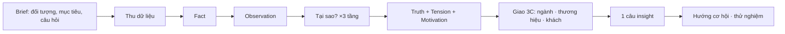

# Nghiên cứu phương pháp viết insight

Phiên bản 1.0, ngày 21/10/2026. Loại: tài liệu nghiên cứu. Đây không phải quy tắc nghiệp vụ. Các đề xuất ở Phần 5 chờ chủ duyệt.
Nguồn: 3 trang web và 1 đoạn tóm tắt của chủ. Danh sách nguồn có link ở Phần 1.
Tài liệu này là bản tự viết lại. Tài liệu không chép nguyên văn nguồn.

## Phần 1. Đã đọc được gì

| Nguồn | Đọc được | Giới hạn |
|---|---|---|
| [1] Brandcamp: bài tập "Insight Brief" | Toàn bộ bài | Bài ngắn. Bài chủ yếu quảng cáo khóa học. Các mục "4R", "4 ô nhận thức", "Information – Interpretation – Insight" chỉ có tên, không có nội dung. |
| [2] Brands Vietnam: "Làm Research và phân tích Insight bài bản" | Toàn bộ bài | Bài nói về cách làm rõ đề bài và chọn nguồn. Bài không có công thức viết insight. |
| [3] Studocu: "Insight cách viết hay" | Trang 1/3 (bản xem trước) | Trang 2–3 cần đăng nhập. Tôi không đăng nhập. Phần TTM và ví dụ nhuộm tóc lấy từ đoạn chủ dán. |
| [4] Đoạn tóm tắt chủ dán (21/10) | Toàn bộ | Không có link. Gồm: Fact và Insight, TTM, quy trình 3 bước. |

### Nguồn

1. Thái Thùy Anh, "Bài tập: Một bản Insight Brief đầy đủ sẽ giúp bạn đạt được mục tiêu nào sau đây?", Brandcamp, 10/01/2025. <https://www.brandcamp.asia/blog/289-bai-tap-mot-ban-insight-brief-day-du-se-giup-ban-dat-duoc-muc-tieu-nao-sau-day> (đọc 21/10/2026)
2. Ngọc (Norah) Võ, "Làm Research và phân tích Insight bài bản như thế nào?", Brands Vietnam, 10/03/2023. <https://www.brandsvietnam.com/congdong/topic/330744-lam-research-va-phan-tich-insight-bai-ban-nhu-the-nao> (đọc 21/10/2026)
3. "Insight: Cách viết hay như thế nào" (Template đào insight, mô hình 3C), Studocu, học phần Marketing căn bản, Đại học Kinh tế Quốc dân. <https://www.studocu.vn/vn/document/dai-hoc-kinh-te-quoc-dan/marketing-can-ban/insight-cach-viet-hay-nhu-the-nao/54060119> (đọc 21/10/2026, chỉ trang 1/3)
4. Đoạn tóm tắt chủ dán trong phiên làm việc, 21/10/2026.

Mỗi ý ở Phần 2 ghi số nguồn trong ngoặc vuông.

## Phần 2. Ý chính, tự viết lại

### 2.1. Insight brief đến trước việc tìm dữ liệu [1]

- Một brief đủ có 3 tác dụng: mỗi người biết việc của mình; nhóm biết phạm vi và đối tượng; nhóm có kế hoạch tìm thông tin.
- Brief ghi rõ: nhiệm vụ, bối cảnh, vấn đề. Hai mục quan trọng nhất là **đối tượng (Target)** và **mục tiêu (Objectives)**.
- Brief chặn việc đi lạc. Nhóm chỉ thu thông tin phục vụ mục tiêu.

### 2.2. Bắt đầu từ đích đến [2]

- Bước đầu và quan trọng nhất: làm rõ đề bài. Đề bài quyết định phương pháp, thời gian và công sức.
- Tư duy "bắt đầu từ cái kết": khi xong nghiên cứu, ta trả lời được câu hỏi nào?
- Có 2 loại nghiên cứu. Phải chọn 1 trước khi làm:
  - **Khám phá**: tìm điểm bắt đầu. Phải định trước sâu tới đâu thì dừng.
  - **Kiểm chứng**: xác định một giả thuyết đúng hay sai. Giả thuyết phải có định nghĩa đo được và mốc thời gian của số liệu.
- Kiểm tra nguồn: ai làm, cỡ mẫu, đối tượng, thời điểm, nơi làm, bên làm có lợi ích gì. Nguồn ở nước khác chỉ dùng để tham khảo xu hướng. Nguồn càng gần thị trường đích càng đáng tin.
- Có checklist mốc để biết đã đi được bao xa.
- Rà dữ liệu và ghi kết luận ngay khi làm. Không đợi cuối mới rà. Insight hình thành khi các dữ kiện nối với nhau dần.

### 2.3. Đào từ Fact tới Insight [3] [4]

- **Fact** là thông tin có thật. **Observation** là điều ta thấy từ thông tin đó. **Insight** là lý do ẩn: động cơ hoặc rào cản sau hành vi.
  - Ví dụ của chủ: thức khuya là fact; "đó là thời gian của riêng tôi" là insight.
- Hỏi "Tại sao?" ít nhất 3 tầng. Mỗi tầng phải hỏi lại: ta có thật sự biết không, hay ta đoán?
- **Mô hình 3C** [3]: insight tốt nằm ở chỗ 3 sự thật gặp nhau.
  - Sự thật ngành hàng: yếu tố đẩy hoặc cản người mua bước vào ngành. Ghi bằng từ khóa, không viết câu.
  - Sự thật thương hiệu: chọn **một** điểm mạnh cạnh tranh giải quyết được nỗi đau của khách.
  - Sự thật khách hàng: nỗi sợ hoặc mong muốn. Phải đào sâu, không ghi điều hời hợt.
- **TTM** [4]: Truth – Tension – Motivation.
  - Truth: điều khách tin hoặc làm.
  - Tension: chữ "nhưng / tuy nhiên". Đây là xung đột. Không có xung đột thì chưa có insight.
  - Motivation: điều khách thật sự muốn đạt.
  - Mẫu câu: "Tôi muốn đạt [A], nhưng tôi lo hoặc bị kẹt bởi [B]."
- **Quy trình 3 bước** [4]: thu dữ liệu → hỏi "Tại sao?" ≥3 tầng → cô lại thành 1 câu bằng lời khách.

### 2.4. Guideline quan trọng nhất (gộp [1]–[4])

| # | Guideline | Kiểm tra được bằng gì |
|---|---|---|
| G1 | Có brief trước: đối tượng, mục tiêu, câu hỏi cần trả lời | Có I01 và câu hỏi có điểm dừng |
| G2 | Chọn rõ: khám phá hay kiểm chứng | Mỗi câu hỏi có nhãn loại |
| G3 | Ghi bối cảnh của mọi nguồn | Phụ lục nguồn có ai, khi nào, ở đâu, cỡ mẫu |
| G4 | Tách Fact – Observation – Insight | Mỗi kết luận chỉ ra tầng của nó |
| G5 | Hỏi "Tại sao?" ≥3 tầng, mỗi tầng có bằng chứng | Mỗi tầng trỏ tới bản ghi |
| G6 | Insight phải có xung đột (Tension) | Câu có vế "nhưng" với 2 vế có bằng chứng |
| G7 | Insight nằm ở giao 3C | Có đủ 3 cột: ngành, thương hiệu, khách |
| G8 | Rà và ghi kết luận trong lúc làm | Có nhật ký phát hiện theo vòng |

## Phần 3. Phương pháp này va chạm với quy tắc của ta ở đâu

Phương pháp trong nguồn viết cho agency làm quảng cáo. Ta làm báo cáo dựa trên bản ghi công khai. Một số bước phải đổi cách làm.

| Bước trong nguồn | Quy tắc của ta | Cách làm thay |
|---|---|---|
| Thu dữ liệu bằng phỏng vấn, khảo sát | Ultimate quy tắc 6: không khảo sát, không phỏng vấn, không người trả lời giả lập | Chỉ dùng đánh giá, bình luận, video công khai đã mã hóa |
| Câu insight ở ngôi thứ nhất "Tôi muốn…" | R-I27: không có câu ngôi thứ nhất do máy viết; R-I11: không hiện bình luận thô | Viết câu ngôi thứ ba có số đếm: "Trong N bản ghi khen X, M bản ghi cũng chê Y" |
| Insight cảm xúc, văn hóa cho chiến dịch (ví dụ "thời gian của riêng tôi") | R-L12, R-I22, F8: không làm insight sáng tạo hoặc cảm xúc cho quảng cáo | Chỉ giữ động cơ và rào cản có trong lời khách: công dụng, giá, quy cách, chất lượng, giao hàng |
| Hỏi "Tại sao?" 3 tầng với khách thật | Không hỏi được khách | Mỗi tầng "tại sao" phải là một mã có sẵn trong bản ghi (ví dụ: chê vị → vì ngọt → vì quy cách cho trẻ). Không có bản ghi thì dừng ở tầng đó và ghi "chưa đủ bằng chứng" |
| Insight về "người tiêu dùng" | R-I01: đếm bản ghi, không đếm người | Viết "bản ghi", không viết "khách hàng" hay "%" người |
| Gộp mọi nguồn để tìm 1 sự thật | R-I06: đếm từng sàn, không cộng Shopee + TikTok | Tension có thể khác theo sàn; ghi riêng |
| Tần suất cao = insight | R-I10: tần suất không phải mức quan trọng | Xếp theo tần suất, nhưng không gọi là "quan trọng nhất" |
| Sự thật thương hiệu = điểm mạnh của ta | Ta không có sản phẩm của chủ trong dữ liệu | Thay bằng điểm mạnh và điểm yếu của thương hiệu đang bán (I13), không tự nhận |

Kết luận Phần 3: ta giữ được **cấu trúc** Fact → Tại sao → Tension → câu insight. Ta **không** giữ được lời văn ngôi thứ nhất và insight cảm xúc. Câu insight của ta là câu xung đột có số đếm.

Mẫu câu insight cho ta (đề xuất, chờ chủ duyệt):

> Trên [sàn], [n] bản ghi khen [A]. Trong số đó, [m] bản ghi cũng chê [B]. Xung đột: khách mua vì [A] nhưng bị cản bởi [B].

## Phần 4. Bảng đối chiếu: sắp lại I01–I17 theo phương pháp

Cột "Thứ tự mới" là vị trí của mục trong luồng phương pháp. Số mục I giữ nguyên để không đổi code.

| Thứ tự mới | Bước phương pháp | Mục hiện có | Mục giải quyết được gì | Thiếu so với phương pháp | Bị chặn bởi quy tắc / dữ liệu (21/10) |
|---|---|---|---|---|---|
| 1 | Brief: mục tiêu, câu hỏi | I01 Câu hỏi kinh doanh | Câu hỏi kinh doanh của chủ | Chưa có nhãn khám phá / kiểm chứng (G2); chưa có điểm dừng | Không |
| 2 | Brief: đối tượng | I02 Khách hàng và hoàn cảnh | Thẻ 3 số nhân khẩu, bối cảnh dùng từ bản ghi | Đối tượng chưa ghi trong brief trước khi thu dữ liệu | Thẻ nền "toàn dân" có; lời khách 0 bản ghi |
| 3 | Kế hoạch tìm, kiểm tra nguồn | I03 Phương pháp nghiên cứu + I17 Phụ lục | Cách chọn sản phẩm, giới hạn đánh giá, đóng băng tập bản ghi, bản kê nguồn | Bối cảnh từng nguồn (ai, khi nào, cỡ mẫu) chưa đủ ở I17 (G3) | I17 luôn có; web S19 có dữ liệu 3/3 lần |
| 4 | Fact | I04 Hành vi | Hành vi mua, dùng đếm từ bản ghi | Chưa tách Fact và Observation (G4) | S05 = 0 đánh giá (lỗi app); S07 chưa nạp tiền |
| 5 | Fact | I12 Điểm tiếp xúc | Kênh, quảng cáo người bán | Lời người bán, không phải lời khách | Quảng cáo Meta là lời người bán (R-I12); S15–S17 = 0 mẫu |
| 6 | Fact | I13 Thương hiệu và đối thủ | Thương hiệu nào nói gì, bán gì | Đây là "sự thật thương hiệu" của 3C nhưng chưa nối với rào cản ngành | Phần thị trường có dữ liệu; phần lời khách thiếu |
| 7 | Observation | I10 Chủ đề và mối quan tâm | Xếp tần suất chủ đề × khen/chê | Chỉ là Observation, chưa hỏi tại sao | R-I10: tần suất ≠ mức quan trọng; cần lời khách |
| 8 | Observation | I05 Cảm nhận và thái độ | Khen/chê theo chủ đề | Chưa có vế "nhưng" (Tension) | Cần lời khách |
| 9 | Observation | I11 Khác biệt giữa các nhóm | So sản phẩm, so sàn | Có thể lộ Tension khác nhau theo nhóm | R-I07: cần ≥30 đánh giá chữ mỗi sản phẩm |
| 10 | Tại sao? tầng 1–3 | I06 Hành trình | Trước – trong – sau mua | Chưa có chuỗi "tại sao" có bằng chứng từng tầng (G5) | Cần lời khách |
| 11 | Motivation | I07 Lý do lựa chọn | Lý do mua có mã | Đây là vế A của TTM | Cần lời khách |
| 12 | Tension | I08 Rào cản | Lý do không mua, lý do chê | Đây là vế B của TTM. Chưa ghép với I07 thành 1 xung đột | Cần lời khách |
| 13 | Truth + 3C, câu insight | I09 Nhu cầu chưa được đáp ứng | Khoảng trống giữa muốn và có | **Chưa có câu insight 1 dòng (G6, G7)**. Đây là chỗ nên đặt câu xung đột có số đếm | Cần lời khách; không viết ngôi thứ nhất (R-I27) |
| 14 | Từ insight sang hành động | I14 Hướng cơ hội | Cơ hội từ khoảng trống | Nên trỏ ngược về câu insight ở I09 | Cần I14 admission |
| 15 | Hành động | I15 Định hướng chiến lược | Gói quyết định cho chủ | Đúng phương pháp | ≤3 đề xuất, nhãn "Đề xuất, chờ chủ duyệt" (R-I21, R-I24) |
| 16 | Kiểm chứng | I16 Thử nghiệm và đo lường | Thử nghiệm để kiểm giả thuyết | Đúng loại nghiên cứu "kiểm chứng" (G2) | Không |
| 17 | Bằng chứng | I17 Phụ lục và bằng chứng | Bản kê nguồn, ngữ cảnh web | Thiếu nhật ký phát hiện theo vòng (G8) | Không |

Nhận xét:

- Mục hiện có **phủ đủ các bước** của phương pháp. Thứ tự hiện tại (I04 → I09) gần đúng luồng Fact → Tại sao → Tension.
- **Khoảng trống lớn nhất**: không mục nào viết **câu insight 1 dòng có xung đột**. I07 (vế A) và I08 (vế B) đứng tách nhau. Không ai ghép chúng thành Tension.
- **Khoảng trống thứ hai**: không mục nào ghi chuỗi "tại sao" 3 tầng có bằng chứng từng tầng.
- **3C** đang rải ở 3 mục: ngành (I10 + phần thị trường), thương hiệu (I13), khách (I07, I08). Chưa có chỗ nào đặt 3 cột cạnh nhau.
- **Dữ liệu**: các bước 4–13 cần lời khách. Hôm nay lời khách = 0 (S05 lỗi app, S07 chưa nạp tiền). Vì vậy phương pháp này chưa chạy được trên báo cáo thật. Chỉ bước 1–3 và 14–17 chạy được.

## Phần 5. Đề xuất, chờ chủ duyệt (tối đa 3)

1. **Thêm "câu insight xung đột" vào đầu I09.** Ghép 1 mã ở I07 và 1 mã ở I08 khi cùng bản ghi có cả hai. Viết theo mẫu ngôi thứ ba có số đếm ở Phần 3. Chỉ ra câu khi có ≥ số bản ghi tối thiểu (chủ chọn ngưỡng). Cần PR vào `docs/business-spec/business-rules/insight.md` (quy tắc mới R-I29).
2. **Thêm bảng 3C ở I13 hoặc I09.** 3 cột: sự thật ngành (từ khóa), sự thật thương hiệu đang bán, sự thật khách (mã I07/I08). Mỗi ô trỏ tới bản ghi.
3. **Thêm nhãn "khám phá / kiểm chứng" cho mỗi câu hỏi ở I01** và điểm dừng cho câu hỏi khám phá. I16 nhận các câu hỏi kiểm chứng.

Cả 3 đề xuất chỉ có giá trị khi lời khách có dữ liệu. Thứ tự gợi ý: sửa S05 hoặc nạp S07 trước, rồi mới làm 1–3.
