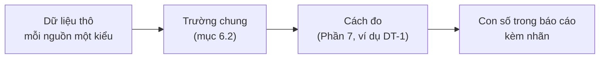

# Từ điển trường (lớp 2)

> Đã chuyển nguyên văn từ mục 6.2 của [tài liệu câu hỏi Insight](../../research/ultimate-method/insight-cau-hoi-nghiep-vu.md) ngày 21/10/2026. Bản trước khi chuyển: [bản chụp](../../outdated/2026-10-21-6/docs/research/ultimate-method/insight-cau-hoi-nghiep-vu.md). Nội dung bên dưới không đổi. Số mục (6.2.x) giữ như cũ.

### 6.2 Từ điển trường (lớp 2)

Mỗi nguồn trả dữ liệu thô theo kiểu riêng. Lớp 2 đổi dữ liệu thô thành **trường chung**. Phần 7 (chỉ số và cách đo) chỉ đọc trường chung, không đọc dữ liệu thô.



Bảng trong mục này kiểm với mã ngày 21/10/2026 (bản `b6e3848f`). Trường không có trong mã ghi "**không có**". Không ghi "dự kiến".

#### 6.2.1 Trường chung cho mọi bản ghi

| Trường chung | Nghĩa | Bắt buộc |
|---|---|---|
| `nguon` | Mã nguồn (S01…S25) | Có |
| `maBanGhi` | Mã bản ghi do nguồn cấp, hoặc do hệ thống tạo | Có |
| `san` | Sàn hoặc nền tảng: Shopee, TikTok Shop, Facebook… Không có thì ghi "không áp dụng" | Có |
| `ky` | Khoảng thời gian số liệu nói tới: từ ngày, tới ngày; hoặc năm; hoặc tháng | Có. Không rõ thì ghi "kỳ không rõ" |
| `ngayLay` | Lúc hệ thống lấy dữ liệu | Có |
| `choTro` | Vị trí trong gói nguồn: trang, dòng, ô, đoạn byte. Dùng để mở lại bằng chứng | Có |
| `trangThai` | Đọc được, thiếu, không hợp lệ, bị loại (kèm lý do) | Có |

#### 6.2.2 Trường theo 5 loại dữ liệu

| Loại | Trường thêm | Ví dụ nguồn |
|---|---|---|
| **Lời** (review, bình luận, lời trong video, chữ quảng cáo) | `chu` (nội dung), `trangThaiChu`, `vaiNguoiNoi` (khách, người bán, nhà quảng cáo) | S05, S07, S14, S16 |
| **Số đo** (doanh thu, lượt bán, giá, lượt xem, lượt thích) | `giaTri`, `chuHienThi` (chữ nguyên gốc trên trang), `donVi`, `doChinhXac` | S01, S02, S14, S16 |
| **Danh sách kết quả** (kết quả tìm, mục quảng cáo) | `viTri`, `tieuDe`, `duongDan`, `doanTrich` | S19, S15, S17 |
| **Chỉ số tương đối** (0–100) | `chiSo`, `vung`, `tuKhoa` | S20 |
| **Số nền** (vĩ mô, thương mại, thống kê nhà nước) | `giaTri`, `donVi`, `nam` hoặc `ky`, `trangThaiSo` (ước tính, sơ bộ, chính thức), `maChiTieu` | S21, S22, S23, S24 |

**Quy tắc chung:**
1. Giữ `chuHienThi` cạnh `giaTri`. Người đọc kiểm lại được số với trang gốc.
2. Ghi `donVi` rõ ràng. Không để đơn vị ngầm hiểu.
3. Thiếu thì ghi "thiếu". Không đổi thành 0.
4. Dữ liệu thô chỉ nằm trong hệ thống. Báo cáo không trích nguyên văn lời khách.

#### 6.2.3 Trường của từng nguồn (theo mã)

| Nguồn | Mã có những trường gì | Trường chung | Không có |
|---|---|---|---|
| S01 Số bán trên sàn | Mỗi số: nhãn, chữ hiển thị, giá trị, đơn vị (đồng, đếm, %), độ chính xác, sàn, kỳ, chỗ trỏ. Nhóm: tổng (doanh thu, lượt bán, số sản phẩm có bán, số shop), tách sàn, theo tháng, ngành, mức giá, tỉ trọng top 10, loại shop, vùng, sản phẩm, shop và thương hiệu hàng đầu | Số đo | Giá niêm yết và giá sau giảm không tách |
| S02 Video bán hàng (đường API) | Mã sản phẩm, tiêu đề, đường dẫn, ảnh, mô tả, kỳ quan sát; số đo doanh thu hoặc lượt bán kèm kỳ | Số đo | — |
| S04 Trang sản phẩm | **Không có bộ thu riêng.** Số đánh giá tổng và "đã bán" cộng dồn tách từ ô tên trong bảng S01, kèm tháng tạo | Số đo | Điểm sao trung bình; quy cách |
| S05 Đánh giá Shopee | Mã bản ghi, mã shop, mã sản phẩm, chữ và trạng thái chữ (đọc được, rỗng, không đọc được), số sao (4 trạng thái: không có ô, thiếu, hợp lệ, không hợp lệ), thời gian tạo, vùng, cách nhận (chọn có chữ, sản phẩm khác, chưa rõ sản phẩm, không có chữ), chỗ trỏ (trang, dòng) | Lời | **Mã người viết**; phân loại hàng; ô mẫu |
| S14 Video người bán | Bảng số: doanh thu, lượt xem, lượt bán, ngày đăng (dạng chữ). Lời nói: đoạn chữ kèm giây bắt đầu, giây kết thúc, nhãn giọng | Số đo, Lời | Mã video trong bảng số; kỳ của số |
| S15 Quảng cáo Meta | Mỗi quảng cáo: mã thư viện, trạng thái (đang chạy, đã dừng, không rõ), ngày bắt đầu. Mỗi thương hiệu: tên, mã trang (khớp đúng tên, chưa xác minh chủ sở hữu), số kết quả (chữ nguyên gốc) | Danh sách kết quả | **Chữ quảng cáo, tiêu đề, nút kêu gọi, nền tảng hiển thị, ảnh, đường dẫn** |
| S16 Quảng cáo nổi bật TikTok | Mỗi thẻ: chữ quảng cáo, tài khoản, ngành, mục tiêu, lượt thích (chữ nguyên gốc). Đếm số thẻ bị loại vì lệch chủ đề | Lời, Số đo | Chi phí, hiệu quả, tỉ lệ (bị chặn có chủ ý) |
| S17 Quảng cáo trên công cụ tìm kiếm | Theo tên miền thương hiệu: tổng kết quả, số mẫu quảng cáo, số ngày hiện lâu nhất, định dạng (chữ, hình, video), lần hiện đầu, lần hiện cuối, nguồn của tên miền | Danh sách kết quả | **Tên nhà quảng cáo**, mã, ảnh, đường dẫn (không lưu có chủ ý) |
| S19 Tìm kiếm mở rộng | Vị trí, tiêu đề, đường dẫn, đoạn trích, trang, ngày đăng | Danh sách kết quả | — |
| S20 Mức quan tâm tìm kiếm | Theo kỳ: chỉ số 0–100. Theo vùng: tên tỉnh, chỉ số | Chỉ số tương đối | Số lượt tìm |
| S21, S22 Thống kê nhà nước | Bảng, trang tính, dòng, ô, nhãn, kỳ, loại số (mức hay chỉ số), giá trị, chữ hiển thị, đơn vị, gốc so sánh, trạng thái (ước tính, sơ bộ, chính thức). Theo tỉnh: tên tỉnh, giá trị | Số nền | — |
| S23 Chỉ tiêu vĩ mô | Tên chỉ tiêu, giá trị, đơn vị, năm, ngày nguồn cập nhật, trạng thái, chú thích, chỗ trỏ, chuỗi tối đa 10 năm | Số nền | — |
| S24 Thương mại quốc tế | Mã HS, mô tả chính thức, mô tả tiếng Việt. Mỗi dòng: chiều (nước báo cáo, đối tác), nước, luồng (nhập, xuất), năm, giá trị USD | Số nền | — |
| S25 Tài liệu PDF | Đường dẫn, trạng thái, lý do, mã băm, dung lượng; đoạn trích kèm trang | Lời | — |

**Điểm lệch cần biết:**
1. Tên trường trong mã chưa thống nhất. Ví dụ: ngày lấy có 4 tên (`retrievedAt`, `readAt`, `downloadedAt`, `capturedAt`). Kỳ có 5 tên (`window`, `period`, `year`, `requestedRange`, `observedWindow`). Chỗ trỏ có 5 tên (`captureIndex`, `span`, `sourcePointer`, `locator`, `cell`). Từ điển này là tên chung. Mã đổi sang tên chung khi làm mục 7.8.
2. S05 nguồn mới không có phân loại hàng. Vì vậy quy cách (mục 6.6) chưa đọc được từ review. S04 cũng chưa có trường quy cách.
3. S15 chưa tách chữ quảng cáo. Vì vậy chưa mã hoá được thông điệp quảng cáo Meta. S16 có chữ quảng cáo.
4. S14 bảng số không có kỳ. Thiếu khoảng ngày thì ghi "kỳ không rõ".

**Ví dụ một review thô (S05, giả định):**

```json
{
  "recordId": "R-0412",
  "shopId": "SHOP-A",
  "itemId": "SP-A",
  "createdAt": "2026-09-14T13:31:00Z",
  "rating": { "state": "VALID", "value": 4 },
  "text": "Mua lần 2 cho con ăn sau giờ học. Vị xoài ngon nhưng hơi ngọt, mong shop có loại ít đường. Giao 4 ngày, hộp hơi móp.",
  "textState": "READABLE",
  "admission": "SELECTED_TEXT"
}
```

Sau lớp 2, bản ghi này có: `nguon` = S05, `maBanGhi` = R-0412, `san` = Shopee, `ngayLay` = lúc thu, `choTro` = trang và dòng, `chu` = nội dung, `vaiNguoiNoi` = khách.

Mục 6.3 và 6.4 dùng bản ghi R-0412 này làm ví dụ chung. Một review cho dữ liệu tới nhiều section.
