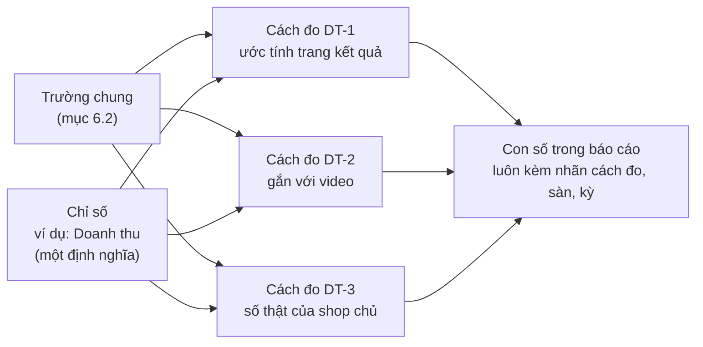

# Từ điển chỉ số và cách đo (semantic layer)

> Đã chuyển nguyên văn từ Phần 7 của [tài liệu câu hỏi Insight](../../research/ultimate-method/insight-cau-hoi-nghiep-vu.md) ngày 21/10/2026. Bản trước khi chuyển: [bản chụp](../../outdated/2026-10-21-6/docs/research/ultimate-method/insight-cau-hoi-nghiep-vu.md). Nội dung bên dưới không đổi. Số mục (7.x) giữ như cũ. Từ điển trường nằm ở [fields.md](fields.md).

## Phần 7. Từ điển chỉ số (semantic layer)

### 7.1 Vì sao cần

Một chỉ số có thể được đo theo nhiều cách. Ví dụ "doanh thu":
- Số ước tính từ trang kết quả trên sàn (S01).
- Số bán gắn với một video (S02, S14).
- Số bán thật của shop chủ (S12, chưa có đường thu).

Ba số này cùng tên "doanh thu" nhưng khác cách đo, khác kỳ, khác phạm vi. Nếu báo cáo chỉ ghi "doanh thu", người đọc sẽ so hoặc cộng nhầm.

**Quy tắc:** mỗi con số trong báo cáo gắn với **một chỉ số** (định nghĩa chung) và **một cách đo** (nguồn và cách tính). Chỉ so hoặc cộng các số cùng cách đo.

Hai tầng nối nhau:
- **Từ điển trường (mục 6.2)** nói một bản ghi có trường gì, tên gì.
- **Từ điển chỉ số (Phần 7)** nói con số nghĩa là gì, so hoặc cộng với số nào. Mỗi cách đo ghi rõ nó đọc trường nào.

Từ điển này gom các quy tắc đã có vào một chỗ:
- Hạng nguồn, "ước tính", "trong mẫu", "thiếu khác 0" (quy chuẩn dữ liệu đầu vào).
- Không cộng Shopee với TikTok Shop. Không xếp theo doanh thu, không thị phần.
- Đơn vị chuẩn và hồ sơ đơn vị (mục 6.6). So giá cùng đơn vị, cùng loại giá, cùng kỳ (E9).
- Không trộn số nền (vĩ mô, thương mại, thống kê nhà nước), số video và số quảng cáo với số trong mẫu.

Từ điển viết dạng tài liệu trước. Cách viết mượn từ Cube (chỉ số, chiều phân tích, định nghĩa một lần). Chưa dùng Cube (quyết định 20/10/2026). Xem lại khi có dashboard hoặc nhiều nơi cùng đọc số.

### 7.2 Mẫu khai báo

**Một chỉ số gồm:**

| Ô | Nghĩa | Ví dụ |
|---|---|---|
| Mã | Mã ngắn, không đổi | DT |
| Tên trong báo cáo | Chữ người đọc thấy | Doanh thu |
| Định nghĩa chung | Một câu, không nói nguồn | Tiền bán được của sản phẩm trong một kỳ |
| Đơn vị | Theo hồ sơ đơn vị (mục 6.6) | đồng |
| Chiều phân tích được phép | Cách chia số | sàn, sản phẩm, thương hiệu theo tiêu đề, nhóm quy cách, kỳ |
| Cấm | Cách dùng không được phép | không cộng hai sàn, không thị phần |

**Một cách đo gồm:**

| Ô | Nghĩa | Ví dụ |
|---|---|---|
| Mã cách đo | Mã chỉ số + số thứ tự | DT-1 |
| Nguồn | Mã nguồn | S01 |
| Trường đọc | Trường chung ở mục 6.2 | `giaTri`, `donVi`, `san`, `ky` |
| Hạng, đại diện | Theo quy chuẩn dữ liệu đầu vào | C, Vừa |
| Cách tính | Nguồn tự tính hay mình tính, tính thế nào | Nguồn ước tính |
| Kỳ | Từ ngày, tới ngày, múi giờ | 30 ngày liên tục, theo lần thu |
| Phạm vi | Sàn, mẫu | Một sàn, trong mẫu kết quả tìm kiếm |
| Tính / không tính | Đơn hoàn, voucher, phí ship… | Không tính đơn hoàn (theo mô tả của nguồn) |
| Nhãn trong báo cáo | Chữ ghi cạnh con số | "ước tính, trong mẫu, Shopee, 30 ngày" |
| So / cộng được với | Cách đo nào | Chỉ DT-1 cùng sàn, cùng kỳ |

### 7.3 Từ điển

Bản 21/10/2026 có 13 chỉ số. Ô "Trường đọc" dùng tên chung ở mục 6.2. Các ô "cần kiểm" ở bản 20/10 đã kiểm với mã và tài liệu nguồn. Kết quả ở mục 7.7.

#### 7.3.1 Chỉ số bán hàng và lời khách

**DT · Doanh thu** — tiền bán được của sản phẩm trong một kỳ. Đơn vị: đồng.

| Mã | Nguồn | Trường đọc | Hạng | Cách tính | Phạm vi, kỳ | Nhãn trong báo cáo | So / cộng được với |
|---|---|---|---|---|---|---|---|
| DT-1 | S01 | `giaTri`, `donVi` = đồng, `san`, `ky` | C | Nguồn ước tính từ số "đã bán" công khai và giá ghi nhận từng ngày. Không tính đơn hoàn (theo mô tả của nguồn, chưa tự kiểm) | Từng sàn, trong mẫu kết quả tìm kiếm. 30 ngày liên tục, theo lần thu | "ước tính, trong mẫu, <sàn>, 30 ngày" | DT-1 cùng sàn, cùng kỳ. Không so với số đơn của kênh người bán |
| DT-2 | S02, S14 | `giaTri`, `ky`, `maBanGhi` (sản phẩm) | C | Nguồn ước tính số bán gắn với một video | TikTok Shop, từng video. Kỳ = khoảng ngày khi xuất | "ước tính, gắn với video, <kỳ>" | DT-2 cùng kỳ. Không lấy làm phần của DT-1. Thiếu kỳ thì ghi "kỳ không rõ" và không so giữa các lần lấy |
| DT-3 | S12 | — | A | Số thật của shop chủ | Shop chủ | "số của shop" | DT-3. **Chưa có đường thu** |

**LB · Lượt bán** — số đơn vị hàng bán được trong một kỳ. Đơn vị: đơn vị đếm của hồ sơ đơn vị (mục 6.6).

| Mã | Nguồn | Trường đọc | Hạng | Cách tính | Phạm vi, kỳ | Nhãn | So / cộng được với |
|---|---|---|---|---|---|---|---|
| LB-1 | S01 | `giaTri`, `donVi` = đếm, `san`, `ky` | C | Nguồn ước tính: "đã bán" cuối kỳ trừ "đã bán" đầu kỳ | Từng sàn, trong mẫu. 30 ngày | "ước tính, trong mẫu, <sàn>, 30 ngày" | LB-1 cùng sàn, cùng kỳ, cùng đơn vị đếm |
| LB-2 | S02, S14 | `giaTri`, `ky` | C | Số bán gắn với video | Từng video. Kỳ như DT-2 | "ước tính, gắn với video, <kỳ>" | LB-2 cùng kỳ |
| LB-3 | S01 (ô tên sản phẩm) | `chuHienThi`, `giaTri` | B | Số "đã bán" công khai trên sàn, cộng dồn từ lúc đăng | Từng sản phẩm, không có kỳ | "đã bán, cộng dồn tới <ngày lấy>, theo số công khai trên sàn" | Không so với LB-1 hay LB-2. Không ghi "đã trừ hoàn, huỷ" |

**GIA · Giá** — tiền khách trả cho một đơn vị so giá. Đơn vị: đồng mỗi đơn vị so giá (mục 6.6).

| Mã | Nguồn | Trường đọc | Hạng | Cách tính | Phạm vi, kỳ | Nhãn | So / cộng được với |
|---|---|---|---|---|---|---|---|
| GIA-1 | S01 (ô giá) | `giaTri`, `chuHienThi`, `ngayLay` | C | Một ô giá mỗi sản phẩm. Loại giá (niêm yết hay sau giảm) chưa rõ | Từng sản phẩm, một thời điểm | "giá hiển thị, loại chưa rõ, ngày <ngày>" | GIA-1 cùng nhóm quy cách, cùng ngày lấy. Không cộng |
| GIA-2 | S01 | DT-1, LB-1 | C | DT-1 chia LB-1: giá bình quân trong kỳ | Trong mẫu, 30 ngày | "giá bình quân ước tính, mỗi <đơn vị>" | GIA-2 cùng nhóm quy cách. Nên dùng GIA-2 để so. Không so với GIA-1 |
| GIA-3 | S05 | `chu` | B | Giá khách nhắc trong review | Câu khách nói | Không ra con số. Chỉ đếm số lần nhắc "đắt", "rẻ" (chỉ số NH) | — |

**DG · Số đánh giá** — số bản ghi đánh giá. Đơn vị: bản ghi (không phải người, không phải đơn hàng).

| Mã | Nguồn | Trường đọc | Hạng | Cách tính | Phạm vi | Nhãn | So / cộng được với |
|---|---|---|---|---|---|---|---|
| DG-1 | S05 | `maBanGhi`, `trangThai` | B | Đếm bản ghi đã thu sau lọc nghĩa | Shopee, tối đa 300 mỗi sản phẩm | "đánh giá đã thu, Shopee" | DG-1 cùng mốc thu |
| DG-2 | S05 | `trangThaiChu` = đọc được | B | DG-1, chỉ bản ghi có chữ | Như DG-1 | "đánh giá có chữ" | Mẫu số cho chỉ số NH. So hai sản phẩm khi mỗi bên ≥30 |
| DG-3 | S01 (ô tên sản phẩm) | `giaTri` | B | Tổng số đánh giá sàn hiển thị | Từng sản phẩm | "sàn hiển thị" | Không so với DG-1 |

**SAO · Điểm sao** — mức sao khách cho, từ 1 tới 5.

| Mã | Nguồn | Trường đọc | Hạng | Cách tính | Phạm vi | Nhãn | So / cộng được với |
|---|---|---|---|---|---|---|---|
| SAO-1 | S05 | `giaTri` (số sao, chỉ trạng thái hợp lệ) | B | Phân bố số bản ghi theo 1–5 sao (L6: tách riêng, không gộp với chủ đề) | Bản ghi đã thu | "trong <n> đánh giá đã thu" | SAO-1 cùng sàn. Không tính trung bình thay cho phân bố |

SAO-2 (điểm trung bình sàn hiển thị) **bỏ**: không nguồn nào có trường này.

**NH · Tỉ lệ nhắc chủ đề** — phần bản ghi có nhắc một chủ đề đã duyệt. Đơn vị: n/N bản ghi. Đây là chỉ số chính của Insight.

| Mã | Nguồn | Trường đọc | Hạng | Cách tính | Phạm vi | Nhãn | So / cộng được với |
|---|---|---|---|---|---|---|---|
| NH-1 | S05 | `chu`, mã chủ đề | B, đại diện Thấp | n = bản ghi có mã chủ đề; N = DG-2 | Shopee, trong mẫu | "<n>/<N> đánh giá có chữ, Shopee" | NH-1 cùng bộ mã, cùng sàn. Không đổi thành "% khách hàng" |
| NH-2 | S07 | `chu`, mã chủ đề | B, đại diện Thấp | Như NH-1, trên bình luận TikTok | TikTok | "<n>/<N> bình luận, TikTok" | NH-2. **Dừng vì tiền.** Không cộng với NH-1 |
| NH-3 | S14 | `chu`, `vaiNguoiNoi` = người bán | B | Số video có nhắc chủ đề trong lời người bán | Video đã xem | "<n>/<N> video, lời người bán" | NH-3. Không so với NH-1 (lời người bán khác lời khách, L7) |
| NH-4 | S16 | `chu`, `vaiNguoiNoi` = nhà quảng cáo | B | Số thẻ quảng cáo có nhắc chủ đề | Thẻ đúng chủ đề, Việt Nam, 30 ngày | "<n>/<N> quảng cáo nổi bật, lời nhà quảng cáo" | NH-4. Không so với NH-1 hay NH-3 |

**XEM · Lượt xem** — số lần video được xem.

| Mã | Nguồn | Trường đọc | Hạng | Cách tính | Phạm vi, kỳ | Nhãn | So / cộng được với |
|---|---|---|---|---|---|---|---|
| XEM-1 | S02, S14 | `giaTri`, `ky`, `ngayLay` | C | Nguồn ghi | Từng video. Kỳ như DT-2 | "lượt xem, <kỳ>" | XEM-1 cùng kỳ. Không suy ra số người xem |

**QT · Mức quan tâm tìm kiếm** — mức tìm một từ khoá so với đỉnh của chính nó.

| Mã | Nguồn | Trường đọc | Hạng | Cách tính | Phạm vi | Nhãn | So / cộng được với |
|---|---|---|---|---|---|---|---|
| QT-1 | S20 | `chiSo`, `ky`, `tuKhoa` | B | Chỉ số 0–100 theo kỳ | Một từ khoá, một vùng | "mức quan tâm tương đối (0–100)" | Chỉ so các kỳ trong cùng một lần lấy. Không nói thành số lượt tìm |
| QT-2 | S20 | `chiSo`, `vung` | B | Chỉ số 0–100 theo tỉnh | Một từ khoá | "nơi tìm nhiều (0–100)" | Chỉ xếp các tỉnh trong cùng một lần lấy. Không ghi "nơi khách sống" |

#### 7.3.2 Chỉ số quảng cáo

Số quảng cáo cho biết **thương hiệu đang làm gì**. Số này không cho biết chi tiêu hay hiệu quả.

**QC · Số quảng cáo** — số quảng cáo của một thương hiệu mà thư viện quảng cáo hiển thị. Đơn vị: quảng cáo.

| Mã | Nguồn | Trường đọc | Hạng | Cách tính | Phạm vi | Nhãn | So / cộng được với |
|---|---|---|---|---|---|---|---|
| QC-1 | S15 | `maBanGhi`, `trangThai` = đang chạy | B | Đếm mã quảng cáo đang chạy của trang khớp đúng tên thương hiệu | Một trang, tới ngày lấy | "quảng cáo đang chạy trong thư viện quảng cáo công khai, tới <ngày lấy>" | QC-1 các thương hiệu cùng ngày lấy. Ghi "trang khớp tên, chưa xác minh chủ sở hữu" |
| QC-2 | S15 | `ky` (ngày bắt đầu) | B | Số ngày từ ngày bắt đầu tới ngày lấy, từng quảng cáo | Quảng cáo đang chạy | "đã chạy <n> ngày" | QC-2 cùng ngày lấy |
| QC-3 | S17 | `giaTri` (số mẫu quảng cáo), định dạng | B | Số mẫu quảng cáo theo tên miền thương hiệu, tách chữ, hình, video | Một tên miền, tối đa 3 thương hiệu | "mẫu quảng cáo trên công cụ tìm kiếm, <định dạng>" | QC-3 cùng ngày lấy. Không cộng với QC-1 (hai thư viện khác nhau) |
| QC-4 | S17 | `ky` (lần hiện đầu, lần hiện cuối) | B | Số ngày hiện lâu nhất | Một tên miền | "hiện lâu nhất <n> ngày" | QC-4. Không so với QC-2 |

**TL · Lượt thích quảng cáo** — lượt thích trên một thẻ quảng cáo nổi bật.

| Mã | Nguồn | Trường đọc | Hạng | Cách tính | Phạm vi, kỳ | Nhãn | So / cộng được với |
|---|---|---|---|---|---|---|---|
| TL-1 | S16 | `chuHienThi`, `giaTri` | B | Nguồn ghi | Từng thẻ, Việt Nam, 30 ngày | "lượt thích, quảng cáo nổi bật, 30 ngày" | TL-1 cùng lần lấy. Không so với lượt thích video thường. Không suy ra hiệu quả |

**Cấm cho mọi số quảng cáo:** không nói chi tiêu, ngân sách, tỉ lệ chuyển đổi hay hiệu quả. Không cộng hai thư viện.

#### 7.3.3 Số nền

Số nền mô tả **thị trường chung**, không mô tả mẫu sản phẩm. Hạng A, đại diện Cao. Báo cáo đặt số nền ở phần riêng.

**VM · Chỉ tiêu vĩ mô** — giá trị một chỉ tiêu quốc gia trong một năm.

| Mã | Nguồn | Trường đọc | Hạng | Cách tính | Phạm vi, kỳ | Nhãn | So / cộng được với |
|---|---|---|---|---|---|---|---|
| VM-1 | S23 | `maChiTieu`, `giaTri`, `donVi`, `nam`, `trangThaiSo` | A | Nguồn công bố | Việt Nam, một năm; chuỗi tối đa 10 năm | "<tên chỉ tiêu>, <năm>, <đơn vị>, Ngân hàng Thế giới" | VM-1 cùng chỉ tiêu, khác năm (xu hướng). Không ghép với số mẫu |

**TM · Kim ngạch thương mại** — giá trị nhập hoặc xuất của một mã hàng HS.

| Mã | Nguồn | Trường đọc | Hạng | Cách tính | Phạm vi, kỳ | Nhãn | So / cộng được với |
|---|---|---|---|---|---|---|---|
| TM-1 | S24 | `maChiTieu` (mã HS), `giaTri` (USD), luồng, nước, `nam` | A | Nguồn công bố | Một mã HS, một nước, một luồng, một năm | "kim ngạch <nhập/xuất>, mã HS <mã>, <năm>, USD" | TM-1 cùng mã HS, cùng luồng. **Không cộng các đối tác.** Không đổi sang đồng để so với DT |

**TK · Số thống kê nhà nước** — số liệu Cục Thống kê công bố.

| Mã | Nguồn | Trường đọc | Hạng | Cách tính | Phạm vi, kỳ | Nhãn | So / cộng được với |
|---|---|---|---|---|---|---|---|
| TK-1 | S21, S22 | `giaTri`, `donVi`, `ky`, `trangThaiSo`, loại số = mức | A | Nguồn công bố | Cả nước hoặc từng tỉnh | "<nhãn>, <kỳ>, <ước tính/sơ bộ/chính thức>, Cục Thống kê" | TK-1 cùng nhãn, cùng trạng thái |
| TK-2 | S21, S22 | `giaTri`, gốc so sánh, `ky`, loại số = chỉ số | A | Nguồn công bố | Như TK-1 | "chỉ số <nhãn>, gốc <gốc>, <kỳ>" | TK-2 cùng gốc. Không so với TK-1 |

### 7.4 Quy tắc so và cộng

| Hai con số | Được làm gì |
|---|---|
| Cùng cách đo, cùng sàn, cùng kỳ, cùng đơn vị | So, cộng (nếu không thiếu thành viên nào) |
| Cùng cách đo, khác sàn | Đặt cạnh. Không cộng |
| Cùng cách đo, khác kỳ | So xu hướng, ghi rõ hai kỳ. Không cộng |
| Cùng chỉ số, khác cách đo | Đặt cạnh, ghi nhãn từng số, giải thích vì sao khác. Không cộng, không tính tỉ lệ giữa hai số |
| Khác chỉ số | Chỉ ghép khi có công thức khai báo trong từ điển (ví dụ GIA-2 = DT-1 / LB-1) |
| Số nền với số mẫu | Đặt ở hai phần riêng. Không ghép công thức. Không tính "phần của thị trường" |
| Số quảng cáo với số bán | Đặt cạnh. Không nói quảng cáo gây ra doanh thu |
| Một số bị thiếu | Ghi "thiếu". Không đổi thành 0. Không nêu tổng |

Ví dụ:
- **Sai:** "Video A mang lại 12% doanh thu của sản phẩm." (DT-2 chia DT-1, hai cách đo khác nhau.)
- **Đúng:** "Video A gắn với khoảng 18 triệu đồng doanh thu ước tính trong 30 ngày. Sản phẩm có khoảng 150 triệu đồng doanh thu ước tính trong mẫu Shopee. Hai số đo theo hai cách khác nhau nên không chia cho nhau."
- **Sai:** "Mẫu chiếm 3% kim ngạch nhập khẩu." (DT-1 chia TM-1, số mẫu với số nền.)

### 7.5 Cách hiện trong báo cáo

- Mỗi con số có nhãn cách đo ngay cạnh, hoặc ở tiêu đề cột: "Doanh thu (ước tính, trong mẫu, Shopee, 30 ngày, đồng)".
- Nhãn dùng tên nguồn trung tính ("dữ liệu số bán", "dữ liệu đánh giá"). Không nêu tên công cụ. Số nền ghi tên cơ quan công bố theo bảng nguồn.
- Hạng C luôn có chữ "ước tính". Đại diện Thấp luôn có chữ "trong mẫu".
- Cuối báo cáo (I03 hoặc phụ lục) có bảng "Chỉ số đã dùng": mã cách đo, nhãn, nguồn trung tính, kỳ.

### 7.6 Áp vào section nào

| Section | Chỉ số dùng |
|---|---|
| I02 Bối cảnh | DT-1, LB-1 (chọn sản phẩm), QT-1, QT-2. Số nền VM-1, TM-1, TK-1, TK-2 ở phần riêng |
| I03 Phạm vi và giới hạn | Bảng "Chỉ số đã dùng", DG-1, DG-2 |
| I04–I10 Lời khách | NH-1, SAO-1, DG-2 |
| I07, I13 Giá và thương hiệu | GIA-2 (theo nhóm quy cách), GIA-1 khi cần giá một thời điểm |
| I12 Điểm tiếp xúc | DT-2, LB-2, XEM-1, NH-3, QC-1, QC-3, TL-1 |
| I13 Thương hiệu và đối thủ | QC-1 đến QC-4, NH-4 |
| I14, I15 Đề xuất | Mỗi đề xuất ghi mã cách đo của phát hiện nó dựa vào |
| I16 Kết quả sau khi làm | DT-3 khi có S12. Chưa có thì ghi "chưa đo được" |

### 7.7 Kết quả kiểm (21/10/2026)

Bản 20/10 có 5 điểm "cần kiểm". Đã kiểm với mã (bản `eac3bf5e`) và tài liệu của nguồn:

| Điểm | Kết quả | Đã sửa ở |
|---|---|---|
| 1. Kỳ của DT-1, LB-1 | 30 ngày liên tục, theo từng lần thu. Mã kiểm kỳ trang hiển thị | DT-1, LB-1 |
| 2. Đơn hoàn, huỷ | Mã không xử lý. Tài liệu nguồn nói số là đơn đã nhận và không hoàn | Nhãn DT-1 |
| 3. Loại giá | Một ô giá, không tách niêm yết và sau giảm | GIA-1; ưu tiên GIA-2 |
| 4. Trang sản phẩm | Không có bộ thu riêng. "Đã bán" và số đánh giá tách từ ô tên của S01. Không có điểm sao trung bình | LB-3, DG-3 đổi nguồn; SAO-2 bỏ |
| 5. Kỳ của số video | Mã không ghi kỳ. Đường API có khoảng ngày. Tệp tải tay phụ thuộc lúc xuất | DT-2, LB-2, XEM-1 |

**Còn mở:**
1. Loại giá của ô giá S01: niêm yết hay sau giảm.
2. Trường quy cách: chưa nguồn nào có (mục 6.2.3, điểm lệch 2).
3. Chữ quảng cáo S15: chưa tách. Chưa có NH cho quảng cáo Meta.
4. Tệp video tải tay: phải ghi khoảng ngày lúc xuất.

### 7.8 Đưa vào code

1. Đổi tên trường trong mã về tên chung (mục 6.2.1). Làm dần theo từng nguồn khi sửa nguồn đó.
2. Viết từ điển thành một tệp dữ liệu trong repo: mỗi chỉ số và cách đo là một mục, theo mẫu ở 7.2.
3. Mỗi con số mà mã tính ra mang mã cách đo (ví dụ DT-1).
4. Nhãn trong báo cáo lấy từ từ điển, không viết tay.
5. Thêm một luật vào cổng kiểm: con số không có mã cách đo thì chặn. Phép cộng hoặc chia giữa hai cách đo không được khai báo thì chặn.
6. Xem lại Cube khi có dashboard hoặc nhiều nơi cùng đọc số. Từ điển đã viết theo cách của Cube nên chuyển được.
