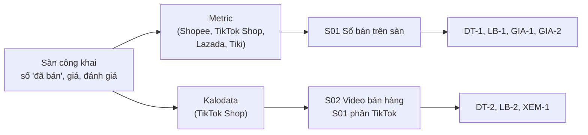
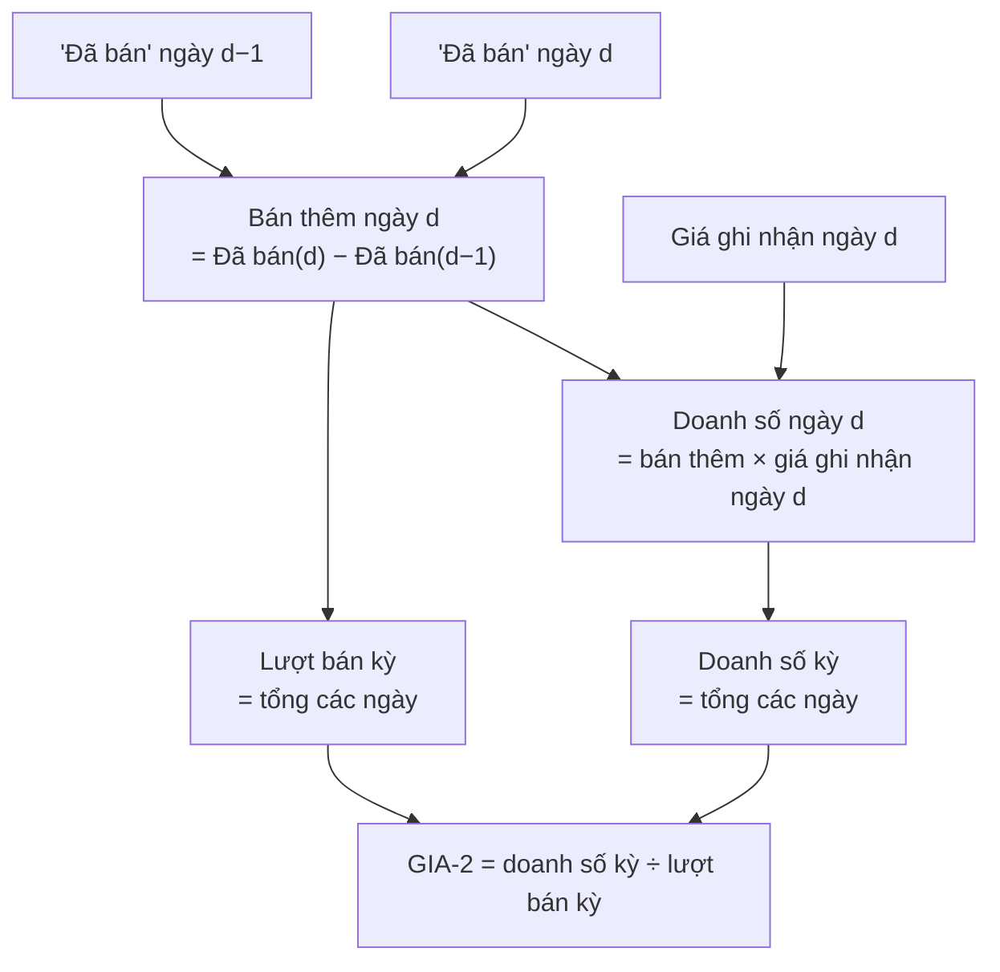

# Cách nguồn tính ra con số (Metric và Kalodata)

Ngày kiểm: 21/10/2026. Tài liệu nghiên cứu. Báo cáo gửi khách **không** nêu tên nguồn.

Tài liệu này ghi lại cách hai nguồn số bán tính ra con số. Mỗi mục có đường dẫn tới tài liệu gốc. Mục 4 nối mỗi cách tính với chỉ số ở Phần 7 của tài liệu câu hỏi Insight, nay là [metrics.md](metrics.md). Mục 5 ghi điều liên quan tới quy đổi đơn vị.

Ký hiệu:
- **Nguồn nói** = câu lấy từ tài liệu của nguồn. Hệ thống chưa tự kiểm.
- **Đã kiểm** = hệ thống đã thấy trong dữ liệu thật.
- **Chưa rõ** = tài liệu không nói. Không đoán.

## 1. Metric

Tài liệu gốc: trang hỗ trợ `hotro.metric.vn`. Mục lục máy đọc: `https://hotro.metric.vn/llms.txt`. Mỗi trang có bản `.md` (thêm `.md` vào cuối đường dẫn).

### 1.1 Lượt bán

Nguồn nói ([cach-metric-ghi-nhan-so-lieu](https://hotro.metric.vn/ho-tro/cau-hoi-thuong-gap/du-lieu/cach-metric-ghi-nhan-so-lieu)):
1. Sàn hiện số "Đã bán" cộng dồn trên mỗi sản phẩm.
2. Metric đọc số này liên tục.
3. Lượt bán từ ngày A tới ngày B = "Đã bán" tại B trừ "Đã bán" tại A.

Hệ quả:
- Lượt bán là số **đơn vị chào bán** (một lần mua một "sản phẩm"). Một đơn vị có thể là 1 gói, 1 hộp hoặc 1 thùng. Metric **không** quy đổi.
- Sàn làm tròn số "Đã bán" lớn (ví dụ "1,2k"). Sai số lớn hơn ở sản phẩm bán ít trong kỳ. **Chưa rõ** Metric xử lý làm tròn thế nào.
- Đơn hoàn và đơn huỷ: sàn tự trừ khỏi "Đã bán" theo luật của sàn. Metric không trừ thêm.

### 1.2 Doanh số

Nguồn nói (cùng trang 1.1):
1. Doanh số một ngày = lượt bán tăng thêm trong ngày × "giá sản phẩm ghi nhận của ngày hôm đó".
2. Doanh số một kỳ = tổng doanh số các ngày.

Trang hỏi đáp của eReport ([cach-ereport-ghi-nhan-so-lieu](https://hotro.metric.vn/ereport/ho-tro/faqs/cach-ereport-ghi-nhan-so-lieu)) ghi cách gọn hơn: tổng đã bán từ A tới B × giá tại B. Hai cách cho số khác nhau khi giá đổi trong kỳ. **Chưa rõ** màn hình tìm kiếm dùng cách nào. Hệ thống coi doanh số là số ước tính (mức C).

Nguồn nói: doanh số Metric khớp với "Đơn đã thanh toán" của Shopee (giá trị hàng đã nhận, chưa hoàn). Trang người bán Shopee có cả phí vận chuyển, đơn huỷ, đơn hoàn. Metric chỉ tính lượt bán × giá bán. Vì vậy hai số **không** so trực tiếp.

### 1.3 Giá

- **Giá ghi nhận** là giá bán Metric đọc trên trang sản phẩm mỗi ngày. **Chưa rõ** đó là giá trước hay sau mã giảm của shop, của sàn, hoặc giá thấp nhất trong các phân loại.
- Bảng kết quả tìm có một ô giá (GIA-1) và có cột giá thấp nhất, giá cao nhất. Hệ thống hiện chỉ đọc ô giá.
- Danh sách bán chạy có "giá bán, giá từng phân loại hàng" ([danh-sach-ban-chay](https://hotro.metric.vn/phan-tich-thi-truong/danh-sach-ban-chay)). Đây là chỗ có thể đọc **quy cách theo phân loại** (mục 5).
- Có trang lịch sử giá theo thời điểm cho từng sản phẩm ([lich-su-gia-lich-su-da-ban](https://hotro.metric.vn/phan-tich-san-pham/lich-su-gia-lich-su-da-ban)). Hệ thống không dùng trang này.
- Kết luận: dùng GIA-2 (doanh số ÷ lượt bán) để so. GIA-2 là giá bình quân thật trong kỳ theo cách Metric tính. GIA-1 chỉ là một thời điểm.

### 1.4 Bộ lọc mặc định

Nguồn nói ([cach-loc-don-ao-khi-phan-tich](https://hotro.metric.vn/ho-tro/cau-hoi-thuong-gap/du-lieu/cach-loc-don-ao-khi-phan-tich)):

| Bộ lọc | Luật | Mặc định |
|---|---|---|
| Đơn ảo | Bỏ sản phẩm có tổng đánh giá < 3% tổng đã bán. Người dùng đổi được tỉ lệ (ví dụ 5%) | Bật |
| Quà tặng | Bỏ sản phẩm có tên chứa từ khoá quà tặng | Bật |
| Giá ảo | Bỏ sản phẩm có giá bất thường | Bật (nguồn nói, không ghi luật) |

Hệ quả:
- Sản phẩm mới, ít đánh giá có thể bị bỏ dù bán thật.
- Hệ thống không đổi bộ lọc trên trang (luật an toàn Metric: không lưu, không đổi cài đặt). Mọi số Metric trong hệ thống là số **sau** bộ lọc mặc định.

### 1.5 Độ phủ và độ chính xác

Nguồn nói ([tieu-chuan-du-lieu-metric](https://hotro.metric.vn/ho-tro/cau-hoi-thuong-gap/du-lieu/tieu-chuan-du-lieu-metric)):

| Mục | Số nguồn nói |
|---|---|
| Độ phủ gian hàng | 90% (trung bình tuần) |
| Độ phủ SKU | 90% (trung bình tuần) |
| Độ chính xác doanh số | 82% (theo phản hồi khách, quý 2/2025) |
| Độ chính xác lượt bán | 86% (như trên) |
| Lịch sử | 5 năm Shopee, Lazada, Tiki. 3 năm TikTok Shop |

"Độ chính xác 82%" không có định nghĩa (sai số trung bình hay tỉ lệ khớp). Hệ thống **không** in con số này lên báo cáo. Hệ thống chỉ ghi "ước tính".

### 1.6 Chỉ số và thống kê

Nguồn nói ([chi-so](https://hotro.metric.vn/phan-tich-thi-truong/chi-so), [bao-cao-thong-ke](https://hotro.metric.vn/phan-tich-thi-truong/bao-cao-thong-ke)):

| Chỉ số Metric | Nghĩa |
|---|---|
| Sản phẩm đã bán | Số sàn hiện, theo mục 1.1 |
| Doanh số | Theo mục 1.2 |
| Shop có lượt bán | Số shop có ít nhất một lượt bán trong kỳ |
| Sản phẩm có lượt bán | Số SKU có ít nhất một lượt bán trong kỳ |
| Thống kê mức giá | Doanh số và lượt bán theo các khoảng giá. Tài liệu không nói có quy đổi quy cách. Hệ thống coi khoảng giá là giá **một đơn vị chào bán** |
| Tỉ trọng thương hiệu | Chỉ gồm sản phẩm người bán có ghi thương hiệu. Phần còn lại không vào bảng |
| Tỉ trọng shop | Top 10 shop |
| Kiểu gian hàng | Mall và thường |
| Kho hàng | Chỉ Shopee |
| Ngành hàng | Tới cấp 3 |

### 1.7 Tìm theo từ khoá và thời gian

Nguồn nói ([loc-tu-khoa](https://hotro.metric.vn/ho-tro-phan-tich/loc-tu-khoa), [loc-phan-tich-co-ban](https://hotro.metric.vn/ho-tro-phan-tich/loc-phan-tich-co-ban)):
1. Từ khoá so với **tên sản phẩm**. "+" là bắt buộc có. "-" là loại trừ. "Tìm thông minh" khớp cả khi các từ không liền nhau.
2. Kỳ có sẵn: 7, 30, 90, 180, 365 ngày. Kỳ tính tới **lần cập nhật dữ liệu mới nhất**, không phải tới hôm nay.

Hệ quả:
- Mẫu = các sản phẩm có tên khớp từ khoá. Sản phẩm đặt tên khác bị bỏ sót. Vì vậy mọi số là "trong mẫu kết quả tìm".
- Ghi ngày cuối kỳ theo trang, không theo ngày lấy.

### 1.8 Còn chưa rõ

1. Giá ghi nhận là giá trước hay sau giảm (video "Hiểu về mức giá" của nguồn chưa xem).
2. Màn hình tìm dùng cách tính doanh số nào trong mục 1.2.
3. Cách xử lý số "Đã bán" làm tròn.
4. Luật của bộ lọc giá ảo.

## 2. Kalodata

Tài liệu gốc:
- Trang chủ, mục hỏi đáp: `https://www.kalodata.com/vi`
- Tài liệu API: `https://www.kalodata.com/open-center/docs` (bản máy đọc: `/api/open-center/api-docs/public`, OpenAPI 3.0.1)
- Bảng giá API: `https://www.kalodata.com/open-center/pricing`

Trang hỏi đáp khác ngoài trang chủ cần đăng nhập. Hệ thống không đăng nhập.

### 2.1 Cách nguồn có số

Nguồn nói (hỏi đáp trang chủ):
1. Đội kỹ thuật thu dữ liệu TikTok Shop từ kênh công khai.
2. Mô hình thuật toán xử lý thêm. Một số số liệu (ví dụ số tiền giao dịch, chi phí quảng cáo) có sai số so với số thật.
3. Mô hình học lại hằng ngày.
4. Nguồn khuyên: không dùng số này cho việc cần độ chính xác cao (trả hoa hồng, đánh giá hiệu suất).

Nguồn **không** công bố công thức, độ phủ hay tỉ lệ sai số. Vì vậy mọi số Kalodata là mức C (ước tính bằng mô hình). Chi phí quảng cáo và ROAS là số mô hình đoán, mức thấp hơn doanh số.

### 2.2 Trường và nghĩa (theo tài liệu API)

Mọi số doanh thu, lượt bán là "trong khoảng thời gian đã chọn" (`date_range`).

**Sản phẩm** (`/openapi/v1/tiktok/product/rank`, `/product/detail`):

| Trường | Nghĩa nguồn ghi |
|---|---|
| `revenue` | Doanh thu đã hoàn tất theo điều kiện lọc, trong kỳ |
| `sales_volumn` | Lượt bán trong kỳ |
| `unit_price` | "Đơn giá" của sản phẩm trong kỳ. **Chưa rõ** là giá niêm yết hay doanh thu ÷ lượt bán |
| `min_price`, `max_price` | Giá SKU thấp nhất, cao nhất (chỉ ở `detail`) |
| `sku_count` | Số SKU (chỉ ở `rank`) |
| `video_revenue`, `live_revenue`, `showcase_revenue`, `shopping_mall_revenue` | Doanh thu tách theo kênh: video, livestream, tủ hàng, khu mua sắm |
| `revenue_growth_rate` | Tốc độ tăng doanh thu |
| `creator_number`, `video_number`, `live_number` | Số nhà sáng tạo, video, livestream có quảng bá sản phẩm trong kỳ |
| `commission_rate` | Tỉ lệ hoa hồng, 1.0 = 1% |
| `product_review_count` | Số đánh giá |
| `launch_date` | Ngày đăng sản phẩm |
| `revenue_trend` | Doanh thu theo ngày trong kỳ |
| `product_description` | Mô tả sản phẩm, dạng khối chữ và ảnh. Rỗng khi không có |

**Phân tích điểm bán** (`/openapi/v1/tiktok/product/analysis`): `highlights[]` (từ khoá điểm bán, chữ gốc trên sản phẩm) và `attributes[]` (cặp tên thuộc tính, giá trị). Nguồn tạo phân tích này bằng máy và lưu sẵn. Lần đầu có thể trả "chưa có" và không tính phí.

**Ngành hàng** (`/category/detail`): `revenue`, `sale`, `shop_number` (shop có bán), `active_product_number` (sản phẩm có bán), doanh thu tách kênh, `affiliate_revenue` (qua nhà sáng tạo liên kết), `self_operate_revenue` (qua nhà sáng tạo của shop), `average_shop_revenue`. Bảng xếp ngành có `top3_shop_revenue_ratio`.

**Video** (`/video/rank`, `/video/detail`): doanh thu, lượt bán, lượt xem trong kỳ; `video_gpm`; lượt xem quảng cáo; ROAS; khoảng ngày chạy quảng cáo; cờ quảng cáo; cờ video do AI tạo. Lọc được theo `shop_id`, `creator_id`, `product_id`, `category_ids`.

### 2.3 Kỳ

| Điểm cuối | Kỳ nhận |
|---|---|
| Sản phẩm, shop, video, nhà sáng tạo, livestream (bảng xếp) | Tối đa 30 ngày: `lastDay`, `last7Day`, `last30Day`, khoảng `yyyy-MM-dd~yyyy-MM-dd` (≤30 ngày), hoặc tháng `yyyy-MM` |
| Ngành hàng | Chỉ `last7Day`, `last30Day`, `last90Day`, `last180Day`, `last365Day` |

Hệ quả: số video lấy qua API **có kỳ rõ**. Điều này giải điểm lệch "S14 bảng số không có kỳ" (mục 6.2.3 của tài liệu nghiệp vụ) nếu đổi sang API.

### 2.4 Chi phí và giới hạn

Nguồn nói (bảng giá API):

| Gọi | Điểm |
|---|---|
| Chi tiết (sản phẩm, shop, video…) | 0,1 |
| Bảng xếp | 0,1 × số trang 100 dòng |
| Đường dẫn video | 0,01 |
| Tổng hợp bình luận | 1 (chỉ khi có dữ liệu mới) |
| Phân tích điểm bán | 0,1 (chỉ khi có dữ liệu) |
| Số dư, nhật ký điểm | 0 |

Giới hạn: 10 lần gọi mỗi 10 giây (bình luận và phân tích: 100 lần mỗi 10 giây).

### 2.5 Còn chưa rõ

1. Nghĩa chính xác của `unit_price`.
2. "Doanh thu đã hoàn tất" có trừ đơn hoàn, huỷ không.
3. Độ phủ shop và SKU ở Việt Nam.

## 3. So hai nguồn

| Mục | Metric | Kalodata |
|---|---|---|
| Sàn | Shopee, TikTok Shop, Lazada, Tiki | TikTok Shop |
| Cách có lượt bán | Hiệu số "Đã bán" công khai | Thu công khai + mô hình (không công bố) |
| Cách có doanh số | Lượt bán ngày × giá ghi nhận ngày | Không công bố |
| Độ chính xác công bố | 82% doanh số, 86% lượt bán (phản hồi khách) | Không công bố |
| Lọc mặc định | Đơn ảo 3%, quà tặng, giá ảo | Không công bố |
| Kỳ | 7–365 ngày, tới lần cập nhật cuối | ≤30 ngày (ngành: 7–365) |
| Quy cách | Giá từng phân loại ở danh sách bán chạy | `min_price`/`max_price`, `attributes[]`, `product_description` |

Luật dùng:
1. Không cộng số hai nguồn. Không cộng Shopee với TikTok Shop.
2. Số TikTok Shop của hai nguồn có thể khác nhau. Mỗi số ghi rõ một nguồn (trong hệ thống), báo cáo chỉ ghi "ước tính".
3. Không so số của nguồn với số kênh người bán (DT-3).

## 4. Nối với chỉ số Phần 7

| Chỉ số | Cách nguồn tính | Mức | Lưu ý mới từ tài liệu này |
|---|---|---|---|
| DT-1 | Metric: tổng (bán thêm ngày × giá ghi nhận ngày) | C | Số sau bộ lọc đơn ảo 3% và quà tặng. Trong mẫu tên khớp từ khoá |
| LB-1 | Metric: "Đã bán" cuối kỳ − đầu kỳ | C | Đếm **đơn vị chào bán**, chưa quy đổi quy cách |
| LB-3 | Số "Đã bán" sàn hiện, cộng dồn | B | Sàn tự trừ hoàn, huỷ theo luật sàn |
| GIA-1 | Ô giá Metric, một thời điểm | C | Loại giá chưa rõ (mục 1.8) |
| GIA-2 | DT-1 ÷ LB-1 | C | Là giá bình quân **một đơn vị chào bán**. Chỉ so khi cùng nhóm quy cách (mục 5) |
| DT-2, LB-2 | Kalodata video: doanh thu, lượt bán trong `date_range` | C | API cho kỳ rõ ≤30 ngày |
| XEM-1 | Kalodata video: lượt xem trong kỳ | C | Lượt xem quảng cáo tách riêng |

## 5. Liên quan tới quy đổi đơn vị

Cả hai nguồn đếm **đơn vị chào bán**. Một đơn vị có thể là 1 gói 200 g hoặc 1 thùng 24 hộp. Vì vậy:
- Cộng lượt bán của nhiều sản phẩm là cộng gói với thùng.
- GIA-2 của gói 200 g và của thùng 24 hộp không so được.
- Khoảng giá của Metric (mục 1.6) cũng trộn các quy cách.

Trường có thể cho quy cách, **không đoán từ tên**:

| Trường | Nguồn | Phủ |
|---|---|---|
| Tên và giá từng phân loại | Metric, danh sách bán chạy | Shopee, TikTok Shop. Cần kiểm trang kết quả thật |
| `attributes[]`, `product_description` | Kalodata phân tích điểm bán, chi tiết sản phẩm | TikTok Shop. 0,1 điểm mỗi sản phẩm |
| `min_price`, `max_price` | Kalodata chi tiết | Chỉ là giá, không có lượng |
| `variation`, `model_name` | Đánh giá Shopee | Chỉ phân loại khách mua, không có giá |
| Tệp quy cách chủ shop tải lên (LISTING_SPEC) | Hệ thống | Có sẵn, luồng tự động chưa dùng |

Cách dùng trong báo cáo Market: xem kế hoạch sửa quy đổi đơn vị.
