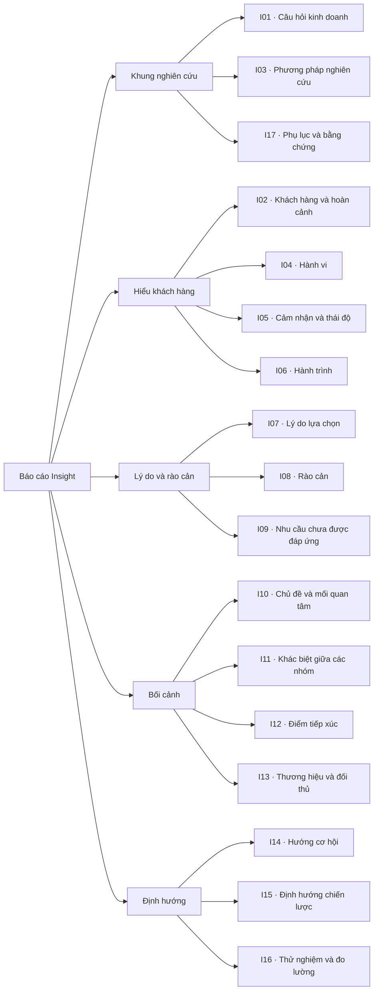
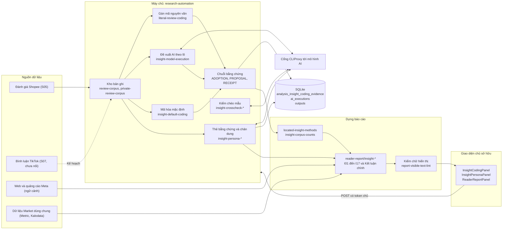
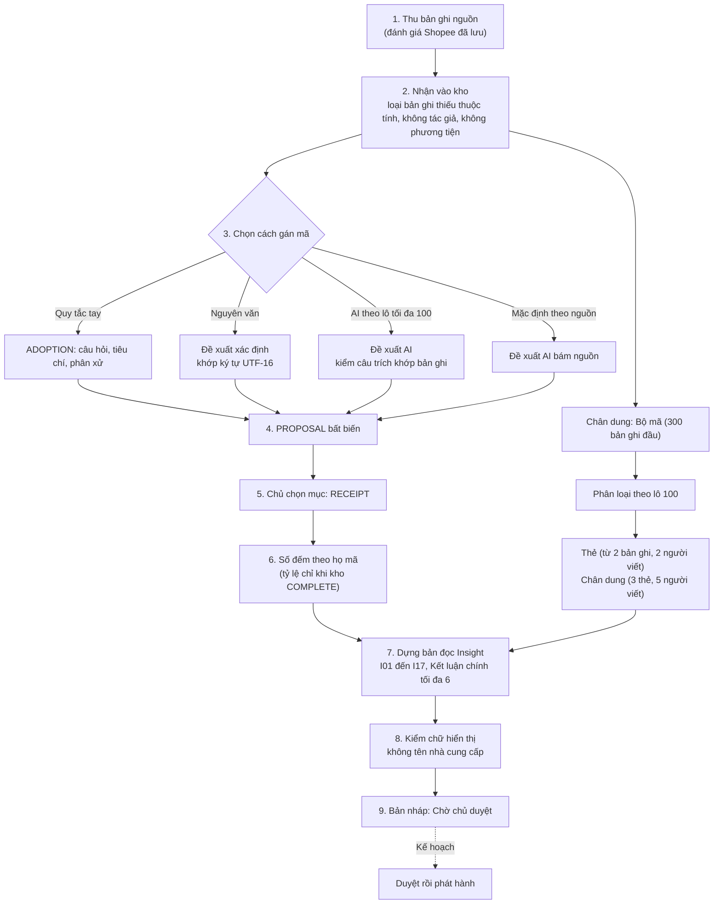
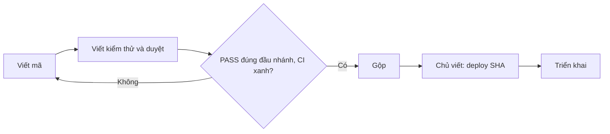

# Thiết kế hệ thống báo cáo Insight (khách hàng)

Mục đích: mô tả thiết kế hệ thống báo cáo Insight. Tài liệu gồm:

- kiến trúc;
- luồng dữ liệu từ nguồn đến bình luận đã gán mã, insight, chân dung và báo cáo;
- phần dùng chung với Market;
- các quyết định;
- việc còn lại trước khi mở lại;
- câu hỏi cho chủ dự án.

Cập nhật: 20/10/2026 · Commit chính: `e9e0f444`
Commit chính: `e9e0f444` (nhánh `main`)

> Trạng thái: TẠM NGỪNG (chủ dự án, 19/10/2026). Tài liệu mô tả mã hiện có; phần chưa có ghi "Kế hoạch".

## Mục lục

- Phần 1. Mục tiêu và nguyên tắc thiết kế
- Phần 2. Kiến trúc tổng thể
- Phần 3. Luồng dữ liệu
- Phần 4. Chuỗi bằng chứng bất biến
- Phần 5. Phần dùng chung với Market
- Phần 6. Các quyết định thiết kế
- Phần 7. Việc còn lại trước khi mở lại
- Phần 8. Câu hỏi cho chủ dự án
- Phần 9. Giải thích thuật ngữ

## Phần 1. Mục tiêu và nguyên tắc thiết kế

Mục tiêu: trả lời "khách hàng thật nói gì" bằng lời khách thật, có thể kiểm.

Nguyên tắc:

1. **Không bình luận thô trên báo cáo.** Mọi lời khách phải qua gán mã và trích nguyên văn (quyết định 19/10).
2. **AI chỉ đề xuất.** Mọi đầu ra AI mang nhãn "đề xuất, chờ chủ duyệt"; chủ xác nhận từng bước.
3. **Bằng chứng bất biến.** Quy tắc, đề xuất, biên nhận ghi vào bảng chỉ thêm, có trigger chặn sửa.
4. **Không bịa.** Thiếu dữ liệu thì ghi thiếu; thuộc tính chân dung phải bằng đúng một câu trích.
5. **Không tên nhà cung cấp trong báo cáo gửi khách.**
6. **Đơn vị là bản ghi**, không đếm người; không cộng chéo Shopee và TikTok.

### Các chức năng của báo cáo

Báo cáo Insight có 17 section, từ I01 đến I17. Sơ đồ phân rã chức năng dưới đây chia 17 section thành 5 nhóm. Báo cáo Insight đang tạm dừng (xem Phần 7), nên sơ đồ mô tả thiết kế, không mô tả phần đang chạy.

- Cách chia 5 nhóm chỉ giúp đọc dễ hơn. Nó không thay đổi quy tắc nghiệp vụ nào.
- Phần kết luận chính của Insight (quy tắc E6) không phải một section có mã, nên không có trong sơ đồ.
- Sơ đồ không cho biết thứ tự chạy. Thứ tự chạy nằm ở Phần 3.
- Phương pháp và trạng thái của từng section nằm ở [Ultimate Method, mục 3](../../research/ultimate-method/ultimate-method-30-sections.md#3-bảng-tổng-quan-30-section).

## Phần 2. Kiến trúc tổng thể

Ghi chú: sơ đồ không vẽ riêng hai cầu nối `located-review-bridge` và `native-source-review-bridge`, để giữ sơ đồ gọn. Hai cầu nối này đưa bản ghi có định vị vào phương pháp I06/I09.

## Phần 3. Luồng dữ liệu

Điểm cần lưu ý:

- Mỗi bước từ 3 đến 5 là một yêu cầu riêng với khóa yêu cầu duy nhất. Mở trang hay tải lại không tự gọi AI.
- Khi kết quả AI không rõ, hệ thống giữ yêu cầu cũ để đọc lại. Hệ thống không tạo yêu cầu mới, để tránh gọi AI hai lần.
- Mẫu bộ mã của chân dung là 300 bản ghi đầu theo thứ tự lưu. Mô tả mẫu này là mẫu quan sát, không đại diện.

## Phần 4. Chuỗi bằng chứng bất biến

| Loại | Cha | Ý nghĩa |
| --- | --- | --- |
| ADOPTION | (gốc) | Quy tắc đã chấp nhận (hoặc gốc nội bộ PERSONA_RULE cho chân dung) |
| PROPOSAL | ADOPTION | Đề xuất (xác định, AI hoặc mặc định) |
| RECEIPT | PROPOSAL | Biên nhận lựa chọn của chủ |

Bảng `analysis_insight_coding_evidence` (migration `0045_analysis_insight_coding.sql`) có `pair_sha256`, `request_key` duy nhất, `artifact_sha256`, `artifact_json`; trigger `immutable_insight_coding` chặn sửa và xóa. Lần chạy AI nằm ở `analysis_research_automation_ai_executions` với trạng thái PREPARED, DISPATCHING, COMPLETED, DISPATCH_UNKNOWN.

## Phần 5. Phần dùng chung với Market

Dùng chung:

- Phiên "Nghiên cứu tự động" và bảng phiên, đầu ra, lượt thử bản sửa (`0038`, `0041`).
- Bảng lần chạy AI và nhân thực thi tổng hợp; cổng CLIProxy (`i14-cliproxy-transport.ts`).
- Bộ nguồn lõi: Kalodata, SerpApi, Apify/Shopee và Metric.
  - Hệ thống chỉ gọi SerpApi sau khi sản phẩm đã xác nhận.
  - Quy chuẩn cho phép tối đa 3 lần gọi SerpApi mỗi báo cáo.
- Kho đánh giá (`review-corpus.ts`), cầu nối nguồn, bộ kiểm chữ hiển thị.
- Giao diện: cùng trang Nghiên cứu tự động và cùng khung "Các phiên bản báo cáo". Bảng báo cáo đọc dùng `report_kind` (`0050`).
- Phía Market chỉ nhận đánh giá Shopee như nguồn được đếm (phương án A, 19/10). Market giữ năm thứ:
  - số đếm;
  - nhãn "review công khai trên Shopee";
  - mốc 300;
  - giới hạn.

Riêng của Insight:

- gán mã chủ đề;
- trích nguyên văn;
- thẻ bằng chứng và chân dung;
- kiểm chéo;
- các mục I01 đến I17.

Liên hệ ngược: khi Insight mở lại, mục M11 "Cơ hội" của Market sẽ lấy tín hiệu I08/I09 từ Insight (**Kế hoạch**).

## Phần 6. Các quyết định thiết kế

| Quyết định | Lý do | Nguồn |
| --- | --- | --- |
| Market trước, Insight song song rồi tạm ngừng | Đưa Market chạy tự động trước | Chủ 12/10 và 19/10 |
| Chân dung cho phép nếu có thẻ bằng chứng | Chủ bỏ điều cấm cũ; mỗi thuộc tính phải trích dẫn thật | Chủ 07/10 |
| Cấm câu khảo sát mô phỏng và lời ngôi thứ nhất do AI viết | Không bịa lời khách | Chủ 07/10 |
| Không bình luận thô lên báo cáo | Phải qua quy trình gán mã | Chủ 19/10 |
| Phương án A: bỏ S2 khỏi Market | Gán mã chủ đề thuộc Insight | Chủ 19/10 |
| Mọi thao tác ghi cần OWNER, từng bước xác nhận | Tránh gọi AI nhầm, tránh phát sinh chi phí | `docs/frontend/research-insight-coding-surface.md` |
| Token chủ chỉ ở bộ nhớ trang | Không lưu vào trình duyệt | cùng tài liệu |
| Không gợi ý mã, nhãn ngành, nhóm khách | Tránh áp đặt | cùng tài liệu |
| Chưa có thống kê kiểm chéo (κ) và phát hành chân dung | Cách tính chưa được chủ chốt | `docs/handoffs/NEXT-PERSONA.md` (cần xác nhận) |
| Báo cáo luôn là bản nháp | Chưa có luồng duyệt rồi phát hành | `docs/research/ultimate-method/coverage-209/insight.md` |
| Gợi ý ngầm từ bộ persona tổng hợp, không nêu tên trong báo cáo | Chỉ dùng làm gợi ý nội bộ | Quy chuẩn dữ liệu đầu vào (Kế hoạch) |
| Dừng lấy mẫu theo lô 25: 2 lô nền, dừng khi chủ đề mới không quá 5% | Giới hạn thu thập | Quy chuẩn dữ liệu đầu vào |
| Số bản ghi tối thiểu: khoảng 300 đánh giá mỗi sản phẩm (tối đa 500); ít nhất 30 đánh giá chữ để so hai sản phẩm; nhóm sản phẩm chiếm ít nhất 50% doanh thu (80% với phương pháp C), ít nhất 5 thương hiệu, cả hai nền tảng; nói "của ngành" cần ít nhất 3 sản phẩm khác thương hiệu | Đủ cơ sở kết luận | Quy chuẩn dữ liệu đầu vào |
| M10: dữ liệu dưới 180 ngày chỉ được kịch bản có điều kiện | Tránh ngoại suy | Quy chuẩn dữ liệu đầu vào |

## Phần 7. Việc còn lại trước khi mở lại

Danh sách (Kế hoạch trừ khi ghi khác):

1. Chủ quyết định mở lại Insight; trước đó Market cần đạt 14/14 bằng tự động hóa.
2. Luồng duyệt rồi phát hành báo cáo Insight.
3. Chốt cách tính thống kê kiểm chéo và điều kiện phát hành chân dung (U11).
4. Lớp "người bán nhắm tới" (E5).
5. Buộc kết luận chính nêu giới hạn mẫu.
6. Nối bình luận TikTok (S07) và nền tảng chân dung ngoài Shopee.
7. Nguồn còn thiếu đường thu: S06, S08, S10, S12, S18.
   - Apify đang hết tiền, nên hệ thống chuyển Shopee sang dịch vụ Shopee API riêng (đã gộp qua gói S).
8. Nối gợi ý ngầm từ bộ persona tổng hợp.
9. Dựng bảng chủ đề và câu trích từ bình luận đã gán mã vào báo cáo.
10. Nối bản thể (ontology) vào ứng dụng nếu chủ muốn; hiện chỉ là hình dạng tổng hợp.
11. Bổ sung tên bộ persona tổng hợp và tên mô hình AI vào danh sách chữ cấm của bộ kiểm báo cáo.
12. Tự động hóa Insight đến mức Market: dùng lại luồng Market, chạy thử ít nhất 3 sản phẩm, chấm theo quy tắc.

Ước tính sơ bộ (không phải cam kết): cần khoảng 1 đến 2 tuần sau khi chủ mở lại. Ước tính này giả định hai điều:

- dùng lại luồng Market;
- chủ ra đủ quyết định.

Nhịp thực tế hiện tại: mỗi gói mất khoảng 0,5 đến 1 ngày, gồm viết mã, kiểm thử, duyệt và CI.

Quy trình làm việc:

- Một mô hình AI viết mã.
- Một mô hình AI khác viết kiểm thử (có đối chứng âm) và duyệt. Mỗi vai dùng một phiên mới.
- Mỗi gói có một PR. Tối đa 3 PR mở cùng lúc.

Hệ thống chỉ triển khai khi chủ viết «deploy <SHA>».

## Phần 8. Câu hỏi cho chủ dự án

1. Khi nào mở lại Insight, và có đặt sau mốc Market đạt 14/14 ổn định không?
2. Chân dung: chấp nhận cỡ mẫu bộ mã 300 bản ghi đầu (không ngẫu nhiên), hay cần mẫu ngẫu nhiên hoặc phân tầng?
3. Thống kê kiểm chéo giữa hai mô hình: dùng độ đo nào, ngưỡng nào để coi là đạt?
4. Báo cáo Insight có cần bước duyệt rồi phát hành riêng, hay dùng chung luồng với Market?
5. Có đưa bình luận TikTok vào Insight không, và nguồn thu nào (hiện Apify đang hết tiền, cần nạp)?
6. Mức trần chi cho Insight (gọi AI theo lô)? Hiện chưa có ước tính chi phí trên giao diện.
7. Nhóm nguồn S06, S08, S10, S12, S18: làm hay bỏ?
8. Gợi ý ngầm từ bộ persona tổng hợp: có làm khi Insight mở lại, và dùng ở bước nào?
9. Có muốn nối bản thể (ontology) vào ứng dụng, hay giữ ở mức theo dõi?

## Phần 9. Giải thích thuật ngữ

| Từ | Nghĩa |
| --- | --- |
| Insight | Hiểu biết về khách hàng rút ra từ lời khách |
| Gán mã | Gắn nhãn chủ đề kèm câu trích chứng minh |
| ADOPTION, PROPOSAL, RECEIPT | Chấp nhận quy tắc, đề xuất, biên nhận |
| Thẻ bằng chứng | Nhóm câu trích thật cùng một tình huống |
| Chân dung | Mô tả kiểu khách do AI tổng hợp từ thẻ bằng chứng |
| Kiểm chéo | Hai lượt gán mã độc lập rồi so sánh khác biệt |
| CLIProxy | Cổng gọi mô hình AI |
| U11 | Thống kê đồng thuận và phát hành; chưa có |
| OWNER | Vai trò chủ sở hữu |
| Kế hoạch | Chưa có trong mã |

