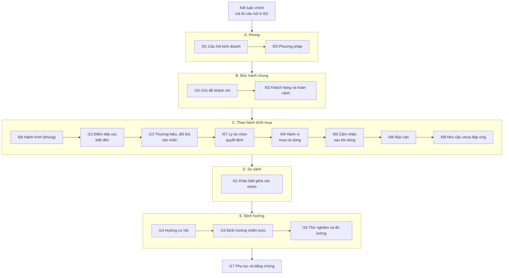
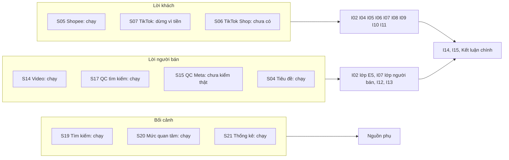
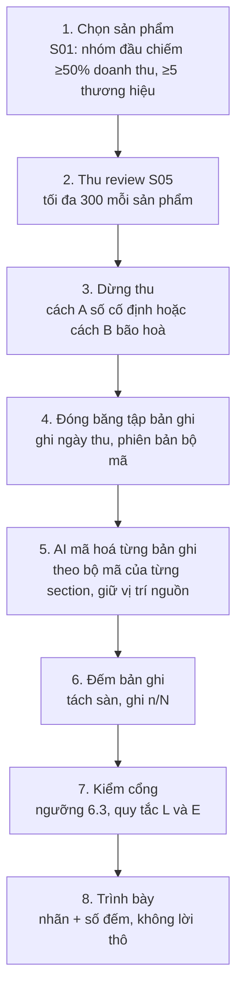
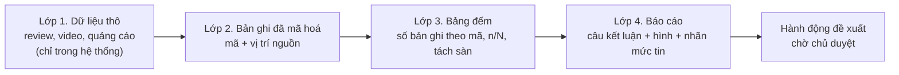
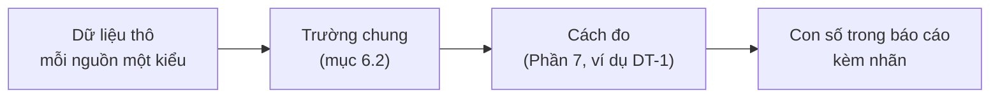
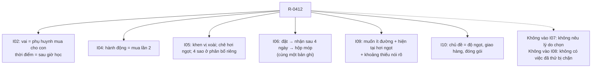
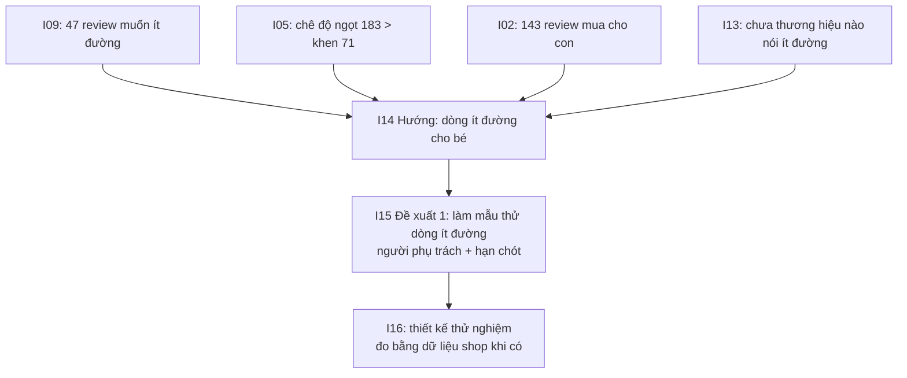
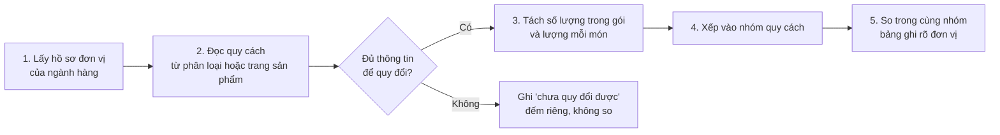
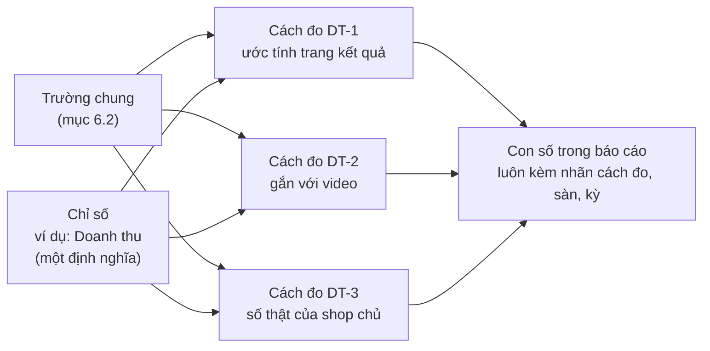

# Báo cáo Insight: mỗi section trả lời câu hỏi gì

Bản nháp 20/10/2026, dùng để bàn nghiệp vụ. Cập nhật 21/10/2026: mục 6.2 thành từ điển trường (lớp 2), khớp với mã; Phần 7 sửa theo kết quả kiểm mã và tra tài liệu nguồn, thêm chỉ số quảng cáo và số nền. Đây là bản đầu tiên trong repo.

- **Căn cứ:** Ultimate Method v1.12 (mục 5 và mục 6) và bảng nguồn "Input data sources for 30 sections".
- **Ví dụ:** dùng sản phẩm thạch dừa. Mọi con số trong ví dụ là **số giả định để minh hoạ**, không phải kết quả thật.
- **Đơn vị đếm:** "bản ghi" là một review hoặc một bình luận. Báo cáo đếm bản ghi, không đếm người.
- **Chỉ số:** mỗi con số gắn với một chỉ số và một cách đo trong từ điển chỉ số (Phần 7).

Mỗi section có 4 phần:
1. **Dùng để quyết gì:** quyết định kinh doanh mà section này hỗ trợ.
2. **Câu hỏi chủ hỏi:** các câu hỏi cụ thể mà section trả lời.
3. **Câu trả lời trông như thế nào:** một ví dụ.
4. **Không trả lời:** những câu hỏi section này cố ý không trả lời, và lý do.

---

## Phần 1. Thứ tự section đề xuất

### Vấn đề của thứ tự hiện tại

Thứ tự hiện tại (I01 → I17) có 4 chỗ khó đọc:

1. **I10 "Chủ đề" nằm giữa báo cáo.** Đây là bức tranh tổng: khách nói về những chuyện gì. Người đọc nên thấy nó trước, rồi mới đi vào từng chi tiết như hành vi hay cảm nhận.
2. **I03 "Phương pháp" chen giữa I02 và I04.** Hai section này đều nói về khách hàng nhưng bị I03 tách ra.
3. **Các section về khách không theo thứ tự mua hàng.** Người đọc phải tự ghép. Đúng ra nên đi theo các bước: biết đến (I12) → cân nhắc thương hiệu (I13) → lý do chọn (I07) → mua và dùng (I04) → cảm nhận (I05) → vướng mắc (I08) → mong muốn (I09).
4. **I11 "Khác biệt giữa các nhóm" đứng trước I12 và I13.** I11 là một lăng kính cắt ngang mọi section trước nó, nên phải đứng sau tất cả các section mô tả.

### Thứ tự đề xuất



| Thứ tự mới | Mã | Section | Lý do đặt ở đây |
|---|---|---|---|
| 0 | — | Kết luận chính | Người đọc cần câu trả lời trước. |
| 1 | I01 | Câu hỏi kinh doanh | Mọi section sau phục vụ câu hỏi này. |
| 2 | I03 | Phương pháp | Người đọc cần biết mức tin trước khi đọc số. |
| 3 | I10 | Chủ đề khách nói | Bức tranh tổng, dẫn vào các phần chi tiết. |
| 4 | I02 | Khách hàng và hoàn cảnh | Biết ai nói trước khi đọc họ nói gì. |
| 5 | I06 | Hành trình | Khung cho phần C. Dữ liệu ít nên I06 chỉ ngắn. |
| 6 | I12 | Điểm tiếp xúc | Bước biết đến. |
| 7 | I13 | Thương hiệu và đối thủ | Bước cân nhắc. |
| 8 | I07 | Lý do lựa chọn | Bước quyết định mua. |
| 9 | I04 | Hành vi | Bước mua và dùng. |
| 10 | I05 | Cảm nhận và thái độ | Sau khi dùng. |
| 11 | I08 | Rào cản | Chỗ khách bị vướng. |
| 12 | I09 | Nhu cầu chưa được đáp ứng | Khoảng trống. Đây là đầu vào chính cho I14. |
| 13 | I11 | Khác biệt giữa các nhóm | Lăng kính cắt ngang phần B và C. |
| 14 | I14 | Hướng cơ hội | Gom bằng chứng thành các hướng đi. |
| 15 | I15 | Định hướng chiến lược | Đặt các phương án cạnh nhau để chủ chọn. |
| 16 | I16 | Thử nghiệm và đo lường | Cách kiểm tra phương án đã chọn. |
| 17 | I17 | Phụ lục và bằng chứng | Luôn ở cuối. |

**Giữ nguyên mã I01–I17, chỉ đổi thứ tự hiển thị.** Mã đang dùng trong code, trong các hợp đồng dữ liệu, và trong liên kết sang M11 (nhận I08 và I09). Nếu đổi mã thì phải sửa tất cả những chỗ đó.

---

## Phần 2. Câu hỏi chi tiết của từng section

Các section dưới đây xếp theo thứ tự mới.

### Kết luận chính

- **Dùng để quyết gì:** chủ đọc trong 1 phút và biết câu trả lời cho câu hỏi ở I01.
- **Câu hỏi chủ hỏi:**
  1. Câu trả lời ngắn cho câu hỏi của tôi là gì?
  2. 4–6 phát hiện quan trọng nhất là gì? Mỗi phát hiện nằm ở phần nào, hình nào, bảng nào?
  3. Mẫu rộng hay hẹp? Có đủ để tin không?
  4. Phát hiện nào chắc chắn, phát hiện nào mới là giả thuyết?
- **Câu trả lời trông như thế nào:** "Mẫu: 24 sản phẩm, 7 thương hiệu, chỉ Shopee, 01/07–30/09. Trong 2.400 bản ghi có chữ, 410 bản ghi nhắc 'ngọt quá' (xem I05, hình 3)."
- **Không trả lời:** kết luận cho cả ngành hàng khi mẫu chỉ có 1 sản phẩm hoặc 1 gian hàng.

### I01 · Câu hỏi kinh doanh

- **Dùng để quyết gì:** chốt phạm vi trước khi thu dữ liệu, để không thu thừa và không thu thiếu.
- **Câu hỏi chủ hỏi:**
  1. **Quyết định nào** sẽ dựa trên báo cáo này? Ví dụ:
     - "Có nên ra dòng thạch dừa ít đường không?"
     - "Nên đẩy Shopee hay TikTok Shop?"
     - "Có nên bán sỉ cho quán trà sữa không?"
  2. **Ai đọc và ai quyết?** Chủ shop, nhóm sản phẩm hay nhóm marketing? Mỗi người cần mức chi tiết khác nhau.
  3. **Phạm vi là gì?** Ngành hàng nào, những sản phẩm nào, sàn nào, kỳ nào (ví dụ 90 ngày gần nhất)?
  4. **Shop của chủ đang ở đâu?** Đã bán sản phẩm này chưa, hay đang tính vào ngành?
  5. **Chủ đang tin điều gì cần kiểm tra?** Ví dụ: "Tôi nghĩ khách chê vì ngọt quá."
  6. **Có ràng buộc gì?** Ngân sách, thời hạn ra quyết định, khả năng sản xuất, những thứ không thể đổi (giá vốn, bao bì đang có).
  7. **Kết quả thế nào thì chủ đổi quyết định?** Ví dụ: "Nếu chuyện ngọt xuất hiện ở ít nhất 3 thương hiệu thì tôi làm bản ít đường."
- **Câu trả lời trông như thế nào:** một khung brief gồm 5 trường bắt buộc:
  - `questionText`, `decisionToInform`, `audience`, `scope`, `knownConstraints`.
  - Trường nào thiếu thì ghi `UNSET`.
  - Nếu chủ chưa viết câu hỏi, AI soạn "câu hỏi làm việc, chờ chủ duyệt" (E7) kèm danh sách trường chủ cần bổ sung.
- **Không trả lời:** hệ thống không đặt mục tiêu kinh doanh thay chủ.

### I03 · Phương pháp nghiên cứu

- **Dùng để quyết gì:** chủ biết nên tin báo cáo tới mức nào.
- **Câu hỏi chủ hỏi:**
  1. Đã thu bao nhiêu bản ghi? Từ sàn nào, sản phẩm nào, thương hiệu nào, ngày nào?
  2. Các sản phẩm được đọc chiếm bao nhiêu phần doanh thu của nhóm sản phẩm lõi? Ngưỡng là ≥50%.
  3. Có đủ ≥5 thương hiệu không? Có đủ cả hai sàn không?
  4. Mỗi sản phẩm có bao nhiêu bản ghi có chữ? Có đủ 30 bản ghi để so giữa các sản phẩm không?
  5. Nguồn có số sao không? Có mã người viết không?
  6. Bao nhiêu bản ghi bị loại, vì sao? Lý do có thể là trùng chữ, ngoài kỳ, hoặc không liên quan đến sản phẩm (L9).
  7. Muốn thu nguồn nào mà chưa thu được, vì sao? Ví dụ: bình luận TikTok chưa thu vì chưa nạp tiền.
  8. Mỗi nguồn ở hạng tin cậy nào (A–D)?
- **Câu trả lời trông như thế nào:** bảng gồm các cột nguồn, sàn, ngày thu, số bản ghi, số sao (có/không), mã người viết (có/không), số bản ghi ngoài kỳ, hạng tin cậy. Bên dưới bảng là danh sách ngưỡng ở mục 6.3, ghi rõ đạt hay chưa đạt.
- **Không trả lời:** không nói mẫu "đại diện cho thị trường". Báo cáo không dùng khảo sát và không dùng phỏng vấn.

### I10 · Chủ đề và mối quan tâm

- **Dùng để quyết gì:** chọn chủ đề cần đào sâu. Đây cũng là chỗ thấy vấn đề chung của cả ngành, không chỉ của một sản phẩm.
- **Câu hỏi chủ hỏi:**
  1. Khách nói về những chủ đề nào? Ví dụ: vị, độ ngọt, độ dai, đóng gói, giao hàng, giá, hạn dùng.
  2. Mỗi chủ đề xuất hiện trong bao nhiêu bản ghi trên tổng số (n/N)?
  3. Với mỗi chủ đề, khách khen nhiều hơn hay chê nhiều hơn?
  4. Chủ đề nào xuất hiện ở ≥3 sản phẩm khác thương hiệu? Những chủ đề đó gọi là "vấn đề của ngành hàng". Chủ đề nào chỉ có ở 1 sản phẩm?
  5. Trong tổng số, bao nhiêu là chuyện về sản phẩm, bao nhiêu là chuyện về dịch vụ (giao hàng, shop)?
  6. Chủ đề nào hay xuất hiện cùng nhau? Ví dụ: "giao lâu" và "hộp móp".
- **Câu trả lời trông như thế nào:** bảng chủ đề với n/N và số sản phẩm, số thương hiệu có chủ đề đó. Xếp theo tần suất (E15). Nếu cách xếp chưa được duyệt thì có nhãn ngay tại câu.
- **Không trả lời:**
  - "40% khách hàng nghĩ…". Số đếm là số bản ghi, không phải số người.
  - "Giao lâu làm hộp móp". Hai chủ đề đi cùng nhau không phải là nguyên nhân.

### I02 · Khách hàng và hoàn cảnh

- **Dùng để quyết gì:** biết bán cho ai và nói với họ về hoàn cảnh nào.
- **Câu hỏi chủ hỏi:**
  1. **Ai mua?** Theo lời khách tự nói. Ví dụ: mua cho con, cho gia đình, mở quán chè, mua về bán lại.
  2. **Mua cho dịp gì?** Ăn vặt, nấu chè, làm topping trà sữa, đãi khách, ăn kiêng.
  3. **Dùng khi nào, ở đâu?** Mùa hè, dịp lễ, ở văn phòng, ở nhà.
  4. **Có những nhóm chân dung nào?** Mỗi thuộc tính của chân dung dựa trên câu trích nào? Chân dung cần ≥5 người viết đến từ ≥3 sản phẩm.
  5. **Người bán đang nhắm tới ai?** Câu này lấy từ tiêu đề, video và quảng cáo của người bán.
  6. **Hai lớp có khớp nhau không?** So nhóm người bán nhắm tới với nhóm khách thật sự mua. Đặt cạnh nhau, không gộp.
  7. **Nhóm đó lớn cỡ nào?** Dùng số liệu bối cảnh của Cục Thống kê.
  8. **Nhóm quan tâm có tuổi, giới tính, vùng thế nào so với toàn dân?** Báo cáo ra chỉ số nhân khẩu học như Facebook Audience Insights và Google Ads: phân bố tuổi × giới tính, vùng, thành thị và nông thôn, sở thích, từ khóa. Đây là số đo, không phải phần cài quảng cáo. Trường thiếu nguồn ghi "Không rõ". Xem mục 6.4, I02.
- **Câu trả lời trông như thế nào:**
  - Thẻ chân dung "Chủ quán chè nhỏ": 3 thuộc tính, mỗi thuộc tính có 1 câu trích. 7 người viết, 4 sản phẩm.
  - Bên cạnh là thẻ "Người bán nhắm tới: mẹ có con nhỏ (12 video)".
  - Dưới thẻ chân dung là thẻ chỉ số nhân khẩu học: bảng tuổi × giới tính, bảng vùng, cột "toàn dân" để so.
- **Không trả lời:**
  - Tuổi, giới, thu nhập khi khách không tự nói ra.
  - Tuổi, giới tính, vùng **của người mua**. Không nguồn nào có số này. Số nhân khẩu học là của nhóm quan tâm hoặc của toàn dân, và ghi nhãn đúng như vậy.
  - Không nêu tên hồ sơ do AI tạo (S28). Số toàn dân lấy từ S28 được dùng (chủ đồng ý 20/10), nhưng chỉ ghi "toàn dân".

### I06 · Hành trình

- **Dùng để quyết gì:** biết khách hay vấp ở bước nào trong quá trình mua.
- **Câu hỏi chủ hỏi:**
  1. Khách tự kể quá trình mua và dùng ra sao? Ví dụ: đặt hàng → chờ giao → mở hộp → dùng → mua lại.
  2. Khách hay kể bị vấp ở bước nào?
  3. Có khách kể đã mua lần 2, lần 3 không? Giữa các lần có gì thay đổi?
  4. Có khách kể đã chuyển từ thương hiệu khác sang không? Vì sao?
- **Câu trả lời trông như thế nào:** một vài chuỗi do khách tự kể, giữ đúng thứ tự khách viết. Mỗi chuỗi lấy từ một bản ghi.
- **Không trả lời:**
  - Tỷ lệ chuyển đổi, tỷ lệ rơi rụng.
  - Ghép các bản ghi khác nhau thành một hành trình.
  - Quan hệ nhân quả mà khách không nói ra.

### I12 · Điểm tiếp xúc

- **Dùng để quyết gì:** chọn kênh và định dạng nội dung để chủ thử.
- **Câu hỏi chủ hỏi:**
  1. Người bán xuất hiện ở những kênh nào? Video TikTok, livestream, quảng cáo Meta, trang shop.
  2. Video dùng định dạng gì? Nói thẳng vào máy, khách chia sẻ, hướng dẫn nấu, theo trend. Mỗi định dạng có bao nhiêu video?
  3. 3–5 giây đầu video nói gì? Trích nguyên văn, kèm mốc giây.
  4. Video kêu gọi khách làm gì? Bình luận, nhắn tin, mua ngay, gọi điện.
  5. Khách tự kể biết sản phẩm qua đâu? Ví dụ: "xem live", "thấy trên TikTok".
  6. Mỗi video có số bán bao nhiêu? Đặt cạnh nội dung của chính video đó, kèm ngày lấy số.
- **Câu trả lời trông như thế nào:** bảng định dạng × số video, đặt cạnh số bán của chính các video đó. Mọi số chỉ mô tả trong mẫu.
- **Không trả lời:** kênh nào hiệu quả hơn, ROI, nhân quả. Những câu này cần một thử nghiệm riêng (I16).

### I13 · Thương hiệu và đối thủ

- **Dùng để quyết gì:** chọn cách định vị khác với đối thủ.
- **Câu hỏi chủ hỏi:**
  1. Những thương hiệu nào đang bán nhiều? Tập đối thủ lấy tự động từ số bán (E11).
  2. Mỗi thương hiệu tự định vị ra sao? Câu ghi trong báo cáo có dạng: "Người bán định vị là…".
  3. Khách nhắc thương hiệu nào? Khen, chê gì riêng thương hiệu đó?
  4. Khách có so sánh thương hiệu này với thương hiệu khác không? Ví dụ: "ngon hơn hãng X".
  5. Người bán tự nêu và tự trả lời lo ngại nào của khách? Ví dụ: "có chất bảo quản không?".
  6. Có thông điệp nào chưa thương hiệu nào nói? Câu trả lời cho câu này luôn gắn nhãn giả thuyết.
- **Câu trả lời trông như thế nào:** bảng thương hiệu gồm các cột: thông điệp cốt lõi, lo ngại người bán tự nêu, khách khen, khách chê, số bản ghi. Thương hiệu lấy từ tiêu đề thì ghi "theo tiêu đề người bán".
- **Không trả lời:** mức độ nhận biết thương hiệu, mức độ ưa thích, thị phần.

### I07 · Lý do lựa chọn

- **Dùng để quyết gì:** chọn thông điệp bán hàng dựa trên lý do khách thật sự nói.
- **Câu hỏi chủ hỏi:**
  1. Khách tự nói vì sao chọn mua? Ví dụ: rẻ, ngon, quen dùng, đang có khuyến mãi, người quen giới thiệu, xem review.
  2. Bao nhiêu bản ghi có nêu lý do? Bao nhiêu bản ghi không nêu?
  3. Lý do khác nhau thế nào giữa các sản phẩm, các thương hiệu?
  4. Người bán nhấn mạnh lý do gì? Lý do đó có khớp với lý do khách nêu không?
- **Câu trả lời trông như thế nào:** "38/2.400 bản ghi nêu trực tiếp lý do mua. Người bán nhấn mạnh 'không chất bảo quản' (đặt cạnh, không gộp)." Nếu không có bản ghi nào nêu lý do thì ghi "0 bản ghi nêu trực tiếp lý do mua".
- **Không trả lời:** suy lý do từ việc khách đã mua.

### I04 · Hành vi

- **Dùng để quyết gì:** chọn quy cách đóng gói, combo, chương trình mua lại.
- **Câu hỏi chủ hỏi:**
  1. Mỗi lần khách mua bao nhiêu? 1 hộp, 1 thùng hay theo kg?
  2. Bao nhiêu bản ghi nói **đã** mua lại? Bao nhiêu bản ghi chỉ nói **sẽ** mua lại?
  3. Khách dùng sản phẩm thế nào? Ăn liền, làm topping hay nấu chè?
  4. Khách bảo quản thế nào? Có để tủ lạnh không, dùng hết trong bao lâu?
  5. Có hành vi săn mã, chờ đợt giảm giá, mua combo, mua tặng không?
- **Câu trả lời trông như thế nào:** bảng hành vi theo n/N. Hai cột "đã mua lại" và "ý định mua lại" để tách riêng.
- **Không trả lời:** động cơ phía sau hành vi. Lý do mua nằm ở I07.

### I05 · Cảm nhận và thái độ

- **Dùng để quyết gì:** biết phải sửa gì ở sản phẩm và dịch vụ.
- **Câu hỏi chủ hỏi:**
  1. Khách khen gì, chê gì về chính sản phẩm? Vị, độ ngọt, độ dai, mùi.
  2. Khách khen gì, chê gì về đóng gói, giao hàng, cách shop phục vụ?
  3. Số sao phân bố thế nào? Có bản ghi 5 sao mà chữ lại chê không?
  4. Khen hoặc chê có kèm điều kiện không? Ví dụ: "ngon nếu để lạnh".
  5. Hàng nhận được có giống mô tả không? Ví dụ: "khác ảnh".
- **Câu trả lời trông như thế nào:** bảng gồm các cột khía cạnh, khen (n), chê (n), có điều kiện (n). Phân bố số sao là một hình riêng.
- **Không trả lời:** suy cảm nhận từ số sao. Câu "chưa nhận hàng" không tính là lời chê.

### I08 · Rào cản

- **Dùng để quyết gì:** chọn vấn đề cần gỡ trước. I08 cũng là đầu vào cho M11 "Cơ hội" của Market.
- **Câu hỏi chủ hỏi:**
  1. Khi dùng, khách vướng ở đâu? Ví dụ: khó mở nắp, hộp rò nước, hạn dùng ngắn, khó bảo quản.
  2. Khi mua, khách vướng ở đâu? Ví dụ: phí giao cao so với giá hàng, đơn tối thiểu.
  3. Rào cản nào xuất hiện ở ≥3 sản phẩm khác thương hiệu (của ngành)? Rào cản nào chỉ ở 1 sản phẩm?
  4. Người bán đang trả lời những lo ngại nào? Đặt cạnh.
- **Câu trả lời trông như thế nào:** danh sách rào cản. Mỗi rào cản ghi việc khách đã thử, trở ngại cụ thể, số bản ghi, số sản phẩm.
- **Không trả lời:**
  - Một lời chê không kèm việc khách đã thử thì không tính là rào cản.
  - Không tính tỷ lệ phổ biến khi chưa có khung chọn mẫu.

### I09 · Nhu cầu chưa được đáp ứng

- **Dùng để quyết gì:** tìm ý tưởng sản phẩm mới hoặc cải tiến. I09 là đầu vào chính cho I14 và cho M11.
- **Câu hỏi chủ hỏi:**
  1. Khách mong gì mà sản phẩm hiện tại chưa có? Ví dụ: "giá có loại ít đường", "ước có hộp nhỏ".
  2. Mong muốn đó xuất hiện ở mấy sản phẩm, mấy thương hiệu? Có phải nhu cầu của ngành không?
  3. Bản ghi nào có nghĩa chưa chắc? Có những cách hiểu nào?
- **Câu trả lời trông như thế nào:** danh sách nhu cầu. Mỗi nhu cầu ghi mong muốn, thực trạng, chỗ thiếu, câu trích, số sản phẩm. Bản ghi có nghĩa chưa chắc có nhãn "chưa đủ bằng chứng".
- **Không trả lời:** những thứ sau không tính là nhu cầu chưa đáp ứng:
  - không thấy trong mẫu;
  - tìm kiếm ra 0 kết quả;
  - sản phẩm bán ít;
  - một lời than lẻ.

### I11 · Khác biệt giữa các nhóm

- **Dùng để quyết gì:** chọn có làm riêng sản phẩm hoặc thông điệp cho từng nhóm hay không.
- **Câu hỏi chủ hỏi:**
  1. Khách Shopee và khách TikTok Shop khác nhau thế nào về chủ đề, cảm nhận, lý do mua?
  2. Khách mua sỉ (quán, mua về bán) khác khách mua lẻ ở điểm nào?
  3. Chủ có muốn so thêm nhóm nào khác không? Ví dụ: phân khúc giá thấp với giá cao. Nếu có, chủ phải định nghĩa nhóm trước khi xem số.
  4. Chênh lệch có đủ lớn để đọc không? Mỗi nhóm cần ≥30 bản ghi. Ở mức 30 bản ghi, sai số khoảng ±18 điểm phần trăm.
- **Câu trả lời trông như thế nào:** hai cột đặt cạnh nhau. Mỗi cột ghi mẫu số riêng.
- **Không trả lời:**
  - Kết luận thống kê.
  - Cộng gộp hai sàn.

### I14 · Hướng cơ hội

- **Dùng để quyết gì:** chọn 1–3 hướng để bàn tiếp.
- **Câu hỏi chủ hỏi:**
  1. Từ các phát hiện, có những hướng nào? Ví dụ: dòng ít đường, cải tiến đóng gói, bán sỉ cho quán.
  2. Với mỗi hướng:
     - bằng chứng ủng hộ là gì (section nào, n/N)?
     - bằng chứng phản bác là gì?
     - còn thiếu bằng chứng gì?
  3. Mỗi hướng vướng gì khi thực hiện?
  4. Hướng nào do chủ đặt, hướng nào do AI nêu?
- **Câu trả lời trông như thế nào:** mỗi hướng là một thẻ có 3 cột: ủng hộ, phản bác, còn thiếu. Hướng do AI nêu có nhãn "hướng AI đề xuất, chờ chủ duyệt".
- **Không trả lời:** xếp hạng các hướng khi chủ chưa cho tiêu chí.

### I15 · Định hướng chiến lược

- **Dùng để quyết gì:** chủ chọn phương án cho câu hỏi ở I01.
- **Câu hỏi chủ hỏi:**
  1. Với câu hỏi ở I01, có những phương án nào?
  2. Đặt các phương án cạnh nhau: bằng chứng, rủi ro, nguồn lực cần, thời gian.
  3. Với mỗi đề xuất (tối đa 3): ai phụ trách, hạn chót là khi nào?
  4. Chủ cần quyết gì tiếp? Cần thêm dữ liệu gì?
- **Câu trả lời trông như thế nào:** bảng các phương án, cùng một bộ bằng chứng. Mỗi đề xuất có nhãn "đề xuất, chờ chủ duyệt".
- **Không trả lời:**
  - Tự chọn phương án thay chủ.
  - Tự chấm điểm khi chủ chưa cho trọng số.

### I16 · Thử nghiệm và đo lường

- **Dùng để quyết gì:** biết làm sao kiểm tra phương án đã chọn có đúng không.
- **Câu hỏi chủ hỏi:**
  1. Muốn biết phương án X có hiệu quả không thì đo chỉ số gì? So với cái gì? Trong bao lâu? Cần cỡ mẫu bao nhiêu?
  2. Cần dữ liệu gì mà hiện chưa có? Ví dụ: dữ liệu shop của chủ (S12).
- **Câu trả lời trông như thế nào:** bản thiết kế thử nghiệm, ghi "chưa chạy" (`DESIGN_ONLY`), kèm danh sách dữ liệu còn thiếu.
- **Không trả lời:**
  - Kết quả thử nghiệm.
  - Mức tăng tính từ dữ liệu quan sát.
  - Đề xuất đặt hàng thử.

### I17 · Phụ lục và bằng chứng

- **Dùng để quyết gì:** kiểm lại bất kỳ ý nào trong báo cáo.
- **Câu hỏi chủ hỏi:**
  1. Ý này lấy từ bản ghi nào?
  2. Đã dùng những bản ghi nào? Bản nào ngoài kỳ, bản nào trùng?
  3. Bản ghi nào bị loại, vì sao?
  4. Báo cáo dùng nguồn nào, hạng tin cậy nào, cỡ mẫu bao nhiêu? Có giới hạn gì? Những gì chưa thu được?
- **Câu trả lời trông như thế nào:** bảng tra ngược theo dạng ý → section → bản ghi.
- **Không trả lời:** "đã chứng minh". `RESOLVED` chỉ nghĩa là bản ghi nguồn tồn tại.

---

## Phần 3. Điểm cần chốt với đồng nghiệp

1. **Thứ tự mới.** Đồng nghiệp có đồng ý đi theo hành trình mua (phần C) không? Có đồng ý giữ nguyên mã, chỉ đổi thứ tự hiển thị không?
2. **I06 có nên đứng riêng không.** Dữ liệu cho I06 rất ít vì chỉ ghép trong cùng một bản ghi. Có hai cách:
   - giữ I06 làm khung mở đầu phần C;
   - gộp I06 thành một đoạn mở đầu của phần C.
3. **I11 khi chỉ có Shopee.** Hiện chưa có dữ liệu TikTok, nên không so được giữa hai sàn. Khi đó chỉ còn so mua sỉ với mua lẻ. Giữ hay ẩn I11?
4. **Câu trích nguyên văn.** Chủ quyết ngày 19/10 là không đưa lời khách thô vào báo cáo. Nhưng I02 (chân dung), I09 và I17 cần câu trích. Đề xuất: được dùng câu trích đã gán mã, cấm dồn khối lời thô.

---

## Phần 4. Nguồn đang có giải quyết được section nào

**Căn cứ:**
- Trạng thái nguồn lấy từ `quy-chuan-du-lieu-dau-vao.md` (bản mới nhất ngày 20/10).
- Bảng "section dùng nguồn nào" lấy từ "Input data sources for 30 sections".

### 4.1 Trạng thái nguồn cho Insight

| Nhóm | Nguồn | Insight dùng vào việc gì |
|---|---|---|
| **Đang chạy, dùng được ngay** | S05 Đánh giá Shopee. Bật trên máy chủ từ 20/10. Tối đa 300 đánh giá mỗi sản phẩm. | Lời khách: nguồn chính của I02, I04–I10 |
| | S14 Xem video bán hàng. Tối đa 10 video, mỗi video tối đa 180 giây. | Lời người bán: I02 (lớp E5), I12, I13 |
| | S17 Thư viện quảng cáo trên công cụ tìm kiếm | Lời người bán: I12, I13 |
| | S19 Tìm kiếm mở rộng (gồm S13 bài viết, S26 báo chí) | Nguồn phụ: I05, I07, I08, I12, I13 |
| | S20 Mức quan tâm tìm kiếm | Nguồn phụ của I10 (từ khoá nào đang được tìm) |
| | S21 Số liệu Cục Thống kê | Nguồn phụ của I02, I12. Không dùng cho I11 (E12) |
| | S01, S04 Số bán và trang sản phẩm | Chọn sản phẩm để đọc review. Tiêu đề người bán dùng cho I07, I13 |
| **Bật, chưa kiểm thật** | S15 Thư viện quảng cáo Meta | Lời người bán: I12, I13. Cần một lần chạy thật |
| | S02 Video bán hàng có số bán | Đặt nội dung video cạnh số bán (I12, E5). Có lại điểm từ 19/10 |
| **Dừng vì tiền** | S07 Bình luận TikTok | Lời khách phía TikTok. Thiếu nguồn này thì Insight chỉ có lời khách từ Shopee |
| **Chưa có đường thu** | S06 Đánh giá TikTok Shop | Lời khách TikTok Shop. Cần tìm công cụ |
| | S18 Trang Facebook thương hiệu | I13. Chủ chưa quyết làm |
| | S10 Bài đăng trên X | Nguồn phụ, làm sau cùng |
| | S12 Dữ liệu shop của chủ | Nguồn duy nhất để I16 có kết quả thật. Chủ quyết không nhờ gửi tay |
| | S28 Hồ sơ người Việt do AI viết | Gợi ý ngầm cho AI nên tìm tình huống nào. Số "toàn dân" (tuổi, giới tính, vùng) ở I02 (chủ đồng ý 20/10). Không là bằng chứng về người mua, không nêu tên |
| **Không dùng cho Insight** | S08 Facebook (chủ dừng), S09 Instagram (không có công cụ), S11 YouTube (chủ bỏ 17/10), S16 Quảng cáo TikTok (không dùng cho I12), S27 dịch vụ thứ ba | — |

### 4.2 Section nào trả lời được hôm nay

Ký hiệu:
- **Được:** đủ nguồn chính.
- **Một phần:** trả lời được nhưng thiếu một mặt quan trọng.
- **Chưa:** chưa có nguồn chính.

Section xếp theo thứ tự hiển thị mới (Phần 1).

| Section | Nguồn chính đang có | Mức | Thiếu gì |
|---|---|---|---|
| Kết luận chính | Kết quả của các section dưới | Một phần | Mẫu chỉ có Shopee. Giới hạn này phải là điểm đầu tiên |
| I01 Câu hỏi kinh doanh | Không cần nguồn. AI soạn câu hỏi làm việc (E7) | Được | Chủ duyệt câu hỏi |
| I03 Phương pháp | Mọi nguồn đã thu | Được | — |
| I10 Chủ đề | S05; phụ S20 | Được | Lời khách TikTok (S06, S07) |
| I02 Khách hàng và hoàn cảnh | S05; lớp E5 từ S14, S17 (S15 khi chạy thật) | Một phần | Review sàn ít nói người mua là ai. Bình luận video (S07) có nhiều hoàn cảnh hơn |
| I06 Hành trình | S05 | Được, nhưng ít dữ liệu | Chỉ ghép trong cùng một bản ghi |
| I12 Điểm tiếp xúc | S14, S17; phụ S19, S21 | Được (chỉ PRESENCE) | S15 chưa kiểm thật; S07 thiếu |
| I13 Thương hiệu và đối thủ | S05, S14, S17, S04; phụ S19 | Được phần lớn | S15 chưa kiểm thật; S18 chưa có |
| I07 Lý do lựa chọn | S05; lớp người bán từ S04, S14 | Được | Lý do nêu trực tiếp thường ít |
| I04 Hành vi | S05 | Được | Hành vi phía TikTok |
| I05 Cảm nhận | S05 kèm số sao | Được | — |
| I08 Rào cản | S05 | Được | Phản bác trong bình luận video (S07). I08 cấp cho Market M11 |
| I09 Nhu cầu chưa đáp ứng | S05 | Được, nhưng hiếm | Cần cả mong muốn và thiếu hụt trong cùng bản ghi |
| I11 Khác biệt giữa các nhóm | S05 | Một phần | Không so được hai sàn. Chỉ so sỉ và lẻ khi bản ghi tự nói |
| I14 Hướng cơ hội | Tổng hợp | Được (nhãn đề xuất) | Chủ duyệt hướng |
| I15 Định hướng chiến lược | Tổng hợp | Được (tối đa 3 đề xuất) | Chủ duyệt |
| I16 Thử nghiệm và đo lường | Không có | Chưa (chỉ bản thiết kế) | S12 dữ liệu shop của chủ |
| I17 Phụ lục | Mọi nguồn | Được | — |

### 4.3 Ba điểm cần biết

1. **Lời khách hôm nay chỉ đến từ Shopee.** Ngưỡng "Hai sàn" ở mục 6.3 chưa đạt. Kết luận chính và I03 phải ghi rõ điều này.
2. **Nạp tiền cho S07 mở được nhiều section nhất.** S07 là nguồn chính của I02, I04, I05, I07, I08, I09, I10, I12 và I13.
3. **I16 không có cách giải bằng nguồn công khai.** Nếu chủ không gửi dữ liệu shop, I16 chỉ là bản thiết kế thử nghiệm.



---

## Phần 5. Method cụ thể từng section

### 5.1 Đường xử lý chung cho lời khách

Các section lời khách (I02, I04–I11) dùng chung một đường xử lý. Mỗi section chỉ khác ở bước 5: mã hoá trường nào và theo quy tắc nào.



**Chi tiết các bước:**

1. **Chọn sản phẩm.**
   - Lấy từ S01 các sản phẩm cộng dồn chiếm ≥50% doanh thu nhóm lõi (cách C: ≥80% khi cần phủ rộng).
   - Cần ≥5 thương hiệu. Chọn trải đều thương hiệu, không dồn vào một thương hiệu.
2. **Thu review.** Thu S05, tối đa 300 review mỗi sản phẩm. Giữ số sao và mã người viết ẩn danh.
3. **Dừng thu.**
   - Cách A: đạt số cố định.
   - Cách B: đọc theo lô 25 review có chữ. Dừng khi lô mới thêm ≤5% mã chủ đề mới.
   - Lấy cách nào đến trước.
4. **Đóng băng.** Sau khi đóng băng, không thêm và không bớt bản ghi. Ghi ngày thu theo giờ Việt Nam. Đánh dấu bản ghi ngoài kỳ và bản ghi trùng nguyên văn.
5. **Mã hoá.**
   - AI đọc từng bản ghi và gán mã theo bộ mã có phiên bản.
   - Mỗi mã giữ vị trí nguồn: mã bản ghi và đoạn chữ.
   - Một bản ghi được nhiều mã khi bộ mã cho phép.
6. **Đếm.**
   - Đếm bản ghi, không đếm người.
   - Mỗi sàn đếm riêng. Không cộng Shopee và TikTok.
   - Ghi n/N khi mẫu số đầy đủ.
   - Lượng và giá quy về một đơn vị chuẩn trước khi so (mục 6.6). Dòng chưa quy đổi được đếm riêng.
   - Mỗi con số mang mã cách đo (Phần 7). Chỉ so hoặc cộng các số cùng cách đo.
7. **Kiểm cổng.**
   - So giữa sản phẩm chỉ khi mỗi sản phẩm có ≥30 review có chữ.
   - Gọi là vấn đề "của ngành hàng" chỉ khi vấn đề có ở ≥3 sản phẩm khác thương hiệu. Dưới mức đó ghi "của sản phẩm".
8. **Trình bày.**
   - Báo cáo hiện nhãn đã mã hoá và số đếm.
   - Lời khách thô không vào báo cáo (chủ quyết 19/10).
   - Vị trí nguồn nằm ở I17.

### 5.2 Đường xử lý chung cho lời người bán

Lời người bán dùng cho I12, I13, lớp E5 của I02 và lớp "người bán nhắm tới" của I07.

1. **Chọn thương hiệu.** Tập đối thủ lấy tự động từ dữ liệu bán hàng theo E11.
2. **Thu.**
   - S14: tối đa 10 video. Ưu tiên phụ đề có sẵn để chuyển giọng nói thành chữ.
   - S17: tối đa 3 thương hiệu.
   - S15: tối đa 2 thương hiệu, sau khi có lần chạy thật.
3. **Đọc.** AI trả lời 10 câu hỏi ở mục 6.2 cho từng video hoặc quảng cáo. Mỗi câu trả lời ghi mốc giây hoặc vị trí nguồn.
4. **Gắn nhãn.** Mọi kết quả ghi là "người bán nói…" hoặc "người bán nhắm tới…" (L7). Không trộn với lời khách.
5. **Đếm.**
   - Đếm số video hoặc quảng cáo có một đặc điểm, trong tập cố định.
   - Một video chỉ cho kết luận ở mức video.

### 5.3 Method từng section

Mỗi section có 3 phần: **Đầu vào**, **Cách làm**, **Kiểm trước khi đưa ra**. Section xếp theo thứ tự hiển thị mới.

#### Kết luận chính (E6)

- **Đầu vào:** kết quả đã kiểm của mọi section.
- **Cách làm:**
  - AI chọn 4–6 phát hiện.
  - Mỗi phát hiện trỏ tới section, hình hoặc bảng.
  - Ghi phạm vi: số sản phẩm, sàn, kỳ, ngày thu.
- **Kiểm trước khi đưa ra:**
  - Nếu mẫu hẹp (ví dụ chỉ Shopee), giới hạn đó là điểm đầu tiên.
  - Số đếm theo bộ mã chưa duyệt có nhãn ngay tại câu.
  - Không có insight kiểu ý tưởng quảng cáo (ghi nhận 20/10).

#### I01 · Câu hỏi kinh doanh

- **Đầu vào:** brief của chủ. Nếu không có brief, AI dùng tên sản phẩm và báo cáo Market.
- **Cách làm:**
  - Điền 5 trường: câu hỏi, quyết định, người đọc, phạm vi, ràng buộc.
  - Trường nào thiếu thì ghi `UNSET`.
  - Khi chủ chưa viết câu hỏi, AI soạn "câu hỏi làm việc" (E7).
- **Kiểm trước khi đưa ra:** câu hỏi AI soạn có nhãn "chờ chủ duyệt", kèm danh sách trường chủ cần bổ sung.

#### I03 · Phương pháp

- **Đầu vào:** nhật ký thu của từng nguồn.
- **Cách làm:** máy tự lập bảng. Mỗi nguồn một dòng, gồm:
  - nền tảng;
  - ngày thu;
  - số bản ghi;
  - có hay không có số sao và mã người viết;
  - số bản ghi ngoài kỳ;
  - cách dừng thu (A hoặc B).
- **Kiểm trước khi đưa ra:**
  - Ghi rõ nguồn nào chưa thu và lý do. Ví dụ: "bình luận TikTok chưa thu: chưa nạp tiền".
  - Không tuyên bố mẫu đại diện.

#### I10 · Chủ đề và mối quan tâm

- **Đầu vào:** S05 đã đóng băng; phụ S20.
- **Cách làm:**
  1. AI đọc hai lô đầu và đề xuất bộ mã chủ đề.
  2. Bộ mã được khoá kèm số phiên bản.
  3. Mã hoá toàn bộ tập bản ghi.
  4. Đếm số bản ghi có mỗi chủ đề, theo từng sản phẩm và từng sàn. Xếp theo E15.
  5. Đặt S20 cạnh, ở dạng bối cảnh "từ khoá nào đang được tìm". Không cộng với số review.
- **Kiểm trước khi đưa ra:**
  - Nhãn ô có sẵn trong mẫu đánh giá ("Hương vị:") không quyết định chủ đề.
  - Không đọc số thành "% khách hàng".
  - Hai chủ đề hay đi cùng nhau không có nghĩa là cái này gây ra cái kia.
  - Bộ mã chưa kiểm chéo thì ghi "nháp" (L3).

#### I02 · Khách hàng và hoàn cảnh

- **Đầu vào:**
  - Lớp lời khách (E4): S05.
  - Lớp người bán nhắm tới (E5): S14, S17, S15.
  - Gợi ý ngầm và số toàn dân: S28.
- **Cách làm:**
  1. AI tìm trong mỗi review 4 thuộc tính, chỉ khi review nói ra: vai, việc, thời điểm, bối cảnh. Ví dụ: "mua cho con", "ăn trưa văn phòng".
  2. Đếm bản ghi có mỗi thuộc tính.
  3. Chân dung chỉ ghép từ các thuộc tính có thật. Mỗi thuộc tính có thẻ bằng chứng: nhãn, số bản ghi, vị trí nguồn.
  4. Lớp E5 lấy từ câu hỏi "Khách hàng mục tiêu" ở mục 6.2. Lớp này hiện ở một khối riêng.
  5. S28 chỉ gợi ý cho AI nên tìm tình huống nào. Tình huống phải có trong lời khách thật mới được ghi.
  6. Lập thẻ chỉ số nhân khẩu học (mục 6.4, I02):
     - Cột "toàn dân": đếm S28 theo nhóm tuổi của Google, giới tính, 6 vùng, thành thị và nông thôn.
     - Cột "nhóm quan tâm": ước tính tệp khách của Meta theo sở thích của ngành hàng. Chưa có tài khoản quảng cáo thì ghi "Chưa có số".
     - Cột "so với toàn dân" = tỉ lệ nhóm quan tâm ÷ tỉ lệ toàn dân. Chỉ tính khi có cả hai cột.
     - Nơi tìm nhiều lấy từ S12. Sở thích lấy từ review, video. Từ khóa lấy từ S12 và kết quả tìm kiếm.
- **Kiểm trước khi đưa ra:**
  - Chân dung cần ≥5 người viết khác nhau, đến từ ≥3 sản phẩm hoặc thương hiệu.
  - Không trộn hai lớp.
  - Không nêu tên S28.
  - Thẻ chỉ số có đủ các dòng. Mỗi số ghi loại số (toàn dân, nhóm quan tâm, lời khách). Dòng không có số ghi "Không rõ" hoặc "Chưa có số".
  - Tỉnh của Meta gộp về 6 vùng trước khi so với toàn dân. Chỉ so tuổi từ 18.

#### I06 · Hành trình

- **Đầu vào:** S05.
- **Cách làm:**
  1. AI tìm review kể trước và sau trong cùng một bản ghi. Ví dụ: "đặt hôm thứ 2, nhận thứ 5, mở ra thấy móp". Gắn nhãn `SOURCE_EXPLICIT_SAME_RECORD`.
  2. Ghi các bước theo đúng thứ tự khách viết.
  3. Đếm số bản ghi có mỗi bước.
- **Kiểm trước khi đưa ra:**
  - Không nối review của hai người thành một hành trình.
  - Không tự thêm "vì… nên…" khi khách không nói.
  - Không tính tỷ lệ rơi rụng.

#### I12 · Điểm tiếp xúc

- **Đầu vào:** S14, S17; S15 khi có lần chạy thật; phụ S19, S21.
- **Cách làm:**
  1. Theo mục 6.2, mỗi video ghi: định dạng, câu mở đầu 3–5 giây kèm mốc giây, lời kêu gọi.
  2. Đếm số video hoặc quảng cáo có mỗi điểm tiếp xúc. Trạng thái là PRESENCE (có xuất hiện).
  3. Khi có S02, đặt số bán của chính video đó bên cạnh, ở dạng mô tả trong mẫu.
- **Kiểm trước khi đưa ra:**
  - Không viết "kênh này hiệu quả hơn".
  - Không lấy số sự kiện chia số sự kiện rồi gọi là tỷ lệ chuyển đổi.

#### I13 · Thương hiệu và đối thủ

- **Đầu vào:** S05 (khách nhắc thương hiệu), S04 (tiêu đề), S14, S17, S15; phụ S19.
- **Cách làm:**
  1. Tập đối thủ lấy tự động theo E11.
  2. Đếm số review nhắc tới mỗi thương hiệu, theo từng sàn.
  3. Mỗi thương hiệu ghi: thông điệp cốt lõi, định vị, nỗi đau mà người bán nêu (mục 6.2).
  4. Lập bảng so cạnh nhau giữa các thương hiệu.
- **Kiểm trước khi đưa ra:**
  - Thương hiệu lấy từ tiêu đề ghi là "theo tiêu đề người bán".
  - Không nói về mức độ biết đến, mức ưa thích hay thị phần.
  - Suy luận về rủi ro gắn nhãn giả thuyết.

#### I07 · Lý do lựa chọn

- **Đầu vào:** S05; lớp người bán từ S04, S14; phụ S19.
- **Cách làm:**
  1. AI tìm review nêu trực tiếp lý do chọn. Ví dụ: "chọn vì ít ngọt", "mua vì đang giảm giá".
  2. Review không nêu lý do được tính vào `reasonNotStated`.
  3. Đếm số bản ghi theo mỗi lý do.
  4. Lý do người bán nhấn mạnh hiện ở một cột riêng, cạnh lý do của khách.
- **Kiểm trước khi đưa ra:**
  - Nếu không có review nào nêu lý do, ghi "0 bản ghi nêu trực tiếp lý do mua".
  - Không lấy việc đã mua để suy ra lý do.

#### I04 · Hành vi

- **Đầu vào:** S05.
- **Cách làm:**
  1. AI tìm hành động mà review ghi. Ví dụ: "mua lần 3", "chờ sale mới mua", "mua 5 hộp chia cho bạn".
  2. Tách hai mã: hành động đã xảy ra và ý định ("sẽ mua thêm").
  3. Đếm số bản ghi theo từng hành động.
- **Kiểm trước khi đưa ra:**
  - Ý định không tính là lần mua lại.
  - Săn khuyến mãi là hành vi, không là lý do mua.

#### I05 · Cảm nhận và thái độ

- **Đầu vào:** S05 và số sao; phụ S19.
- **Cách làm:**
  1. AI mã hoá câu khen, câu chê và câu có điều kiện. Giữ phủ định ("không ngọt lắm") và lời kể lại ("nghe nói…").
  2. Đếm số bản ghi theo cảm nhận, theo từng sản phẩm.
  3. Số sao hiện ở một biểu đồ phân bố riêng (L6).
- **Kiểm trước khi đưa ra:**
  - Không lấy số sao để suy ra cảm nhận.
  - Review chỉ báo trạng thái ("chưa nhận hàng") có mã riêng, không tính là lời chê.

#### I08 · Rào cản

- **Đầu vào:** S05; phụ S19.
- **Cách làm:**
  1. AI chỉ nhận một bản ghi khi bản ghi có cả việc khách đã thử và trở ngại cụ thể. Ví dụ: "muốn đổi vị khác nhưng shop không cho chọn".
  2. Review chỉ chê mà không có việc đã thử thì giữ ở I05.
  3. Đếm số bản ghi theo mỗi rào cản.
  4. Chuyển kết quả cho Market M11.
- **Kiểm trước khi đưa ra:**
  - Phản bác mà người bán tự nêu trong video thuộc I13, không thuộc I08.
  - Không ghi tỷ lệ phổ biến khi chưa có mẫu số.

#### I09 · Nhu cầu chưa được đáp ứng

- **Đầu vào:** S05.
- **Cách làm:**
  1. AI chỉ nhận một bản ghi khi bản ghi có đủ 3 ý: mong muốn, tình trạng hiện tại, và khoảng thiếu giữa hai ý. Ví dụ: "muốn loại không đường cho người tiểu đường mà chưa thấy".
  2. Đếm số bản ghi và số sản phẩm có nhu cầu đó.
  3. Bản ghi có nghĩa chưa chắc thì gắn "chưa đủ bằng chứng" và nêu các cách hiểu có thể.
- **Kiểm trước khi đưa ra:**
  - Không tính "không có trong mẫu", "bán ít" hay một lời than đơn lẻ là nhu cầu chưa đáp ứng.
  - Gọi là nhu cầu "của ngành hàng" chỉ khi có ở ≥3 sản phẩm khác thương hiệu.

#### I11 · Khác biệt giữa các nhóm

- **Đầu vào:** S05; S06, S07 khi có.
- **Cách làm:**
  1. Nhóm mặc định theo E11: theo sàn, và theo mua lẻ hoặc mua sỉ.
  2. Chỉ xếp bản ghi vào nhóm sỉ khi bản ghi tự nói. Ví dụ: "lấy 10 thùng về bán".
  3. So cùng một nhãn, cùng kỳ. Mỗi nhóm ghi mẫu số riêng.
  4. Hiện hai nhóm cạnh nhau (L5).
- **Kiểm trước khi đưa ra:**
  - Nhóm có quá ít bản ghi thì ghi "không đủ để so".
  - Không dùng số liệu Cục Thống kê (E12).
  - Hôm nay chỉ có Shopee, nên phần so sàn bị ẩn và có ghi lý do.

#### I14 · Hướng cơ hội

- **Đầu vào:** kết quả I02–I13.
- **Cách làm:**
  1. AI gom các phát hiện thành hướng. Ví dụ: "dòng ít ngọt cho trẻ em".
  2. Mỗi hướng liệt kê: bằng chứng ủng hộ, bằng chứng ngược lại, phần còn thiếu, điểm chặn.
  3. `priority` để trống khi chủ chưa đặt tiêu chí.
- **Kiểm trước khi đưa ra:**
  - Có nhãn "hướng AI đề xuất, chờ chủ duyệt".
  - Mỗi bằng chứng trỏ về section gốc.

#### I15 · Định hướng chiến lược

- **Đầu vào:** các hướng ở I14 và phương án chủ đưa (nếu có).
- **Cách làm:**
  1. Đặt các phương án cạnh nhau, cùng một bộ bằng chứng.
  2. AI soạn tối đa 3 đề xuất. Mỗi đề xuất có người phụ trách và hạn chót đề xuất (E2).
- **Kiểm trước khi đưa ra:**
  - Có nhãn "đề xuất, chờ chủ duyệt".
  - Thứ tự theo L4. Không chấm điểm khi chủ chưa cho trọng số.

#### I16 · Thử nghiệm và đo lường

- **Đầu vào:** hiện không có. S12 là đầu vào khi chủ có dữ liệu shop.
- **Cách làm:** chế độ `DESIGN_ONLY`. AI viết bản thiết kế thử nghiệm gồm:
  - giả thuyết lấy từ I14;
  - chỉ số cần đo;
  - nhóm so sánh;
  - thời gian chạy;
  - dữ liệu còn thiếu.

  Kết quả ghi `NOT_EXECUTED`.
- **Kiểm trước khi đưa ra:**
  - So review trước và sau một thay đổi chỉ là so sánh quan sát. Ghi rõ "không đo được hiệu quả".
  - Không đề xuất đặt hàng thử (L8).

#### I17 · Phụ lục và bằng chứng

- **Đầu vào:** mọi nguồn, bộ mã, kết quả mã hoá.
- **Cách làm:**
  1. Mỗi khẳng định trong báo cáo trỏ tới bản ghi nguồn qua mã bản ghi.
  2. Liệt kê nguồn, cỡ mẫu, hạng nguồn, giới hạn, và những gì chưa thu.
  3. Đánh dấu bản ghi ngoài kỳ và bản ghi trùng.
- **Kiểm trước khi đưa ra:**
  - Mọi con trỏ phải tồn tại.
  - Còn một điểm chưa chốt (Phần 3, điểm 4). Method gốc cho phép liệt kê nguyên văn bản ghi ở phụ lục. Chủ quyết ngày 19/10 không đưa lời thô vào báo cáo. Cách làm theo kết quả chốt điểm 4.

### 5.4 Thứ tự nên làm để mở thêm section

| Việc | Mở thêm | Ai quyết |
|---|---|---|
| Nạp tiền Apify cho S07 | Lời khách TikTok cho 9 section; I11 so được hai sàn | Chủ |
| Chạy thật S15 một lần | Lớp người bán đầy đủ hơn cho I12, I13 | Đội kỹ thuật |
| Tìm công cụ thu S06 | Đạt ngưỡng "Hai sàn" ở mục 6.3 | Đội kỹ thuật |
| Chủ gửi dữ liệu shop (S12) | I16 có kết quả thật | Chủ (hiện quyết là không) |

---

## Phần 6. Từ dữ liệu thô tới báo cáo và hành động

Phần này trả lời 4 câu hỏi cho mỗi section:
1. Dữ liệu thô mong đợi là gì?
2. Xử lý dữ liệu thô như thế nào?
3. Báo cáo viết kết quả ra sao?
4. Chủ nên làm gì tiếp (hành động đề xuất)?

**Lưu ý:**
- Mọi bản ghi và con số trong ví dụ là **giả định để minh hoạ**.
- Dữ liệu thô chỉ nằm trong hệ thống. Báo cáo chỉ hiện nhãn, số đếm và mã bản ghi (chủ quyết 19/10).

### 6.1 Bốn lớp dữ liệu



- **Lớp 1 → lớp 2:** AI đọc và gán mã. Đây là bước duy nhất dùng AI để hiểu nghĩa.
- **Lớp 2 → lớp 3:** máy đếm. Không dùng AI.
- **Lớp 3 → lớp 4:** AI viết câu từ bảng đếm. Mỗi con số trong câu phải có trong bảng.
- **Lớp 4 → hành động:** AI đề xuất. Mỗi hành động trỏ về phát hiện gốc.

### 6.2 Từ điển trường (lớp 2)

Mỗi nguồn trả dữ liệu thô theo kiểu riêng. Lớp 2 đổi dữ liệu thô thành **trường chung**. Phần 7 (chỉ số và cách đo) chỉ đọc trường chung, không đọc dữ liệu thô.



Bảng trong mục này kiểm với mã ngày 21/10/2026 (bản `b6e3848f`). Trường không có trong mã ghi "**không có**". Không ghi "dự kiến".

#### 6.2.1 Trường chung cho mọi bản ghi

| Trường chung | Nghĩa | Bắt buộc |
|---|---|---|
| `nguon` | Mã nguồn (S01…S25) | Có |
| `maBanGhi` | Mã bản ghi do nguồn cấp, hoặc do hệ thống tạo | Có |
| `san` | Sàn hoặc nền tảng: Shopee, TikTok Shop, Facebook… Không có thì ghi "không áp dụng" | Có |
| `ky` | Khoảng thời gian số liệu nói tới: từ ngày, tới ngày; hoặc năm; hoặc tháng | Có. Không rõ thì ghi "kỳ không rõ" |
| `ngayLay` | Lúc hệ thống lấy dữ liệu | Có |
| `choTro` | Vị trí trong gói nguồn: trang, dòng, ô, đoạn byte. Dùng để mở lại bằng chứng | Có |
| `trangThai` | Đọc được, thiếu, không hợp lệ, bị loại (kèm lý do) | Có |

#### 6.2.2 Trường theo 5 loại dữ liệu

| Loại | Trường thêm | Ví dụ nguồn |
|---|---|---|
| **Lời** (review, bình luận, lời trong video, chữ quảng cáo) | `chu` (nội dung), `trangThaiChu`, `vaiNguoiNoi` (khách, người bán, nhà quảng cáo) | S05, S07, S14, S16 |
| **Số đo** (doanh thu, lượt bán, giá, lượt xem, lượt thích) | `giaTri`, `chuHienThi` (chữ nguyên gốc trên trang), `donVi`, `doChinhXac` | S01, S02, S14, S16 |
| **Danh sách kết quả** (kết quả tìm, mục quảng cáo) | `viTri`, `tieuDe`, `duongDan`, `doanTrich` | S19, S15, S17 |
| **Chỉ số tương đối** (0–100) | `chiSo`, `vung`, `tuKhoa` | S20 |
| **Số nền** (vĩ mô, thương mại, thống kê nhà nước) | `giaTri`, `donVi`, `nam` hoặc `ky`, `trangThaiSo` (ước tính, sơ bộ, chính thức), `maChiTieu` | S21, S22, S23, S24 |

**Quy tắc chung:**
1. Giữ `chuHienThi` cạnh `giaTri`. Người đọc kiểm lại được số với trang gốc.
2. Ghi `donVi` rõ ràng. Không để đơn vị ngầm hiểu.
3. Thiếu thì ghi "thiếu". Không đổi thành 0.
4. Dữ liệu thô chỉ nằm trong hệ thống. Báo cáo không trích nguyên văn lời khách.

#### 6.2.3 Trường của từng nguồn (theo mã)

| Nguồn | Mã có những trường gì | Trường chung | Không có |
|---|---|---|---|
| S01 Số bán trên sàn | Mỗi số: nhãn, chữ hiển thị, giá trị, đơn vị (đồng, đếm, %), độ chính xác, sàn, kỳ, chỗ trỏ. Nhóm: tổng (doanh thu, lượt bán, số sản phẩm có bán, số shop), tách sàn, theo tháng, ngành, mức giá, tỉ trọng top 10, loại shop, vùng, sản phẩm, shop và thương hiệu hàng đầu | Số đo | Giá niêm yết và giá sau giảm không tách |
| S02 Video bán hàng (đường API) | Mã sản phẩm, tiêu đề, đường dẫn, ảnh, mô tả, kỳ quan sát; số đo doanh thu hoặc lượt bán kèm kỳ | Số đo | — |
| S04 Trang sản phẩm | **Không có bộ thu riêng.** Số đánh giá tổng và "đã bán" cộng dồn tách từ ô tên trong bảng S01, kèm tháng tạo | Số đo | Điểm sao trung bình; quy cách |
| S05 Đánh giá Shopee | Mã bản ghi, mã shop, mã sản phẩm, chữ và trạng thái chữ (đọc được, rỗng, không đọc được), số sao (4 trạng thái: không có ô, thiếu, hợp lệ, không hợp lệ), thời gian tạo, vùng, cách nhận (chọn có chữ, sản phẩm khác, chưa rõ sản phẩm, không có chữ), chỗ trỏ (trang, dòng) | Lời | **Mã người viết**; phân loại hàng; ô mẫu |
| S14 Video người bán | Bảng số: doanh thu, lượt xem, lượt bán, ngày đăng (dạng chữ). Lời nói: đoạn chữ kèm giây bắt đầu, giây kết thúc, nhãn giọng | Số đo, Lời | Mã video trong bảng số; kỳ của số |
| S15 Quảng cáo Meta | Mỗi quảng cáo: mã thư viện, trạng thái (đang chạy, đã dừng, không rõ), ngày bắt đầu. Mỗi thương hiệu: tên, mã trang (khớp đúng tên, chưa xác minh chủ sở hữu), số kết quả (chữ nguyên gốc) | Danh sách kết quả | **Chữ quảng cáo, tiêu đề, nút kêu gọi, nền tảng hiển thị, ảnh, đường dẫn** |
| S16 Quảng cáo nổi bật TikTok | Mỗi thẻ: chữ quảng cáo, tài khoản, ngành, mục tiêu, lượt thích (chữ nguyên gốc). Đếm số thẻ bị loại vì lệch chủ đề | Lời, Số đo | Chi phí, hiệu quả, tỉ lệ (bị chặn có chủ ý) |
| S17 Quảng cáo trên công cụ tìm kiếm | Theo tên miền thương hiệu: tổng kết quả, số mẫu quảng cáo, số ngày hiện lâu nhất, định dạng (chữ, hình, video), lần hiện đầu, lần hiện cuối, nguồn của tên miền | Danh sách kết quả | **Tên nhà quảng cáo**, mã, ảnh, đường dẫn (không lưu có chủ ý) |
| S19 Tìm kiếm mở rộng | Vị trí, tiêu đề, đường dẫn, đoạn trích, trang, ngày đăng | Danh sách kết quả | — |
| S20 Mức quan tâm tìm kiếm | Theo kỳ: chỉ số 0–100. Theo vùng: tên tỉnh, chỉ số | Chỉ số tương đối | Số lượt tìm |
| S21, S22 Thống kê nhà nước | Bảng, trang tính, dòng, ô, nhãn, kỳ, loại số (mức hay chỉ số), giá trị, chữ hiển thị, đơn vị, gốc so sánh, trạng thái (ước tính, sơ bộ, chính thức). Theo tỉnh: tên tỉnh, giá trị | Số nền | — |
| S23 Chỉ tiêu vĩ mô | Tên chỉ tiêu, giá trị, đơn vị, năm, ngày nguồn cập nhật, trạng thái, chú thích, chỗ trỏ, chuỗi tối đa 10 năm | Số nền | — |
| S24 Thương mại quốc tế | Mã HS, mô tả chính thức, mô tả tiếng Việt. Mỗi dòng: chiều (nước báo cáo, đối tác), nước, luồng (nhập, xuất), năm, giá trị USD | Số nền | — |
| S25 Tài liệu PDF | Đường dẫn, trạng thái, lý do, mã băm, dung lượng; đoạn trích kèm trang | Lời | — |

**Điểm lệch cần biết:**
1. Tên trường trong mã chưa thống nhất. Ví dụ: ngày lấy có 4 tên (`retrievedAt`, `readAt`, `downloadedAt`, `capturedAt`). Kỳ có 5 tên (`window`, `period`, `year`, `requestedRange`, `observedWindow`). Chỗ trỏ có 5 tên (`captureIndex`, `span`, `sourcePointer`, `locator`, `cell`). Từ điển này là tên chung. Mã đổi sang tên chung khi làm mục 7.8.
2. S05 nguồn mới không có phân loại hàng. Vì vậy quy cách (mục 6.6) chưa đọc được từ review. S04 cũng chưa có trường quy cách.
3. S15 chưa tách chữ quảng cáo. Vì vậy chưa mã hoá được thông điệp quảng cáo Meta. S16 có chữ quảng cáo.
4. S14 bảng số không có kỳ. Thiếu khoảng ngày thì ghi "kỳ không rõ".

**Ví dụ một review thô (S05, giả định):**

```json
{
  "recordId": "R-0412",
  "shopId": "SHOP-A",
  "itemId": "SP-A",
  "createdAt": "2026-09-14T13:31:00Z",
  "rating": { "state": "VALID", "value": 4 },
  "text": "Mua lần 2 cho con ăn sau giờ học. Vị xoài ngon nhưng hơi ngọt, mong shop có loại ít đường. Giao 4 ngày, hộp hơi móp.",
  "textState": "READABLE",
  "admission": "SELECTED_TEXT"
}
```

Sau lớp 2, bản ghi này có: `nguon` = S05, `maBanGhi` = R-0412, `san` = Shopee, `ngayLay` = lúc thu, `choTro` = trang và dòng, `chu` = nội dung, `vaiNguoiNoi` = khách.

Mục 6.3 và 6.4 dùng bản ghi R-0412 này làm ví dụ chung. Một review cho dữ liệu tới nhiều section.

### 6.3 Một review đi vào những section nào



### 6.4 Từng section: thô → xử lý → báo cáo → hành động

Mỗi section có 5 dòng:
- **Thô:** dữ liệu đầu vào.
- **Xử lý:** các bước biến thô thành bảng đếm.
- **Bảng đếm:** kết quả lớp 3 (giả định).
- **Báo cáo viết:** câu xuất hiện trong báo cáo.
- **Hành động đề xuất:** việc chủ có thể làm, nhãn "đề xuất, chờ chủ duyệt".

Giả định chung: 8 sản phẩm, 6 thương hiệu, chỉ Shopee, 1.840 review có chữ, thu ngày 18/10/2026.

#### I10 · Chủ đề và mối quan tâm

- **Thô:** trường `text` (chữ) của 1.840 review.
- **Xử lý:**
  1. AI đọc 2 lô đầu (50 review) và đề xuất bộ mã: vị, độ ngọt, giá, giao hàng, đóng gói, hạn dùng…
  2. Khoá bộ mã v1.
  3. AI gán mã cho từng review. Một review được nhiều mã.
  4. Máy đếm số review có mỗi mã, theo sản phẩm.
- **Bảng đếm:**

  | Chủ đề | Số review | /1.840 | Số sản phẩm có chủ đề |
  |---|---|---|---|
  | Vị | 812 | 44% | 8/8 |
  | Độ ngọt | 296 | 16% | 7/8 |
  | Đóng gói, móp hộp | 221 | 12% | 6/8 |

- **Báo cáo viết:** "Trong 1.840 review có chữ trên Shopee, 296 review (16%) nhắc tới độ ngọt. Chủ đề này có ở 7/8 sản phẩm, thuộc 5 thương hiệu, nên là chủ đề của ngành hàng. Bộ mã ở trạng thái nháp." Kèm biểu đồ cột ngang.
- **Hành động đề xuất:** đưa "độ ngọt" vào danh sách chủ đề cần đào sâu ở I05 và I09.

#### I02 · Khách hàng và hoàn cảnh

- **Thô:** `text` của S05; lời nói trong video S14.
- **Xử lý:**
  1. AI tìm 4 thuộc tính nếu review nói ra: vai, việc, thời điểm, bối cảnh.
  2. Đếm review có mỗi thuộc tính.
  3. Ghép chân dung chỉ từ thuộc tính có ≥ ngưỡng bản ghi, từ ≥3 sản phẩm.
  4. Lớp người bán: AI đọc video, trả lời "người bán nhắm tới ai", ghi mốc giây.
- **Bảng đếm:**

  | Thuộc tính | Lời khách (review) | Người bán nhắm tới (video) |
  |---|---|---|
  | Mua cho con | 143 review, 6 sản phẩm | 4/10 video |
  | Ăn vặt văn phòng | 38 review, 3 sản phẩm | 0/10 video |
  | Mua làm quà | 12 review, 2 sản phẩm | 2/10 video |

- **Báo cáo viết:**
  - Thẻ chân dung: "Phụ huynh mua cho con ăn sau giờ học. Bằng chứng: 143 review, 6 sản phẩm. Mã bản ghi xem phụ lục I17."
  - Câu so sánh: "Người bán nhắm tới phụ huynh ở 4/10 video. Không video nào nhắm tới dân văn phòng, dù 38 review nhắc tới hoàn cảnh này."
  - Giới hạn: "Review không có mã người viết, nên số trên là số review, không phải số người."
- **Thẻ chỉ số nhân khẩu học:**
  - Mục đích: cho chủ thấy nhóm quan tâm đến ngành hàng gồm ai, theo cùng các chỉ số của Facebook Audience Insights [a] và Google Ads [b]. Đây là số đo, không phải phần cài quảng cáo.
  - Ba loại số. Mỗi số ghi rõ loại:

  | Loại số | Nguồn | Nhãn trong báo cáo | Tình trạng 20/10/2026 |
  |---|---|---|---|
  | Toàn dân (mốc) | S28, không nêu tên | "toàn dân" | Đã chạy thật, 1.000.000 bản ghi |
  | Nhóm quan tâm | Ước tính tệp khách của Meta | "người quan tâm trên Facebook, ước tính của nền tảng" | Chưa có số: chưa có tài khoản quảng cáo |
  | Lời khách tự nói | Review, bình luận | "số review tự nói" | Có, nhưng ít (6/143 review ở lần thử 17/10) |

  - Bảng tuổi × giới tính. Cột toàn dân là số thật từ lần chạy 20/10/2026:

  | Nhóm tuổi | Toàn dân, nam | Toàn dân, nữ | Nhóm quan tâm, nam | Nhóm quan tâm, nữ | So với toàn dân |
  |---|---|---|---|---|---|
  | 18–24 | 6,0% | 5,9% | Chưa có số | Chưa có số | — |
  | 25–34 | 10,3% | 10,0% | Chưa có số | Chưa có số | — |
  | 35–44 | 10,8% | 10,8% | Chưa có số | Chưa có số | — |
  | 45–54 | 9,2% | 9,3% | Chưa có số | Chưa có số | — |
  | 55–64 | 6,9% | 7,6% | Chưa có số | Chưa có số | — |
  | 65+ | 5,3% | 8,0% | Chưa có số | Chưa có số | — |

  - Bảng vùng:

  | Vùng | Toàn dân | Nhóm quan tâm | So với toàn dân |
  |---|---|---|---|
  | Đồng bằng sông Hồng | 24,5% | Chưa có số | — |
  | Đông Nam Bộ | 20,8% | Chưa có số | — |
  | Bắc Trung Bộ và Duyên hải miền Trung | 17,6% | Chưa có số | — |
  | Đồng bằng sông Cửu Long | 15,5% | Chưa có số | — |
  | Trung du và miền núi phía Bắc | 12,4% | Chưa có số | — |
  | Tây Nguyên | 9,2% | Chưa có số | — |

  - Các dòng khác:

  | Chỉ số | Số trong báo cáo | Nguồn |
  |---|---|---|
  | Thành thị, nông thôn | Toàn dân: 38,6% thành thị, 61,4% nông thôn | S28 |
  | Tình trạng hôn nhân | Toàn dân: đã kết hôn 70,8%, độc thân 19,6%, góa 7,1%, ly hôn 2,5% | S28 |
  | Nơi tìm nhiều | Xếp hạng tỉnh theo mức tìm kiếm. Ghi "nơi tìm nhiều", không ghi "nơi khách sống". Không chia cho dân số, vì mức tìm kiếm đã là tỉ lệ. | S12 |
  | Làm cha mẹ | Số review tự nói ("mua cho bé") | Review |
  | Thu nhập hộ | Không rõ. Chỉ ghi phân khúc giá đã mua (đơn vị chuẩn, mục 6.6). Không đổi giá thành thu nhập. | — |
  | Sở thích, hành vi | Chủ đề và số bản ghi | Review, bình luận, video |
  | Từ khóa | Danh sách từ khóa | S12, kết quả tìm kiếm |

  - Quy tắc:
    - "So với toàn dân" = tỉ lệ nhóm quan tâm ÷ tỉ lệ toàn dân, cùng nhóm. Cách đọc: nhóm quan tâm có 16% là nữ 25–34, toàn dân 10,0%, chỉ số 1,6 ("gấp 1,6 lần tỉ lệ dân số"). Đây là số giả định để minh họa, không phải kết quả.
    - Chưa có cột nhóm quan tâm thì không tính chỉ số. Báo cáo chỉ in cột toàn dân và ghi "Chưa có số của nhóm quan tâm".
    - Tỉnh của Meta gộp về 6 vùng trước khi so. Meta tính từ 13 tuổi; chỉ so từ 18 tuổi.
    - Số toàn dân và số nhóm quan tâm không phải số người mua. Báo cáo ghi dưới thẻ: "Số nhân khẩu học là của nhóm quan tâm và của toàn dân, không phải của người mua."
    - Lời khách tự nói chỉ làm câu trích, không làm phân bố. Đếm bản ghi, không đếm người.
    - Không nêu tên S28 và các nguồn dữ liệu.
  - Nguồn chỉ số: [a] Meta, "About reaching new audiences" (facebook.com/business/help/717368264947302). [b] Google Ads, "About demographic targeting" (support.google.com/google-ads/answer/2580383). Tra ngày 20/10/2026.
- **Hành động đề xuất:** thử một nội dung video cho hoàn cảnh "ăn vặt văn phòng", vì khách có nhắc mà người bán chưa nhắm tới.

#### I06 · Hành trình

- **Thô:** `text` có kể trước và sau trong cùng một review.
- **Xử lý:**
  1. AI tách các bước theo đúng thứ tự khách viết.
  2. Gắn nhãn `SOURCE_EXPLICIT_SAME_RECORD`.
  3. Đếm review có mỗi chuỗi bước.
- **Bảng đếm:** 64 review kể nhận hàng rồi mở hộp; 41 trong số đó nhắc móp hoặc chảy nước.
- **Báo cáo viết:** "64 review kể lại bước nhận hàng và mở hộp. 41 review trong số đó nhắc hộp móp hoặc chảy nước. Đây là thứ tự khách kể, không phải tỷ lệ rơi rụng."
- **Hành động đề xuất:** kiểm lại cách đóng gói ở khâu giao hàng.

#### I12 · Điểm tiếp xúc

- **Thô:** đoạn lời nói kèm giây của 10 video S14; định dạng quảng cáo S17.
- **Xử lý:**
  1. AI xếp mỗi video vào một định dạng theo danh sách E11.
  2. Ghi câu mở đầu 3–5 giây và lời kêu gọi.
  3. Đếm số video có mỗi định dạng và mỗi lời kêu gọi.
  4. Đặt số bán của chính video đó bên cạnh (S02).
  5. Quy số bán về đơn vị chuẩn (kg) theo quy cách của sản phẩm trong video (mục 6.6). Video bán "gói 200 g" và video bán "hộp 1 kg" không cộng số đơn vị với nhau.
- **Bảng đếm:**

  | Định dạng | Số video | Số bán quy về kg | Video chưa quy đổi được |
  |---|---|---|---|
  | Nói thẳng vào máy | 5/10 | 2.100 kg | 1 |
  | Khách chia sẻ | 2/10 | 1.640 kg | 0 |
  | Hướng dẫn | 3/10 | 380 kg | 1 |

- **Báo cáo viết:** "Trong 10 video được đọc, 5 video nói thẳng vào máy. 2 video dạng khách chia sẻ bán được 1.640 kg. 2 video chưa ghi quy cách nên không tính. Đây là mô tả trong mẫu, không chứng minh định dạng nào hiệu quả hơn."
- **Hành động đề xuất:** chạy thử dạng "khách chia sẻ" và đo bằng I16 trước khi tăng ngân sách.

#### I13 · Thương hiệu và đối thủ

- **Thô:** tiêu đề S04; lời nói video S14; nội dung quảng cáo S17; review S05 có nhắc thương hiệu.
- **Xử lý:**
  1. Lấy tập đối thủ tự động (E11).
  2. AI trả lời "thông điệp cốt lõi" và "định vị" cho từng thương hiệu, kèm mốc giây.
  3. Đếm review nhắc tới mỗi thương hiệu.
  4. Lấy giá theo đơn vị chuẩn từ Market (giá mỗi kg). Không so giá niêm yết của "hộp" với giá của "gói".
- **Bảng đếm:**

  | Thương hiệu (theo tiêu đề người bán) | Thông điệp người bán | Review nhắc thương hiệu | Giá mỗi kg |
  |---|---|---|---|
  | A | "nguyên chất, không phẩm màu" | 31 | 68.000 đ |
  | B | "rẻ nhất, mua sỉ" | 12 | 41.000 đ |
  | C | "cho bé" | 27 | 95.000 đ (gói 100 g) |

- **Báo cáo viết:** "Thương hiệu A định vị là nguyên chất (3/3 video của A). Thương hiệu C nhắm tới trẻ em và có giá mỗi kg cao nhất, vì bán gói nhỏ 100 g. Không thương hiệu nào nói về ít đường."
- **Hành động đề xuất:** xét định vị "ít đường cho bé", vì chưa thương hiệu nào nói tới, trong khi I09 có nhu cầu này.

#### I07 · Lý do lựa chọn

- **Thô:** `text` nêu trực tiếp lý do chọn; tiêu đề S04 và video S14 cho lớp người bán.
- **Xử lý:**
  1. AI chỉ nhận câu có lý do nói rõ ("chọn vì…", "mua vì…").
  2. Review không nêu lý do được tính vào `reasonNotStated`.
  3. Đếm theo từng lý do.
- **Bảng đếm:** 1.840 review; 212 nêu lý do. Giảm giá 88, quen vị 61, người quen giới thiệu 34. 1.628 không nêu lý do.
- **Báo cáo viết:** "Chỉ 212/1.840 review nêu lý do mua. Lý do nhiều nhất là giảm giá (88). Người bán nhấn mạnh 'nguyên chất' ở 6/10 video, nhưng chỉ 9 review nêu lý do này."
- **Hành động đề xuất:** xem lại thông điệp "nguyên chất", vì khách ít nhắc lý do này.

#### I04 · Hành vi

- **Thô:** `text` có hành động. Quy cách: hiện **chưa có trường** (mục 6.2.3, điểm lệch 2).
- **Xử lý:**
  1. AI tách hành động đã xảy ra ("mua lần 2") và ý định ("sẽ mua thêm").
  2. Khi có trường quy cách: máy đọc quy cách và quy về kg (mục 6.6). Ví dụ: "Hộp 1kg" và "5 gói 200g" cùng là quy cách 1 kg. Bước này không cần AI. Khi chưa có: bỏ bước 2 và 3, ghi giới hạn trong I03.
  3. Máy đếm số review theo quy cách đã quy đổi.
- **Bảng đếm:** 97 review nói đã mua lại; 54 review nói sẽ mua thêm. Quy cách 1 kg: 61% review; dưới 500 g: 27%; chưa quy đổi được ("Hộp", không ghi khối lượng): 12%.
- **Báo cáo viết:** "97 review nói đã mua lại. 54 review chỉ nói sẽ mua thêm; đây là ý định, chưa là lần mua. 61% review thuộc quy cách 1 kg, gồm cả hộp 1 kg và lốc 5 gói 200 g. 12% review có phân loại không ghi khối lượng nên không xếp được."
- **Hành động đề xuất:** ưu tiên giữ hàng quy cách 1 kg.

#### I05 · Cảm nhận và thái độ

- **Thô:** `text`; `rating` (chỉ dùng số sao ở trạng thái hợp lệ).
- **Xử lý:**
  1. AI mã hoá câu khen, câu chê, câu có điều kiện cho từng khía cạnh.
  2. Máy vẽ phân bố số sao riêng.
- **Bảng đếm:** độ ngọt: 71 khen, 183 chê, 42 có điều kiện ("ngọt nhưng con thích"). Số sao: 5 sao 78%, 4 sao 14%, 1–3 sao 8%.
- **Báo cáo viết:** "Với độ ngọt, review chê (183) nhiều hơn review khen (71). Có 14% review 4 sao nhắc 'hơi ngọt'. Số sao cao không có nghĩa khách hài lòng mọi mặt."
- **Hành động đề xuất:** thêm phân loại ít đường cho sản phẩm bán chạy nhất.

#### I08 · Rào cản

- **Thô:** `text` có cả việc đã thử và trở ngại.
- **Xử lý:**
  1. AI chỉ nhận review đủ hai ý.
  2. Review chỉ chê, không có việc đã thử, ở lại I05.
  3. Gửi kết quả cho Market M11.
- **Bảng đếm:** muốn đổi vị nhưng gian hàng không cho chọn: 19; muốn hỏi hạn dùng nhưng không ai trả lời: 11.
- **Báo cáo viết:** "19 review muốn chọn vị khác nhưng gian hàng không cho chọn. 11 review hỏi hạn dùng mà không được trả lời."
- **Hành động đề xuất:** thêm phân loại "chọn vị" và ghi hạn dùng trên trang sản phẩm.

#### I09 · Nhu cầu chưa được đáp ứng

- **Thô:** `text` có đủ mong muốn, tình trạng hiện tại, và khoảng thiếu.
- **Xử lý:**
  1. AI chỉ nhận review đủ ba ý.
  2. Review nghĩa chưa chắc gắn "chưa đủ bằng chứng".
  3. Đếm số review và số sản phẩm, thương hiệu.
- **Bảng đếm:** "muốn loại ít đường": 47 review, 6 sản phẩm, 5 thương hiệu.
- **Báo cáo viết:** "47 review nói rõ muốn loại ít đường mà chưa có. Nhu cầu này có ở 6 sản phẩm của 5 thương hiệu, nên là nhu cầu của ngành hàng."
- **Hành động đề xuất:** làm mẫu thử dòng ít đường. Đây là ứng viên số 1 cho I14.

#### I11 · Khác biệt giữa các nhóm

- **Thô:** `text` có nói mua sỉ ("lấy 10 thùng về bán").
- **Xử lý:**
  1. Xếp nhóm sỉ chỉ khi review tự nói.
  2. So cùng chủ đề giữa hai nhóm. Mỗi nhóm ghi mẫu số riêng.
  3. Khi so giá hoặc lượng mua, quy "thùng" và "hộp" về kg trước (mục 6.6). Ví dụ: "thùng 24 hộp × 1 kg" = 24 kg.
- **Bảng đếm:** nhóm sỉ: 23 review, quá ít để so.
- **Báo cáo viết:** "Chỉ 23 review nói mua sỉ, chưa đủ để so với nhóm mua lẻ. Chưa so được giữa hai sàn vì chưa có dữ liệu TikTok."
- **Hành động đề xuất:** nạp tiền cho nguồn bình luận TikTok (S07) để mở phần so sàn.

#### I03 và I17 · Phương pháp và phụ lục

- **Thô:** nhật ký thu, bộ mã, bảng mã hoá.
- **Xử lý:** máy tự lập bảng. Không dùng AI.
- **Báo cáo viết:**
  - I03: "Shopee: 8 sản phẩm, 1.840 review có chữ, thu 18/10/2026. Không có mã người viết. Bình luận TikTok chưa thu vì chưa nạp tiền."
  - I17: mỗi phát hiện kèm danh sách mã bản ghi. Ví dụ: "Nhu cầu ít đường: R-0412, R-0518, …".
- **Hành động đề xuất:** không có. Hai section này để kiểm tra.

### 6.5 Từ phát hiện tới chiến lược hành động

Mỗi section ở 6.4 cho một hành động nhỏ. I14 và I15 gom các hành động đó thành chiến lược.



**Cách I14 viết một hướng:**

| Trường | Ví dụ |
|---|---|
| Hướng | Dòng ít đường cho bé |
| Bằng chứng ủng hộ | I09 (47 review, 5 thương hiệu), I05 (chê độ ngọt), I02 (143 review mua cho con), I13 (chưa ai định vị) |
| Bằng chứng ngược lại | I05: 42 review nói "ngọt nhưng con thích" |
| Còn thiếu | Lời khách TikTok; giá khách chấp nhận |
| Điểm chặn | Chưa biết chi phí làm dòng mới |
| Nhãn | Hướng AI đề xuất, chờ chủ duyệt |

**Cách I15 viết một đề xuất:**

| Trường | Ví dụ |
|---|---|
| Việc làm | Làm 1 mẫu ít đường, bán thử trên Shopee 4 tuần |
| Vì sao | Hướng "dòng ít đường cho bé" ở I14 |
| Người phụ trách (đề xuất) | Người lo sản phẩm |
| Hạn chót (đề xuất) | 30/11/2026 |
| Đo bằng gì | Thiết kế ở I16 |
| Nhãn | Đề xuất, chờ chủ duyệt |

**Quy tắc cho hành động:**
- Mỗi hành động trỏ về ít nhất một phát hiện có số đếm.
- Tối đa 3 đề xuất ở I15 (E6).
- Không viết hành động dạng ý tưởng quảng cáo cảm xúc (ghi nhận 20/10).
- Không viết lời khuyên cho đối thủ.
- Không đề xuất đặt hàng thử (L8).
- Đề xuất về giá hoặc quy cách ghi theo đơn vị chuẩn, ví dụ "giá mỗi kg" (mục 6.6).

### 6.6 Thống nhất đơn vị trước khi so sánh

**Quy tắc:** quy tắc này dùng cho mọi ngành hàng. Đơn vị là một ô trong từ điển chỉ số (Phần 7). Trước khi so sánh hoặc lập bảng, mọi số liệu về lượng và giá phải quy về **đơn vị chuẩn của ngành hàng**. Số liệu chưa quy đổi được không đưa vào phép so.

**Vì sao:**
- Một ngành hàng có nhiều cách bán. Ví dụ: thạch dừa bán theo hộp, gói hoặc thùng. Son bán theo thỏi thường, thỏi mini hoặc set 3 thỏi. Bình giữ nhiệt bán theo bình lẻ hoặc combo 2 bình.
- Nếu không quy đổi, "100 hộp" và "100 gói" bị so như nhau. "Set 3 thỏi" bị đếm là 1. Bình 350 ml bị so giá với bình 1,2 l.

#### 6.6.1 Hồ sơ đơn vị của ngành hàng

Mỗi ngành hàng có một **hồ sơ đơn vị** gồm ba ô:

| Ô | Nghĩa | Dùng để |
|---|---|---|
| Đơn vị đếm | Một món hàng khách nhận | Đếm lượng bán, lượng mua |
| Đơn vị so giá | Lượng dùng để chia giá | Tính "giá mỗi …" |
| Nhóm quy cách | Thông số chia sản phẩm thành nhóm so được | Chỉ so giá trong cùng nhóm |

Có hai loại ngành hàng:
- **Hàng dùng hết** (thực phẩm, mỹ phẩm, viên uống, tã): giá so theo lượng chứa (g, ml, viên, miếng).
- **Hàng dùng lâu** (bình, quạt, giày, nồi): giá so theo cái, đôi hoặc bộ, và **chỉ trong cùng nhóm quy cách**. Ví dụ: không so bình 350 ml với bình 1,2 l.

**Ví dụ hồ sơ đơn vị:**

| Ngành hàng | Loại | Đơn vị đếm | Đơn vị so giá | Nhóm quy cách |
|---|---|---|---|---|
| Thạch dừa | Dùng hết | kg | giá mỗi kg | Có đường / ít đường |
| Son môi | Dùng hết | thỏi | giá mỗi g | Son thỏi / son kem / son dưỡng |
| Kem chống nắng | Dùng hết | tuýp | giá mỗi ml | Dạng kem / xịt |
| Viên uống bổ sung | Dùng hết | hộp | giá mỗi viên | Thành phần chính |
| Tã em bé | Dùng hết | gói | giá mỗi miếng | Size (S, M, L…) |
| Bình giữ nhiệt | Dùng lâu | cái | giá mỗi cái | Dung tích: dưới 500 ml / 500 ml–1 l / trên 1 l |
| Quạt điện | Dùng lâu | cái | giá mỗi cái | Loại: đứng / bàn / treo / sạc |
| Giày thể thao | Dùng lâu | đôi | giá mỗi đôi | Loại: chạy bộ / đi hằng ngày |
| Bộ nồi | Dùng lâu | bộ | giá mỗi chiếc nồi | Chất liệu |

**Ai lập hồ sơ:**
1. Máy đề xuất hồ sơ từ thông số trên trang sản phẩm (S04). Ví dụ: hầu hết sản phẩm ghi "dung tích" → nhóm quy cách là dung tích.
2. Chủ xác nhận hoặc sửa. Chủ cũng có thể khai báo hồ sơ từ đầu.
3. Ngành hàng chưa có hồ sơ: chỉ đếm theo "cái" và **không so giá** giữa sản phẩm. Báo cáo ghi rõ lý do.
4. Báo cáo ghi hồ sơ đã dùng ở I03.

#### 6.6.2 Các bước quy đổi



1. **Lấy hồ sơ đơn vị** của ngành hàng (mục 6.6.1).
2. **Đọc quy cách từ nguồn.**
   - Đọc từ trường quy cách của nguồn. Ngày 21/10/2026 chưa nguồn nào có trường này (mục 6.2.3, điểm lệch 2).
   - Không đoán quy cách từ tiêu đề. Quy tắc này giống Market (bảng "Giá theo đơn vị chuẩn").
3. **Tách hai số:** số món trong gói (set, combo, lốc, thùng) và lượng mỗi món (g, ml, viên).
   - Quà tặng kèm khác loại không tính. Ví dụ: "bình + túi đựng" = 1 bình.
   - Phân loại không phải lượng (màu son, màu bình, size áo) không đổi đơn vị.
4. **Xếp vào nhóm quy cách.** Sản phẩm thiếu thông số nhóm thì ghi "chưa xếp nhóm" và không so giá.
5. **So trong cùng nhóm**, theo đơn vị so giá của hồ sơ.

**Ví dụ quy đổi nhiều ngành hàng:**

| Ngành hàng | Quy cách nguồn | Đơn vị đếm | Giá so | Nhóm |
|---|---|---|---|---|
| Thạch dừa | Lốc 5 gói × 200g, 95.000 đ | 1 kg | 95.000 đ/kg | Có đường |
| Thạch dừa | Hộp (không ghi khối lượng) | Chưa quy đổi được | — | — |
| Son môi | Set 3 thỏi × 3,5g, 420.000 đ | 3 thỏi | 40.000 đ/g | Son thỏi |
| Son môi | Thỏi mini 1,5g, 89.000 đ | 1 thỏi | 59.300 đ/g | Son thỏi |
| Bình giữ nhiệt | Combo 2 bình 500ml, 380.000 đ | 2 cái | 190.000 đ/cái | 500 ml–1 l |
| Bình giữ nhiệt | Bình 1,2L + túi, 450.000 đ | 1 cái | 450.000 đ/cái | Trên 1 l |
| Bình giữ nhiệt | Bình (không ghi dung tích), 250.000 đ | 1 cái | Không so | Chưa xếp nhóm |
| Giày thể thao | Đôi size 42, 1.200.000 đ | 1 đôi | 1.200.000 đ/đôi | Chạy bộ |

Đọc bảng: thỏi mini rẻ hơn tính theo thỏi nhưng đắt hơn tính theo gam. Hai bình giữ nhiệt 500 ml và 1,2 l nằm ở hai nhóm khác nhau, nên không so giá với nhau.

**Không làm:**
- Không cộng số món của hai đơn vị khác nhau (hộp với gói, thỏi với set).
- Không đổi giữa hai loại đơn vị (ví dụ viên sang g) khi nguồn không ghi lượng mỗi món.
- Không so giá hàng dùng lâu khác nhóm quy cách.

#### 6.6.3 Áp vào section nào

| Section | Chỗ cần quy đổi |
|---|---|
| I04 Hành vi | Đếm review theo quy cách; lượng mua khách nói ("mua 5 hộp") |
| I07 Lý do lựa chọn | Lý do "rẻ": cần giá mỗi đơn vị chuẩn để đặt cạnh |
| I08 Rào cản | Rào cản về quy cách: "gói quá nhỏ", "chỉ có thùng", "bình quá nặng" |
| I09 Nhu cầu | Nhu cầu về quy cách: "muốn gói nhỏ ăn một lần", "muốn son mini mang theo" |
| I11 Khác biệt nhóm | Sỉ và lẻ, set và món lẻ: quy về cùng đơn vị đếm |
| I12 Điểm tiếp xúc | Số bán của video quy về đơn vị chuẩn |
| I13 Thương hiệu | Bảng giá so giữa thương hiệu: giá mỗi đơn vị so giá, trong cùng nhóm quy cách |
| I14, I15 | Đề xuất về giá hoặc quy cách ghi theo đơn vị chuẩn |

**Kiểm trước khi đưa ra:**
- Mỗi bảng và biểu đồ có số lượng hoặc giá ghi rõ đơn vị ở tiêu đề cột.
- Mỗi bảng ghi số dòng "chưa quy đổi được".
- Bảng giá hàng dùng lâu chỉ gồm sản phẩm cùng nhóm quy cách. Ghi số sản phẩm "chưa xếp nhóm".
- Số review là số bản ghi, không phải số đơn vị hàng. Không đổi số review thành lượng bán.

### 6.7 Điểm mới phát hiện cần chốt

1. **Review Shopee không có mã người viết.**
   - Hệ quả: ngưỡng chân dung "≥5 người viết khác nhau" (mục 6.3) không kiểm được.
   - Đề xuất: đổi thành "≥5 review từ ≥3 sản phẩm hoặc thương hiệu", và ghi giới hạn trong I03.
   - Mã ngày 21/10/2026: nguồn S05 mới ghi nhãn "nguồn không có mã người viết" và dùng ngưỡng "≥5 nội dung khác nhau, chưa xác minh là 5 người".
2. **Mức hành động ở từng section.** Method gốc chỉ cho đề xuất ở I14 và I15. Phần này thêm một dòng "hành động đề xuất" ở cuối mỗi section. Cần chốt: giữ dòng này ở từng section, hay chỉ gom ở I14?


---

## Phần 7. Từ điển chỉ số (semantic layer)

### 7.1 Vì sao cần

Một chỉ số có thể được đo theo nhiều cách. Ví dụ "doanh thu":
- Số ước tính từ trang kết quả trên sàn (S01).
- Số bán gắn với một video (S02, S14).
- Số bán thật của shop chủ (S12, chưa có đường thu).

Ba số này cùng tên "doanh thu" nhưng khác cách đo, khác kỳ, khác phạm vi. Nếu báo cáo chỉ ghi "doanh thu", người đọc sẽ so hoặc cộng nhầm.

**Quy tắc:** mỗi con số trong báo cáo gắn với **một chỉ số** (định nghĩa chung) và **một cách đo** (nguồn và cách tính). Chỉ so hoặc cộng các số cùng cách đo.



Hai tầng nối nhau:
- **Từ điển trường (mục 6.2)** nói một bản ghi có trường gì, tên gì.
- **Từ điển chỉ số (Phần 7)** nói con số nghĩa là gì, so hoặc cộng với số nào. Mỗi cách đo ghi rõ nó đọc trường nào.

Từ điển này gom các quy tắc đã có vào một chỗ:
- Hạng nguồn, "ước tính", "trong mẫu", "thiếu khác 0" (quy chuẩn dữ liệu đầu vào).
- Không cộng Shopee với TikTok Shop. Không xếp theo doanh thu, không thị phần.
- Đơn vị chuẩn và hồ sơ đơn vị (mục 6.6). So giá cùng đơn vị, cùng loại giá, cùng kỳ (E9).
- Không trộn số nền (vĩ mô, thương mại, thống kê nhà nước), số video và số quảng cáo với số trong mẫu.

Từ điển viết dạng tài liệu trước. Cách viết mượn từ Cube (chỉ số, chiều phân tích, định nghĩa một lần). Chưa dùng Cube (quyết định 20/10/2026). Xem lại khi có dashboard hoặc nhiều nơi cùng đọc số.

### 7.2 Mẫu khai báo

**Một chỉ số gồm:**

| Ô | Nghĩa | Ví dụ |
|---|---|---|
| Mã | Mã ngắn, không đổi | DT |
| Tên trong báo cáo | Chữ người đọc thấy | Doanh thu |
| Định nghĩa chung | Một câu, không nói nguồn | Tiền bán được của sản phẩm trong một kỳ |
| Đơn vị | Theo hồ sơ đơn vị (mục 6.6) | đồng |
| Chiều phân tích được phép | Cách chia số | sàn, sản phẩm, thương hiệu theo tiêu đề, nhóm quy cách, kỳ |
| Cấm | Cách dùng không được phép | không cộng hai sàn, không thị phần |

**Một cách đo gồm:**

| Ô | Nghĩa | Ví dụ |
|---|---|---|
| Mã cách đo | Mã chỉ số + số thứ tự | DT-1 |
| Nguồn | Mã nguồn | S01 |
| Trường đọc | Trường chung ở mục 6.2 | `giaTri`, `donVi`, `san`, `ky` |
| Hạng, đại diện | Theo quy chuẩn dữ liệu đầu vào | C, Vừa |
| Cách tính | Nguồn tự tính hay mình tính, tính thế nào | Nguồn ước tính |
| Kỳ | Từ ngày, tới ngày, múi giờ | 30 ngày liên tục, theo lần thu |
| Phạm vi | Sàn, mẫu | Một sàn, trong mẫu kết quả tìm kiếm |
| Tính / không tính | Đơn hoàn, voucher, phí ship… | Không tính đơn hoàn (theo mô tả của nguồn) |
| Nhãn trong báo cáo | Chữ ghi cạnh con số | "ước tính, trong mẫu, Shopee, 30 ngày" |
| So / cộng được với | Cách đo nào | Chỉ DT-1 cùng sàn, cùng kỳ |

### 7.3 Từ điển

Bản 21/10/2026 có 13 chỉ số. Ô "Trường đọc" dùng tên chung ở mục 6.2. Các ô "cần kiểm" ở bản 20/10 đã kiểm với mã và tài liệu nguồn. Kết quả ở mục 7.7.

#### 7.3.1 Chỉ số bán hàng và lời khách

**DT · Doanh thu** — tiền bán được của sản phẩm trong một kỳ. Đơn vị: đồng.

| Mã | Nguồn | Trường đọc | Hạng | Cách tính | Phạm vi, kỳ | Nhãn trong báo cáo | So / cộng được với |
|---|---|---|---|---|---|---|---|
| DT-1 | S01 | `giaTri`, `donVi` = đồng, `san`, `ky` | C | Nguồn ước tính từ số "đã bán" công khai và giá ghi nhận từng ngày. Không tính đơn hoàn (theo mô tả của nguồn, chưa tự kiểm) | Từng sàn, trong mẫu kết quả tìm kiếm. 30 ngày liên tục, theo lần thu | "ước tính, trong mẫu, <sàn>, 30 ngày" | DT-1 cùng sàn, cùng kỳ. Không so với số đơn của kênh người bán |
| DT-2 | S02, S14 | `giaTri`, `ky`, `maBanGhi` (sản phẩm) | C | Nguồn ước tính số bán gắn với một video | TikTok Shop, từng video. Kỳ = khoảng ngày khi xuất | "ước tính, gắn với video, <kỳ>" | DT-2 cùng kỳ. Không lấy làm phần của DT-1. Thiếu kỳ thì ghi "kỳ không rõ" và không so giữa các lần lấy |
| DT-3 | S12 | — | A | Số thật của shop chủ | Shop chủ | "số của shop" | DT-3. **Chưa có đường thu** |

**LB · Lượt bán** — số đơn vị hàng bán được trong một kỳ. Đơn vị: đơn vị đếm của hồ sơ đơn vị (mục 6.6).

| Mã | Nguồn | Trường đọc | Hạng | Cách tính | Phạm vi, kỳ | Nhãn | So / cộng được với |
|---|---|---|---|---|---|---|---|
| LB-1 | S01 | `giaTri`, `donVi` = đếm, `san`, `ky` | C | Nguồn ước tính: "đã bán" cuối kỳ trừ "đã bán" đầu kỳ | Từng sàn, trong mẫu. 30 ngày | "ước tính, trong mẫu, <sàn>, 30 ngày" | LB-1 cùng sàn, cùng kỳ, cùng đơn vị đếm |
| LB-2 | S02, S14 | `giaTri`, `ky` | C | Số bán gắn với video | Từng video. Kỳ như DT-2 | "ước tính, gắn với video, <kỳ>" | LB-2 cùng kỳ |
| LB-3 | S01 (ô tên sản phẩm) | `chuHienThi`, `giaTri` | B | Số "đã bán" công khai trên sàn, cộng dồn từ lúc đăng | Từng sản phẩm, không có kỳ | "đã bán, cộng dồn tới <ngày lấy>, theo số công khai trên sàn" | Không so với LB-1 hay LB-2. Không ghi "đã trừ hoàn, huỷ" |

**GIA · Giá** — tiền khách trả cho một đơn vị so giá. Đơn vị: đồng mỗi đơn vị so giá (mục 6.6).

| Mã | Nguồn | Trường đọc | Hạng | Cách tính | Phạm vi, kỳ | Nhãn | So / cộng được với |
|---|---|---|---|---|---|---|---|
| GIA-1 | S01 (ô giá) | `giaTri`, `chuHienThi`, `ngayLay` | C | Một ô giá mỗi sản phẩm. Loại giá (niêm yết hay sau giảm) chưa rõ | Từng sản phẩm, một thời điểm | "giá hiển thị, loại chưa rõ, ngày <ngày>" | GIA-1 cùng nhóm quy cách, cùng ngày lấy. Không cộng |
| GIA-2 | S01 | DT-1, LB-1 | C | DT-1 chia LB-1: giá bình quân trong kỳ | Trong mẫu, 30 ngày | "giá bình quân ước tính, mỗi <đơn vị>" | GIA-2 cùng nhóm quy cách. Nên dùng GIA-2 để so. Không so với GIA-1 |
| GIA-3 | S05 | `chu` | B | Giá khách nhắc trong review | Câu khách nói | Không ra con số. Chỉ đếm số lần nhắc "đắt", "rẻ" (chỉ số NH) | — |

**DG · Số đánh giá** — số bản ghi đánh giá. Đơn vị: bản ghi (không phải người, không phải đơn hàng).

| Mã | Nguồn | Trường đọc | Hạng | Cách tính | Phạm vi | Nhãn | So / cộng được với |
|---|---|---|---|---|---|---|---|
| DG-1 | S05 | `maBanGhi`, `trangThai` | B | Đếm bản ghi đã thu sau lọc nghĩa | Shopee, tối đa 300 mỗi sản phẩm | "đánh giá đã thu, Shopee" | DG-1 cùng mốc thu |
| DG-2 | S05 | `trangThaiChu` = đọc được | B | DG-1, chỉ bản ghi có chữ | Như DG-1 | "đánh giá có chữ" | Mẫu số cho chỉ số NH. So hai sản phẩm khi mỗi bên ≥30 |
| DG-3 | S01 (ô tên sản phẩm) | `giaTri` | B | Tổng số đánh giá sàn hiển thị | Từng sản phẩm | "sàn hiển thị" | Không so với DG-1 |

**SAO · Điểm sao** — mức sao khách cho, từ 1 tới 5.

| Mã | Nguồn | Trường đọc | Hạng | Cách tính | Phạm vi | Nhãn | So / cộng được với |
|---|---|---|---|---|---|---|---|
| SAO-1 | S05 | `giaTri` (số sao, chỉ trạng thái hợp lệ) | B | Phân bố số bản ghi theo 1–5 sao (L6: tách riêng, không gộp với chủ đề) | Bản ghi đã thu | "trong <n> đánh giá đã thu" | SAO-1 cùng sàn. Không tính trung bình thay cho phân bố |

SAO-2 (điểm trung bình sàn hiển thị) **bỏ**: không nguồn nào có trường này.

**NH · Tỉ lệ nhắc chủ đề** — phần bản ghi có nhắc một chủ đề đã duyệt. Đơn vị: n/N bản ghi. Đây là chỉ số chính của Insight.

| Mã | Nguồn | Trường đọc | Hạng | Cách tính | Phạm vi | Nhãn | So / cộng được với |
|---|---|---|---|---|---|---|---|
| NH-1 | S05 | `chu`, mã chủ đề | B, đại diện Thấp | n = bản ghi có mã chủ đề; N = DG-2 | Shopee, trong mẫu | "<n>/<N> đánh giá có chữ, Shopee" | NH-1 cùng bộ mã, cùng sàn. Không đổi thành "% khách hàng" |
| NH-2 | S07 | `chu`, mã chủ đề | B, đại diện Thấp | Như NH-1, trên bình luận TikTok | TikTok | "<n>/<N> bình luận, TikTok" | NH-2. **Dừng vì tiền.** Không cộng với NH-1 |
| NH-3 | S14 | `chu`, `vaiNguoiNoi` = người bán | B | Số video có nhắc chủ đề trong lời người bán | Video đã xem | "<n>/<N> video, lời người bán" | NH-3. Không so với NH-1 (lời người bán khác lời khách, L7) |
| NH-4 | S16 | `chu`, `vaiNguoiNoi` = nhà quảng cáo | B | Số thẻ quảng cáo có nhắc chủ đề | Thẻ đúng chủ đề, Việt Nam, 30 ngày | "<n>/<N> quảng cáo nổi bật, lời nhà quảng cáo" | NH-4. Không so với NH-1 hay NH-3 |

**XEM · Lượt xem** — số lần video được xem.

| Mã | Nguồn | Trường đọc | Hạng | Cách tính | Phạm vi, kỳ | Nhãn | So / cộng được với |
|---|---|---|---|---|---|---|---|
| XEM-1 | S02, S14 | `giaTri`, `ky`, `ngayLay` | C | Nguồn ghi | Từng video. Kỳ như DT-2 | "lượt xem, <kỳ>" | XEM-1 cùng kỳ. Không suy ra số người xem |

**QT · Mức quan tâm tìm kiếm** — mức tìm một từ khoá so với đỉnh của chính nó.

| Mã | Nguồn | Trường đọc | Hạng | Cách tính | Phạm vi | Nhãn | So / cộng được với |
|---|---|---|---|---|---|---|---|
| QT-1 | S20 | `chiSo`, `ky`, `tuKhoa` | B | Chỉ số 0–100 theo kỳ | Một từ khoá, một vùng | "mức quan tâm tương đối (0–100)" | Chỉ so các kỳ trong cùng một lần lấy. Không nói thành số lượt tìm |
| QT-2 | S20 | `chiSo`, `vung` | B | Chỉ số 0–100 theo tỉnh | Một từ khoá | "nơi tìm nhiều (0–100)" | Chỉ xếp các tỉnh trong cùng một lần lấy. Không ghi "nơi khách sống" |

#### 7.3.2 Chỉ số quảng cáo

Số quảng cáo cho biết **thương hiệu đang làm gì**. Số này không cho biết chi tiêu hay hiệu quả.

**QC · Số quảng cáo** — số quảng cáo của một thương hiệu mà thư viện quảng cáo hiển thị. Đơn vị: quảng cáo.

| Mã | Nguồn | Trường đọc | Hạng | Cách tính | Phạm vi | Nhãn | So / cộng được với |
|---|---|---|---|---|---|---|---|
| QC-1 | S15 | `maBanGhi`, `trangThai` = đang chạy | B | Đếm mã quảng cáo đang chạy của trang khớp đúng tên thương hiệu | Một trang, tới ngày lấy | "quảng cáo đang chạy trong thư viện quảng cáo công khai, tới <ngày lấy>" | QC-1 các thương hiệu cùng ngày lấy. Ghi "trang khớp tên, chưa xác minh chủ sở hữu" |
| QC-2 | S15 | `ky` (ngày bắt đầu) | B | Số ngày từ ngày bắt đầu tới ngày lấy, từng quảng cáo | Quảng cáo đang chạy | "đã chạy <n> ngày" | QC-2 cùng ngày lấy |
| QC-3 | S17 | `giaTri` (số mẫu quảng cáo), định dạng | B | Số mẫu quảng cáo theo tên miền thương hiệu, tách chữ, hình, video | Một tên miền, tối đa 3 thương hiệu | "mẫu quảng cáo trên công cụ tìm kiếm, <định dạng>" | QC-3 cùng ngày lấy. Không cộng với QC-1 (hai thư viện khác nhau) |
| QC-4 | S17 | `ky` (lần hiện đầu, lần hiện cuối) | B | Số ngày hiện lâu nhất | Một tên miền | "hiện lâu nhất <n> ngày" | QC-4. Không so với QC-2 |

**TL · Lượt thích quảng cáo** — lượt thích trên một thẻ quảng cáo nổi bật.

| Mã | Nguồn | Trường đọc | Hạng | Cách tính | Phạm vi, kỳ | Nhãn | So / cộng được với |
|---|---|---|---|---|---|---|---|
| TL-1 | S16 | `chuHienThi`, `giaTri` | B | Nguồn ghi | Từng thẻ, Việt Nam, 30 ngày | "lượt thích, quảng cáo nổi bật, 30 ngày" | TL-1 cùng lần lấy. Không so với lượt thích video thường. Không suy ra hiệu quả |

**Cấm cho mọi số quảng cáo:** không nói chi tiêu, ngân sách, tỉ lệ chuyển đổi hay hiệu quả. Không cộng hai thư viện.

#### 7.3.3 Số nền

Số nền mô tả **thị trường chung**, không mô tả mẫu sản phẩm. Hạng A, đại diện Cao. Báo cáo đặt số nền ở phần riêng.

**VM · Chỉ tiêu vĩ mô** — giá trị một chỉ tiêu quốc gia trong một năm.

| Mã | Nguồn | Trường đọc | Hạng | Cách tính | Phạm vi, kỳ | Nhãn | So / cộng được với |
|---|---|---|---|---|---|---|---|
| VM-1 | S23 | `maChiTieu`, `giaTri`, `donVi`, `nam`, `trangThaiSo` | A | Nguồn công bố | Việt Nam, một năm; chuỗi tối đa 10 năm | "<tên chỉ tiêu>, <năm>, <đơn vị>, Ngân hàng Thế giới" | VM-1 cùng chỉ tiêu, khác năm (xu hướng). Không ghép với số mẫu |

**TM · Kim ngạch thương mại** — giá trị nhập hoặc xuất của một mã hàng HS.

| Mã | Nguồn | Trường đọc | Hạng | Cách tính | Phạm vi, kỳ | Nhãn | So / cộng được với |
|---|---|---|---|---|---|---|---|
| TM-1 | S24 | `maChiTieu` (mã HS), `giaTri` (USD), luồng, nước, `nam` | A | Nguồn công bố | Một mã HS, một nước, một luồng, một năm | "kim ngạch <nhập/xuất>, mã HS <mã>, <năm>, USD" | TM-1 cùng mã HS, cùng luồng. **Không cộng các đối tác.** Không đổi sang đồng để so với DT |

**TK · Số thống kê nhà nước** — số liệu Cục Thống kê công bố.

| Mã | Nguồn | Trường đọc | Hạng | Cách tính | Phạm vi, kỳ | Nhãn | So / cộng được với |
|---|---|---|---|---|---|---|---|
| TK-1 | S21, S22 | `giaTri`, `donVi`, `ky`, `trangThaiSo`, loại số = mức | A | Nguồn công bố | Cả nước hoặc từng tỉnh | "<nhãn>, <kỳ>, <ước tính/sơ bộ/chính thức>, Cục Thống kê" | TK-1 cùng nhãn, cùng trạng thái |
| TK-2 | S21, S22 | `giaTri`, gốc so sánh, `ky`, loại số = chỉ số | A | Nguồn công bố | Như TK-1 | "chỉ số <nhãn>, gốc <gốc>, <kỳ>" | TK-2 cùng gốc. Không so với TK-1 |

### 7.4 Quy tắc so và cộng

| Hai con số | Được làm gì |
|---|---|
| Cùng cách đo, cùng sàn, cùng kỳ, cùng đơn vị | So, cộng (nếu không thiếu thành viên nào) |
| Cùng cách đo, khác sàn | Đặt cạnh. Không cộng |
| Cùng cách đo, khác kỳ | So xu hướng, ghi rõ hai kỳ. Không cộng |
| Cùng chỉ số, khác cách đo | Đặt cạnh, ghi nhãn từng số, giải thích vì sao khác. Không cộng, không tính tỉ lệ giữa hai số |
| Khác chỉ số | Chỉ ghép khi có công thức khai báo trong từ điển (ví dụ GIA-2 = DT-1 / LB-1) |
| Số nền với số mẫu | Đặt ở hai phần riêng. Không ghép công thức. Không tính "phần của thị trường" |
| Số quảng cáo với số bán | Đặt cạnh. Không nói quảng cáo gây ra doanh thu |
| Một số bị thiếu | Ghi "thiếu". Không đổi thành 0. Không nêu tổng |

Ví dụ:
- **Sai:** "Video A mang lại 12% doanh thu của sản phẩm." (DT-2 chia DT-1, hai cách đo khác nhau.)
- **Đúng:** "Video A gắn với khoảng 18 triệu đồng doanh thu ước tính trong 30 ngày. Sản phẩm có khoảng 150 triệu đồng doanh thu ước tính trong mẫu Shopee. Hai số đo theo hai cách khác nhau nên không chia cho nhau."
- **Sai:** "Mẫu chiếm 3% kim ngạch nhập khẩu." (DT-1 chia TM-1, số mẫu với số nền.)

### 7.5 Cách hiện trong báo cáo

- Mỗi con số có nhãn cách đo ngay cạnh, hoặc ở tiêu đề cột: "Doanh thu (ước tính, trong mẫu, Shopee, 30 ngày, đồng)".
- Nhãn dùng tên nguồn trung tính ("dữ liệu số bán", "dữ liệu đánh giá"). Không nêu tên công cụ. Số nền ghi tên cơ quan công bố theo bảng nguồn.
- Hạng C luôn có chữ "ước tính". Đại diện Thấp luôn có chữ "trong mẫu".
- Cuối báo cáo (I03 hoặc phụ lục) có bảng "Chỉ số đã dùng": mã cách đo, nhãn, nguồn trung tính, kỳ.

### 7.6 Áp vào section nào

| Section | Chỉ số dùng |
|---|---|
| I02 Bối cảnh | DT-1, LB-1 (chọn sản phẩm), QT-1, QT-2. Số nền VM-1, TM-1, TK-1, TK-2 ở phần riêng |
| I03 Phạm vi và giới hạn | Bảng "Chỉ số đã dùng", DG-1, DG-2 |
| I04–I10 Lời khách | NH-1, SAO-1, DG-2 |
| I07, I13 Giá và thương hiệu | GIA-2 (theo nhóm quy cách), GIA-1 khi cần giá một thời điểm |
| I12 Điểm tiếp xúc | DT-2, LB-2, XEM-1, NH-3, QC-1, QC-3, TL-1 |
| I13 Thương hiệu và đối thủ | QC-1 đến QC-4, NH-4 |
| I14, I15 Đề xuất | Mỗi đề xuất ghi mã cách đo của phát hiện nó dựa vào |
| I16 Kết quả sau khi làm | DT-3 khi có S12. Chưa có thì ghi "chưa đo được" |

### 7.7 Kết quả kiểm (21/10/2026)

Bản 20/10 có 5 điểm "cần kiểm". Đã kiểm với mã (bản `eac3bf5e`) và tài liệu của nguồn:

| Điểm | Kết quả | Đã sửa ở |
|---|---|---|
| 1. Kỳ của DT-1, LB-1 | 30 ngày liên tục, theo từng lần thu. Mã kiểm kỳ trang hiển thị | DT-1, LB-1 |
| 2. Đơn hoàn, huỷ | Mã không xử lý. Tài liệu nguồn nói số là đơn đã nhận và không hoàn | Nhãn DT-1 |
| 3. Loại giá | Một ô giá, không tách niêm yết và sau giảm | GIA-1; ưu tiên GIA-2 |
| 4. Trang sản phẩm | Không có bộ thu riêng. "Đã bán" và số đánh giá tách từ ô tên của S01. Không có điểm sao trung bình | LB-3, DG-3 đổi nguồn; SAO-2 bỏ |
| 5. Kỳ của số video | Mã không ghi kỳ. Đường API có khoảng ngày. Tệp tải tay phụ thuộc lúc xuất | DT-2, LB-2, XEM-1 |

**Còn mở:**
1. Loại giá của ô giá S01: niêm yết hay sau giảm.
2. Trường quy cách: chưa nguồn nào có (mục 6.2.3, điểm lệch 2).
3. Chữ quảng cáo S15: chưa tách. Chưa có NH cho quảng cáo Meta.
4. Tệp video tải tay: phải ghi khoảng ngày lúc xuất.

### 7.8 Đưa vào code

1. Đổi tên trường trong mã về tên chung (mục 6.2.1). Làm dần theo từng nguồn khi sửa nguồn đó.
2. Viết từ điển thành một tệp dữ liệu trong repo: mỗi chỉ số và cách đo là một mục, theo mẫu ở 7.2.
3. Mỗi con số mà mã tính ra mang mã cách đo (ví dụ DT-1).
4. Nhãn trong báo cáo lấy từ từ điển, không viết tay.
5. Thêm một luật vào cổng kiểm: con số không có mã cách đo thì chặn. Phép cộng hoặc chia giữa hai cách đo không được khai báo thì chặn.
6. Xem lại Cube khi có dashboard hoặc nhiều nơi cùng đọc số. Từ điển đã viết theo cách của Cube nên chuyển được.
