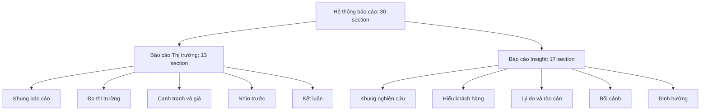

# Tài liệu tiếng Việt

Cập nhật: 20/10/2026 · Commit chính: `e9e0f444`

Mục lục các tài liệu tiếng Việt cho ba phần của hệ thống. Mỗi phần có ba loại tài liệu:

- **Hướng dẫn sử dụng:** cho chủ sở hữu, viết bằng lời đơn giản, làm theo từng bước.
- **Tài liệu kỹ thuật:** cho người bảo trì: mô-đun, API, bảng dữ liệu, cờ cấu hình, kiểm thử.
- **Thiết kế hệ thống:** kiến trúc, luồng dữ liệu (có sơ đồ), các quyết định đã chốt, việc còn mở.

Chỗ nào chưa chắc chắn được ghi "(cần xác nhận)".

Hai báo cáo có 30 section: Market có 13, Insight có 17. Sơ đồ phân rã chức năng dưới đây chia mỗi báo cáo thành 5 nhóm. Danh sách section của từng nhóm nằm trong tài liệu "Thiết kế hệ thống" của mỗi báo cáo.

## Phần 1. Báo cáo Thị trường (Market)

- [Hướng dẫn sử dụng](market-report/huong-dan-su-dung.md)
- [Tài liệu kỹ thuật](market-report/tai-lieu-ky-thuat.md)
- [Thiết kế hệ thống](market-report/thiet-ke-he-thong.md)

## Phần 2. Báo cáo Insight (khách hàng)

Báo cáo Insight đang tạm dừng từ 19/10/2026 để ưu tiên Market.

- [Hướng dẫn sử dụng](insight-report/huong-dan-su-dung.md)
- [Tài liệu kỹ thuật](insight-report/tai-lieu-ky-thuat.md)
- [Thiết kế hệ thống](insight-report/thiet-ke-he-thong.md)

## Phần 3. Content Studio

- [Hướng dẫn sử dụng](content-studio/huong-dan-su-dung.md)
- [Tài liệu kỹ thuật](content-studio/tai-lieu-ky-thuat.md)
- [Thiết kế hệ thống](content-studio/thiet-ke-he-thong.md)

## Phần 4. Báo cáo tiến độ

- [Báo cáo tiến độ đến 20/10/2026](bao-cao-tien-do-2026-10-20.md): việc đã làm, khó khăn, việc đang chờ, ước tính thời gian, quyết định cần chủ sở hữu.
