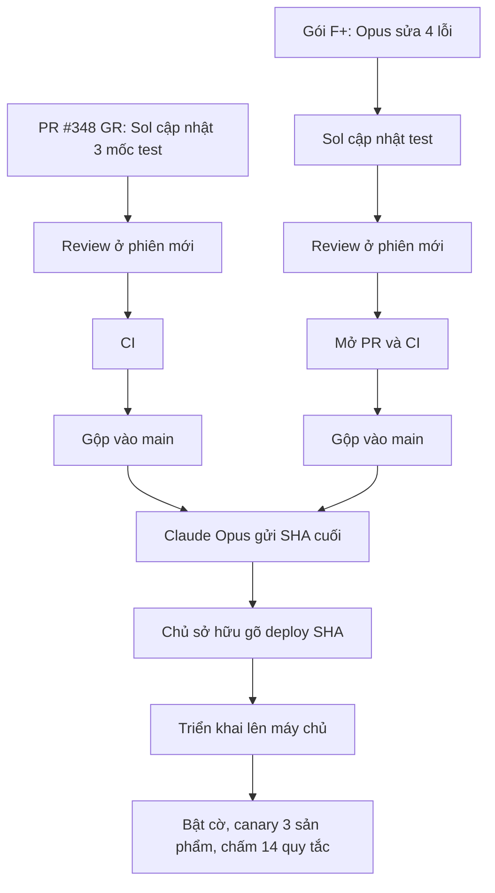

# Báo cáo tiến độ công việc đến 20/10/2026

Mục đích: giúp chủ sở hữu (không chuyên kỹ thuật) nắm bốn điều tính đến ngày 20/10/2026: đã làm gì, vướng gì, đang chờ gì và còn bao lâu nữa.

Cập nhật: 20/10/2026 · Commit chính: `e9e0f444`

Mã commit chính được mô tả nằm trên nhánh `main`, sau khi gộp PR #347.

## Mục lục

- Phần 1. Tóm tắt một trang
- Phần 2. Nhật ký theo mốc thời gian
- Phần 3. Khó khăn (blocker) đã gặp
- Phần 4. Việc đang chờ (current pending)
- Phần 5. Ước tính thời gian
- Phần 6. Quyết định cần chủ sở hữu
- Phần 7. Giải thích thuật ngữ

Lưu ý đọc báo cáo:

- Ngày viết theo dạng ngày/tháng/2026.
- "PR #n" là mã một gói thay đổi đã được gộp vào hệ thống trên GitHub.
- Báo cáo này là tài liệu nội bộ cho chủ sở hữu.
- Báo cáo gửi khách hàng không bao giờ hiện tên nhà cung cấp dữ liệu hay tên công cụ AI.

---

## Phần 1. Tóm tắt một trang

### Đã xong

- **Nền tảng (đầu tháng 9):** xong khoảng 13/09 (PR #1 đến #43). Gồm 4 mục:
  - cơ sở dữ liệu;
  - kho dữ liệu đã chốt phiên bản;
  - quy trình B7 đến B10 (chọn sản phẩm, 4 cổng duyệt, khóa hồ sơ STP, quyết định danh mục và vốn);
  - giao diện thao tác.
- **Content Studio (Caption và Poster):** đã gộp xong (PR #44 đến #58, 25 đến 28/09). Gồm thiết kế, thương hiệu, danh mục sản phẩm và ảnh tham chiếu, thư viện prompt, chiến dịch, Insight, Big Idea và Angle, Caption và Poster.
  - Kiểm tra thật trên máy chủ Fedora đạt ngày 29/09 với 6 lần gọi thật.
  - Chủ sở hữu quyết định hoãn tính năng AI sửa nội dung (052).
- **Báo cáo Market (thị trường):** chạy tự động từ đầu đến cuối.
  - Các sản phẩm mới quạt điện, giày thể thao, son đã qua 14/14 quy tắc tự động (15/10), sau khi học từ báo cáo mẫu thạch dừa.
  - Báo cáo đang chạy thật trên máy chủ ở bản `f026acd9` (triển khai 19/10).
- **Nguồn dữ liệu cho Market:** Metric (đọc trang kết quả), Kalodata, SerpApi, Apify, Ngân hàng Thế giới, UN Comtrade, Cục Thống kê, quảng cáo Meta và Google, đọc PDF, xem video.
  - Hầu hết nguồn đã có mã.
  - Một số nguồn đang để cờ tắt, chờ bật.
- **Trên nhánh chính (`main`) đã có hai gói:**
  - gói S: đánh giá công khai trên Shopee làm nguồn đếm (PR #346);
  - gói G-evidence: bảng bằng chứng, biểu đồ vĩ mô, tên nguồn (PR #347).

### Đang làm

Hai gói đang chờ gộp: PR #348 (GR) và gói F+.

**PR #348 (GR, tham chiếu):**

- Reviewer đã PASS hai lần ở bản `72c86105`.
- CI báo 3 test lỗi, vì nhánh GR chưa có các thay đổi mới trên `main` (gói S và G-evidence).
- Mốc so sánh trong test được ghi trước khi có GR.
- Đã gộp `main` vào nhánh GR, không có xung đột.
- GPT Sol đang cập nhật 3 mốc này kèm bằng chứng.
- Tiếp theo: review ở phiên mới, CI, rồi gộp.

**Gói F+ (biểu đồ cho bản đọc hiện tại, đánh số exhibit, tham chiếu dòng, đơn vị):**

- Mã đã xong (bản `4341be24`, đã gồm sửa của GR).
- Test do GPT Sol viết tìm ra 4 lỗi trong mã.
- Claude Opus đang sửa 4 lỗi này.
- Tiếp theo: Sol cập nhật test theo bản sửa, review ở phiên mới, mở PR, CI, gộp.

### Chờ chủ sở hữu

- Câu lệnh **«deploy <SHA>»** để triển khai sau khi gộp xong. Mỗi lần triển khai đều cần câu này.
- Quyết định cho Kalodata các phương án B đến E (phương án A đã gộp).
- Khi nào bật lại báo cáo Insight (đang tạm dừng từ 19/10).
- Nạp tiền dịch vụ khi cần (Apify chưa nạp; Kalodata đã nạp).

Sơ đồ dưới đây cho thấy mỗi gói còn thiếu gì trước khi gộp và triển khai.

---

## Phần 2. Nhật ký theo mốc thời gian

Quy ước nhóm: **Market** (báo cáo thị trường), **Insight** (báo cáo insight khách hàng), **Content Studio**, **Hạ tầng và quy trình**.

Số PR lấy từ lịch sử GitHub. Một số PR nhỏ gộp chung một dòng.

### Giai đoạn 1: Nền tảng (06/09 đến 13/09)

- **Hạ tầng:** cơ sở dữ liệu SQLite, cổng kiểm tra tự động trên GitHub (CI), kho dữ liệu đã chốt phiên bản, tài liệu nghiên cứu lưu nguyên byte (PR #1 đến #10).
- **Market:**
  - ảnh chụp thị trường cố định, AI diễn giải có giới hạn, kiểm tra bằng chứng nghiên cứu (PR #5 đến #10);
  - nghiên cứu Shopee từ tệp và báo cáo bằng chứng xuất ra tệp (Task 015 đến 023).
- **Quy trình sản phẩm B7 đến B10:**
  - danh sách ứng viên, khóa rổ ứng viên, tạo không gian sản phẩm;
  - 4 cổng duyệt (B8), hồ sơ STP và khóa B9;
  - quyết định danh mục cùng vốn B10 (Task 025 đến 032);
  - giao diện đọc, rồi giao diện chủ sở hữu ghi quyết định (Task 033 đến 046).

### Giai đoạn 2: Content Studio (25/09 đến 29/09)

**Content Studio:**

- thiết kế B11 đến B13 (Task 047, PR #44);
- thương hiệu (#45);
- danh mục sản phẩm và ảnh tham chiếu (#46, sửa #48);
- thư viện prompt (#47, #49);
- chiến dịch (#50);
- nền AI sáng tạo (#53);
- Insight (#56);
- Big Idea và Angle (#57);
- Caption và Poster (#58).

Ngày 1/10 có một sửa lỗi nhỏ về nội suy prompt cho Poster.

**Fedora:**

- Pha 0 xong.
- Kiểm tra thật ngày 29/09 đạt tại bản `2b208cd` (6 lần gọi thật).
- Lần đầu bị dừng do giao diện trắng dưới chính sách bảo mật của máy chủ. Đã sửa ở PR #84.

**Market (song song):** loạt "Research A1 đến A46" (28/09 đến 01/10), gồm:

- tính toán xác định;
- báo cáo có phiên bản;
- sổ ghi bất biến;
- biểu đồ có nguồn;
- cổng sẵn sàng dữ liệu;
- kiểm tra 30 phần.

### Giai đoạn 3: Tự động hóa nghiên cứu (02/10 đến 09/10)

**Market và Insight:**

- nghiên cứu tự động bản 1 với hai báo cáo tách riêng (02/10);
- chạy trong TDN, migration 0039 đến 0047 (06/10);
- bản đọc cho chủ có nút Duyệt hoặc Từ chối (06/10);
- kết quả Google qua SerpApi;
- giới hạn số đánh giá Shopee mỗi link.

**Hạ tầng và quy trình:**

- văn bản nghiệp vụ "Ultimate Method" v1.2 đến v1.12 làm nguồn chuẩn (07 đến 08/10);
- sổ đăng ký nguồn dữ liệu cho 30 phần;
- bảng trạng thái nguồn 11 thẻ;
- kế hoạch đồng bộ SYNC-1 đến SYNC-6;
- các gói P1 đến P4.

**Insight:**

- bản nháp Insight giới hạn, đếm sao, ghi chú trùng lặp, giọng người bán;
- persona có bằng chứng (PR #194);
- bản đọc Insight đã lưu (#198 đến #208).

**Market:**

- ngôn ngữ ngành, hướng dẫn đơn giá và thông số;
- nguồn Ngân hàng Thế giới (#193);
- nhập trang Meta (#195, gộp 12/10);
- xuất PDF bản đọc (#205, gộp 10/10).

### Giai đoạn 4: Bộ 14 quy tắc và Metric (11/10 đến 14/10)

- **Market:** các gói "-209" (PR #210 đến #254). Gồm:
  - cổng quy tắc nghiệp vụ trong luồng tự động (#217);
  - 14 quy tắc Market bắt buộc (#228);
  - đọc tiếng Việt thường (#220);
  - biểu đồ vẽ bằng Flint (#244, #245);
  - ảnh bìa minh họa AI (#247).
- **Metric:** không có chức năng tải báo cáo.
  - Bộ chuyển đổi (adapter) đọc trực tiếp trang kết quả qua OpenCLI (#223 đến #252).
  - Có nhiều sửa lỗi bấm nút, chờ mạng, tab ẩn.
- **Quy trình:** ghi quyết định chủ sở hữu 11/10 (không cộng tổng một phần, chỉ hủy và xóa bản dở...).

### Giai đoạn 5: Tự chạy và nguồn mới (15/10 đến 17/10)

**Market:**

- bộ tự chạy (auto-runner) gồm 3 PR #255, #256, #257;
- canary quạt điện đạt 14/14;
- ba sản phẩm mới quạt điện, giày thể thao, son đạt 14/14 tự động;
- cổng `PARTIAL_TOTAL_FORBIDDEN` (#260);
- tách kết quả tìm kiếm thành cách làm, tin tức, khác (#261);
- xu hướng tìm kiếm (#262);
- tìm kiếm mở rộng (#263).

**Nguồn dữ liệu (16 đến 17/10):**

| Nguồn | PR |
|---|---|
| Ngân hàng Thế giới | #265 |
| Trích PDF | #266 |
| Video người bán | #268, #270, #271 |
| UN Comtrade | #273 |
| Trang Meta | #274 |
| Quảng cáo tìm kiếm | #276 |
| Cục Thống kê | #277, #280 |
| Đọc tự động thư viện quảng cáo Meta | #278 |
| Quảng cáo TikTok | #279 |
| Biểu đồ vĩ mô | #281 |
| Tự tìm PDF | #282, #284 |
| Xu hướng tìm kiếm theo vùng | #285 |

**Hạ tầng:**

- Kalodata hết tín dụng ngày 16/10. Nhóm thêm cơ chế dừng khi hết tín dụng (#269, #272).
- Nhóm sửa lệnh kiểm tra kiểu trên Windows (#275).

### Giai đoạn 6: Hoàn thiện bản đọc và giao diện (18/10)

**Market:**

| Việc | PR |
|---|---|
| Bìa theo quý, danh sách nguồn dễ đọc, bảng chú giải | #286 |
| Trang Market chỉ đọc có diễn giải | #287 |
| Chế độ phát lại Kalodata cho môi trường thử | #289 |
| Đọc PDF có trích dẫn số | #290, #301 |
| Giá trị Metric kèm mũi tên xu hướng (adapter v11) | #309 |
| Không đếm dòng thiếu cửa hàng thành 1 cửa hàng | #310 |
| Sửa Ngân hàng Thế giới | #312 |
| Bản mẫu đánh giá Shopee thử | #315, #319 |

**Giao diện (UX M-01 đến M-16):**

- Nội dung gồm:
  - trạng thái trung thực;
  - tìm phiên nghiên cứu;
  - thẻ nguồn;
  - tiến độ gói;
  - tạo chiến dịch từ sản phẩm nghiên cứu;
  - "Việc cần làm";
  - bố cục điện thoại.
- PR: #305, #308, #311, #313, #316, #318, #321, #323, #326, #327, #329, #332, #338.

**Hạ tầng:** sửa treo CI trong test khóa trình duyệt (#307).

### Giai đoạn 7: Gói A, G, S, F+ (19/10 đến 20/10)

**Market:**

| Việc | PR |
|---|---|
| Phần 11 và Phần 12 theo từng nền tảng | #331 |
| Phần 1 và Phần 2 theo nền tảng | #333 |
| Đọc soát câu chữ | #334, #335 |
| Sửa id trùng của Metric | #336 |
| Giá tham chiếu dễ đọc | #337 |
| Gói A: bộ lọc AI về mức độ liên quan (cờ tắt thì dùng v2) | #339 |
| Bỏ lặp nội dung | #340 |
| Mở đầu bằng phát hiện trong mẫu | #341 |
| Nhãn phần trung thực, Phần 9 có ngày | #342 |
| Chân trang | #343 |
| Mốc thời gian, cột nền tảng, cơ sở giá | #344 |
| Diễn giải nghiệp vụ, khoảng giá, phương án | #345 |
| **Gói S:** đánh giá công khai Shopee làm nguồn đếm (quyết định phương án A) | #346 |
| **Gói G-evidence** (20/10) | #347 |

**Insight:** chủ sở hữu tạm dừng từ 19/10 để ưu tiên Market.

**Hạ tầng và quy trình:**

- Ngày 19/10 nhóm triển khai bản `f026acd9`, kèm đọc tài liệu PDF bằng PageIndex trên máy chủ thật.
- Chốt vai trò: Claude Opus viết mã, GPT Sol viết test cùng review. Mỗi vai dùng một phiên riêng.

**Đang chờ gộp:** PR #348 (GR), gói F+.

---

## Phần 3. Khó khăn (blocker) đã gặp

| Vấn đề | Ảnh hưởng | Cách xử lý | Trạng thái |
|---|---|---|---|
| Bộ phân loại an toàn chặn triển khai thật và một số lần gộp, nếu chủ sở hữu chưa viết đúng câu | Mỗi lần triển khai phải chờ chủ sở hữu | Chỉ triển khai khi nhận «deploy <SHA>». Claude gửi sẵn SHA để chủ chỉ việc xác nhận | Đang diễn ra (theo thiết kế) |
| Kalodata: các phương án tiết kiệm lượt gọi B đến E chưa quyết | Chi phí dữ liệu và độ phủ còn cố định theo phương án A | Phương án A đã gộp (#269): dừng khi hết tín dụng, chặn thu thập thiếu | Chờ chủ sở hữu |
| Báo cáo Insight bị tạm dừng | Insight chưa tiến thêm | Làm Market trước; ghi lại mục tiêu Insight | Chờ chủ sở hữu |
| Apify chưa nạp tiền | Đánh giá Shopee qua Apify không chạy | Chuyển sang dịch vụ Shopee API riêng (gói S). Nạp tiền là quyết định của chủ | Đang diễn ra |
| Giới hạn công suất GPT (một mô hình bị giới hạn đến 22/10) | Các lần review và test bị gián đoạn | Chuyển mọi vai GPT sang GPT Sol. Gặp lỗi công suất thì tiếp tục đúng phiên cũ | Đã xử lý, theo dõi |
| Ổ tạm của máy chủ Fedora có hạn mức, đầy do các luồng test | Lỗi ghi git, lỗi cơ sở dữ liệu | Lưu trữ các luồng đã xong định kỳ | Đang diễn ra |
| CI treo khoảng 1 trong 3 lần chạy | Mất thời gian chờ, phải chạy lại | Đã sửa một phần (#307, #258). Chạy lại khi cần | Giảm nhưng chưa hết |
| Công cụ trên Windows (dòng lệnh dài, kiểm tra kiểu) | Không tin kết quả cục bộ | Kết quả CI trên Linux là chuẩn. Sửa lệnh typecheck (#275) | Đang diễn ra |
| Kalodata hết tín dụng 16/10 | Thu thập Market bị chặn | Chủ nạp tiền. Thêm chế độ phát lại và cơ chế dừng khi hết tín dụng | Đã xử lý |
| Metric không có chức năng xuất báo cáo | Không lấy được dữ liệu dạng tệp | Adapter đọc trang kết quả. Sửa ô có mũi tên xu hướng ở bản v11 (#309) | Đã xử lý |
| Ngân hàng Thế giới cần tham số `source=2` | Báo lỗi bộ dữ liệu | Sửa URL | Đã xử lý |
| Id Metric trùng (#336) | Số liệu sai | Thêm hậu tố id | Đã xử lý |
| Dòng thiếu cửa hàng (#310) | Số liệu sai | Không đếm dòng thiếu cửa hàng | Đã xử lý |
| Bình luận thô xuất hiện trên báo cáo | Lộ dữ liệu khách hàng | Chủ chọn phương án A: chỉ dùng số đếm, bỏ bảng chủ đề và trích dẫn (S2 bỏ) | Đã xử lý |
| Nguồn đánh giá Shopee miễn phí không ổn định (4/4 lần lỗi ngày 19/10) | Thiếu đánh giá cho báo cáo thử | Dịch vụ Shopee API riêng (gói S) | Đã xử lý |

---

## Phần 4. Việc đang chờ (current pending)

| Việc | Ai làm | Trạng thái |
|---|---|---|
| Gộp PR #348 (GR) | GPT Sol (cập nhật mốc test, review), CI, rồi gộp | Đã gộp `main` vào nhánh. Sol đang cập nhật 3 mốc test |
| Gói F+: sửa mã, test, review, PR, CI, gộp | Claude Opus (mã), GPT Sol (test, review) | Opus đang sửa 4 lỗi do test tìm ra |
| Gửi SHA cuối cho chủ sở hữu | Claude Opus | Sau khi gộp xong |
| «deploy <SHA>» | **Chủ sở hữu** | Chờ |
| Sau triển khai: bật cờ mô hình AI về mức độ liên quan | Claude Opus (sau lệnh của chủ) | Chưa làm |
| Sau triển khai: bật S (đánh giá công khai Shopee, ngưỡng 300) | Claude Opus (sau lệnh của chủ) | Chưa làm |
| Sau triển khai: bỏ dòng giới hạn phí Shopee 10 USD cũ (giữ ngưỡng TikTok 5) | Claude Opus (sau lệnh của chủ) | Chưa làm |
| Canary tối thiểu 3 sản phẩm và chấm bản v2 tự động theo 14 quy tắc | Claude Opus, Sol chấm | Chưa làm |
| Quyết định Kalodata B đến E | **Chủ sở hữu** | Chờ |
| Khởi động lại Insight | **Chủ sở hữu** | Chờ |
| Việc nhỏ: thêm tên nhà cung cấp persona và tên mô hình AI vào danh sách từ cấm của báo cáo | Claude Opus | Ưu tiên thấp |
| Việc nhỏ: tăng tốc các test chậm của gói S | Claude Opus, Sol | Ưu tiên thấp |
| Content Studio: checklist ngừng dùng Windows | **Chủ sở hữu** quyết sau thời gian dùng thật | Chờ (xem docs/content-studio-release.md) |
| Content Studio: quy tắc lưu trữ mục danh mục chưa được thiết kế | Chủ sở hữu quyết | Chờ |

---

## Phần 5. Ước tính thời gian

Đây là phán đoán của Claude, dạng khoảng. Nhịp thực tế: một gói mất khoảng 0,5 đến 1 ngày, gồm viết mã, test, review, CI (CI khoảng 30 phút).

| Hạng mục | Ước tính |
|---|---|
| Gộp PR #348 (GR): cập nhật mốc test, review lại, CI | Khoảng 2 đến 4 giờ |
| Gói F+: sửa mã, cập nhật test, review, PR, CI, gộp | Khoảng 6 đến 10 giờ (lâu hơn nếu review tìm ra lỗi) |
| Triển khai sau «deploy <SHA>», canary 3 sản phẩm và chấm điểm | Khoảng 3 đến 5 giờ |
| Mỗi gói sửa lỗi do canary phát hiện | Khoảng 0,5 đến 1 ngày |
| Việc nhỏ ưu tiên thấp (danh sách từ cấm; tăng tốc test S) | Khoảng 0,5 ngày mỗi việc |
| Báo cáo Insight sau khi chủ khởi động lại | Sơ bộ 1 đến 2 tuần để đạt mức tự động như Market |
| Content Studio còn lại | Chưa có mốc thời gian (ước tính sơ bộ) |

Content Studio còn lại gồm ba việc:

- checklist chuyển khỏi Windows;
- quy tắc lưu trữ danh mục (cần quyết định);
- AI sửa nội dung đã hoãn.

Các tính năng khác của Content Studio đã gộp và kiểm tra thật xong.

**Giả định:**

- Mọi nguồn dữ liệu (Metric qua trình duyệt, Kalodata, dịch vụ Shopee) vẫn hoạt động và còn tín dụng.
- Chủ sở hữu phản hồi «deploy <SHA>» trong ngày.
- Công suất GPT Sol đủ cho test và review. Lỗi công suất chỉ làm chậm, không đổi kết quả.
- Insight tái sử dụng đường ống Market và cần các quyết định của chủ sở hữu.

**Rủi ro:**

- Canary phát hiện lỗi nghiệp vụ mới trên sản phẩm chưa thử, thêm 0,5 đến 1 ngày mỗi gói.
- CI treo ngẫu nhiên, mất thêm thời gian chờ.
- Nguồn dữ liệu thay đổi giao diện (Metric) làm adapter hỏng.
- Quy tắc 3 lần: một việc thất bại 3 lần test thì dừng. Nhóm hỏi Sol ở phiên mới và nghĩ lại phương pháp, nên mốc có thể lùi.

---

## Phần 6. Quyết định cần chủ sở hữu

1. **«deploy <SHA>»** cho bản sau khi #348 và F+ được gộp (Claude sẽ gửi SHA).
2. **Kalodata:** chọn tiếp phương án B, C, D hay E, hoặc giữ nguyên phương án A.
3. **Insight:** chọn khi nào khởi động lại và theo phạm vi nào. Phạm vi gồm:
   - cùng 4 nguồn chính;
   - chỉ dùng bình luận đã mã hóa;
   - persona chỉ khi kèm thẻ bằng chứng.
4. **Nạp tiền Apify:** chọn nạp hay không. Luồng Market hiện chưa cần.
5. **Content Studio:** chọn thời điểm ngừng dùng Windows và cách xử lý lưu trữ mục danh mục (chưa có thiết kế).

---

## Phần 7. Giải thích thuật ngữ

| Từ | Nghĩa dễ hiểu |
|---|---|
| PR (pull request) | Một gói thay đổi mã, được review rồi mới gộp vào nhánh chính |
| Gộp (merge) | Đưa gói thay đổi đã duyệt vào nhánh chính `main` |
| SHA | Mã định danh của một phiên bản mã nguồn (ví dụ `e9e0f444`) |
| Triển khai (deploy) | Đưa phiên bản mã lên máy chủ thật để dùng |
| CI | Hệ thống tự chạy kiểm tra trên GitHub trước khi gộp |
| Canary | Chạy thử một báo cáo thật trên vài sản phẩm để xem có đạt không |
| Cờ (flag) | Công tắc bật tắt một tính năng, không cần viết lại mã |
| Adapter | Bộ nối đọc dữ liệu từ một nguồn bên ngoài |
| Fedora | Máy chủ chạy hệ thống thật |
| 14/14 quy tắc | Bộ 14 quy tắc chất lượng chủ sở hữu đặt ra cho báo cáo Market |
| Reviewer, PASS | Người kiểm tra độc lập (GPT Sol); PASS là đạt |
| Phiên bản mới (fresh session) | Một phiên làm việc mới, không mang theo ngữ cảnh cũ, để kiểm tra khách quan |
| Insight | Báo cáo hiểu khách hàng (nỗi đau, giọng nói), khác với Market |
| Persona | Chân dung khách hàng giả lập, chỉ dùng khi mọi thuộc tính đều có trích dẫn thật |
| Phương án A | Chỉ đếm đánh giá công khai Shopee, không hiện bình luận thô |
| Nhà cung cấp dữ liệu | Các dịch vụ cấp số liệu; báo cáo gửi khách không hiện tên các dịch vụ này |
