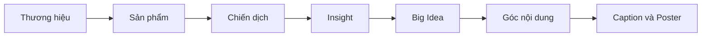
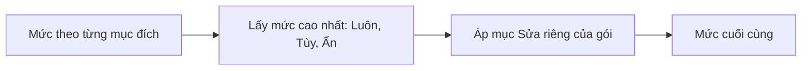

# Content Studio — Hướng dẫn sử dụng

Mục đích: giúp chủ sở hữu (không cần biết kỹ thuật) làm từng bước từ thương hiệu đến bài đăng và poster.

Cập nhật: 20/10/2026 · Commit chính: `e9e0f444`

## Mục lục

- Phần 1. Content Studio là gì
- Phần 2. Thương hiệu và quy tắc hiển thị
- Phần 3. Danh mục sản phẩm và ảnh
- Phần 4. Thư viện prompt
- Phần 5. Chiến dịch
- Phần 6. Insight → Big Idea → Góc nội dung → Caption & Poster
- Phần 7. Mã nhánh A, A1, A1·1
- Phần 8. Xóa và khôi phục trong 30 ngày
- Phần 9. Số lần gọi AI
- Phần 10. Chưa làm
- Phần 11. Giải thích thuật ngữ

## Phần 1. Content Studio là gì

Content Studio là khu làm nội dung quảng cáo trong hệ thống. Bạn đi theo một đường thẳng, từng bước:

1. Khai báo thương hiệu.
2. Thêm sản phẩm.
3. Mở chiến dịch.
4. Chốt Insight (điều khách hàng thật sự quan tâm).
5. Sinh ý tưởng lớn (Big Idea).
6. Sinh các góc kể (Góc nội dung).
7. Tạo bài đăng (Caption) và ảnh quảng cáo (Poster).

Các màn hình dùng đường dẫn bắt đầu bằng dấu `#`. Ví dụ:

- `#/brands`: thương hiệu.
- `#/content`: chiến dịch.
- `#/prompts/...`: thư viện prompt.

Nguồn: `frontend/src/routing.ts`.

Mọi thao tác ghi (tạo, sửa, xóa) cần "mở khóa chủ sở hữu". Khi chưa mở khóa, bạn chỉ xem được. Các nút ghi bị tắt và có dòng nhắc "Cần mở khóa OWNER". Khi chưa cấu hình AI, nút tạo bằng AI không chạy.

Lưu ý: báo cáo giao cho khách hàng không bao giờ ghi tên nhà cung cấp dữ liệu hay tên mô hình AI.

## Phần 2. Thương hiệu và quy tắc hiển thị

Vào `#/brands` để xem danh sách, bấm vào một thương hiệu để mở hồ sơ.

1. Bấm tạo thương hiệu. Nhập các mục sau:
   - tên;
   - tagline (khẩu hiệu ngắn);
   - hotline;
   - website;
   - fanpage;
   - địa chỉ;
   - logo.
2. Logo chỉ nhận PNG hoặc JPEG. Logo tối đa 2 MiB.
3. Mỗi lần lưu là một phiên bản mới. Phiên bản cũ vẫn còn, không bị ghi đè.

Quy tắc hiển thị quyết định thông tin nào của thương hiệu xuất hiện trong bài đăng và poster. Với mỗi thành phần (tên, logo, tagline, hotline, website và fanpage gộp một mục, địa chỉ) và mỗi mục đích, bạn chọn một trong ba mức:

- Luôn: thành phần phải có.
- Tùy: có thể có, tùy bối cảnh.
- Ẩn: không được xuất hiện.

Khi một góc nội dung có nhiều mục đích, hệ thống lấy mức cao nhất (Luôn cao hơn Tùy, Tùy cao hơn Ẩn). Sau đó, khi tạo Caption & Poster, bạn chỉnh riêng cho từng gói được (mục "Sửa riêng"). Chỉnh riêng thắng quy tắc theo mục đích.

Lưu ý về thông tin liên hệ: hotline, website, địa chỉ không được gửi cho AI. Hệ thống tự gắn "khối liên hệ" vào cuối Caption sau khi AI viết xong. Nguồn: `src/modules/flow/content-display-rules.ts`.

## Phần 3. Danh mục sản phẩm và ảnh

Vào `#/brands/<mã thương hiệu>/products` để xem danh mục sản phẩm của thương hiệu.

1. Thêm sản phẩm: tên, mô tả, ảnh.
2. Ảnh chỉ nhận PNG hoặc JPEG. Ảnh sản phẩm tối đa 8 MiB, mỗi cạnh từ 64 đến 8192 điểm ảnh, tối đa 50 triệu điểm ảnh. Nguồn: `src/modules/flow/content-image.ts`.
3. Nếu ảnh bị từ chối, màn hình báo lý do (sai định dạng, quá lớn, file hỏng...).
4. Khi tạo Poster, bạn chọn ảnh sản phẩm làm ảnh tham chiếu (xem Phần 6, Bước 4).
5. Ảnh được lưu nguyên bản, kể cả thông tin ẩn trong ảnh (EXIF), và được gửi cho dịch vụ tạo ảnh khi làm Poster. Đây là quyết định của chủ sở hữu. Nếu ảnh có thông tin nhạy cảm, hãy xử lý ảnh trước khi tải lên.

Khi một sản phẩm được sửa thành phiên bản mới, chiến dịch cũ vẫn dùng phiên bản đã ghim lúc chọn. Ảnh của phiên bản mới hơn sẽ bị ẩn trong bước chọn ảnh tham chiếu, kèm dòng báo số ảnh bị ẩn.

## Phần 4. Thư viện prompt

Prompt là hướng dẫn bạn đưa cho AI. Vào `#/prompts` để xem. Có bốn loại: Big Idea, Góc nội dung, Caption, Poster.

Mỗi lần AI chạy có hai lớp hướng dẫn:

- Lớp sáng tạo: do bạn viết hoặc chọn từ thư viện (giọng điệu, phong cách, ý muốn).
- Lớp hệ thống: cố định, do hệ thống giữ (dữ liệu đầu vào, quy tắc an toàn và đúng sự thật, định dạng kết quả). Bạn không sửa được lớp này.

Có hai cách dùng:

- Dùng thư viện: chọn một prompt có sẵn (của hệ thống hoặc của bạn). Prompt hệ thống có đánh dấu "mặc định". Prompt của bạn hiện dưới dạng "Của bạn · v<số>".
- Prompt tự do (freestyle): gõ hướng dẫn riêng cho lần này, tối đa 12.000 ký tự. Muốn dùng lại, đặt tên (tối đa 120 ký tự) rồi bấm "Lưu thành prompt" để đưa vào thư viện.

Sửa prompt của bạn tạo ra phiên bản mới. Ý tưởng hay gói đã tạo trước đó vẫn nhớ chính xác phiên bản prompt đã dùng.

## Phần 5. Chiến dịch

Vào `#/content` để xem danh sách chiến dịch, bấm "Chiến dịch mới" (`#/content/new`).

1. Chọn thương hiệu.
2. Chọn một hoặc nhiều sản phẩm từ danh mục. Hệ thống ghim phiên bản sản phẩm tại thời điểm chọn.
3. Đặt tên chiến dịch.
4. Nếu bạn mở chiến dịch từ một sản phẩm trong báo cáo thị trường (`#/content/new/<mã sản phẩm>`), chiến dịch được liên kết với sản phẩm nghiên cứu đó. Theo quy định D26 và D33 trong `INTENT.md`, khi đó mục "Duyệt" của B10 bị đóng băng cho chiến dịch có liên kết. Đây là quy định nội bộ, bạn không cần thao tác gì.

Trong chiến dịch có thanh các bước: Insight, Big Idea, Góc nội dung, Caption & Poster. Chiến dịch xóa đi vẫn khôi phục được (xem Phần 8).

## Phần 6. Insight → Big Idea → Góc nội dung → Caption & Poster

### Bước 1. Insight

Mở `#/content/<mã chiến dịch>/insight`.

Lưu ý: bạn phải khóa Insight trước khi tạo ý tưởng. Nếu chưa khóa, màn hình báo "Cần khóa Insight trước khi tạo ý tưởng".

1. Viết Insight: điều khách hàng thật sự cảm thấy hoặc cần, mà sản phẩm có thể chạm tới.
2. Gõ tự do, hoặc lấy từ một bản STP đã khóa trong hệ thống. STP là bản định vị khách hàng mục tiêu. Cách chọn trên màn hình cần xác nhận.
3. Bấm lưu. Mỗi lần lưu là một bản sửa.
4. Khi hài lòng, bấm "Khóa". Kết quả: Insight không đổi nữa và các bước sau dựa trên bản đã khóa.

### Bước 2. Big Idea

Mở `#/content/<mã chiến dịch>/big-idea`.

1. Chọn prompt từ thư viện hoặc dùng prompt tự do. Bạn chọn được nhiều prompt. Mỗi prompt có một "Số ý" từ 1 đến 10.
2. Chọn mô hình AI trong danh sách "Mô hình".
3. Đọc nút tạo. Nút ghi rõ số lần gọi AI, ví dụ "Tạo 3 ý".
4. Bấm tạo. Khung tiến trình báo "Đang tạo · n".
5. Nếu muốn dừng, bấm "Dừng sau lần gọi này". Lần gọi đang chạy vẫn hoàn tất.
6. Bấm "Phát triển ý này" cho ý bạn muốn đi tiếp. Kết quả: ý có trạng thái "Đang phát triển". Mỗi Big Idea có mã A, B, C...
7. Để bỏ một ý, bấm "Ngừng phát triển".

### Bước 3. Góc nội dung

Mở bằng nút "Tạo góc nội dung" trên một Big Idea đang phát triển.

Mỗi góc là một cách kể Big Idea cho một mục đích cụ thể. Cách chọn prompt giống Bước 2.

Lưu ý: góc chưa gắn mục đích thì bạn chưa chọn được để tạo Caption & Poster.

1. Bấm "Gắn mục đích" để gắn mục đích cho góc. Mỗi góc có tối đa 6 mục đích (`MAX_PURPOSES` trong `frontend/src/idea-data-source.ts`).
2. Chọn một mục đích gợi ý sẵn, hoặc bấm "Mục đích mới" để thêm mục đích riêng.
3. Với mục đích mới, chọn loại trong "Hiển thị giống". Hệ thống áp quy tắc hiển thị của loại đó.
4. Tick các góc muốn làm bài.
5. Bấm "Tạo Caption & Poster". Mỗi lô có tối đa 20 góc (`PACKAGE_BATCH_LIMIT` trong `frontend/src/package-data-source.ts`).

Khi sửa tay, Caption có tối đa 4.000 ký tự.

### Bước 4. Caption & Poster

Mở `#/content/<mã chiến dịch>/package/new?angles=A1,A2`.

1. Trong phần "Thiết lập cho cả lô", chọn cho Caption:
   - prompt;
   - mô hình;
   - giọng văn;
   - độ dài.
2. Trong cùng phần, chọn cho Poster:
   - prompt;
   - mô hình;
   - khổ ảnh;
   - có dùng logo hay không;
   - ảnh tham chiếu (chỉ chọn được 1 ảnh).
3. Chọn khổ ảnh: vuông, dọc, story hoặc ngang. Xem kích thước trong màn hình.
4. Nếu một góc cần thiết lập riêng, bấm "Sửa riêng" trên dòng của góc. Mỗi góc là một dòng. Bạn chỉnh được giọng văn, độ dài, hiển thị thành phần và ảnh tham chiếu.
5. Để dùng lại thiết lập, bấm "Lưu làm mặc định cho chiến dịch".
6. Bấm "Tạo n gói". Hệ thống tạo Caption trước, rồi Poster. Nếu Caption của một góc lỗi, hệ thống bỏ qua Poster của góc đó.
7. Mở từng gói theo mã (ví dụ `A1·1`). Bạn xem Caption kèm khối liên hệ, Poster và bảng "Kiểm tra thông tin thương hiệu".

Bảng kiểm tra gán cho từng thành phần một trong bốn trạng thái: khớp, không nhắc tới, đang ẩn, sai lệch. Kiểm tra chỉ cảnh báo, không chặn bạn dùng.

Sau khi tạo gói, bạn có bốn thao tác:

- "Tạo lại": cho ra phiên bản mới của Caption hoặc Poster.
- "Sửa tay": bạn viết lại Caption. Khối liên hệ vẫn tự thêm.
- "Khôi phục": đưa một phiên bản cũ thành phiên bản mới nhất.
- "Thử lại lần lỗi": chạy lại lần gọi bị lỗi hoặc bị gián đoạn.

Hệ thống giữ mọi phiên bản. Không có gì bị ghi đè.

Nếu mất mạng giữa chừng, bấm "Tiếp tục" hoặc "Gửi lại". Hệ thống dùng lại đúng mã yêu cầu cũ nên không tạo bản trùng.

## Phần 7. Mã nhánh A, A1, A1·1

Mã giúp bạn gọi tên từng nhánh mà không nhầm:

- Big Idea đặt mã chữ: A, B, C...
- Góc nội dung thuộc Big Idea A có mã A1, A2...
- Gói Caption & Poster làm từ góc A1 có mã A1·1 (dấu chấm giữa).

Mã cố định, không đổi dù bạn xóa hay khôi phục.

## Phần 8. Xóa và khôi phục trong 30 ngày

- Xóa không làm mất dữ liệu ngay. Bạn có 30 ngày để khôi phục. Màn hình ghi ngày hết hạn khôi phục.
- Áp dụng cho chiến dịch, Big Idea, Góc nội dung, gói Caption & Poster và các bản ghi khác của Content Studio có nút Xóa.
- Xóa một Big Idea thì các góc và gói thuộc nó bị ẩn theo. Góc hiện thông báo "Ẩn vì Big Idea đã bị xóa". Khôi phục Big Idea thì chúng hiện lại.
- Nếu nhiều hạn khác nhau cùng áp dụng, hạn sớm nhất được tính.
- Xóa Big Idea đang phát triển thì nó tự ngừng phát triển.
- Quá 30 ngày thì không khôi phục được: màn hình báo "đã quá hạn khôi phục" và nút Khôi phục không còn.

## Phần 9. Số lần gọi AI

AI tốn tiền và thời gian, nên hệ thống luôn báo trước:

- Big Idea hoặc Góc: số prompt đã chọn nhân với số ý mỗi prompt. Ví dụ 2 prompt × 3 ý = 6 lần gọi.
- Caption & Poster: mỗi góc một lần gọi Caption (văn bản) và một lần gọi Poster (ảnh). Ví dụ 4 góc làm cả hai = 8 lần gọi.
- Số lần gọi hiện ngay cạnh nút bấm trước khi bạn xác nhận.

Hệ thống ghi mỗi lần gọi vào sổ lần gọi AI. Mỗi lần gọi có một trong bốn trạng thái: đang chạy, thành công, lỗi, bị gián đoạn. Để xem sổ, mở mục "Lần gọi AI" trong trang gói. Hệ thống không tự thử lại. Muốn thử lại, bạn bấm.

Nếu AI báo lỗi, thông báo bằng tiếng Việt. Ví dụ:

- "Chưa cấu hình AI".
- "AI không phản hồi trong thời hạn".
- "Ảnh AI trả về không hợp lệ".

## Phần 10. Chưa làm

Những mục dưới đây chưa có trong bản hiện tại:

- Đăng bài tự động lên mạng xã hội và làm video: Chưa làm (kế hoạch phát hành ghi rõ không có đăng bài, không có video).
- Danh mục sản phẩm chưa có chức năng lưu trữ hoặc xóa mục: Chưa làm (chưa có quyết định).
- Gợi ý chỉnh sửa bằng AI cho Caption và Poster: Chưa làm (hoãn sang bản sau theo quyết định chủ sở hữu 25/09/2026). Sửa tay và khôi phục phiên bản đã có.
- Việc triển khai (deploy) chính thức cần chủ sở hữu cho phép riêng. Tài liệu phát hành ghi một lần chạy thử với AI thật trên máy chủ Fedora ngày 29/09/2026: 6 lần gọi, đều thành công. Việc dùng thật lâu dài và tắt máy Windows còn chờ chủ sở hữu. Xem `docs/content-studio-release.md`.
- Khay "Đang tạo" đầy đủ cho mọi màn hình: cần xác nhận. Hiện có khung tiến trình trong ba màn: Big Idea, Góc nội dung, Caption & Poster.

## Phần 11. Giải thích thuật ngữ

- Thương hiệu: hồ sơ gồm tên, logo, liên hệ.
- Danh mục: danh sách sản phẩm của một thương hiệu.
- Prompt: hướng dẫn gửi cho AI.
- Freestyle (prompt tự do): hướng dẫn bạn tự gõ cho một lần chạy.
- Insight: điều khách hàng thật sự quan tâm, làm nền cho ý tưởng.
- Big Idea: ý tưởng lớn dẫn dắt cả chiến dịch.
- Góc nội dung (Angle): một cách kể Big Idea cho một mục đích.
- Caption: bài viết đi kèm hình.
- Poster: ảnh quảng cáo.
- Gói (package): một cặp Caption và Poster của một góc.
- Phiên bản: mỗi lần lưu hoặc tạo lại sinh một phiên bản mới, bản cũ không mất.
- Khóa: chốt Insight không cho sửa nữa.
- Mở khóa chủ sở hữu: bước xác nhận bạn có quyền ghi.
- Mã nhánh: tên gọi A, A1, A1·1.
- Khối liên hệ: đoạn hotline, website, địa chỉ tự gắn cuối Caption.
- PNG, JPEG: hai định dạng ảnh được nhận.
- EXIF: thông tin ẩn trong ảnh (máy chụp, vị trí...).
- Demo: chế độ thử, dữ liệu chỉ ở trình duyệt, không có AI thật.
