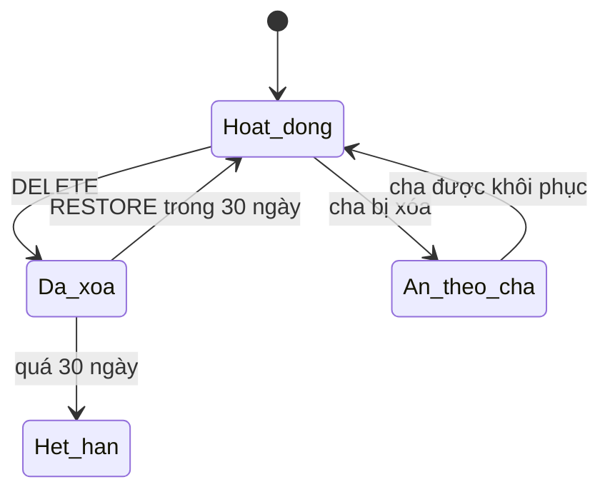
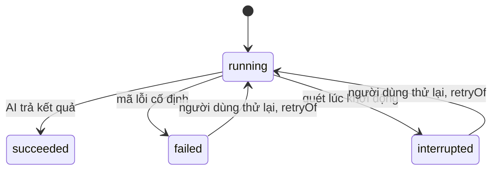
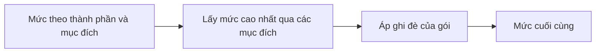

# Content Studio — Tài liệu kỹ thuật

Mục đích: mô tả mô-đun, đường dẫn API, bảng dữ liệu, prompt, cổng AI, kiểm tra ảnh và kiểm thử của Content Studio cho người bảo trì.

Cập nhật: 20/10/2026 · Commit chính: `e9e0f444`

Quy ước:

- Đường dẫn trong dấu huyền là đường dẫn tương đối từ gốc kho mã.
- Chỗ nào chưa chắc, tài liệu ghi "(cần xác nhận)".
- Báo cáo giao cho khách không bao giờ ghi tên nhà cung cấp dữ liệu hay tên mô hình AI. Tài liệu này chỉ ghi định danh mô hình khi đó là tên trong mã.

## Mục lục

- Phần 1. Tổng quan và công nghệ
- Phần 2. Mô-đun nghiệp vụ
- Phần 3. API và đường dẫn
- Phần 4. Bảng dữ liệu và migration
- Phần 5. Prompt và việc ghim phiên bản
- Phần 6. Cổng AI và sổ lần gọi
- Phần 7. Kiểm tra ảnh
- Phần 8. Quy tắc hiển thị và kiểm tra thông tin thương hiệu
- Phần 9. Giao diện (frontend)
- Phần 10. Kiểm thử
- Phần 11. Vận hành và cấu hình
- Phần 12. Chỗ cần xác nhận

## Phần 1. Tổng quan và công nghệ

Content Studio (B11–B13) nằm trong hệ thống tdn-growth-os. Công nghệ gồm:

- Mã TypeScript chạy trên Node.
- Máy chủ dùng `node:http` có sẵn. Mã không nhập thư viện Express, dù `ARCHITECTURE.md` còn nhắc Express.
- Giao diện React + Vite dùng đường dẫn băm (`#/...`).
- Một cơ sở dữ liệu SQLite với migration đánh số.
- JSON Schema đóng kèm kiểu sinh tự động trong `contracts/`.

Nguyên tắc chung:

- Mọi bản ghi bất biến và có phiên bản. Muốn đổi thì ghi bản mới.
- Ghi dùng `expectedVersion` hoặc `expectedSequence`. Nếu số sai, API trả 409. Giao diện tải lại nhưng giữ bản nháp.
- Gửi lại đúng yêu cầu cũ là không-thao-tác (trả 200).
- Mỗi lần đọc, API kiểm tra lại mã băm SHA-256 của tệp lưu trữ (artifact). Nếu mã lệch, API trả `500 integrity_error` với thông báo an toàn.
- Đọc ở `/api/content/*`; ghi của chủ sở hữu ở `/owner-api/content/*`.

Nguồn: `docs/adr/0003-content-studio-b11-b13.md`, `docs/adr/0004-content-ai-synchronous-attempts.md`, `src/api/content-api.ts`.

## Phần 2. Mô-đun nghiệp vụ

ADR 0003 nói mã nằm ở `src/modules/flow/content/`, nhưng thực tế các tệp nằm phẳng dạng `src/modules/flow/content-*.ts`:

- `content-brand-service.ts`: thương hiệu, hồ sơ, quy tắc hiển thị.
- `content-catalog-service.ts`, `content-media-service.ts`: danh mục sản phẩm, ảnh.
- `content-image.ts`, `content-jpeg.ts`: giải mã và kiểm tra ảnh PNG/JPEG.
- `content-prompt-library.ts`, `content-prompt-service.ts`: thư viện prompt, ghim SHA-256.
- `content-poster-prompt.ts`: dựng prompt cho Poster.
- `content-campaign-service.ts`: chiến dịch.
- `content-insight-service.ts`: Insight (bản sửa, khóa).
- `content-idea-service.ts`: Big Idea, Góc nội dung, mục đích, trạng thái.
- `content-package-service.ts`: gói Caption & Poster, phiên bản, mặc định.
- `content-display-rules.ts`: giải quy tắc hiển thị.
- `content-brand-fact-check.ts`: kiểm tra thông tin thương hiệu trong Caption.
- `content-ai-attempt-service.ts`, `content-ai-status.ts`, `content-ai-call-count.ts`: sổ lần gọi AI, trạng thái, đếm lần gọi.
- `content-artifacts.ts`: ghi và xác minh tệp lưu trữ.

Cổng AI: `src/platform/ai/creative-ai-gateway.ts` (giao diện và bảng định tuyến), cùng bộ điều hợp CLIProxy `src/platform/ai/cliproxy-creative-gateway.ts`, cấu hình `src/platform/ai/cliproxy-configuration.ts`, và bản giả cho kiểm thử `src/platform/ai/fake-creative-gateway.ts`.

## Phần 3. API và đường dẫn

Phân tích đường dẫn bằng `pathParts` trong `src/api/content-api.ts`; ý tưởng và gói được tách sang `src/api/content-ideas-api.ts` và `src/api/content-packages-api.ts`. Cổng gắn vào ứng dụng ở `src/api/operator-app.ts`.

Nhóm đọc (`/api/content/...`), theo các đoạn đường dẫn tìm thấy trong mã (đường dẫn đầy đủ cần xác nhận):

- thương hiệu, danh mục (`catalog`), ảnh (`media`);
- thư viện prompt (`prompts`), prompt hệ thống (`system-prompts`);
- chiến dịch (`campaigns`) với `insight`, `ideas`, `packages`;
- gói (`packages`) với `posters`;
- mục đích (`purpose-tags`);
- trạng thái AI (`ai/status`).

Nhóm ghi của chủ sở hữu (`/owner-api/content/...`):

- tạo và sửa thương hiệu, danh mục, ảnh, prompt (`revisions`);
- Insight (`revisions`, `lock`);
- ý tưởng (`ideas`, `generate`, `state`);
- gói (`packages`, `defaults`, `generate`, `versions`, `state`).

Xác thực ghi: token chủ sở hữu, bật bằng biến môi trường `TDN_OWNER_API_ENABLED`, `TDN_OWNER_API_TOKEN`, `TDN_OWNER_API_ACTOR_ID`.

Ánh xạ lỗi ghi:

| Mã | Ý nghĩa |
|---|---|
| 400 | yêu cầu sai |
| 404 | không có |
| 409 | sai phiên bản |
| 500 `integrity_error` | mã băm lệch |

Lỗi AI mang mã cố định và thông báo tiếng Việt. Thông báo không lộ văn bản của nhà cung cấp, URL hay khóa (xem Phần 6).

## Phần 4. Bảng dữ liệu và migration

Migration theo thứ tự, trong thư mục `migrations/`:

- `0021_flow_content_brands.sql`: thương hiệu.
- `0022_flow_content_catalog_media.sql`: danh mục và ảnh.
- `0023_flow_content_prompts.sql`: thư viện prompt.
- `0024_flow_content_campaigns.sql`: chiến dịch.
- `0025_flow_content_ai_attempts.sql`: sổ lần gọi AI (`flow_content_ai_attempts`).
- `0026_flow_content_insights.sql`: Insight.
- `0027_flow_content_ideas.sql`: Big Idea, Góc nội dung.
- `0028_flow_content_ai_active_target.sql`: chặn hai lần gọi chạy cùng một mục tiêu.
- `0029_flow_content_packages.sql`: gói Caption & Poster.
- `0034_flow_content_ai_provider_model.sql`: ghi thêm `provider_model` cho mỗi lần gọi.

Các migration 0030–0033 và từ 0035 trở đi thuộc phần phân tích/báo cáo thị trường, không thuộc Content Studio.

Xóa mềm: các sự kiện DELETE/RESTORE chỉ nối thêm (append-only). Trigger trong cơ sở dữ liệu ép ba điều:

- DELETE và RESTORE luân phiên đúng;
- đúng thứ tự thời gian;
- cửa sổ khôi phục 30 ngày.

Xóa suy diễn (quyết định Q6): khi bạn xóa Big Idea hoặc Góc, hệ thống ẩn con cháu mà không ghi thêm dòng. Hệ thống áp dụng hạn sớm nhất.

Chi tiết cột từng bảng: đọc trực tiếp các tệp migration ở trên (không chép lại ở đây để tránh lệch).

## Phần 5. Prompt và việc ghim phiên bản

Hai lớp:

- Lớp sáng tạo: người dùng viết hoặc lấy từ thư viện.
- Lớp hệ thống: tệp trong `prompts/content/system/` (`angle-v1.md`, `big-idea-v1.md`, `caption-v1.md`, `poster-v1.md`), khóa dữ liệu vào, quy tắc an toàn và sự thật, định dạng kết quả.

Thư viện sẵn có trong `prompts/content/library/`: `big-idea-insight-v1.md`, `big-idea-strategic-v3.1.md`, `angle-content-v1.md`, `angle-social-v3.md`, `caption-social-post-v1.md`, `caption-facebook-v3.md`, `poster-b2b-infographic-v2.md`.

Ghim: các tệp trên được ghim bằng mã băm SHA-256 trong `src/modules/flow/content-prompt-library.ts`. Sửa tệp mà không cập nhật mã băm thì bị từ chối khi nạp. Poster từng được sửa nội suy prompt (commit `df84a183`, 30/09/2026); mã băm hiện tại của lớp hệ thống Poster cần xác nhận lại từ mã. Các slug loại prompt trong `#/prompts/<loại>` là `big-idea`, `angle`, `caption`, `poster` (`frontend/src/prompt-data-source.ts`); mã tham chiếu là UUID hoặc `system-<tên>`.

Mỗi gói và mỗi ý tưởng nhớ chính xác nguồn prompt (hệ thống, người dùng hoặc tự do) và phiên bản. Prompt tự do có giới hạn 12.000 ký tự ở giao diện.

## Phần 6. Cổng AI và sổ lần gọi

`CreativeAiGateway` là giao diện riêng cho tác vụ sáng tạo, tách khỏi cổng phân tích `AiGateway` (giữ nguyên). Hai phương thức: `generateText`, `generateImage`, thêm `listModels`.

Danh sách mô hình cho phép (allowlist) và bảng định tuyến `CREATIVE_MODEL_ROUTES` nằm ở `src/platform/ai/creative-ai-gateway.ts`: 3 mô hình văn bản và 2 mô hình ảnh. Một id văn bản của sản phẩm được định tuyến sang id mạnh hơn ở nhà cung cấp; migration 0034 lưu `provider_model` thực tế đã gửi. Kiểm tra lúc biên dịch bảo đảm tập mô hình sáng tạo bằng với enum mô hình của thư viện prompt.

Khổ ảnh (`CREATIVE_IMAGE_FORMATS`): vuông 1088×1088, dọc 1088×1360, story 1152×2048, ngang 2048×1152.

Mã lỗi (`CreativeAiErrorCode`): `ai_not_configured`, `model_not_allowed`, `request_too_large`, `timeout`, `network_error`, `gateway_http_error`, `malformed_envelope`, `response_too_large`, `invalid_image`, `schema_mismatch`. Mỗi mã có một thông báo tiếng Việt cố định; lỗi không mang `cause`.

Sổ lần gọi `flow_content_ai_attempts` ghi mọi lần gọi với trạng thái running, succeeded, failed, interrupted.

Quy tắc theo ADR 0004:

- Gọi đồng bộ theo từng lần, không hàng đợi nền.
- Một khóa thực thi cho mỗi cơ sở dữ liệu.
- Chỉ tiến trình thực thi quét lại lúc khởi động. Tiến trình này đánh dấu lần gọi dở dang là interrupted.
- Không tự thử lại. Thử lại là hành động của người dùng (gắn `retryOf`).

Số lần gọi hiện trước khi xác nhận. Hàm tính nằm ở `content-ai-call-count.ts`:

- Big Idea hoặc Góc = số lượt × số ý mỗi lượt (mỗi giá trị 1–10).
- Caption & Poster = số góc cho văn bản, cộng số góc cho ảnh.
- Trong hàm, số góc từ 1 đến 50. Giao diện giới hạn 20 góc mỗi lô.

Biến môi trường (chỉ tên, đọc ở `src/platform/ai/cliproxy-configuration.ts` và `src/api/executor-lock.ts`): `TDN_CLIPROXY_BASE_URL`, `TDN_CLIPROXY_API_KEY`, `TDN_WORKSPACE_DB`, `TDN_ARTIFACT_ROOT`. Khôi phục tay khi khóa thực thi kẹt: xem `docs/runbooks/fedora-local-operator-runtime.md`.

## Phần 7. Kiểm tra ảnh

`src/modules/flow/content-image.ts` và `content-jpeg.ts`:

- Chỉ nhận PNG và JPEG, giải mã đầy đủ (không tin phần mở rộng tên tệp).
- Giới hạn: logo 2 MiB, ảnh sản phẩm 8 MiB, mỗi cạnh 64–8192 điểm ảnh, tối đa 50 triệu điểm ảnh.
- Từ chối kèm mã lý do.
- Byte và EXIF được lưu nguyên và gửi nguyên cho dịch vụ tạo ảnh (quyết định của chủ sở hữu).
- Với Poster, mỗi lần chỉ gửi 1 ảnh tham chiếu (`POSTER_MAX_REFERENCES = 1`). Cổng cho phép 0–4 ảnh.
- Ảnh AI trả về được dò loại từ byte và đối chiếu kích thước với khổ đã chọn; lệch thì giao diện hiện ghi chú.

## Phần 8. Quy tắc hiển thị và kiểm tra thông tin thương hiệu

- Giải quy tắc (`content-display-rules.ts`): mỗi thành phần × mục đích có mức Luôn/Tùy/Ẩn. Qua nhiều mục đích, hệ thống lấy mức cao nhất. Sau đó hệ thống áp ghi đè của gói.

- Giá trị liên hệ không gửi cho mô hình. Hệ thống tự thêm khối liên hệ vào cuối Caption.
- Kiểm tra thông tin (`content-brand-fact-check.ts`): từng dòng một trong MATCH, NOT_MENTIONED, HIDDEN, MISMATCH. Chỉ cảnh báo, không chặn.
- Sáu thành phần được xét (`name`, `logo`, `tagline`, `hotline`, `web`, `address`); Caption không xét `logo`; Poster có công tắc bật/tắt thay vì ba mức.

## Phần 9. Giao diện (frontend)

Thư mục `frontend/src/`. Các tuyến (từ `routing.ts`): `#/brands`, `#/brands/:id`, `#/brands/:id/products[/:itemId]`, `#/content`, `#/content/new[/:productId]`, `#/content/:id`, `#/content/:id/insight`, `#/content/:id/big-idea`, `#/content/:id/angle[/:bigIdeaId]`, `#/content/:id/package/new?angles=A1,A2`, `#/content/:id/package/:code`, `#/prompts/:type[/:ref]`.

Trang chính:

- `IdeasPage.tsx`: Big Idea và Góc.
- `PackageNewPage.tsx`: tạo lô.
- `PackagePage.tsx`: một gói.

Mỗi trang có chế độ demo (dữ liệu trong trình duyệt, bộ sinh giả lập) và chế độ thật.

Hằng số:

- tối đa 10 ý mỗi prompt;
- tối đa 6 mục đích mỗi góc;
- tối đa 20 góc mỗi lô;
- Caption sửa tay tối đa 4.000 ký tự;
- khôi phục gói trong 30 ngày.

Khi mất kết nối, giao diện gửi lại lần gọi dở dang bằng cùng mã yêu cầu nên không tạo bản trùng. Khi người dùng rời trang, giao diện dừng lô trước lần gọi kế tiếp.

## Phần 10. Kiểm thử

Các tệp kiểm thử và công cụ nằm trong thư mục kiểm thử của kho mã (danh sách tệp cụ thể cần xác nhận). Quy trình hiện hành:

- Một mô hình AI viết mã; một mô hình AI khác viết kiểm thử (có đối chứng âm) và rà soát, mỗi vai trong một phiên riêng.
- Chỉ gộp khi rà soát đạt tại đúng commit đầu và CI xanh. CI Linux là trọng tài; chạy trên Windows chỉ để kiểm tra sơ bộ.
- Kiểm thử theo hàng của hợp đồng, không viết kiểm thử mơ hồ.

## Phần 11. Vận hành và cấu hình

- Chạy migration theo thứ tự trước khi bật Content Studio; bước nhập hợp đồng ở `docs/runbooks/fedora-local-operator-runtime.md`.
- Triển khai lên máy chủ thật cần chủ sở hữu cho phép bằng câu lệnh riêng. Xem Phần 4 của `thiet-ke-he-thong.md`.
- Khi `TDN_CLIPROXY_BASE_URL` hoặc khóa chưa đặt, cổng trả `ai_not_configured` và giao diện báo "Chưa cấu hình AI".

## Phần 12. Chỗ cần xác nhận

- Mã băm lớp hệ thống Poster hiện tại và danh sách tệp kiểm thử cụ thể.
- `ARCHITECTURE.md` còn ghi Express; mã dùng `node:http`.
- `INTENT.md` có hai mục cùng đánh số D33; việc đánh số lại là quyết định của chủ sở hữu.
- Quyết định xóa: bản thiết kế cũ ghi 24 giờ, quyết định cuối là 30 ngày.
