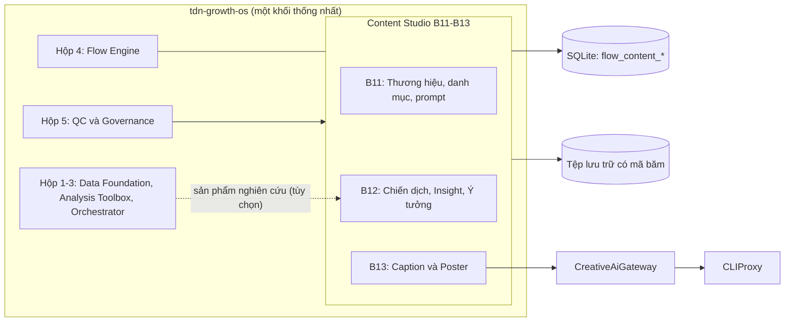
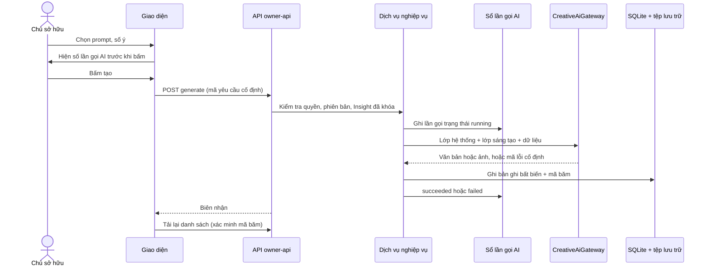
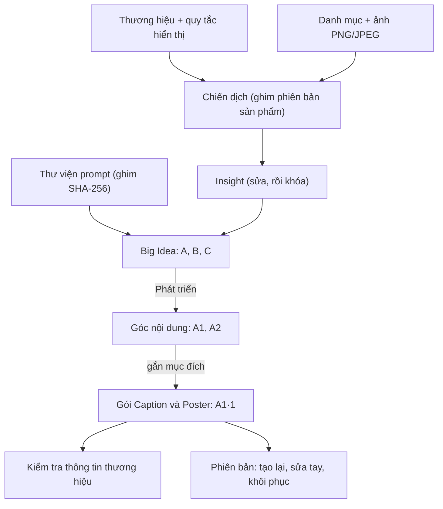
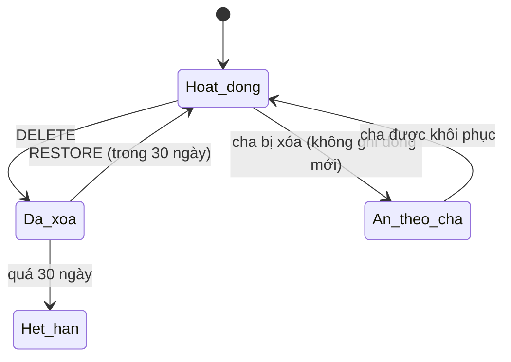

# Content Studio — Thiết kế hệ thống

Mục đích: cho thấy Content Studio nằm ở đâu trong hệ thống, dữ liệu chảy thế nào, các quyết định đã chốt, tình trạng phát hành và việc còn mở.

Cập nhật: 20/10/2026 · Mã nguồn chính: `e9e0f444`

## Mục lục

- Phần 1. Vị trí trong hệ thống năm hộp
- Phần 2. Kiến trúc và luồng dữ liệu
- Phần 3. Các quyết định (ADR, INTENT, chủ sở hữu)
- Phần 4. Tình trạng phát hành và triển khai
- Phần 5. Câu hỏi còn mở

## Phần 1. Vị trí trong hệ thống năm hộp

tdn-growth-os là một khối thống nhất (modular monolith) gồm năm hộp (xem `ARCHITECTURE.md`). Content Studio là ba khối B11–B13 nằm trong Hộp 4 (Flow Engine), dùng chung một cơ sở dữ liệu SQLite với các hộp khác, nhưng bảng riêng tiền tố `flow_content_*`.

Quan hệ với báo cáo thị trường: chiến dịch có thể mở từ một sản phẩm nghiên cứu (đường dẫn `#/content/new/<mã sản phẩm>`). Theo D26 và D33 trong `INTENT.md`, mục "Duyệt" (`APPROVE`) của B10 chỉ bị đóng băng cho chiến dịch có liên kết với sản phẩm nghiên cứu. Ngoài ra Content Studio không phụ thuộc kết quả phân tích.

Tên các hộp lấy từ `ARCHITECTURE.md`. Mũi tên từ Hộp 1-3 và Hộp 5 vào Content Studio chỉ minh họa quan hệ, không phải phụ thuộc cứng (cần xác nhận).

## Phần 2. Kiến trúc và luồng dữ liệu

Các lớp:

- Giao diện: React + Vite, đường dẫn băm (`frontend/src/`), có chế độ demo.
- API: `node:http`, đọc `/api/content/*`, ghi của chủ sở hữu `/owner-api/content/*` (`src/api/content-api.ts`, `content-ideas-api.ts`, `content-packages-api.ts`).
- Dịch vụ nghiệp vụ: `src/modules/flow/content-*.ts`.
- Cổng AI: `src/platform/ai/creative-ai-gateway.ts` → bộ điều hợp CLIProxy.
- Lưu trữ: SQLite (migration 0021–0029 và 0034) cùng tệp lưu trữ có mã băm, mỗi lần đọc xác minh lại.

Chuỗi nghiệp vụ và mã nhánh:

Vòng đời xóa mềm:

Điểm thiết kế đáng chú ý:

- Bất biến và có phiên bản: sửa là thêm bản mới, ghi có điều kiện `expectedVersion` hoặc `expectedSequence`; sai thì 409, gửi lại đúng thì no-op.
- Gọi AI đồng bộ, một khóa thực thi cho mỗi cơ sở dữ liệu, quét lúc khởi động đánh dấu lần gọi dở dang là bị gián đoạn, không tự thử lại (ADR 0004).
- Giá trị liên hệ không đi vào mô hình; hệ thống tự thêm khối liên hệ.
- Lớp prompt hệ thống ghim bằng SHA-256; người dùng chỉ sửa được lớp sáng tạo.
- Lỗi AI trả mã cố định và thông báo cố định, không lộ văn bản nhà cung cấp, URL hay khóa.

## Phần 3. Các quyết định (ADR, INTENT, chủ sở hữu)

- ADR 0003 (`docs/adr/0003-content-studio-b11-b13.md`): Content Studio là B11–B13 trong khối thống nhất, một cơ sở dữ liệu, migration có thứ tự, API đọc/ghi tách đôi. ADR ghi thư mục `src/modules/flow/content/`, nhưng mã thực tế là các tệp phẳng `src/modules/flow/content-*.ts`.
- ADR 0004 (`docs/adr/0004-content-ai-synchronous-attempts.md`): gọi AI đồng bộ có sổ lần gọi, một khóa thực thi, không tự thử lại, hiện số lần gọi trước.
- INTENT D26 và D33 (`INTENT.md`): mục "Duyệt" của B10 chỉ bị đóng băng cho chiến dịch gắn với sản phẩm nghiên cứu. Tiêu đề "D33" xuất hiện hai lần trong tệp; đánh số lại là quyết định của chủ sở hữu.
- Quyết định Q6: xóa suy diễn, cha bị xóa thì con bị ẩn mà không ghi thêm dòng; hạn sớm nhất áp dụng.
- Cửa sổ khôi phục: 30 ngày (bản thiết kế cũ từng ghi 24 giờ, đã bỏ).
- Chủ sở hữu quyết: byte ảnh và EXIF lưu nguyên, gửi nguyên cho dịch vụ tạo ảnh; Poster gửi 1 ảnh tham chiếu.
- Chủ sở hữu quyết (28/09/2026): id mô hình văn bản nhỏ của sản phẩm được định tuyến sang id mạnh hơn ở nhà cung cấp, vì cổng không có id gốc (ghi trong `src/platform/ai/creative-ai-gateway.ts`).
- Kiểm tra thông tin thương hiệu chỉ cảnh báo, không chặn.

## Phần 4. Tình trạng phát hành và triển khai

Nguồn: `docs/content-studio-release.md`.

Tình trạng mã: mọi lát xây dựng đã gộp vào nhánh chính: 047 thiết kế (#44), 048 thương hiệu (#45), 048b danh mục và ảnh (#46), 048c thư viện prompt (#47), 048d chiến dịch (#50), 049 hạ tầng AI (#53), 050a Insight (#56), 050b Big Idea và Góc (#57), 051 Caption & Poster (#58), cùng #68 định tuyến mô hình (migration 0034). Nhiệm vụ 052 (AI đề xuất chỉnh sửa) hoãn sang bản sau. Commit liên quan gần nhất: `df84a183` (30/09/2026, sửa nội suy prompt Poster) và gộp #90 (`02eb59e3`, 01/10/2026). Nhánh chính hiện tại: `e9e0f444`.

Chưa làm (kế hoạch):

- AI đề xuất chỉnh sửa Caption và Poster (nhiệm vụ 052): Chưa làm, hoãn theo quyết định chủ sở hữu 25/09/2026. Sửa tay và khôi phục phiên bản đã có.
- Nghiệm thu thực tế (nhiệm vụ 053): đã chạy trên máy chủ Fedora ngày 29/09/2026 ở commit `2b208cd` với 6 lần gọi AI thật (Big Idea, Góc, 2 gói Caption & Poster cho cả hai mô hình ảnh), đều thành công. Việc tắt máy Windows còn chờ chủ sở hữu sau một thời gian dùng thật.

Triển khai lên máy chủ thật: cần chủ sở hữu cho phép riêng bằng câu lệnh "deploy" kèm mã commit. Tài liệu phát hành chỉ ghi lần chạy nghiệm thu ngày 29/09/2026; tình trạng triển khai sản xuất hiện nay cần xác nhận với chủ sở hữu. Báo cáo thị trường (hệ thống riêng) đang chạy ở một commit khác và không đồng nghĩa với việc Content Studio đã triển khai.

Ước tính sơ bộ (phán đoán, không phải cam kết): nếu chủ sở hữu cho triển khai lên bản mới nhất, chạy migration, bật cổng AI, chạy thử các luồng và rà soát khoảng nửa ngày đến một ngày. Phần AI đề xuất chỉnh sửa (052) chưa có ước tính vì chưa chốt phạm vi.

## Phần 5. Câu hỏi còn mở

1. Có triển khai Content Studio lên môi trường sản xuất không, và khi nào (chủ sở hữu quyết)?
2. Có làm phần AI đề xuất chỉnh sửa (nhiệm vụ 052) không, phạm vi ra sao?
3. Đánh số lại D33 trùng trong `INTENT.md` (chủ sở hữu quyết).
4. Cập nhật `ARCHITECTURE.md` (còn ghi Express) và ADR 0003 (đường dẫn thư mục) cho khớp mã.
5. Khay "Đang tạo" thống nhất trên mọi màn hình: hiện có khung tiến trình ở từng trang, mức hoàn thiện cần xác nhận.
6. Quy tắc lưu trữ/xóa mục danh mục sản phẩm (hiện chưa có, chưa có quyết định).
7. Thời điểm tắt máy Windows sau thời gian dùng thật trên Fedora.
