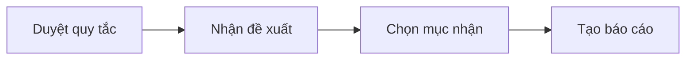
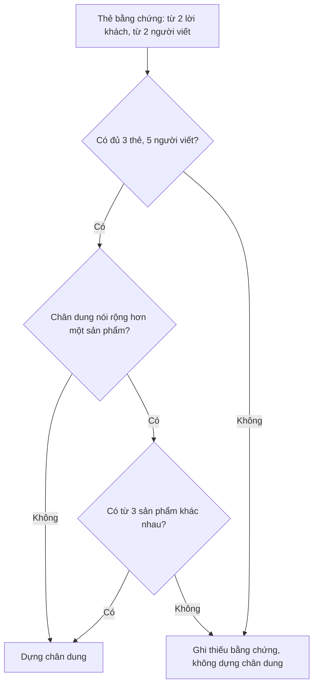

# Hướng dẫn sử dụng báo cáo Insight (khách hàng)

Mục đích: giúp chủ dự án hiểu báo cáo Insight. Tài liệu trả lời bốn câu hỏi:

- Báo cáo Insight dùng để làm gì?
- Báo cáo Insight khác báo cáo Market ở đâu?
- Hôm nay dùng được đến đâu?
- Phần nào chưa làm?

Cập nhật: 20/10/2026 · Commit chính: `e9e0f444`
> Trạng thái: **TẠM NGỪNG** theo quyết định của chủ dự án ngày 19/10/2026 (làm Market trước). Tài liệu này chỉ mô tả những gì đã có trong mã. Mọi thứ chưa có được ghi rõ là **Kế hoạch** hoặc **Chưa làm**.

## Mục lục

- Phần 1. Báo cáo Insight là gì và dùng để làm gì
- Phần 2. Khác nhau giữa Insight và Market
- Phần 3. Hôm nay dùng được những gì
- Phần 4. Cách bắt đầu một phiên có báo cáo Insight
- Phần 5. Cách đọc báo cáo Insight
- Phần 6. Gán mã lời khách (mã hóa bình luận)
- Phần 7. Chân dung khách và thẻ bằng chứng
- Phần 8. Những điều báo cáo sẽ không bao giờ làm
- Phần 9. Chưa có gì và khi nào có
- Phần 10. Câu hỏi thường gặp
- Phần 11. Giải thích thuật ngữ

## Phần 1. Báo cáo Insight là gì và dùng để làm gì

Báo cáo Insight trả lời câu hỏi: **khách hàng thật sự nói gì** về sản phẩm. Báo cáo cho biết:

- vì sao khách mua;
- vì sao khách ngần ngại;
- khách còn thiếu điều gì.

Báo cáo đọc lời khách (đánh giá, bình luận) và xếp lời đó vào các chủ đề. Mỗi chủ đề có câu trích nguyên văn để bạn tự kiểm.

Báo cáo có 17 mục đánh số I01 đến I17 (tên mục lấy từ `src/modules/analysis/reader-report/insight-projection.ts`), gồm:

- I01 Câu hỏi kinh doanh, I02 Khách hàng và hoàn cảnh, I03 Phương pháp nghiên cứu
- I04 Hành vi, I05 Cảm nhận và thái độ, I06 Hành trình, I07 Lý do lựa chọn
- I08 Rào cản, I09 Nhu cầu chưa được đáp ứng, I10 Chủ đề và mối quan tâm
- I11 Khác biệt giữa các nhóm, I12 Điểm tiếp xúc, I13 Thương hiệu và đối thủ
- I14 Hướng cơ hội, I15 Định hướng chiến lược, I16 Thử nghiệm và đo lường, I17 Phụ lục và bằng chứng

Phía trên các mục là phần **Kết luận chính** (tối đa 6 nhận định, mỗi nhận định kèm bằng chứng và phạm vi).

Nguyên tắc nền: bạn truy được mọi câu về lời nguồn thật. Con số do AI đưa ra luôn mang nhãn "đề xuất, chờ chủ duyệt".

## Phần 2. Khác nhau giữa Insight và Market

| Điểm so sánh | Báo cáo Market | Báo cáo Insight |
| --- | --- | --- |
| Câu hỏi | Thị trường lớn cỡ nào, ai bán, bán bao nhiêu, giá ra sao | Khách nghĩ gì, cần gì, ngại gì |
| Dữ liệu chính | Số bán, doanh thu, video bán hàng, số liệu vĩ mô | Lời khách: đánh giá, bình luận |
| Đơn vị đếm | Sản phẩm, thương hiệu, doanh thu | Bản ghi (một đánh giá hoặc một bình luận), không đếm người |
| Mức sẵn sàng hôm nay | Đang là ưu tiên số 1, đã tự động hóa nhiều bước | Có bản nháp và công cụ gán mã, nhưng tạm ngừng; chưa có bước chủ duyệt rồi phát hành |
| Bình luận Shopee | Chỉ ghi là nguồn được đếm (số lượng, nhãn "review công khai trên Shopee", mốc 300, giới hạn). Không có bảng chủ đề, không trích lời | Là nguồn chính, nhưng phải gán mã trước khi đưa lên báo cáo |

Quyết định của chủ (19/10): không bao giờ đưa bình luận thô lên báo cáo. Hệ thống xử lý bình luận trước (gán mã chủ đề, trích đúng nguyên văn) rồi mới dùng. Việc gán mã chủ đề thuộc về Insight, không thuộc Market.

Hai báo cáo dùng chung một phiên "Nghiên cứu tự động". Khi tạo phiên, bạn chọn một trong ba lựa chọn:

- "Cả hai" (Thị trường và Insight);
- "Chỉ Thị trường";
- "Chỉ Insight".

## Phần 3. Hôm nay dùng được những gì

Đã có trong mã (đã mô tả ở các tệp trong `frontend/src/research-automation/`):

1. Chọn soạn báo cáo Insight khi tạo phiên nghiên cứu tự động.
2. Mở bản nháp báo cáo Insight (bản xem trên web và bản PDF nếu phiên cho phép) trong khung "Các phiên bản báo cáo".
3. Nút **Duyệt gán mã Insight**: soạn quy tắc mã hóa, xem đề xuất của AI, chọn mục muốn nhận, rồi tạo phiên bản báo cáo mới.
4. Nút **Xem thẻ và chân dung đề xuất**: tạo thẻ bằng chứng và chân dung đề xuất từ đánh giá Shopee đã lưu.
5. Phần "Chuẩn bị mẫu cho model thứ hai" để so sánh hai lượt gán mã. Chức năng này cần cấu hình riêng (cần xác nhận cấu hình đã bật).

**Lưu ý:** mở khóa OWNER (quyền chủ sở hữu) trên trang trước khi gọi AI hoặc tạo bản nháp. Không có khóa, trang chỉ cho xem.

Bản nháp luôn ghi "Bản nháp · Chờ chủ duyệt". Hiện **chưa có nút duyệt rồi phát hành** cho báo cáo Insight (xem Phần 9).

## Phần 4. Cách bắt đầu một phiên có báo cáo Insight

1. Mở trang **Nghiên cứu tự động** của workspace. Đường dẫn có dạng `#/markets/<mã workspace>/research`.
2. Nhập từ khóa sản phẩm và kỳ nghiên cứu.
3. Ở mục "Báo cáo cần soạn", chọn **Cả hai** hoặc **Chỉ Insight**.
4. Bấm nút bắt đầu ("Bắt đầu tìm nhanh").
5. Chốt phạm vi bằng tay ở bước xác nhận phạm vi.
6. Theo dõi phiên. Địa chỉ phiên có dạng `#/markets/<mã workspace>/research/<mã phiên>`. Nếu bạn tải lại trang, trang vẫn mở đúng phiên.
7. Khi có bản nháp, vào khung **Các phiên bản báo cáo** và chọn phiên bản.
8. Mở "Báo cáo Insight".

**Lưu ý:** quy định chung của hệ thống kiểm soát nguồn dữ liệu và chi phí (xem Phần 10 của tài liệu Market nếu cần). Báo cáo Insight dùng chung các nguồn lõi với Market. Báo cáo Insight chỉ dùng lời khách đã gán mã.

## Phần 5. Cách đọc báo cáo Insight

- **Trang bìa** ghi "Báo cáo · INSIGHT · Bản nháp · Chờ chủ duyệt".
- **Kết luận chính**: tối đa 6 nhận định. Mỗi nhận định có phần "Nhận định", "Bằng chứng" và phạm vi. Câu phạm vi nhắc rằng đơn vị đếm là bản ghi.
- **Các mục I01 đến I17**: mỗi mục có một câu trả lời ngắn. Nếu chưa đủ bằng chứng, mục ghi "Chưa đủ bằng chứng cho mục này". Đó là kết quả bình thường, không phải lỗi.
- **Chân trang** nhắc hai điều:
  - chủ chưa duyệt báo cáo;
  - quy tắc mã hóa và biên nhận lựa chọn không xác nhận sự thật, độ đại diện hay điều kiện phát hành.
- **Nhãn "đề xuất, chờ chủ duyệt"** nghĩa là AI đề xuất, chưa ai xác nhận.
- Cách ghi tỷ lệ: báo cáo chỉ nêu tỷ lệ khi kho bản ghi đã khai báo đầy đủ mẫu số. Nếu chưa, báo cáo chỉ nêu số đếm và ghi rõ là bản nháp.

## Phần 6. Gán mã lời khách (mã hóa bình luận)

"Gán mã" nghĩa là gắn nhãn chủ đề cho từng lời khách, kèm đoạn trích nguyên văn chứng minh nhãn đó.

Khung **Mã hóa Insight theo nguyên văn nguồn** có ba cách:

1. **Soạn tay**: nhập ba thứ.
   - Câu hỏi nghiên cứu.
   - Tiêu chí đưa bản ghi vào.
   - Cách phân xử khi người mã hóa không thống nhất.

   Hệ thống không gợi ý mã, nhãn ngành hay nhóm khách hàng.
2. **Đề xuất AI cho toàn bộ bản ghi**: AI đề xuất theo lô, tối đa 100 bản ghi mỗi lô. Mỗi lô có hộp xác nhận và có thể phát sinh chi phí. Hệ thống chưa có ước tính chi phí. Có nút "Dừng sau lô đang gửi".
3. **Mã hóa mặc định theo nguồn**: bạn không cần duyệt quy tắc trước. AI đề xuất bộ mã bám nguồn. Chưa mục nào được chấp nhận.

Mỗi bước là **một lần xác nhận riêng**. Mở hoặc tải lại trang không tự gửi gì.

Đoạn trích phải khớp từng ký tự với bản ghi gốc. Nếu không khớp, hệ thống từ chối.

Cách chọn đoạn trích:

1. Gõ hoặc bôi đen đoạn trích.
2. Đọc danh sách các chỗ xuất hiện. Mỗi chỗ có chữ xung quanh.
3. Chọn đúng chỗ.

**Cảnh báo:** nếu kết quả chưa rõ (ví dụ mất kết nối giữa chừng), đừng tạo yêu cầu mới. Trang **giữ nguyên yêu cầu cũ** để bạn đọc lại. Yêu cầu mới có thể gọi AI hai lần.

## Phần 7. Chân dung khách và thẻ bằng chứng

Chủ đã cho phép chân dung do AI tổng hợp (07/10), với điều kiện mỗi chân dung dựa trên thẻ bằng chứng là lời khách thật.

Quy tắc đang được mã kiểm tra:

- **Thẻ bằng chứng**: một tình huống, có ít nhất 2 lời khách từ ít nhất 2 người viết khác nhau.
- **Chân dung** cần ba điều kiện:
  - ít nhất **3 thẻ khác nhau**;
  - ít nhất **5 người viết**;
  - ít nhất **3 sản phẩm** khác nhau trong nguồn, nếu chân dung nói rộng hơn một sản phẩm.
- Nếu nguồn không có mã người viết, hệ thống dùng 5 nội dung khác nhau thay thế. Khi đó báo cáo phải ghi: "nguồn không có mã người viết; chưa xác minh là 5 người".
- Mỗi thuộc tính (tình huống, nhu cầu, lo lắng, lý do mua, kênh) phải bằng đúng một đoạn trích nguyên văn. Hệ thống bỏ thuộc tính không có trích dẫn.
- Phiên bản đầu **không có** tuổi, giới, thu nhập, nơi ở, nghề nghiệp.
- Nhãn bắt buộc: "Chân dung do AI tổng hợp từ lời khách thật, không phải một khách hàng có thật".
- Quy mô chỉ ghi dạng "x/y bản ghi trong mẫu — đề xuất, chờ chủ duyệt".
- Không có lời khách do AI tự viết, không có câu trả lời khảo sát giả.
- Nếu chưa đủ bằng chứng, hệ thống ghi thiếu bằng chứng và không dựng chân dung giả.

Hiện chỉ làm được với **đánh giá Shopee**. Bình luận TikTok: Chưa làm.

Cách dùng có ba bước. Mỗi bước cần một lần xác nhận riêng:

1. Đề xuất bộ mã.
2. Phân loại các lô.
3. Đề xuất thẻ và chân dung.

Sau ba bước, bấm nút tạo báo cáo nháp từ đề xuất đã chọn.

## Phần 8. Những điều báo cáo sẽ không bao giờ làm

- Không đưa bình luận thô lên báo cáo.
- Không nêu tên công cụ lấy dữ liệu, bộ dữ liệu giả lập hay tên mô hình AI trong báo cáo gửi khách. Báo cáo ghi nguồn Shopee là "review công khai trên Shopee".
- Không đề xuất "đi mua hàng".
- Không xếp hạng ngầm, không cộng số của Shopee với TikTok.
- Không khẳng định thị phần hay quy mô toàn thị trường từ lời khách.
- Không suy ra ngày sự kiện từ ngày thu thập; ngày nguồn chưa xác lập kỳ đo lường.
- Không tự duyệt, không tự phát hành.

**Lưu ý:** câu trích nguyên văn có thể chứa thông tin cá nhân. Hệ thống không che thông tin này và nói rõ điều đó.

## Phần 9. Chưa có gì và khi nào có

**Chưa làm hoặc đang chặn.** Bảng này theo mã hiện tại và bản rà soát độ phủ trong `docs/research/ultimate-method/coverage-209/insight.md`. Bản rà này có thể đã cũ, nên ghi "cần xác nhận".

| Việc | Trạng thái |
| --- | --- |
| Bước chủ duyệt bộ mã rồi phát hành báo cáo Insight | Chưa làm; báo cáo luôn là bản nháp |
| Thống kê kiểm chéo giữa hai lượt gán mã | Chưa có; chờ chủ quyết định cách tính |
| Chân dung từ bình luận TikTok | Chưa làm |
| Lớp "người bán nhắm tới" (lời người bán) | Chưa có mã |
| Dữ liệu shop của chủ (S12) | Chưa có đường thu |
| Gợi ý ngầm từ bộ persona tổng hợp | Kế hoạch; chưa nối vào ứng dụng, và không bao giờ được nêu tên trong báo cáo |
| Tự động hóa Insight ở mức Market (không chạm tay) | Kế hoạch |

**Khi nào có:** Insight chờ báo cáo Market đạt 14/14 quy tắc bằng tự động hóa (quyết định 17/10 và 19/10).

Ước tính sơ bộ, chưa phải cam kết: sau khi chủ mở lại, cần khoảng 1 đến 2 tuần để Insight đạt mức tự động như Market. Ước tính này giả định hai điều:

- dùng lại luồng Market;
- chủ ra đủ quyết định.

## Phần 10. Câu hỏi thường gặp

**Vì sao báo cáo Insight nhiều chỗ ghi "chưa đủ bằng chứng"?** Vì hệ thống không điền khoảng trống. Thiếu dữ liệu thì ghi thiếu, không ghi 0.

**Vì sao không thấy lời khách trong báo cáo Market?** Theo quyết định ngày 19/10, Market chỉ đếm số đánh giá và nêu giới hạn. Lời khách và chủ đề thuộc Insight.

**Tại sao không bấm được nút gọi AI?** Có ba nguyên nhân thường gặp:

- bạn chưa mở khóa OWNER;
- một thao tác khác đang chạy;
- máy chủ chưa bật cấu hình AI.

Dòng giải thích hiện ngay dưới nút.

**Bấm nhầm hoặc mất mạng giữa chừng?** Bấm nút "Thử lại đúng yêu cầu" hoặc "Đọc lại". Đừng tạo yêu cầu mới, vì hệ thống có thể gọi AI hai lần.

**Có phải Insight giống trang "Insight" trong Content Studio không?** Không. Content Studio có mục Insight riêng để viết ý tưởng nội dung (khóa insight, chiến dịch). Đó là sản phẩm khác, xem tài liệu Content Studio.

## Phần 11. Giải thích thuật ngữ

| Từ | Nghĩa đơn giản |
| --- | --- |
| Insight | Hiểu biết về khách hàng rút ra từ lời họ viết |
| Bản ghi | Một đánh giá hoặc một bình luận; đơn vị đếm của Insight |
| Gán mã (mã hóa) | Gắn nhãn chủ đề cho lời khách, kèm đoạn trích chứng minh |
| Bộ mã (codebook) | Danh sách chủ đề và định nghĩa dùng để gán mã |
| Thẻ bằng chứng | Nhóm lời khách thật cùng một tình huống, làm nền cho chân dung |
| Chân dung (persona) | Mô tả một kiểu khách, do AI tổng hợp từ thẻ bằng chứng |
| Trích nguyên văn | Đoạn chữ lấy y nguyên từ bản ghi gốc |
| Mẫu số | Tổng số bản ghi dùng để tính tỷ lệ |
| OWNER | Quyền chủ sở hữu, cần để ghi hoặc gọi AI |
| Bản nháp | Chưa được chủ duyệt, chưa phát hành |
| Kế hoạch | Dự định, chưa có trong mã |
| Kiểm chéo | Cho hai lượt gán mã độc lập rồi so sánh khác biệt |
