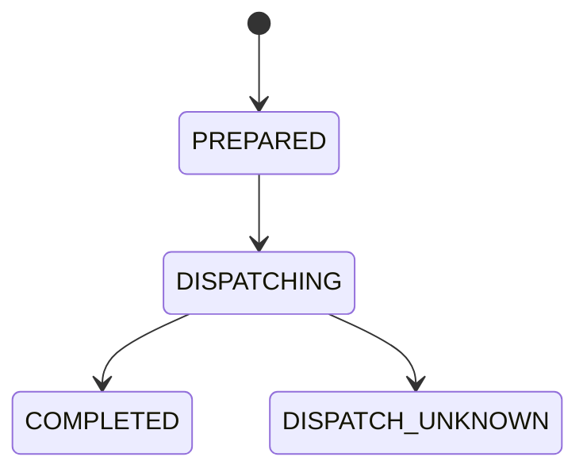
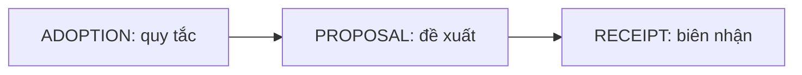
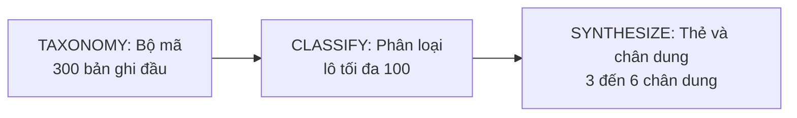

# Tài liệu kỹ thuật báo cáo Insight (khách hàng)

Mục đích: mô tả những gì đang có trong mã cho báo cáo Insight. Tài liệu gồm:

- mô-đun, đường dẫn API, bảng và cờ cấu hình;
- gán mã bình luận;
- quy tắc chân dung và thẻ bằng chứng;
- kiểm thử.

Tài liệu ghi "Kế hoạch" cho phần chưa có.

Cập nhật: 20/10/2026 · Commit chính: `e9e0f444`
Commit chính: `e9e0f444` (nhánh `main`)

> Trạng thái sản phẩm: TẠM NGỪNG theo quyết định chủ dự án ngày 19/10/2026. Mã vẫn nằm trong `main`; không có bước duyệt rồi phát hành, báo cáo luôn là bản nháp.

> Lưu ý trùng tên: `frontend/src/InsightPage.tsx`, `src/modules/flow/content-insight-service.ts`, migration `0026_flow_content_insights.sql` và `contracts/flow/content-insight-*.schema.json` thuộc **Content Studio** (khóa và sửa insight cho chiến dịch). Đó KHÔNG phải báo cáo Insight. Các bài kiểm thử `content-insight-*` cũng thuộc Content Studio.

## Mục lục

- Phần 1. Tổng quan và ranh giới
- Phần 2. Mô-đun phía máy chủ
- Phần 3. Đường dẫn API
- Phần 4. Bảng dữ liệu và migration
- Phần 5. Cờ cấu hình
- Phần 6. Gán mã bình luận (comment coding)
- Phần 7. Thẻ bằng chứng và chân dung (persona)
- Phần 8. Dựng báo cáo Insight
- Phần 9. Giao diện (frontend)
- Phần 10. Kiểm thử
- Phần 11. Giới hạn đã biết và việc chưa làm
- Phần 12. Giải thích thuật ngữ

## Phần 1. Tổng quan và ranh giới

- Báo cáo Insight là một loại báo cáo của phiên "Nghiên cứu tự động" (`analysis_research_automation_runs`, cột `reports` nhận `MARKET`, `INSIGHT` hoặc `MARKET,INSIGHT`; migration `0038_research_automation.sql`).
- Mô-đun gán mã chỉ **sở hữu quy tắc, đề xuất và biên nhận**. Mô-đun không chạy nhà cung cấp dữ liệu và không duyệt báo cáo (ghi chú đầu `src/modules/analysis/research-automation/insight-coding.ts`).
- Mọi ghi vào luồng Insight cần người ghi OWNER (`configuration.owner`, vai trò `OWNER`).
- Đơn vị đếm là **bản ghi** (một đánh giá hoặc một bình luận), không đếm người.

## Phần 2. Mô-đun phía máy chủ

Thư mục `src/modules/analysis/research-automation/`:

| Tệp | Vai trò |
| --- | --- |
| `insight-coding.ts` | Quy tắc mã hóa, đề xuất, biên nhận; chuỗi ADOPTION, PROPOSAL, RECEIPT |
| `insight-default-coding.ts` | Mã hóa mặc định theo nguồn (đề xuất, chờ chủ duyệt) |
| `insight-model-execution.ts` | Gọi mô hình AI theo lô; prompt phiên bản v1 đến v4, lược đồ đóng băng `insight-model-prompt-v1..v4-schemas.json`; v4 là mặc định |
| `insight-literal-bridge.ts`, `insight-literal-source.ts` | Cầu nối nguồn nguyên văn sang bằng chứng |
| `literal-review-coding.ts`, `literal-codebook-proposal.ts` | Gán mã theo quy tắc xác định, khớp ký tự phân biệt hoa thường, vị trí UTF-16; không có chữ khớp không có nghĩa là chủ đề vắng |
| `insight-crosscheck*.ts` | Kiểm chéo bằng mô hình thứ hai trên mẫu tối đa 200 bản ghi |
| `insight-persona-contracts.ts`, `insight-persona-evidence.ts`, `insight-persona-model.ts`, `insight-persona-projection.ts`, `insight-persona-report.ts` | Thẻ bằng chứng, chân dung, báo cáo chân dung |
| `private-review-corpus.ts`, `private-insight-source.ts`, `review-corpus.ts` | Kho bản ghi đánh giá và chiếu nguồn riêng |
| `review-topic-ranking.ts` | Xếp hạng chủ đề E15 |
| `located-review-bridge.ts`, `native-source-review-bridge.ts` | Cầu nối bản ghi có định vị |
| `tiktok-comment-intake.ts` | Lọc bình luận TikTok (chưa nối vào báo cáo Insight) |
| `shopee-coding.ts` | Gán mã đánh giá Shopee (phía báo cáo đọc Shopee) |
| `i14-cliproxy-transport.ts` | Kênh gọi AI cho I14, gán mã Insight, gán mã TikTok, gán mã Shopee |
| `decision-packets.ts` | Gói quyết định |

Mô-đun khác:

- `src/modules/analysis/located-insight-methods.ts`: `buildLocatedInsightMethods`; I06 chỉ ghép trong cùng một bản ghi; I09 ghi rõ khoảng trống; lỗi `LocatedInsightValidationError`.
- `src/modules/analysis/insight-corpus-counts.ts`: chỉ tính tỷ lệ khi kho bản ghi khai báo đầy đủ (trạng thái COMPLETE).
- `src/modules/analysis/bounded-analysis-gates.ts`: cổng I11, I12, I16.
- `src/modules/analysis/report-visible-text-lint.ts`: kiểm tra chữ hiển thị (U13).
- `src/modules/analysis/reader-report/`: `insight-build-v1.ts`, `insight-template.ts`, `insight-projection.ts`, `insight-input-v1.ts`, `insight-web-context.ts`, `insight-meta-ads.ts`, `lint.ts`.
- `src/modules/analysis/report-located-insight-extension.ts`, `report-located-insight-pages.ts`.

Hợp đồng dữ liệu nằm trong `contracts/analysis/`. Mọi tệp có đuôi `.schema.json`:

- `automation-insight-coding`, `-coding-snapshot`, `-crosscheck`, `-model`, `-persona`, `-persona-report`, `-report-revision`, `-selection`;
- `insight-literal-evidence`, `insight-reader-input`, `located-insight-methods`, `private-insight-source-projection`.

Hợp đồng API nằm trong `contracts/api/`, cũng có đuôi `.schema.json`: `research-automation-insight-coding-api`, `-crosscheck-api`, `-model-api`, `-persona-api`.

## Phần 3. Đường dẫn API

Tiền tố: `/api` hoặc `/owner-api` cộng `/workspaces/<id>/research-automation/runs/<runId>/<hành động>`. Bộ so khớp nằm ở `researchAutomationApiPath` và biểu thức chính quy trong `src/api/research-automation-api.ts` (quanh dòng 523 đến 576). Hằng `MAX_INSIGHT_CODING_BYTES` giới hạn thân yêu cầu ghi Insight.

| Phương thức | Hành động | Ghi chú |
| --- | --- | --- |
| GET | `reports/market`, `reports/insight` (và `/pdf`) | Bản báo cáo hiện tại |
| GET | `report-versions/<64 hex>/reports/(market\|insight)` (và `/pdf`) | Theo phiên bản |
| GET | `insight-coding/<64 hex>` | Đọc ảnh chụp mã hóa |
| POST | `insight-coding-adoptions` | Chấp nhận quy tắc (gốc chuỗi) |
| POST | `insight-coding-proposals` | Tạo đề xuất |
| POST | `insight-coding-literal-proposals` | Đề xuất theo quy tắc nguyên văn |
| POST | `insight-coding-receipts` | Biên nhận lựa chọn |
| POST | `insight-coding-model-proposals` | Đề xuất bằng AI theo lô |
| POST | `insight-coding-default-model-proposals` | Đề xuất AI mặc định theo nguồn |
| POST, GET | `insight-crosscheck-preparations` (GET theo `<uuid>`) | Chuẩn bị mẫu kiểm chéo |
| GET | `insight-crosscheck-availability/<64 hex>` | Có thể kiểm chéo không |
| POST | `insight-persona-model-proposals` | Tạo đề xuất theo ba giai đoạn |
| GET | `insight-personas/<64 hex>`, `insight-persona-evidence/<uuid>` | Đọc chân dung và bằng chứng |
| POST | `reader-reports/insight` | Dựng bản đọc của báo cáo Insight |

`reader-reports/tiktok` và `reader-reports/shopee` là bản dựng phía Market, không phải Insight.

## Phần 4. Bảng dữ liệu và migration

- `0038_research_automation.sql`: phiên chạy (`analysis_research_automation_runs`), kết quả đầu ra (`analysis_research_automation_outputs`) với `report_kind` MARKET/INSIGHT.
- `0041_analysis_report_revision_attempts.sql`: lượt thử bản sửa (`analysis_research_automation_attempt_outputs`).
- `0042` và `0047`: bảng lần chạy AI `analysis_research_automation_ai_executions`.
  - Trạng thái: `PREPARED`, `DISPATCHING`, `COMPLETED`, `DISPATCH_UNKNOWN`.
  - `0047` thêm mã mục `INSIGHT_CODING` cùng các cột `coding_adoption_id`, `coding_request_key`, `coding_previous_proposal_id`.
  - Mã mục hiện có: I14, M11, M12, I15, INSIGHT_CODING.
  - Mã lỗi xác nhận: `INVALID_INSIGHT_CODING_RESPONSE`.
  - Mã không rõ kết quả: `INTERRUPTED_AFTER_CLAIM`, `TRANSPORT_OUTCOME_AMBIGUOUS`, `RESPONSE_NOT_RETAINED`.
- `0045_analysis_insight_coding.sql`: bảng `analysis_insight_coding_evidence` với các loại `ADOPTION`, `PROPOSAL`, `RECEIPT`.
  - Chuỗi cha: ADOPTION là gốc; cha của PROPOSAL là ADOPTION; cha của RECEIPT là PROPOSAL.
  - Các trigger `insight_coding_no_update` và `insight_coding_no_delete` (báo lỗi `immutable_insight_coding`) làm bản ghi bất biến.
  - Trigger `insight_coding_parent` kiểm tra bản ghi cha.
  - Cột có `pair_sha256`, `request_key` (UNIQUE), `artifact_sha256`, `artifact_json`.
- `0050_analysis_reader_report_kinds.sql`: thêm `report_kind` MARKET/INSIGHT cho phiên bản báo cáo đọc (bảng v2).
- `0052_analysis_tiktok_coding_executions.sql`, `0053_analysis_shopee_coding_executions.sql`: lần chạy gán mã theo nền tảng, dùng cho bản đọc TikTok và Shopee phía Market (không có bước chủ duyệt thủ công).
- `0054` đến `0059`: tiêu thụ báo cáo Shopee, auto-run và thử lại, nguồn gốc/tiêu đề PageIndex, các giai đoạn đánh giá.

Trạng thái của một lần chạy AI trong bảng `analysis_research_automation_ai_executions`:

## Phần 5. Cờ cấu hình

Chỉ ghi tên biến, không ghi giá trị.

| Biến | Tác dụng |
| --- | --- |
| `TDN_RESEARCH_INSIGHT_CODING_AI_ENABLED` | Chỉ nhận đúng `true` hoặc `false`. Khi bật cần có CLIProxy và bật ghi OWNER |
| `TDN_RESEARCH_INSIGHT_CODING_AI_MODEL` | Bắt buộc có tên mô hình tường minh khi bật |
| `TDN_RESEARCH_SHOPEE_CODING_AI_ENABLED`, `TDN_RESEARCH_SHOPEE_CODING_AI_MODEL` | Gán mã Shopee phía Market |
| `TDN_RESEARCH_TIKTOK_CODING_AI_ENABLED`, `TDN_RESEARCH_TIKTOK_CODING_AI_MODEL` | Gán mã TikTok phía Market |

- Đường dẫn mô hình chân dung dùng lại cấu hình AI của gán mã Insight.
- Cấu hình mô hình thứ hai cho kiểm chéo (`insightCrosscheck`) được định kiểu và xử lý trong `src/api/research-automation-api.ts`, nhưng không thấy chỗ truyền cấu hình này trong `src/api/operator-app.ts` (cần xác nhận).
- Khi AI chưa bật, nút gọi AI bị khóa và giao diện giải thích lý do.

## Phần 6. Gán mã bình luận (comment coding)

Chuỗi bằng chứng bất biến có ba bước: ADOPTION (quy tắc đã duyệt), PROPOSAL (đề xuất), RECEIPT (biên nhận chọn lựa). Mỗi bước là một yêu cầu riêng. Mỗi yêu cầu có `request_key` duy nhất để đọc lại an toàn.

Họ mã được định vị trong lược đồ: I01, I02, I04, I05, I06, I07, I08, I09, I10, I13.

Cách hoạt động:

1. **Quy tắc (ADOPTION)**: câu hỏi nghiên cứu, tiêu chí đưa vào, cách phân xử. I06 và I09 dùng chung câu hỏi. I10 và I13 cần kho riêng, gồm năm thứ:
   - đơn vị;
   - tiêu chí đưa vào;
   - lấy mẫu ngoài;
   - bản ghi thành viên;
   - bộ mã do chủ đặt.

   Hệ thống không gợi ý sẵn mã, nhãn hay phân đoạn.
2. **Đề xuất theo nguyên văn**: quy tắc xác định, khớp ký tự phân biệt hoa thường, vị trí UTF-16 chính xác (`literal-review-coding.ts`).
3. **Đề xuất AI**: chạy theo lô, tối đa 100 bản ghi mỗi lô.
   - Hệ thống dừng ở lô đầu tiên có kết quả không rõ, mâu thuẫn hoặc không hợp lệ.
   - Hệ thống không tự thử lại.
   - Hệ thống chưa ước tính chi phí.
   - Câu trích của AI phải khớp từng ký tự với bản ghi gốc.
4. **Mặc định theo nguồn** (`insight-default-coding.ts`): một mã cho mỗi bản ghi theo kho I10/I13 trừ khi khai báo nhiều mã; tất cả là đề xuất, chờ chủ duyệt.
5. **Kiểm chéo**: mẫu tối đa 200 bản ghi, xếp hạng bằng sha256 (`sha256-ranked-source-records-v1`). Mô hình thứ hai chạy độc lập và chỉ trả về khác biệt nguyên văn. Không có hệ số κ hay thống kê đồng thuận; U11 chưa có. Kiểm chéo không hỗ trợ nguồn Shopee riêng.

Các phiên bản prompt:

- v2 bỏ điều cấm persona do mô hình dựng;
- v3 thêm số đếm nháp;
- v4 là mặc định hiện tại.

Tất cả phiên bản vẫn giữ quy tắc "không đếm người".

Xếp hạng chủ đề E15 (`review-topic-ranking.ts`):

- Hệ thống xếp theo số lần nhắc trên mỗi nền tảng.
- Chủ đề dưới 3 lần gộp vào "Khác".
- Nếu "Khác" trên 20%, hệ thống thu thêm tối đa 1 vòng.

Quy chuẩn dữ liệu đầu vào nêu quy tắc này. Chưa kiểm lại trong mã. Theo bản rà độ phủ, `reader-report/insight-build-v1.ts` chưa gọi hàm này (kiểm một phần).

## Phần 7. Thẻ bằng chứng và chân dung (persona)

Nguồn: chỉ đánh giá Shopee (S05). Nguồn S07 (TikTok) chưa được hỗ trợ.

Giới hạn mang theo trong phép chiếu nguồn: `UNDATED_QUALITATIVE_CONTEXT_ONLY`, `VERBATIM_TEXT_MAY_CONTAIN_PERSONAL_DATA`, `SOURCE_REPORTED_AUTHORS_NOT_INDEPENDENTLY_VERIFIED_PEOPLE`, `NO_CROSS_PLATFORM_JOIN_OR_SUM`, `U11_RELEASE_UNAVAILABLE`. `sourceDateEligibility` luôn là `UNKNOWN`.

Ba giai đoạn (mỗi giai đoạn có hộp xác nhận riêng):

1. **TAXONOMY ("Bộ mã")**: mẫu `retained-source-order-first-300-v1` (300 bản ghi đủ điều kiện đầu tiên theo thứ tự lưu, không ngẫu nhiên, không đại diện).
2. **CLASSIFY ("Phân loại")**: lô tối đa 100. Độ tin cậy có bốn nhóm: HIGH/MEDIUM/LOW/AMBIGUOUS. Hệ thống coi LOW và AMBIGUOUS là chưa phân loại.
3. **SYNTHESIZE ("Thẻ và chân dung")**: dựng thẻ và chân dung. Prompt yêu cầu 3 đến 6 chân dung. Nếu bằng chứng không đủ, mô hình trả `personas:[]` kèm giải thích thiếu bằng chứng.

Quy tắc đủ điều kiện:

- **Thẻ**: ít nhất 2 bản ghi và ít nhất 2 người viết khác nhau (hoặc nội dung khác nhau nếu nguồn không có mã người viết).
- **Chân dung** cần ba điều kiện:
  - ít nhất 3 thẻ đủ điều kiện khác nhau;
  - ít nhất 5 người viết (`MET_WITH_SOURCE_AUTHOR_PROOF`);
  - ít nhất 3 sản phẩm nguồn, nếu phạm vi rộng.
- Dự phòng: 5 nội dung khác nhau, chỉ khi cả nguồn không có mã người viết (`MET_WITH_DISTINCT_CONTENT_FALLBACK`). Nhãn của dự phòng: "nguồn không có mã người viết; chưa xác minh là 5 người".
- Mã chặn: `PERSONA_REQUIRES_THREE_EVIDENCE_CARDS`, `PERSONA_REQUIRES_FIVE_SOURCE_AUTHORS_OR_ABSENT_ID_CONTENTS`, `PERSONA_BROADER_SCOPE_REQUIRES_THREE_SOURCE_PRODUCTS`.
- Loại thuộc tính: SITUATION, NEED, WORRY, PURCHASE_REASON, CHANNEL. Giá trị thuộc tính phải bằng đúng câu trích dẫn. Phiên bản 1 không có thuộc tính nhân khẩu học. Diễn giải không có bằng chứng bị bỏ.
- Hệ thống kiểm câu trích bằng vị trí UTF-16 chính xác. Câu trích không được cắt ngang cặp thay thế (surrogate). Bản ghi gốc đầy đủ hiện cạnh câu trích.
- Mã băm hoặc danh tính người viết không bao giờ vào mô hình, API hay báo cáo.
- Nhãn chân dung: "Chân dung do AI tổng hợp từ lời khách thật, không phải một khách hàng có thật".
- Nhãn quy mô: `x/y bản ghi trong mẫu — đề xuất, chờ chủ duyệt`.
- Trạng thái là `PROPOSED`; `releaseEligibility` là `UNAVAILABLE`.
- Báo cáo chân dung là lựa chọn OWNER tường minh (`personaInsight` có `proposalId` và `proposalSha256`) với nguồn `metric` KEEP và `nativeReview` KEEP. Báo cáo này là bản nháp: không duyệt, không phát hành.
- Luồng chân dung dùng lại vị trí ADOPTION như gốc nội bộ "PERSONA_RULE" (cần xác nhận trong mã) và nhân thực thi `AutomationSynthesisExecutionKernel`.

Chính sách chủ (07/10): cho phép chân dung có thẻ bằng chứng. Hai điều vẫn bị cấm:

- câu trả lời khảo sát do mô hình mô phỏng;
- câu nói ngôi thứ nhất do mô hình viết.

Tài liệu bàn giao `docs/handoffs/NEXT-PERSONA.md` (09/10) ghi P7/U20 mới đạt một phần cho S07. Thống kê U11 và phát hành chưa giải quyết.

Gợi ý ngầm từ bộ persona tổng hợp: **Kế hoạch**, chưa nối vào ứng dụng, không bao giờ nêu tên trong báo cáo.

## Phần 8. Dựng báo cáo Insight

- Tên 17 mục (I01 đến I17) nằm trong `INSIGHT_TITLES` ở `src/modules/analysis/reader-report/insight-projection.ts`.
- "Kết luận chính" dựng từ số đếm từng họ mã, tối đa 6 nhận định.
- Bản đọc là phiên bản trong bảng v2. Ở trạng thái `PENDING_OWNER_REVIEW`, OWNER duyệt hoặc từ chối phiên bản đọc (`ReaderReportPanel.tsx`). Việc này khác với "duyệt rồi phát hành" của báo cáo. Ứng dụng chưa có luồng phát hành, nên báo cáo luôn ghi "Bản nháp · Chờ chủ duyệt".
- Số liệu tỷ lệ chỉ xuất hiện khi kho bản ghi COMPLETE (`insight-corpus-counts.ts`).
- Ngữ cảnh web và quảng cáo Meta: `insight-web-context.ts`, `insight-meta-ads.ts`. Quy tắc quy chuẩn: SerpApi tối đa 3 lần gọi mỗi báo cáo, Meta Ad Library tối đa 5 lần mở trang.
- Quy tắc chữ trong báo cáo gửi khách: không nêu tên nhà cung cấp dữ liệu, công cụ hay mô hình AI. Báo cáo chỉ được nêu: Shopee, TikTok Shop, Meta/Facebook, TikTok, World Bank Open Data, UN Comtrade, Cục Thống kê (nso.gov.vn).
- Bộ kiểm `report-visible-text-lint.ts` thực thi quy tắc này. Danh sách tên cấm cần thêm tên bộ persona tổng hợp và tên mô hình (việc nhỏ trong hàng chờ).

## Phần 9. Giao diện (frontend)

Đường dẫn băm: `#/markets/<workspaceId>/research[/<runId>]` (`frontend/src/research-automation/routes.ts`). Các khung trong `frontend/src/research-automation/`:

- `ResearchEditor.tsx`: chọn "Báo cáo cần soạn" (BOTH hiện nhãn "Cả hai", MARKET, INSIGHT).
- `RunView.tsx`, `SourceStatusBoard.tsx` (hiện "Trần chi").
- `ReportVersionsPanel.tsx`:
  - nút "Duyệt gán mã Insight" / "Đóng gán mã Insight";
  - nút "Xem thẻ và chân dung đề xuất" / "Đóng thẻ và chân dung đề xuất";
  - nạp lười `InsightCodingPanel` và `InsightPersonaPanel`;
  - dòng ghi "Mở hoặc xuất không chạy AI".
- `InsightCodingPanel.tsx` ("Mã hóa Insight theo nguyên văn nguồn"), `InsightCodingRuleForm.tsx`.
- `InsightModelProposalPanel.tsx`: nút "Tạo đề xuất AI cho toàn bộ bản ghi", "Dừng sau lô đang gửi", "Ngắt lô đang gửi".
- `InsightDefaultProposalPanel.tsx`.
- `InsightCrosscheckPanel.tsx`: "Chuẩn bị mẫu cho model thứ hai".
- `InsightPersonaPanel.tsx`.
- `ReaderReportPanel.tsx`: "Loại bản đọc" (Báo cáo thị trường / Báo cáo insight), duyệt hoặc từ chối.

Thiết kế giao diện nằm ở `docs/frontend/research-insight-coding-surface.md`. Tài liệu đó quy định bốn điều:

- bốn lần xác nhận riêng (chấp nhận, đề xuất, nhận, tạo báo cáo);
- bộ chọn lần xuất hiện của câu trích, với vị trí chính xác;
- token chủ sở hữu nằm trong bộ nhớ trang, không lưu trong trình duyệt;
- không gợi ý mã hay nhãn ngành.

## Phần 10. Kiểm thử

- Đơn vị: `insight-persona-{contracts,evidence,model,report,report-contracts}.test.ts`, `insight-crosscheck-{contracts,preparation}.test.ts`, `insight-default-coding.test.ts`, `insight-literal-evidence.test.ts`, `insight-corpus-counts.test.ts`, `ins-209-insight-counts.test.ts`, `next-insight-draft-counts.test.ts`, `literal-review-{coding,projection}.test.ts`, `located-insight-methods.test.ts`, `private-insight-source.test.ts`, `insight-reader*.test.ts`, `report-located-insight-*.test.ts`, `research-selected-insight-projection.test.ts`, `source-package-literal-review-adapter.test.ts`.
- Tích hợp: `research-insight-{persona,persona-report,default,literal,crosscheck-gates,crosscheck-lineage,prompt-retention}.test.ts`, `insight-reader*.test.ts`, `insight-meta-ads-209.test.ts`, `insight-web-context-209.test.ts`.
- Quy trình kiểm thử:
  - Một mô hình AI riêng viết bài kiểm thử (có đối chứng âm).
  - Khi duyệt, một phiên mới tách riêng làm việc đó.
  - CI trên Linux là cổng quyết định. Chạy trên Windows chỉ để kiểm sơ bộ.
  - Chỉ viết kiểm thử theo hàng hợp đồng. Không viết kiểm thử không gắn quy tắc.
- Thí điểm thật: `docs/handoffs/research-insight-real-pilot-results.md` (04/10).
  - Đây là thí điểm hồi tố 20 bản ghi.
  - Tham chiếu có AI hỗ trợ (không phải chuẩn vàng của người).
  - Có bốn lô hợp lệ, mỗi lô 5 bản ghi.
  - Đây không phải kho đại diện và không phải nghiệm thu.

## Phần 11. Giới hạn đã biết và việc chưa làm

Theo `docs/research/ultimate-method/coverage-209/insight.md` (rà soát 54 quy tắc Insight; số liệu có thể đã cũ nên cần xác nhận lại):

- 15 quy tắc có máy kiểm, 33 kiểm một phần, 3 chỉ trên giấy, 3 bị chặn.
- Lớp "người bán nhắm tới" (E5) chưa có mã.
- Kết luận chính chưa buộc nêu giới hạn mẫu.
- Bình luận TikTok đã lọc nhưng chưa nối vào báo cáo Insight.
- Chưa có luồng duyệt rồi phát hành.
- Hình dạng bản thể (ontology) trong `ontology/shapes/*.ttl` là dữ liệu tổng hợp, chưa nối vào ứng dụng.
- Thống kê kiểm chéo và phát hành chân dung (U11) chưa có.
- Nguồn chưa có đường thu: S06 TikTok Shop (đánh giá), S08 bài Facebook (tạm dừng), S10 bài trên X, S12 dữ liệu shop của chủ, S18 trang thương hiệu Facebook (đề xuất).
- Nguồn Shopee công khai và bình luận thô: quyết định 19/10 (phương án A) bỏ S2 khỏi Market; việc gán mã chủ đề và trích lời quay về Insight khi mở lại.

## Phần 12. Giải thích thuật ngữ

| Từ | Nghĩa |
| --- | --- |
| Bản ghi | Một đánh giá hoặc bình luận |
| ADOPTION / PROPOSAL / RECEIPT | Chấp nhận quy tắc, đề xuất, biên nhận lựa chọn |
| Thẻ bằng chứng | Nhóm câu trích thật cùng một tình huống |
| Chân dung | Bản tổng hợp từ thẻ bằng chứng, có nhãn "do AI tổng hợp" |
| U11 | Mã quy tắc về thống kê đồng thuận và phát hành; chưa có |
| E5, E15 | Mã quy tắc: lớp người bán nhắm tới; xếp hạng chủ đề |
| CLIProxy | Cổng trung gian gọi mô hình AI |
| OWNER | Vai trò chủ sở hữu, cần để ghi |
| UTF-16 | Cách đánh số vị trí ký tự để kiểm câu trích chính xác |
| Kế hoạch | Chưa có trong mã |

