# Hướng dẫn sử dụng báo cáo Thị trường (Market) tự động

Mục đích: giúp chủ sở hữu (owner) tạo một báo cáo Thị trường, theo dõi tiến trình, đọc PDF và xử lý các tình huống thường gặp, bằng lời đơn giản.

Cập nhật: 20/10/2026 · Commit chính: `e9e0f444`

> Bản cập nhật 20/10/2026. Bản trước: [bản 20/10/2026 trước khi sửa](../../outdated/2026-10-20/docs/vi/market-report/huong-dan-su-dung.md).

## Mục lục

- Phần 1. Báo cáo Thị trường là gì và hệ thống làm gì thay bạn
- Phần 2. Tạo một báo cáo mới
- Phần 3. Theo dõi tiến trình (không có phần trăm)
- Phần 4. Duyệt phạm vi và đọc kết quả
- Phần 5. Cách đọc bản PDF
- Phần 6. 14 quy tắc đảm bảo điều gì
- Phần 7. Tình huống thường gặp và cách xử lý
- Phần 8. Giải thích thuật ngữ

---

## Phần 1. Báo cáo Thị trường là gì và hệ thống làm gì thay bạn

Báo cáo Thị trường trả lời câu hỏi: "Thị trường Việt Nam của sản phẩm hoặc ngành này đang như thế nào, và nên làm gì tiếp?". Báo cáo dựa trên dữ liệu thật. Hệ thống tự thu thập dữ liệu từ các nguồn sau:

- số liệu bán hàng trên Shopee và TikTok Shop;
- video và quảng cáo;
- mức độ quan tâm tìm kiếm;
- số liệu thống kê chính thức.

Những điều cần biết trước khi dùng:

- Thị trường cố định là Việt Nam. Kỳ nghiên cứu mặc định là 365 ngày (nguồn: `docs/research-automation/README.md`).
- Báo cáo Thị trường và báo cáo Insight là hai báo cáo riêng. Mỗi báo cáo có bản web và bản PDF riêng.
- Báo cáo Insight đang tạm dừng theo quyết định của chủ sở hữu ngày 19/10. Hướng dẫn này chỉ nói về báo cáo Thị trường.
- Việc thu thập dữ liệu chạy hoàn toàn tự động. Bạn không phải tự tải file hay chép số liệu.
- Chỉ xem hoặc gõ trong ô nhập thì chưa gọi nguồn dữ liệu nào và chưa tốn tiền. Hệ thống chỉ bắt đầu thu thập sau khi bạn bấm nút bắt đầu và duyệt phạm vi.
- Báo cáo giao cho khách không bao giờ ghi tên nhà cung cấp dữ liệu hay tên công cụ. Các tên đó chỉ xuất hiện trong ứng dụng quản lý nội bộ của bạn (bảng "Nguồn dữ liệu"). Ở đó bạn biết nguồn nào đang gặp sự cố.
- Báo cáo ra là bản nháp, chưa duyệt. Nhãn "Bản nháp, chưa duyệt" hiện trên thẻ báo cáo cho tới khi chủ sở hữu quyết định.

Sơ đồ dưới đây cho thấy việc nào do bạn làm và việc nào do hệ thống làm.

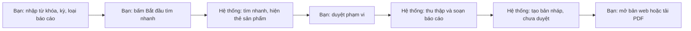

## Phần 2. Tạo một báo cáo mới

Ảnh trong tài liệu này chụp từ ứng dụng thật. Ứng dụng chạy thử trên máy với dữ liệu giả. Dải xanh "Test local" ở đầu ảnh chỉ có ở bản chạy thử.

Trang chủ liệt kê các thị trường. Bấm "Mở thị trường" để vào một thị trường.

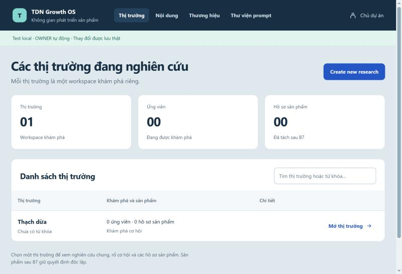

Trong thị trường, bấm "Nghiên cứu tự động". Đường dẫn có dạng `#/markets/<mã thị trường>/research`. Đầu trang là danh sách "Báo cáo và phiên nghiên cứu". Mỗi dòng là một phiên cũ, kèm trạng thái. Bấm "Mở phiên" để xem lại một phiên.

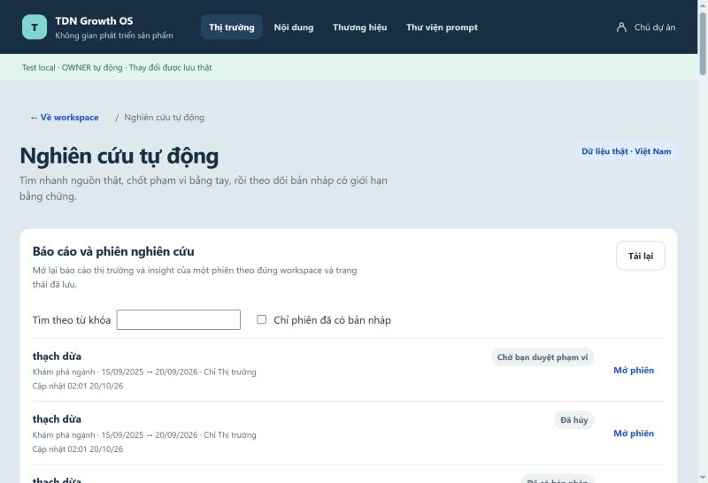

Bên dưới danh sách là khung tạo phiên mới. Bên trái có 6 bước. Ba bước đầu dùng để tạo báo cáo. Khung "Hệ thống đã hiểu" cho bạn kiểm tra lại những gì đã nhập.

### Mở khóa quyền chủ sở hữu

Bạn cần mở khóa OWNER trước khi bấm bắt đầu.

1. Mở khóa OWNER ở đầu trang. Dùng token chủ sở hữu do quản trị viên cấp.
2. Nếu quản trị viên chưa bật quyền ghi, đọc lý do trên màn hình. Bạn vẫn xem được dữ liệu.
3. Sau khi quản trị viên bật quyền ghi, bấm "Kiểm tra quyền lại" ở thanh trên cùng.

Chế độ demo không gửi yêu cầu và không tạo kết quả giả.

### Bước 1. Từ khóa

Câu hỏi của bước này là "Bạn muốn nghiên cứu gì?". Gõ một ngành, một loại sản phẩm hoặc tên sản phẩm. Chọn một trong hai chế độ:

- "Sản phẩm cụ thể": chọn chế độ này khi bạn đã có sản phẩm trong đầu.
  - Mô tả sản phẩm ở ô bên dưới: tên, dạng, dành cho ai, giá. Mô tả càng rõ thì kết quả càng khớp.
  - Bạn không cần phỏng vấn. Hệ thống tìm sản phẩm thật giống mô tả để bạn chọn.
- "Khám phá ngành": chọn chế độ này khi bạn muốn tìm hiểu cả ngành. Hệ thống hỏi vài câu ngắn ở bước 2.

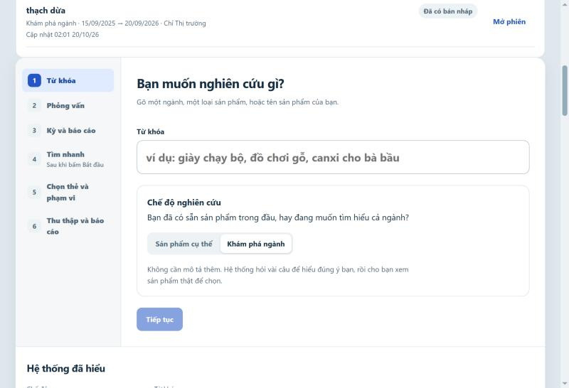

Nếu bạn dán một đoạn mô tả dài vào ô từ khóa, hệ thống tự tách đoạn đó:

- tên sản phẩm thành từ khóa;
- cả đoạn thành mô tả;
- chế độ chuyển sang "Sản phẩm cụ thể".

Nếu bạn không muốn tách, bấm "Hoàn tác".

### Bước 2. Phỏng vấn

Bước này chỉ có khi bạn chọn "Khám phá ngành".

1. Trả lời từng câu hỏi. Nếu bạn không biết, bấm "Không biết".
2. Lưu ý: câu trả lời chỉ ghi lại bối cảnh bạn cung cấp. Hệ thống không tự điền phần bạn chưa biết. Nguồn thực tế vẫn có thể chưa đủ dữ liệu.

### Bước 3. Kỳ và báo cáo

**Lưu ý:** kỳ đã chọn được giữ nguyên cho cả phiên. Nếu muốn đổi kỳ, tạo phiên mới.

1. Ở mục "Chọn nhanh kỳ nghiên cứu", chọn một kỳ. Mặc định là 365 ngày. Bạn cũng có thể tự đặt "Từ ngày" và "Đến ngày". Hệ thống hiện số ngày, tính cả ngày đầu và ngày cuối.
2. Ở mục "Báo cáo cần soạn", chọn "Chỉ Thị trường". Các lựa chọn khác là "Cả hai" và "Chỉ Insight". Nếu chọn "Cả hai", phần Insight hiện đang tạm dừng.
3. Bấm "Bắt đầu tìm nhanh".

Nếu mạng chập chờn, bấm lại. Hệ thống dùng lại cùng mã yêu cầu, nên không tạo phiên trùng.

Nếu gửi bị lỗi, màn hình báo lỗi bằng lời thường. Làm theo bảng sau:

| Màn hình báo | Bạn làm |
| --- | --- |
| Token hết hạn | Mở khóa lại |
| Trùng với một phiên khác | Xem lịch sử nghiên cứu |
| Máy chủ không nhận | Kiểm tra từ khóa, kỳ và báo cáo đã chọn |

## Phần 3. Theo dõi tiến trình (không có phần trăm)

Sau khi bấm bắt đầu, trang tự chuyển sang "Phiên nghiên cứu" và tự cập nhật. Bạn có thể rời trang. Quay lại sau bằng cùng đường dẫn, vì phiên chạy nền trên máy chủ.

Hệ thống cố ý không hiện phần trăm hoàn thành, vì thời gian mỗi nguồn rất khác nhau. Thay vào đó, trang hiện các phần sau:

- Các bước lớn: Từ khóa, Phỏng vấn, Kỳ và báo cáo, Tìm nhanh, Chọn thẻ và phạm vi, Thu thập và báo cáo.
- Danh sách "Tiến độ các bước" của máy chủ: Tìm nhanh, Thu thập, Báo cáo. Mỗi bước có trạng thái riêng.
- Bảng "Độ phủ dữ liệu": mỗi nguồn đã lấy được kỳ nào (kỳ quan sát) và có bị cắt kết quả không.
- Khung "Chi phí và lượt gọi": số lượt gọi nguồn và chi phí đã biết. Nếu chưa có số liệu, nguồn chưa báo. Số đó không bằng 0.
- "Phần chưa thể hoàn thành": những phần thiếu dữ liệu, kèm lý do. Hệ thống không lấp chỗ trống bằng số giả.

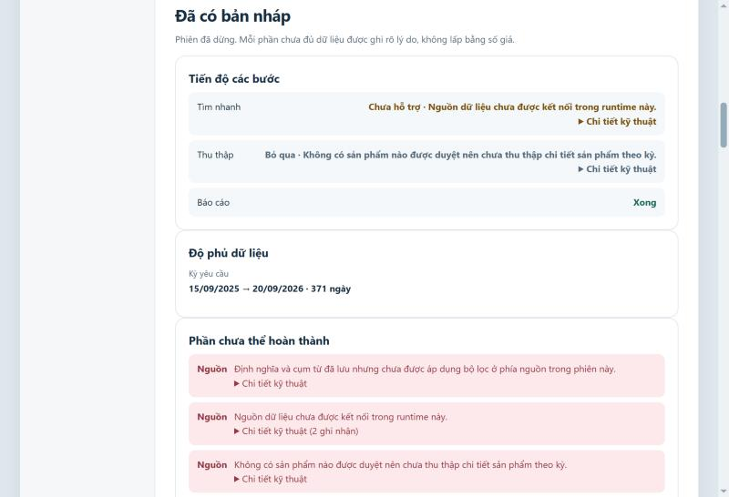

Với phiên tự chạy (auto-run), thẻ "tự động" cho biết phiên đang ở giai đoạn nào trong chuỗi. Sơ đồ dưới đây cho thấy các giai đoạn.

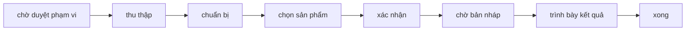

Phiên có thể chuyển sang "đã dừng" ở bất kỳ giai đoạn nào. Nếu phiên dừng, thẻ ghi lý do bằng lời thường. Nếu lỗi thuộc loại thu thập, thẻ có thêm nút "Thử lại".

Nếu cần dừng hẳn, bấm "Hủy phiên nghiên cứu". Hệ thống dừng các bước còn lại. Dữ liệu và chi phí đã phát sinh vẫn được ghi lại. Muốn chạy lại, tạo phiên mới.

## Phần 4. Duyệt phạm vi và đọc kết quả

### Duyệt phạm vi

Sau bước tìm nhanh, hệ thống đưa ra các thẻ sản phẩm thật để bạn chọn. Mỗi thẻ kèm phạm vi sẽ thu thập.

**Cảnh báo:** xác nhận phạm vi bắt đầu việc thu thập đầy đủ. Các nguồn trả phí có thể phát sinh chi phí.

1. Chọn thẻ sản phẩm.
2. Kiểm tra lại từ khóa, kỳ và loại báo cáo.
3. Xác nhận phạm vi.

Nếu không thẻ nào giống ý bạn, bấm "Không cái nào giống ý tôi". Sau đó viết định nghĩa phạm vi bằng lời của bạn. Bạn có thể thêm cụm từ phải có và cụm từ loại trừ, mỗi dòng một cụm.

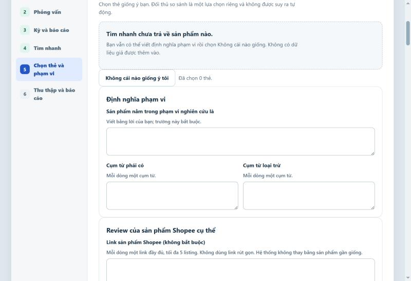

Với phiên tự chạy, hệ thống tự suy ra nhiều thao tác trung gian từ dữ liệu của phiên, như chọn liên kết sản phẩm và xác nhận nguồn. Bạn không cần gõ tay.

### Khi bản nháp sẵn sàng

Trạng thái chuyển sang "Đã có bản nháp". Khung "Bản đọc" hiện bản đọc mới nhất với bốn nút:

- "Mở bản đọc": mở bản đọc trong tab mới.
- "Tải PDF": tải bản PDF.
- "Duyệt": chấp nhận bản đọc này.
- "Từ chối": không chấp nhận bản đọc này.

Bản nháp tự động ở lại máy chủ. Bạn chỉ xem và duyệt bản đọc.

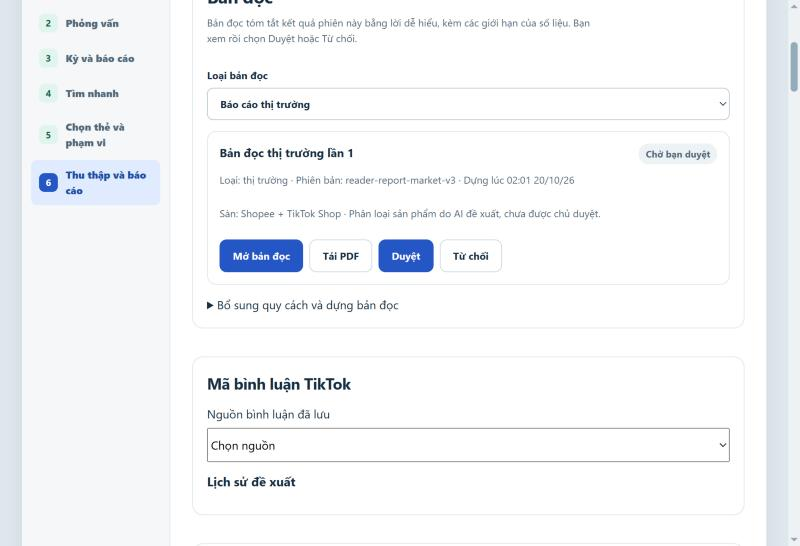

Nếu chưa có PDF, màn hình ghi lý do, ví dụ chưa có trình in PDF. Màn hình kèm "Chi tiết kỹ thuật" để bạn gửi cho quản trị viên.

Bản web và PDF lấy từ đúng một phiên bản đã lưu. Xuất PDF không chạy lại AI.

### Đính kèm PDF của bạn

**Cảnh báo:** tệp đính kèm có thể được gửi đi lập chỉ mục và phát sinh chi phí, nếu kết nối đang bật.

Mục "Đính kèm PDF cho phiên này" cho phép gắn thêm tài liệu PDF, tối đa 32 MiB. Bạn dùng mục này khi phiên đang chờ duyệt phạm vi hoặc đã có bản nháp. Hệ thống chỉ lưu những trích dẫn đã kiểm chứng. Báo cáo đã có không tự thay đổi.

### Các phiên bản

Mỗi lần xây lại báo cáo tạo một phiên bản mới, bất biến. Mỗi phiên bản có tối đa một quyết định của chủ sở hữu. Phiên bản mới hơn thay thế phiên bản cũ chưa được quyết định.

## Phần 5. Cách đọc bản PDF

Bản PDF là sản phẩm chính. Nó được thiết kế cho người không chuyên đọc. Bản đọc trên web có cùng nội dung.

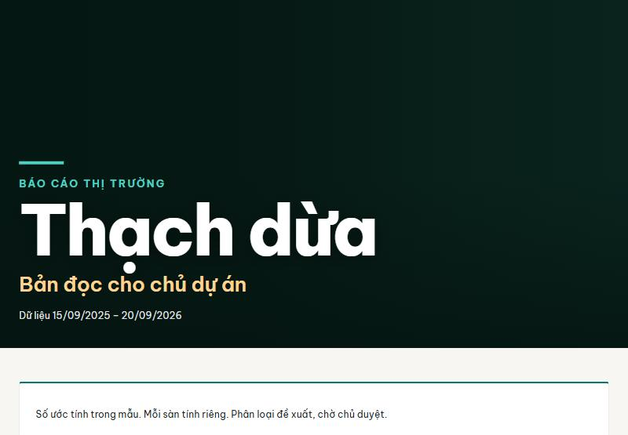

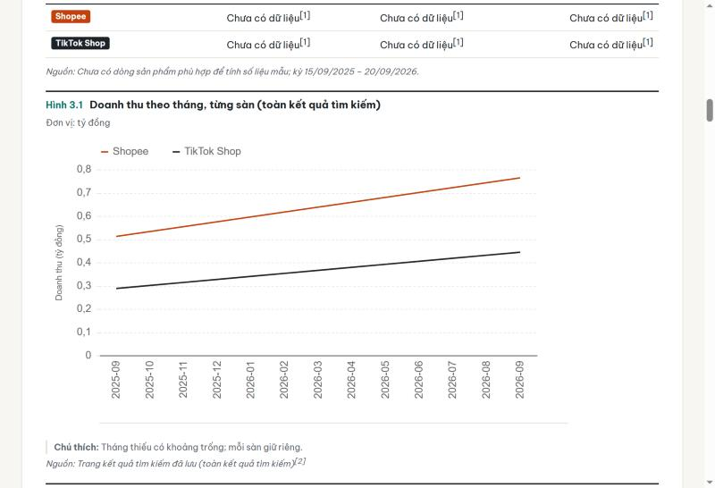

Bản PDF có các phần sau:

1. **Trang bìa.** Trang bìa có ảnh minh họa chung cho từ khóa. Ảnh do AI tạo và có chú thích mô tả ảnh. Báo cáo không tuyên bố ảnh có bản quyền riêng.
2. **12 phần đánh số "Phần 1" đến "Phần 12" và một "Phụ lục".** Mỗi phần có tiêu đề tiếng Việt dễ hiểu và không hiện mã kỹ thuật.
3. **Bảng và biểu đồ.** Bảng trong phụ lục có nhãn "PL.x". Biểu đồ luôn ghi rõ nền tảng (Shopee hay TikTok Shop) bằng chữ và biểu tượng.
4. **Mẫu số liệu "n = ...".** Mỗi con số tổng hợp ghi số mẫu đã dùng. Đọc số mẫu trước khi tin một tỷ lệ.
5. **Dòng "Chú thích:".** Ghi chú nguồn và giới hạn nằm trên dòng riêng, bắt đầu bằng "Chú thích:". Chúng không trộn vào đoạn văn.
6. **Phần "Đề xuất".** Phần này có ba phương án và bảng việc làm ngay. Mọi lựa chọn mang nhãn "đề xuất", có người phụ trách và hạn dạng ngày/tháng/năm. Đây là gợi ý chờ bạn duyệt. Đây không phải quyết định đã chốt.
7. **Bảng chú giải thuật ngữ** bằng tiếng Việt đơn giản.
8. **Nguồn đánh giá Shopee.** Nếu có nguồn này, báo cáo chỉ nêu số lượng, nhãn "review công khai trên Shopee" và mốc 300 đánh giá cho mỗi sản phẩm. Báo cáo không trích nguyên văn bình luận. Báo cáo không lập bảng chủ đề từ bình luận. Nguồn này bắt đầu chạy từ lần triển khai tới.

Báo cáo không bao giờ làm những việc sau:

- cộng số liệu Shopee với TikTok Shop thành một tổng;
- cộng các đối tác thương mại với nhau;
- dùng số "tìm kiếm" như số lượng người mua;
- dùng số của Ngân hàng Thế giới như phép tính thị phần;
- gọi video của người bán là khách hàng hay tổng thị trường.

## Phần 6. 14 quy tắc đảm bảo điều gì

Trước khi coi một bản là đạt, hệ thống tự kiểm 14 quy tắc (nguồn: `src/modules/analysis/research-automation/market-14-rules.ts`). Nói đơn giản:

- Quy tắc 1: có bảng chú giải thuật ngữ bằng tiếng Việt đơn giản.
- Quy tắc 2: các phần có nhãn "Phần n" và "Phụ lục". Bảng phụ lục có nhãn "PL.x". Báo cáo không lộ mã kỹ thuật.
- Quy tắc 3: báo cáo không lộ nội dung kỹ thuật (đường dẫn, mã nội bộ).
- Quy tắc 4: báo cáo không hiện tên nhà cung cấp hay công cụ. Chữ "Google" cũng bị cấm xuất hiện trong báo cáo.
- Quy tắc 5: ghi chú nằm riêng một dòng "Chú thích:".
- Quy tắc 6: con số doanh thu, tỷ trọng, giá trung bình có chứng cứ đi kèm (người rà soát xác nhận).
- Quy tắc 7: báo cáo có ba đặc điểm sau.
  - Không cộng gộp hai nền tảng.
  - Luôn có câu nêu số mẫu "n = ...".
  - Không nói "thị phần" hay "quy mô thị trường" bằng một con số cụ thể không có căn cứ.
- Quy tắc 8: nhận định theo nhóm, doanh thu, giá có chứng cứ (người rà soát xác nhận).
- Quy tắc 9: phần đề xuất có đúng ba phương án và một bảng việc làm ngay. Mỗi dòng có người phụ trách, hạn dạng dd/mm/yyyy và nhãn chờ duyệt.
- Quy tắc 10: ảnh bìa nhúng sẵn trong báo cáo và không liên kết ra ngoài. Ảnh có bản quyền hoặc do chủ sở hữu cung cấp cần chủ sở hữu xem lại.
- Quy tắc 11: biểu tượng nền tảng đúng chỗ, biểu đồ hợp lệ và số biểu đồ đủ. Cần ít nhất 3 biểu đồ. Khi nguồn không ghi gian hàng, cần 2 biểu đồ. Khi đó nội dung báo cáo phải nêu câu "không ghi gian hàng" và mang dấu hiệu `data-market-shops-unrecorded`.
- Quy tắc 12: mọi bảng theo nền tảng đều ghi rõ nền tảng nào.
- Quy tắc 13: đủ bốn loại nguồn trung tính, không nêu tên nhà cung cấp. Bốn loại là số liệu bán hàng, dữ liệu đánh giá, kết quả tìm kiếm và bình luận đã thu. Nhãn review công khai trên Shopee cũng đạt nhóm review và bình luận.
- Quy tắc 14: phần đánh giá và bình luận có chứng cứ về mẫu (người rà soát xác nhận).

Quy tắc 6, 8 và 14 là quy tắc "chứng cứ". Máy chỉ kiểm tra có nội dung liên quan. Người rà soát đọc và xác nhận. Quy tắc 10 vừa có phần máy kiểm vừa có phần cần người xem.

Ngoài 14 quy tắc, hệ thống còn một "cổng kinh doanh". Cổng này kiểm các điều sau:

- không lộ tên nhà cung cấp;
- không cộng nền tảng;
- không có số mơ hồ do cộng một phần thiếu;
- không lộ nội dung rò rỉ nội bộ;
- không dùng số tìm kiếm như số đếm.

Với phiên tự chạy, hệ thống làm theo thứ tự sau.

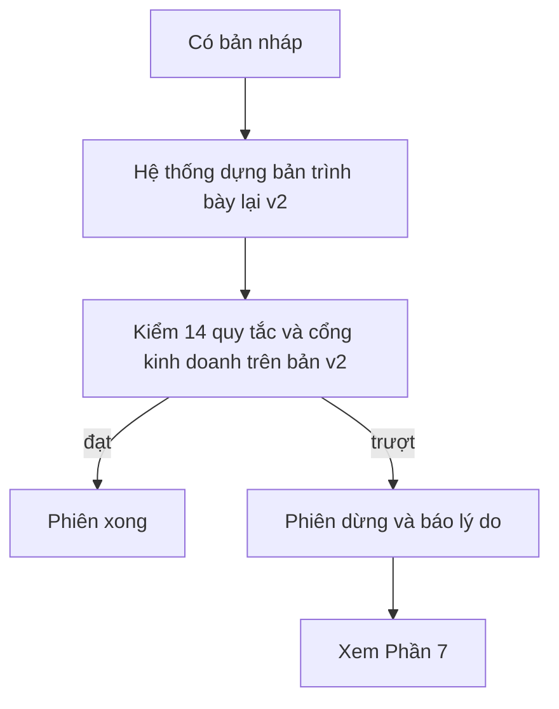

Nếu bản v2 trượt, hệ thống không tự sửa rồi thử lại.

## Phần 7. Tình huống thường gặp và cách xử lý

| Tình huống | Bạn thấy gì | Bạn nên làm |
| --- | --- | --- |
| Nguồn hết số dư (credit) | Phần chưa hoàn thành ghi nguồn tạm dừng hoặc hết số dư; bảng "Nguồn dữ liệu" báo | Nạp thêm số dư cho nguồn đó (quyết định của bạn). Sau đó tạo phiên mới, hoặc bấm "Thử lại" nếu có |
| Cần đăng nhập hoặc gặp captcha ở trang nguồn | Phiên dừng, thẻ ghi cần đăng nhập hoặc xác minh | Chờ người phụ trách kỹ thuật xử lý, rồi bấm "Thử lại". Hệ thống không tự vượt captcha |
| Dữ liệu chỉ có một phần | Mục "Độ phủ dữ liệu" ghi nguồn bị cắt hoặc kỳ quan sát ngắn hơn | Đọc báo cáo kèm giới hạn đã ghi. Phần thiếu có lý do rõ ràng, không có số giả |
| PDF chưa xuất được | Thẻ báo cáo ghi "PDF chưa xuất được" kèm lý do | Gửi "Chi tiết kỹ thuật" cho quản trị viên. Bản web vẫn dùng được |
| Dịch vụ lập chỉ mục PDF tạm dừng | Thông báo "Đã tạm dừng gửi PDF mới" (hết số dư, đang tắt hoặc số dư thấp) | Nạp số dư hoặc đợi quản trị viên bật lại. PDF đã lưu không bị ảnh hưởng |
| Đã bấm bắt đầu nhưng mạng lỗi | Thông báo chưa gửi được | Bấm lại. Hệ thống không tạo phiên trùng. Xem lịch sử nghiên cứu để chắc chắn |
| Phiên báo "Bị gián đoạn" (máy chủ khởi động lại giữa chừng) | Mục "Việc cần làm" liệt kê phần lỗi, dữ liệu còn dùng được, bước tiếp theo | Làm theo mục "Việc cần làm". Hệ thống không tự gọi lại một yêu cầu trả phí chưa rõ kết quả, để tránh tính tiền hai lần |
| Bản trình bày lại (v2) trượt kiểm tra | Phiên dừng, thẻ ghi trình bày kết quả không đạt | Báo quản trị viên. Người vận hành sửa trong mã để áp dụng cho mọi báo cáo. Không sửa tay từng báo cáo |

Nguyên tắc chung: hệ thống không bao giờ nhờ bạn tự thu thập dữ liệu bằng tay. Nếu bước nào cần người, người vận hành kỹ thuật làm bước đó: đăng nhập, nạp số dư, bật cấu hình. Bạn không phải sao chép số liệu.

## Phần 8. Giải thích thuật ngữ

- **Phiên nghiên cứu (run):** một lần chạy trọn vẹn từ lúc bạn bấm bắt đầu đến lúc có báo cáo.
- **Tìm nhanh:** bước đầu. Hệ thống tìm vài sản phẩm thật khớp từ khóa để bạn chọn.
- **Phạm vi:** những sản phẩm, nguồn và kỳ sẽ được thu thập.
- **Duyệt phạm vi:** bước bạn xác nhận trước khi hệ thống thu thập đầy đủ.
- **Nguồn dữ liệu:** nơi lấy số liệu: sàn bán hàng, nền tảng video, tìm kiếm, thống kê chính thức, tài liệu PDF.
- **Độ phủ dữ liệu:** nguồn nào đã lấy được kỳ nào, có thiếu hay bị cắt không.
- **Kỳ quan sát:** khoảng thời gian dữ liệu thực tế của một nguồn. Kỳ này có thể ngắn hơn kỳ bạn yêu cầu.
- **Bản nháp, chưa duyệt:** báo cáo do máy tạo, chờ chủ sở hữu quyết định.
- **Phiên bản (revision):** một lần xây lại báo cáo. Phiên bản bất biến, không bị sửa đè.
- **Cổng kinh doanh:** bộ kiểm tra tự động các lỗi nghiêm trọng về nội dung, như lộ tên nhà cung cấp hay cộng nền tảng.
- **14 quy tắc:** danh sách kiểm định dạng và nội dung của báo cáo Thị trường (Phần 6).
- **Mẫu (n):** số quan sát dùng để tính một con số. Nếu n nhỏ, kết luận kém chắc chắn.
- **Đề xuất:** gợi ý hành động của hệ thống, chờ bạn duyệt. Đề xuất không phải quyết định.
- **Chú thích:** dòng ghi nguồn và giới hạn, đặt riêng một dòng.
- **Số tìm kiếm / mức độ quan tâm:** thước đo mức quan tâm trên công cụ tìm kiếm. Số này không phải số người mua.
- **Review công khai trên Shopee:** đánh giá hiển thị công khai trên sản phẩm. Báo cáo chỉ đếm và nêu mốc 300. Báo cáo không trích nguyên văn. Nguồn này bắt đầu chạy từ lần triển khai tới.
- **Token chủ sở hữu:** chìa khóa để mở quyền ghi. Không chia sẻ cho người khác.
- **Lập chỉ mục PDF:** bước dịch vụ bên ngoài đọc và đánh chỉ mục tài liệu PDF để trích dẫn có kiểm chứng. Bước này có thể tốn tiền.
- **Bộ persona tổng hợp:** bộ mô tả nhóm người dùng dựng từ dữ liệu tổng hợp. Bộ này chỉ dùng làm gợi ý bối cảnh và không được nêu tên nguồn trong báo cáo (kế hoạch, chưa bật trong báo cáo Thị trường, cần xác nhận).
