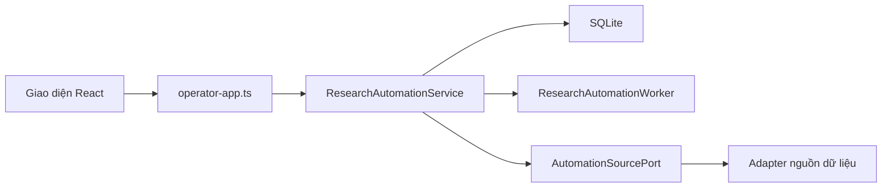
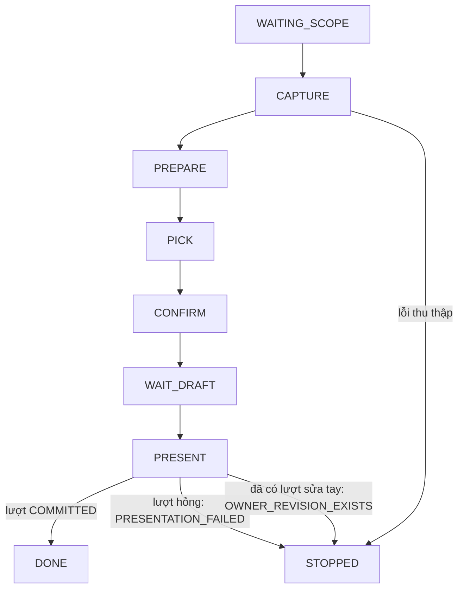

# Tài liệu kỹ thuật báo cáo Thị trường (Market) tự động

Mục đích: mô tả báo cáo Thị trường tự động. Tài liệu gồm module, route, bảng dữ liệu, cờ cấu hình, nguồn, vòng kiểm định, đường PDF, kiểm thử, triển khai và xử lý sự cố.

Cập nhật: 21/10/2026 (Phần 5) · Commit chính: `e9e0f444`

> Bản cập nhật 21/10/2026. Bản trước: [bản 21/10/2026 trước khi sửa](../../outdated/2026-10-21/docs/vi/market-report/tai-lieu-ky-thuat.md).

Quy ước: đường dẫn là tương đối so với gốc repo. Chỗ nào chưa xác nhận trong mã đã đọc thì ghi "(cần xác nhận)". Mục chưa làm ghi "Chưa làm" hoặc "Kế hoạch".

## Mục lục

- Phần 1. Tổng quan và module
- Phần 2. Route HTTP
- Phần 3. Bảng dữ liệu và migration
- Phần 4. Cờ cấu hình (chỉ tên)
- Phần 5. Nguồn, adapter và giới hạn
- Phần 6. Vòng cổng kiểm định, audit và bản sửa v2
- Phần 7. Đường PDF
- Phần 8. Kiểm thử và CI
- Phần 9. Triển khai (deploy)
- Phần 10. Xử lý sự cố

---

## Phần 1. Tổng quan và module

Hệ thống là một monolith TypeScript chia module. Nó dùng SQLite qua `better-sqlite3`. Giao diện là React/Vite với hash route (`frontend/src/research-automation/routes.ts`).

Ứng dụng vận hành (operator app) là tiến trình duy nhất phục vụ API và giao diện. Tiến trình này chỉ lắng nghe trên địa chỉ nội bộ của máy và không mở ra mạng ngoài. Cấu hình dùng hai biến `TDN_OPERATOR_APP_HOST` và `TDN_OPERATOR_APP_PORT` (xem `src/api/operator-app.ts`).

Quyết định kiến trúc chính nằm ở `docs/adr/0006-research-automation-execution.md`:

- Một dịch vụ `ResearchAutomationService` thuộc module Analysis.
- Dịch vụ lưu trạng thái bền trong SQLite (migration 0038).
- Một `ResearchAutomationWorker` tối thiểu gắn vào executor của operator.
- Không dùng hàng đợi riêng.

Khi tiến trình khởi động lại, hệ thống đổi dòng đang chạy nhà cung cấp sang `INTERRUPTED`. Hệ thống không bao giờ tự thử lại dòng đó. Chỉ bước kết xuất cục bộ (không phát sinh phí) được xếp hàng lại.

Các thư mục chính:

| Thư mục / tệp | Vai trò |
| --- | --- |
| `src/api/operator-app.ts` | Dựng cấu hình từ môi trường, kiểm tra phiên bản DB, định tuyến HTTP |
| `src/api/research-generation-api.ts` | Hai route "tạo báo cáo từ đầu vào" (`inputs`, `reports`) |
| `src/api/research-automation-api.ts` | Toàn bộ route phiên nghiên cứu, nguồn, báo cáo đọc, PDF |
| `src/modules/analysis/research-automation/service.ts` | Dịch vụ lõi: trạng thái phiên, bước, chi phí, xác nhận phạm vi |
| `src/modules/analysis/research-automation/worker.ts` | Worker nhận bước đã xếp hàng |
| `src/modules/analysis/research-automation/autorun-derive.ts` | Hàm thuần suy ra mọi giá trị trước đây người vận hành phải gõ tay (phiên tự chạy) |
| `src/modules/analysis/research-automation/providers.ts`, `provider-*.ts` | Cấu hình và gọi nhà cung cấp trả phí |
| `src/modules/analysis/research-automation/*-lane.ts` | Từng "làn" nguồn: Comtrade, World Bank, quảng cáo, thống kê chính thức, video, PDF, v.v. |
| `src/modules/analysis/research-automation/metric-*.ts`, `opencli-*.ts` | Thu thập số liệu bán hàng qua trình duyệt tự động (OpenCLI) |
| `src/modules/analysis/research-automation/market-14-rules.ts` | Kiểm 14 quy tắc |
| `src/modules/analysis/research-automation/market-business-gate.ts` | Cổng kinh doanh |
| `src/modules/analysis/research-automation/reader-report-revisions.ts` | Phiên bản báo cáo đọc (reader) và quyết định chủ sở hữu |
| `src/modules/analysis/research-automation/pdf.ts` | Kết xuất PDF bằng Chromium cục bộ |
| `src/modules/analysis/reader-report/` | Dựng trang đọc: mẫu `market-template*.ts`, biểu đồ `market-charts.ts`, `macro-charts.ts`, `flint.ts`, `lint.ts`, `layout.ts` |
| `contracts/api/` | JSON schema và kiểu sinh ra cho các route |
| `migrations/` | Migration SQL (đến 0059) |
| `docs/research-automation/README.md` | Quyết định sản phẩm (Việt Nam, kỳ mặc định 365 ngày, tách Market/Insight) |

## Phần 2. Route HTTP

Có hai không gian đường dẫn: `/api/...` (đọc) và `/owner-api/...` (ghi, cần xác thực chủ sở hữu). Một yêu cầu ghi phải thỏa cả ba điều kiện:

- đúng `Origin`;
- token chủ sở hữu hợp lệ;
- cờ cho phép ghi `TDN_OWNER_API_ENABLED` đang bật.

Các GET đọc không nhận query string. Nguồn: `src/api/research-automation-api.ts`, `src/api/research-generation-api.ts`.

**Tạo báo cáo từ đầu vào (generation)**

- `GET /owner-api/research-generation/inputs?workspaceId=...` liệt kê đầu vào.
- `POST /owner-api/research-generation/reports` tạo báo cáo.

**Trạng thái nguồn**

- `GET /api/workspaces/<id>/research-automation/source-status`
- `POST /owner-api/workspaces/<id>/research-automation/source-status/pageindex/recheck`

**Phiên nghiên cứu** — mẫu `.../workspaces/<workspaceId>/research-automation/runs[/<runId>[/<hành động>]]`. Các hành động đã thấy trong mã:

- Vòng đời: `confirm-scope`, `cancel`, `auto-run/retry`.
- Nguồn: `sources/metric`, `sources/metric-capture`, `sources/supplemental`, `sources/kalodata-video`, `sources/world-bank` (và `/confirm`), `sources/meta-page` (và `/confirm`), `sources/tiktok-comments` (và `/selections`, `/collect`), `sources/video-reading`, `sources/tiktok-coding`, `sources/shopee-coding` (kèm `samples`, `context`, `proposals`, `consumption`), `source-pdfs`, `pageindex`.
- Quy tắc/thành viên: `metric-rule-adoptions`, `metric-membership-proposals`, `metric-membership-receipts`.
- Báo cáo đọc: `reader-reports`, `reader-reports/decisions`, `reader-reports/v2`, `reader-reports/decisions/v2`, `reader-reports/tiktok`, `reader-reports/shopee`, `reader-reports/insight`, `reader-reports/unit-spec-intakes`, `report-versions`, `report-attempts`, `report-revisions`.
- Phần Insight (hiện tạm dừng theo quyết định chủ sở hữu): `insight-crosscheck-preparations`, `insight-persona-model-proposals`, `insight-coding-model-proposals`, `insight-coding-default-model-proposals`.

Mỗi route có schema trong `contracts/api/` (ví dụ `research-automation-api.schema.json`, `research-automation-reader-report-api.schema.json`).

Yêu cầu ghi dùng khóa yêu cầu (request key) idempotent (ADR 0006):

- Gửi lại cùng khóa và cùng nội dung chuẩn hóa: hệ thống trả biên nhận cũ (`exactRetry`).
- Gửi cùng khóa nhưng khác nội dung: hệ thống báo xung đột.

**Giao diện** dùng hash route `#/markets/<marketId>/research` và `#/markets/<marketId>/research/<runId>`. Id phiên nằm trong URL. Vì vậy khi tải lại trang, giao diện vẫn mở đúng phiên và không dùng bộ nhớ trình duyệt.

## Phần 3. Bảng dữ liệu và migration

Migration nằm ở `migrations/`; 0038 đến 0059 liên quan trực tiếp đến research automation và reader report. Điểm đáng chú ý:

| Migration | Nội dung (theo tên tệp / chú thích đã đọc) |
| --- | --- |
| `0038_research_automation.sql` | Phiên nghiên cứu: ảnh chụp yêu cầu bất biến, từng bước, byte thô và chi phí thực của nguồn, đầu ra nháp |
| `0040`–`0045` | Tập nguồn đã xác nhận (`0040`), lượt bổ sung / kết xuất lại báo cáo và đầu ra của từng lượt (`0041`: bảng `analysis_research_automation_attempts`, `analysis_research_automation_attempt_outputs`), thực thi AI (`0042`), chấp nhận quy tắc Metric (`0043`), thành viên Metric (`0044`), mã hóa Insight (`0045`) |
| `0048_analysis_reader_report_revisions.sql` | Bảng `analysis_reader_report_revisions`: một trang đọc bất biến cho mỗi phiên bản; chỉ dựng từ phiên `DRAFT_READY`; số phiên bản liền mạch; tối đa một quyết định chủ sở hữu mỗi phiên bản |
| `0049_analysis_pageindex_documents.sql`, `0057`, `0058` | Tài liệu PDF lập chỉ mục, nguồn gốc PDF theo phiên, tiêu đề |
| `0050`–`0054` | Loại báo cáo đọc, tiêu thụ và mã hóa TikTok / Shopee |
| `0055_analysis_research_automation_autorun.sql` | Bảng `research_automation_autorun`: trạng thái bền của bộ tự chạy Market |
| `0056_analysis_research_automation_autorun_retries.sql` | Bảng `research_automation_autorun_retries`: mỗi lần chủ sở hữu bấm "Thử lại" một dòng, khóa theo khóa yêu cầu để gửi lại cùng yêu cầu thì trả cùng biên nhận |
| `0059_analysis_research_automation_review_stages.sql` | Bảng `analysis_research_automation_review_stages`: điểm kiểm (checkpoint) bất biến của phần không-đánh-giá, để phần đuôi đánh giá công khai được chốt sau (trigger chặn cập nhật) |

Bảng `research_automation_autorun` (đọc từ migration 0055):

- Chỉ có dòng cho phiên bắt đầu khi bộ tự chạy bật và có yêu cầu MARKET; phiên khi tắt cờ không có dòng.
- `phase` thuộc: `WAITING_SCOPE`, `CAPTURE`, `PREPARE`, `PICK`, `CONFIRM`, `WAIT_DRAFT`, `PRESENT`, `DONE`, `STOPPED`. `phase_state` thuộc `QUEUED`, `RUNNING`.
- `STOPPED` khi và chỉ khi có `stop_code` (chữ hoa/số/gạch dưới, tối đa 64 ký tự); `stop_detail` ngắn, không chứa đường dẫn.
- Khóa yêu cầu cố định theo từng bước (`prepare`, `confirm`, `revision`). Hàm `autorunRequestKey` trong `autorun-derive.ts` sinh khóa. Cùng phiên và cùng bước thì cùng khóa. Vì vậy bước khởi động lại phát lại đúng yêu cầu cũ.
- Thư mục thu thập suy ra từ id phiên, không lưu đường dẫn.

Chỉ mã dừng thuộc nhóm thu thập mới được "Thử lại" thủ công. Nhóm gồm các mã: `METRIC_LOGIN_REQUIRED`, `METRIC_CAPTCHA`, `METRIC_PERIOD_UNSUPPORTED`, `METRIC_UI_CHANGED`, `METRIC_FILTER_MISMATCH`, `METRIC_ROW_CAP`, `METRIC_SEARCH_NOT_APPLIED`, `BRIDGE_DISCONNECTED`, `EXECUTOR_DISABLED`, `TIMEOUT`, `MANIFEST_HASH_MISMATCH`, `EXECUTOR_NOT_CONFIGURED`, `PERIOD_OUTSIDE_RUN`, `CAPTURE_INTERRUPTED`, `CAPTURE_INPUT_INVALID`, `CAPTURE_IO_FAILED`, `CAPTURE_SMART_QUERY_OFF`, `CAPTURE_CATEGORY_NOT_SELECTABLE` (`src/modules/analysis/research-automation/autorun-derive.ts`). Dừng ở giai đoạn chọn, xác nhận, trình bày, kết thúc phiên hoặc do chủ sở hữu thì không thử lại được.

Lượt thu thập thứ hai (v3plug P2, `autorun-scope.ts`): lượt đầu tìm từ khóa 1 ở mọi danh mục. Từ số thô của lượt đầu, hệ thống tính tỷ trọng doanh thu từng danh mục (từng sàn và Shopee + TikTok Shop gộp; số gộp quyết định). Danh mục chiếm từ 80% doanh thu gộp và khớp "Loại sản phẩm" đã khai (bảng đồng nghĩa trong `autorun-category-match.ts`) thì lượt hai chọn danh mục đó. Thiếu doanh thu của bất kỳ danh mục nào thì không tính tỷ trọng, giữ tất cả danh mục (`MISSING_REVENUE`). Từ khóa 2 gợi ý lấy từ tên của tối đa 100 sản phẩm doanh thu cao ở lượt đầu, cộng tên khác do mô hình soạn từ khóa đề xuất; cụm phải chứa danh từ sản phẩm của từ khóa 1 (bỏ các từ dạng bào chế như «viên uống»: «viên uống kẽm» -> «kẽm») hoặc tên khác của nó từ mô hình (canxi/calcium); chỉ giữ cụm có trong từ 20% tên, từ 3 thương hiệu. Riêng danh từ sản phẩm đứng một mình chỉ tính trên tên không chứa từ khóa 1 và chỉ được chọn khi không còn cụm nào khác đạt. Phản hồi phiên dùng `research-automation-run-v2` (có `keyword2Suggestion`); bản v1 cũ vẫn hợp lệ. Khi có từ khóa 2, dòng tự chạy dừng với mã `KEYWORD2_AWAITING` (không phải lỗi) để chủ sở hữu chọn Dùng, Sửa hoặc Bỏ trên thẻ tự chạy (`research-automation-autorun-keyword-v1`, cùng đường gửi với "Thử lại"). Lượt hai là một lần CAPTURE nữa của cùng phiên, ghi `spec-2.json` và `run2/`; bản ghi phạm vi `scope.json` nằm cạnh. Trang không có danh mục đó (`CAPTURE_CATEGORY_NOT_SELECTABLE`) thì giữ lượt đầu. Bản ghi chọn link `autorun-pick-record-v3` lưu thêm `scope`; ngữ cảnh gói thu thập `automation-metric-capture-context-v2` mang các dòng phạm vi in vào báo cáo.

Quy tắc chọn liên kết Shopee của bộ tự chạy có phiên bản: `autorun-pick-v3`. Bản `autorun-pick-v2` còn giữ để tương thích. Quy tắc chọn tối đa 5 liên kết. Cửa sổ kết quả của Metric là 30 ngày, gồm cả hai đầu.

## Phần 4. Cờ cấu hình (chỉ tên)

Cấu hình đọc một lần từ môi trường khi khởi động (`src/api/operator-app.ts`); giá trị boolean sai định dạng làm ứng dụng từ chối khởi động. Chỉ liệt kê tên, không ghi giá trị.

- **Ứng dụng:** `TDN_WORKSPACE_DB`, `TDN_ARTIFACT_ROOT`, `TDN_OPERATOR_APP_HOST`, `TDN_OPERATOR_APP_PORT`, `TDN_OWNER_API_ENABLED`, `TDN_OWNER_API_LOCAL_TEST`, `TDN_OWNER_API_TOKEN`, `TDN_OWNER_API_ACTOR_ID`.
- **Bộ tự chạy / Metric:** `TDN_METRIC_OPENCLI_ENABLED` (đúng "1" mới bật; giá trị khác thì không có bộ tự chạy và không có dòng), `TDN_METRIC_OPENCLI_ADAPTER_MANIFEST`, `TDN_METRIC_OPENCLI_ADAPTER_SHA256`, `TDN_METRIC_CAPTURE_DIR`, `TDN_RESEARCH_KALODATA_REPLAY_SOURCE_RUN_ID` (chế độ phát lại, không tốn điểm).
- **Làn nguồn:** `TDN_RESEARCH_SEARCH_TRENDS_ENABLED`, `TDN_RESEARCH_SEARCH_TRENDS_GEO_ENABLED`, `TDN_RESEARCH_EXPANDED_SEARCH_ENABLED`, `TDN_RESEARCH_WORLD_BANK_ENABLED`, `TDN_RESEARCH_COMTRADE_ENABLED`, `TDN_RESEARCH_GOOGLE_ADS_ENABLED`, `TDN_RESEARCH_OFFICIAL_STATS_ENABLED`, `TDN_RESEARCH_OFFICIAL_STATS_PROVINCE_ENABLED`, `TDN_RESEARCH_META_AUTO_ENABLED`, `TDN_RESEARCH_TIKTOK_TOPADS_ENABLED`, `TDN_RESEARCH_VIDEO_WATCH_ENABLED`, `TDN_RESEARCH_PDF_DISCOVERY_ENABLED`, `TDN_RESEARCH_PDF_DISCOVERY_MAX_PAGES`.
- **Nhà cung cấp trả phí:** `TDN_KALODATA_SECRET_KEY`, `TDN_SERPAPI_API_KEY`, `TDN_APIFY_TOKEN`, `TDN_RESEARCH_SHOPEE_PUBLIC_ENABLED`, `TDN_RESEARCH_SHOPEE_PUBLIC_TOKEN`, `TDN_RESEARCH_SHOPEE_PUBLIC_BASE_URL`, `TDN_RESEARCH_SHOPEE_PUBLIC_MAX_COMMENTS_PER_PRODUCT`; trần: `TDN_RESEARCH_SHOPEE_MAX_CHARGE_USD`, `TDN_RESEARCH_SHOPEE_MAX_REVIEWS_PER_PRODUCT`, `TDN_RESEARCH_TIKTOK_COMMENTS_MAX_CHARGE_USD`; kiểm thử: `TDN_RESEARCH_AUTORUN_TEST_REVIEWS`.
- **AI:** mọi lệnh gọi đi qua cổng AI nội bộ. Cổng dùng hai biến `TDN_CLIPROXY_BASE_URL` và `TDN_CLIPROXY_API_KEY`. Các biến AI gồm:
  - `TDN_RESEARCH_CAPTURE_RELEVANCE_AI_MODEL`: giai đoạn đánh giá độ liên quan. Khi trống, hệ thống dùng luật v2.
  - Các cặp `_ENABLED` / `_MODEL` (ghép tên trong `src/api/operator-app.ts`): `TDN_RESEARCH_KEYWORD_DRAFT_AI_ENABLED` / `_MODEL`, `TDN_RESEARCH_I14_AI_ENABLED` / `_MODEL`, `TDN_RESEARCH_M11_AI_ENABLED` / `_MODEL`, `TDN_RESEARCH_M12_AI_ENABLED` / `_MODEL`, `TDN_RESEARCH_I15_AI_ENABLED` / `_MODEL`, `TDN_RESEARCH_INSIGHT_CODING_AI_ENABLED` / `_MODEL`, `TDN_RESEARCH_TIKTOK_CODING_AI_ENABLED` / `_MODEL`, `TDN_RESEARCH_SHOPEE_CODING_AI_ENABLED` / `_MODEL`, `TDN_RESEARCH_COVER_AI_ENABLED` / `_MODEL`.
  - Mỗi cờ `_ENABLED` phải đúng `true` hoặc `false`. Khi bật cờ, bạn bắt buộc khai tên mô hình tường minh.
- **Video:** `TDN_RESEARCH_VIDEO_MEDIA_DIR`, `TDN_RESEARCH_VIDEO_WATCH_MODEL`, `TDN_RESEARCH_YTDLP_BIN`, `TDN_RESEARCH_FFPROBE_BIN`.
- **PDF và lập chỉ mục:** `TDN_RESEARCH_PDF_CHROMIUM` (đường dẫn trình in; thiếu thì không xuất PDF), `TDN_PAGEINDEX_CLOUD_ENABLED`, `TDN_PAGEINDEX_MAX_QUESTIONS_PER_RUN`, `TDN_PAGEINDEX_STARTING_CREDIT_MICRO_DOLLARS`.
- **Lưu trữ đối tượng:** `TDN_R2_ENABLED` và nhóm khóa `TDN_R2_*`.

Trạng thái bật/tắt trên môi trường chạy thật không nằm trong repo. Xem bảng trạng thái trong `docs/STATUS.md` và quy chuẩn dữ liệu đầu vào (cần xác nhận phiên bản mới nhất).

## Phần 5. Nguồn, adapter và giới hạn

Quy chuẩn dữ liệu đầu vào liệt kê các nguồn S01–S28. Đây là tài liệu quản lý ngoài repo, bản v1.37. Tài liệu này không sao chép bảng đầy đủ. Khi sửa, hãy đối chiếu tài liệu đó. Bảng sau tóm tắt các nhóm nguồn và giới hạn đã xác nhận:

| Nhóm | Nhà cung cấp / công cụ | Ghi chú giới hạn |
| --- | --- | --- |
| Số liệu bán hàng Shopee/TikTok | Metric, đọc qua trang kết quả bằng OpenCLI (`metric-*.ts`, `opencli-*.ts`, runbook `docs/runbooks/metric-opencli.md`) | Không có tính năng tải báo cáo; cửa sổ kết quả 30 ngày; có cổng kiểm adapter qua manifest và mã băm |
| Video và quảng cáo TikTok | Kalodata (`provider-kalodata.ts`) | Tính theo điểm (theo rà soát ngân sách gọi 16/10: mỗi lệnh gọi trả phí khoảng 0,1 điểm; mức này không nằm trong mã, cần xác nhận lại); có chế độ phát lại 0 điểm (`kalodata-replay.ts`); hết điểm thì dừng (tùy chọn A đã gộp: dừng khi nhà cung cấp trả mã 2016, `provider-kalodata.ts`, và chặn các cửa sổ còn thiếu) |
| Đánh giá và bình luận | Apify; dịch vụ Shopee API riêng (nhóm cờ `TDN_RESEARCH_SHOPEE_PUBLIC_` ở Phần 4) | Trần Apify tối đa 15 USD mỗi lần chạy thử; Shopee: tối đa 300 đánh giá mỗi sản phẩm cho nguồn đếm công khai |
| Tìm kiếm | SerpApi (`provider-serpapi.ts`, `search-interest.ts`, `search-geo.ts`, `expanded-search*.ts`) | Mức quan tâm không phải số đếm; SerpApi chỉ chạy sau khi đã xác nhận sản phẩm |
| Quảng cáo | OpenCLI cho Meta (tối đa 5 trang) và TikTok; Google ads qua làn riêng | Cờ riêng từng làn |
| Thống kê chính thức | Cục Thống kê (NSO), Ngân hàng Thế giới, UN Comtrade | World Bank cần tham số nguồn đúng (`source=2`, `world-bank-intake.ts`); Comtrade tối đa 4 lệnh gọi dữ liệu mỗi phiên, cách nhau ít nhất 6 giây, chờ 65 giây và thử lại một lần khi gặp 429 (`comtrade-lane.ts`); không cộng các đối tác |
| Tài liệu PDF | PageIndex (`pdf-discovery-lane.ts`, `pdf-excerpt.ts`) | Tối đa 32 MiB mỗi tệp đính kèm; ngưỡng số dư trong `src/modules/analysis/pageindex-balance.ts`: cảnh báo khi còn tối đa 2 USD, chặn khi còn tối đa 0,5 USD, tính 0,01 USD mỗi trang lập chỉ mục; trích dẫn phải được kiểm chứng |
| Video người bán | Làn xem video (`video-watch-lane.ts`, `video-watch-media.ts`) | Tải TikTok chỉ chạy được ở máy chủ triển khai; giữ 45 ngày rồi tự xóa trong ứng dụng (`VIDEO_WATCH_RETENTION_DAYS` trong `video-watch-media.ts`) |
| Bộ persona tổng hợp (S28) | Kế hoạch, chưa nối vào báo cáo Market | Không bao giờ nêu tên bộ dữ liệu trong báo cáo |

### Trạng thái chạy thật (kiểm tra 21/10/2026)

Căn cứ: 3 lượt Market chạy thật ngày 20/10/2026 (2 lượt quạt điện, 1 lượt thạch dừa). Bảng chỉ ghi nguồn chạy sai, chạy thiếu hoặc chưa ra dữ liệu. S01, S02, S04 và S19 chạy đúng ở cả 3 lượt. Bảng tóm tắt cho người đọc không chuyên ở `docs/research/ultimate-method/source-status.md` mục 2b.

| Nguồn | Kết quả 3 lượt | Nguyên nhân | Chỗ trong mã |
| --- | --- | --- | --- |
| S05 Shopee công khai | 3/3 bị chặn, 0 đánh giá | Bước đọc danh sách việc gốc (`GET /jobs?limit=100`) kiểm từng dòng; một dòng sai mẫu làm cả bước lỗi `INVALID_RESPONSE`; việc mới không bao giờ được gửi | `shopee-public-reviews.ts` |
| S14 Video người bán | Đọc 2–3/9 video mỗi lượt, 0 đoạn lên báo cáo | Ứng viên chỉ đến từ tìm kiếm chung (`EXPANDED_SEARCH`); mọi bài đọc bị loại `NOT_ABOUT_PRODUCT`; giới hạn 180 giây, 14 MiB | `video-watch-lane.ts`, `video-watch-media.ts`, `seller-video.ts` |
| S15 Quảng cáo Meta | 3/3 dừng `STOPPED` | Trình duyệt trên máy chủ đang đăng nhập (`LOGGED_IN_SESSION_PRESENT`); làn chỉ đọc khi không đăng nhập | `meta-auto-lane.ts` |
| S16 Quảng cáo TikTok nổi bật | 3/3 dừng | Trang đòi đăng nhập (`LOGIN_REQUIRED`) | `tiktok-top-ads-lane.ts` |
| S17 Quảng cáo tìm kiếm | 0 mẫu quảng cáo | Cần đúng 1 trang trong top 5 kết quả tự nhiên khớp tên thương hiệu; 6/9 lần tra `NO_MATCH`, 2/9 `AMBIGUOUS` | `google-ads-lane.ts` |
| S20 Mức quan tâm tìm kiếm | 2/3 bỏ qua | Luôn hỏi 12 tháng gần nhất; cổng 372 ngày loại kỳ cũ → `PERIOD_NOT_COVERED` | `search-interest.ts`, `search-geo.ts` |
| S21, S22 Thống kê chính thức | 2/3 có số | Lượt thạch dừa: bước chọn nhóm hàng không ra kết quả → `CATEGORY_NOT_MAPPED`, không thử lại | `official-statistics-lane.ts` |
| S23 Ngân hàng Thế giới | 3/3 có số | 1 chỉ số `TIMEOUT`, không thử lại | `world-bank-lane.ts` |
| S24 Thương mại quốc tế | 2/3 có số | 1 lượt `HS_CODE_NOT_CONFIRMED` vì câu trả lời xác nhận mã hàng sai mẫu, không hỏi lại | `comtrade-lane.ts` |
| S25 Tài liệu PDF | 0 trích dẫn | Lượt 1 `SEARCH_FAILED`, lượt 2 `NOT_ADMITTED`; lượt 3 giữ 2 tệp, nhưng báo cáo dựng khi tệp còn đang lập chỉ mục, nên 0 câu hỏi | `service.ts` (`#processRunPdfs`), `pdf-discovery-lane.ts` |
| S07 Bình luận dưới video | Chưa chạy | Tài khoản thu hết tiền; Insight tạm dừng từ 19/10/2026 | — |

Cách sửa các lỗi trên nằm trong gói sửa đang chờ chủ duyệt. Tài liệu này sẽ cập nhật khi gói được gộp.

Mọi nhà cung cấp đứng sau cổng `AutomationSourcePort` (ADR 0006): thông tin xác thực và giao thức nằm ở adapter, không nằm ở dịch vụ lõi. Chi phí và số lượt gọi được ghi theo từng bước; chi phí chưa biết hiển thị là "chưa có số liệu", không hiển thị 0.

## Phần 6. Vòng cổng kiểm định, audit và bản sửa v2

Một phiên tự chạy đi qua các pha sau (pha nằm trong `research_automation_autorun`):

1. `WAITING_SCOPE`: tìm nhanh xong. Hệ thống chờ chủ sở hữu duyệt phạm vi.
2. `CAPTURE`: thu thập số liệu bán hàng (OpenCLI) vào thư mục theo id phiên.
3. `PREPARE`: chuẩn bị gói đầu vào. Hệ thống đánh giá chất lượng dòng thu thập (`capture-row-quality.ts`). Hệ thống cũng đánh giá độ liên quan (`capture-relevance.ts`): luật v2, hoặc v3 khi cờ mô hình độ liên quan được đặt.
4. `PICK`: chọn liên kết sản phẩm theo luật `autorun-pick-v3`.
5. `CONFIRM`: xác nhận nguồn với phiên bản kỳ vọng.
6. `WAIT_DRAFT`: chờ bản nháp tự động.
7. `PRESENT`: khi phiên ở trạng thái `DRAFT_READY`, bộ tự chạy luôn yêu cầu đúng một lượt trình bày lại (revision attempt). Lượt này đi từ cặp bản nháp mới nhất. Hợp đồng là `automation-market-presentation-revision-v1`, hàm là `#autorunPresent` trong `service.ts`. Lượt này dựng trang đọc v2 và chạy kiểm định.
8. `DONE` hoặc `STOPPED`.

Kết quả của pha `PRESENT`:

- Lượt `COMMITTED`: phiên sang `DONE`.
- Lượt hỏng: phiên dừng với mã `PRESENTATION_FAILED`.
- Đã có lượt sửa tay của chủ sở hữu: phiên dừng với mã `OWNER_REVISION_EXISTS`.

**Kiểm định khi dựng trang đọc** (gọi từ `reader-report-revisions.ts` và mẫu Market):

- `auditMarket14` (trong `market-14-rules.ts`) trả về từng quy tắc 1–14, kèm loại `machine` hay `evidence`.
  - Máy kiểm quy tắc 1–5, 7, 9–13.
  - Quy tắc 6, 8, 14 là loại chứng cứ. Người rà soát kiểm các quy tắc này.
  - Quy tắc 10 là máy kiểm cho ảnh bìa nhúng sẵn, do AI tạo và có chú thích. Bìa có bản quyền hoặc do chủ sở hữu cung cấp cần người xem.
  - `assertMarket14MachineRules` ném `TypeError` với mã `MARKET_14_RULES_FAILED:<danh sách quy tắc>`.
- `auditMarketReportHtml` (cổng kinh doanh, `market-business-gate.ts`) kiểm các mã sau:
  - `G08_PROVIDER_NAME`, `U32_NO_CROSS_PLATFORM_TOTAL`, `E2_NO_REVENUE_ORDER`, `SECTIONS_PRESENT`;
  - `M12_PROPOSAL_LABEL`, `PARTIAL_TOTAL_FORBIDDEN`, `NO_LEAK`, `SEARCH_INTEREST_NOT_COUNT`;
  - `WORLD_BANK_NOT_ARITHMETIC`, `PDF_EXCERPT_NOT_MARKET_NUMBER`, `SELLER_VIDEO_NOT_CUSTOMER_OR_TOTAL`.
  - Khi lỗi, hàm ném `MARKET_BUSINESS_GATE_FAILED:<mã>`.
  - Thêm bộ lint văn bản hiển thị (`src/modules/analysis/report-visible-text-lint.ts`, U13).
- `reader-report-revisions.ts` (dòng 371) bắt hai loại lỗi trên. Nó chuyển lỗi thành `ResearchAutomationValidationError`, để API trả lỗi xác thực rõ ràng.

**Lượt trình bày lại (bản v2).** Ở pha `PRESENT`, bộ tự chạy gọi `requestReportRevision` với `buildRevisionValue` (`autorun-derive.ts`). Lệnh gọi giữ nguyên nguồn Metric và đánh giá gốc (`KEEP`). Nó dùng khóa yêu cầu riêng `autorunRequestKey(runId, 'revision')`, nên khi khởi động lại, hệ thống phát lại đúng yêu cầu.

Lượt này lưu vào bảng `analysis_research_automation_attempts`. Đầu ra nằm ở `analysis_research_automation_attempt_outputs` (migration 0041; route `report-attempts`, `report-revisions`).

Kiểm định 14 quy tắc và cổng kinh doanh chạy khi dựng trang đọc. Nếu có vi phạm, hệ thống từ chối lượt dựng (`MARKET_14_RULES_FAILED`, `MARKET_BUSINESS_GATE_FAILED`). Vì vậy bản đạt là bản v2 (đầu ra của lượt), không phải bản nháp đầu.

Quy tắc vận hành khi chấm: chấm 14/14 trên đầu ra v2 tự động. Không chấm bản nháp canary đầu. Bản nháp này thường trượt các quy tắc 1, 3, 7, 9, 11 (theo ghi chú vận hành, không tự động hóa trong mã).

Cần đọc thêm `service.ts` để biết hai điều: bản nháp đầu có qua cổng riêng không, và số lượt sửa tối đa (cần xác nhận).

**Bốn lớp chứng cứ** (ADR `0005-report-evidence-and-decision-ledger.md`):

- Chứng cứ nguồn: byte gốc.
- Tính toán xác định: đầu vào đã chuẩn hóa và phiên bản phương pháp.
- Diễn giải AI: bất biến, chưa duyệt, chỉ được trích dẫn khẳng định đã có.
- Quyết định con người: chỉ nối thêm, tách khỏi nội dung báo cáo.

**Nguyên tắc sửa lỗi:** sửa phải áp dụng toàn hệ thống và được kiểm trên ít nhất 3 sản phẩm; sửa tay chỉ để học rồi đưa vào mã.

## Phần 7. Đường PDF

1. Báo cáo đọc (HTML) được dựng từ khung ngữ nghĩa đã đóng băng và lưu bất biến, kèm hash (`html_sha256`, `metrics_sha256`, `claims_sha256`, `cover_sha256` trong bảng revisions).
2. `src/modules/analysis/research-automation/pdf.ts` tạo bộ kết xuất `createChromiumPdfRenderer({ executablePath })`. Chromium cục bộ in HTML đã lưu, không chạy script và không gọi ra ngoài. Nó dùng `Page.printToPDF` với nền in và kích thước trang theo CSS, và nhận kết quả dạng stream. Giới hạn kích thước là `MAX_HTML_BYTES` và `MAX_PDF_BYTES` trong `model.ts`. Nếu vượt giới hạn, hệ thống báo lỗi.
3. Hệ thống chỉ lưu PDF khi cấu hình `TDN_RESEARCH_PDF_CHROMIUM` có và Chromium thật chạy thành công. Nếu không, giao diện hiển thị lý do "PDF chưa xuất được" (ADR 0006). Xuất PDF không chạy AI và không tốn phí nhà cung cấp.
4. Ảnh bìa: nhúng dạng JPEG (`cover-image-codec.ts`, `market-cover.ts`), bắt buộc có chú thích mô tả; bìa ngoài hoặc sai định dạng bị quy tắc 10 từ chối.
5. Biểu đồ: `src/modules/analysis/reader-report/flint.ts`, `market-charts.ts`, `macro-charts.ts`, `svg-charts.ts`; phiên bản bộ dựng ghi trong `builder_version`. Báo cáo Market dùng các hằng số trong `reader-report-revisions.ts`: `reader-report-market-v3` (mặc định), `reader-report-market-v4` (bộ dựng kế tiếp) và `reader-report-market-v5` (khi có nguồn đánh giá công khai Shopee). Ý nghĩa chi tiết của v4 cần xác nhận.
6. Tải xuống: giao diện dùng `reportUrl(workspaceId, runId, 'market', 'web'|'pdf')`; mỗi liên kết tương ứng đúng một phiên bản đã lưu.

Tài liệu PDF do người dùng đính kèm là một việc khác: `source-pdfs` và `pageindex` (lập chỉ mục), có tạm dừng khi hết số dư.

## Phần 8. Kiểm thử và CI

Lệnh trong `package.json`: `npm run check` chạy tuần tự sinh hợp đồng (`contracts:generate`), `typecheck`, `frontend:typecheck`, `frontend:build`, `frontend:test`, rồi `test` (đơn vị và tích hợp: `tests/unit/*.test.ts`, `tests/integration/*.test.ts`). Node phải đúng phiên bản trong `engines` (24.15.0).

CI nằm ở `.github/workflows/check.yml`:

- CI chạy trên PR và khi đẩy vào `main`.
- Node 24.15.0; chạy `npm ci`; giới hạn 45 phút.
- Chế độ "research" rút gọn áp dụng cho PR nháp vào nhánh `feature/research-*`, chỉ khi mọi tệp đổi thuộc danh sách cho phép. Các trường hợp còn lại chạy "full".
- Chế độ full cài bộ xác minh PDF cục bộ phiên bản cố định (Python).

Các workflow khác: `local-owner-test-web.yml`, `research-generation-web.yml`, `research-report-preview.yml`.

Quy ước dự án:

- Tác giả mã: một phiên mã hóa riêng; người viết kiểm thử (có kiểm chứng đối chứng âm) và người rà soát là các phiên mới tách biệt.
- Chỉ viết kiểm thử theo dòng hợp đồng có tên; không chạy toàn bộ bộ kiểm thử cục bộ, CI là cổng quyết định.
- Quy tắc 3 lần: một việc trượt kiểm thử 3 lần thì dừng và xem lại phương pháp.
- Máy Windows có giới hạn dòng lệnh dài và công cụ typecheck; Linux CI là bên quyết định.
- Mỗi PR một gói; chỉ gộp khi người rà soát đạt đúng head và CI xanh.

## Phần 9. Triển khai (deploy)

- Chỉ triển khai khi chủ sở hữu viết đúng câu «deploy <SHA>». Gộp vào `main` không đồng nghĩa với triển khai.
- Triển khai ứng dụng gồm bốn bước theo thứ tự:
  1. Lấy đúng SHA.
  2. Chạy migration tiếp theo còn thiếu. Ở thời điểm tài liệu này, kiểm DB đạt phiên bản đầu `0059`. Ứng dụng từ chối khởi động nếu phiên bản DB lệch (xem phần kiểm DB trong `src/api/operator-app.ts`).
  3. Dựng giao diện.
  4. Khởi động lại dịch vụ.
- Cờ cấu hình được mang theo từ lần triển khai trước. Thay đổi cờ là một phần của câu lệnh triển khai và cần chủ sở hữu đồng ý. Ví dụ: bật mô hình độ liên quan, bật nguồn đánh giá công khai Shopee với trần 300.
- Runbook: `docs/runbooks/fedora-local-operator-runtime.md` (vận hành trên máy chủ), `docs/runbooks/metric-opencli.md` (thu thập Metric), `docs/runbooks/agent-pipeline.md`.
- Ngay sau triển khai: chạy canary ít nhất 3 sản phẩm và chấm bản v2 tự động theo 14 quy tắc.
- Trạng thái hiện tại (cần xác nhận lúc đọc):
  - Bản đang chạy thật là `f026acd9`.
  - Mã mới nhất trên `main` là `e9e0f444`. Các lần gộp sau đó chỉ đổi tài liệu.
  - Các PR #345, #346 và #347 đã gộp vào `main` nhưng chưa triển khai.
  - PR #348 (G-references) và gói F+ chưa gộp.

## Phần 10. Xử lý sự cố

| Triệu chứng | Nguyên nhân thường gặp | Cách xử lý |
| --- | --- | --- |
| Ứng dụng không khởi động, báo cờ phải đúng `true`/`false` | Giá trị cờ boolean sai | Sửa giá trị về đúng định dạng |
| Ứng dụng từ chối vì phiên bản DB | Migration chưa chạy hoặc lệch | Chạy `npm run db:migrate` trên môi trường đúng, kiểm tra phiên bản đầu |
| Phiên dừng `METRIC_LOGIN_REQUIRED` / `METRIC_CAPTCHA` | Trình duyệt tự động bị yêu cầu đăng nhập hoặc xác minh | Người vận hành xử lý trên máy chạy trình duyệt, rồi chủ sở hữu bấm "Thử lại" |
| `METRIC_UI_CHANGED` / `METRIC_FILTER_MISMATCH` | Giao diện nguồn đổi hoặc bộ lọc không áp dụng | Xem `docs/runbooks/metric-opencli.md`, cập nhật adapter, khớp mã băm manifest |
| `MANIFEST_HASH_MISMATCH` | Manifest adapter khác mã băm khai báo | Cập nhật `TDN_METRIC_OPENCLI_ADAPTER_SHA256` cho đúng tệp |
| `MARKET_14_RULES_FAILED:<id>` | Bản dựng vi phạm quy tắc | Xem quy tắc tương ứng ở Phần 6; sửa trong mã mẫu hoặc bộ dựng, không sửa tay |
| `MARKET_BUSINESS_GATE_FAILED:<mã>` | Vi phạm cổng kinh doanh | Như trên; tra mã trong `market-business-gate.ts` |
| Kalodata ngừng vì hết điểm | Hết số dư | Chủ sở hữu nạp thêm; dùng chế độ phát lại để kiểm thử không tốn điểm |
| Nhiều bước chậm / treo CI | Khoảng 1/3 lần CI treo (đã giảm một phần) | Chạy lại job; ghi nhận nếu lặp lại |
| PDF không xuất | Thiếu `TDN_RESEARCH_PDF_CHROMIUM` hoặc Chromium lỗi | Kiểm tra cấu hình; xem lý do trong thẻ báo cáo |
| Ổ tạm của máy chủ đầy | Nhiều làn kiểm thử | Lưu trữ bớt các làn đã xong |
| Phiên `INTERRUPTED` | Tiến trình khởi động lại khi nguồn đang chạy | Không tự thử lại yêu cầu trả phí; xem mục "Việc cần làm" và tạo phiên mới nếu cần |

Bảo mật: không ghi giá trị khóa hoặc token vào tài liệu, nhật ký hay báo cáo; token chủ sở hữu chỉ nằm ở biến môi trường và ở ô mở khóa của giao diện.
