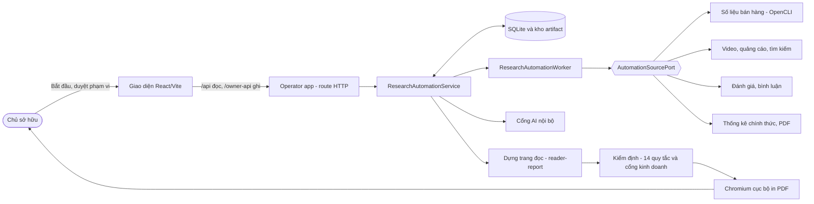
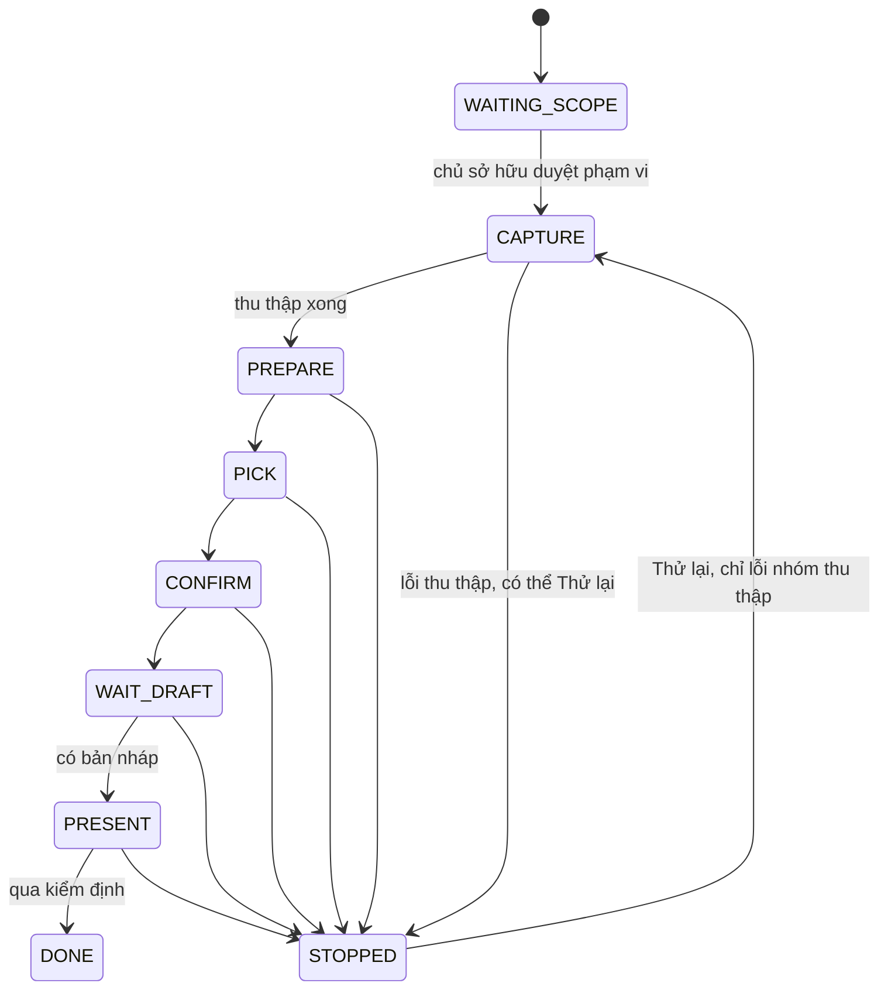
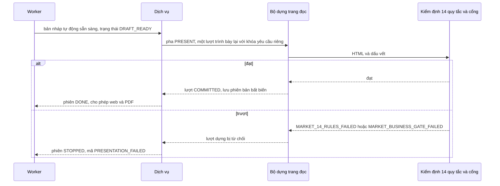

# Thiết kế hệ thống báo cáo Thị trường (Market) tự động

Mục đích: giải thích mục tiêu, kiến trúc, luồng dữ liệu, các quyết định then chốt, cơ chế an toàn và các vấn đề còn mở của báo cáo Thị trường tự động.

Cập nhật: 20/10/2026 · Commit chính: `e9e0f444`

## Mục lục

- Phần 1. Mục tiêu và ngoài phạm vi
- Phần 2. Kiến trúc và luồng dữ liệu
- Phần 3. Các thành phần
- Phần 4. Quyết định then chốt
- Phần 5. An toàn và trần chi phí
- Phần 6. Xử lý lỗi
- Phần 7. Vấn đề còn mở

---

## Phần 1. Mục tiêu và ngoài phạm vi

**Mục tiêu**

- Chủ sở hữu nhập một từ khóa; hệ thống tự thu thập dữ liệu thật từ nhiều nguồn, soạn báo cáo Thị trường cho Việt Nam và xuất bản web cùng PDF, không cần ai thu thập tay (quyết định 17/10: tự động hóa hoàn toàn thu thập).
- Báo cáo đạt 14/14 quy tắc do chính luồng tự động tạo ra và nhất quán qua nhiều lần chạy lại, không phải do sửa tay từng báo cáo.
- Mọi con số truy được về chứng cứ nguồn; AI chỉ diễn giải và chỉ được trích dẫn khẳng định đã có (ADR 0005).
- Dữ liệu nguồn trả phí được kiểm soát: chi phí ghi nhận theo bước, có trần, không tự thử lại yêu cầu trả phí chưa rõ kết quả (ADR 0006).
- Báo cáo giao khách không lộ tên nhà cung cấp và không chứa bình luận thô.

**Ngoài phạm vi (hiện tại)**

- Báo cáo Insight: tạm dừng theo chủ sở hữu từ 19/10. Mục tiêu Insight vẫn giữ (cùng bốn nguồn chính, bình luận đã được mã hóa, persona AI chỉ khi mọi thuộc tính dẫn chứng thật), nhưng Chưa làm trong phạm vi tài liệu này.
- Thị trường ngoài Việt Nam: không hỗ trợ; thị trường cố định (`docs/research-automation/README.md`).
- Tự động duyệt/phê chuẩn báo cáo: hệ thống không bao giờ tự phê chuẩn; quyết định của chủ sở hữu tách riêng (ADR 0005, bảng `analysis_reader_report_revisions`).
- Bảng chủ đề từ bình luận Shopee (S2): bỏ theo quyết định phương án A ngày 19/10.
- Bộ persona tổng hợp cho Market: Kế hoạch, chưa nối.

## Phần 2. Kiến trúc và luồng dữ liệu

**Sơ đồ tổng thể**

**Các pha của phiên tự chạy**

**Lượt trình bày lại (bản v2) và kiểm định**

Luồng một phiên, nói gọn: chủ sở hữu tạo phiên với từ khóa, kỳ và loại báo cáo; tìm nhanh trả thẻ sản phẩm; chủ sở hữu duyệt phạm vi; bộ tự chạy thu thập số liệu bán hàng, chuẩn bị, chọn liên kết, xác nhận nguồn; các làn nguồn khác (video, quảng cáo, tìm kiếm, thống kê, PDF) bổ sung bằng chứng; bản nháp được dựng, rồi bộ tự chạy luôn yêu cầu một lượt trình bày lại (bản v2) có chạy kiểm định, trượt thì phiên dừng; cuối cùng lưu phiên bản bất biến và cho phép tải bản web, PDF.

## Phần 3. Các thành phần

| Thành phần | Trách nhiệm | Vị trí |
| --- | --- | --- |
| Giao diện | Soạn yêu cầu 3 bước, theo dõi phiên, duyệt phạm vi, mở báo cáo; không hiện phần trăm | `frontend/src/research-automation/` |
| Route HTTP | Xác thực chủ sở hữu (Origin, token, cờ ghi), idempotency theo khóa yêu cầu | `src/api/research-automation-api.ts`, `src/api/research-generation-api.ts` |
| Dịch vụ nghiên cứu | Giữ trạng thái bền, ảnh chụp yêu cầu, từng bước, chi phí, xác nhận phạm vi | `src/modules/analysis/research-automation/service.ts` |
| Worker | Nhận bước đã xếp hàng; sau khởi động lại đánh dấu bước đang chạy là bị gián đoạn | `.../worker.ts` |
| Bộ tự chạy | Suy ra mọi giá trị người vận hành từng gõ tay bằng hàm thuần, phát lại đúng yêu cầu khi khởi động lại | `.../autorun-derive.ts`, bảng `research_automation_autorun` |
| Cổng nguồn | Ranh giới giữa dịch vụ lõi và nhà cung cấp; thông tin xác thực nằm sau cổng | `AutomationSourcePort`, `.../providers.ts` |
| Làn nguồn | Mỗi nguồn một làn, có cờ bật riêng và giới hạn riêng | `.../*-lane.ts` |
| Thu thập Metric | Đọc trang kết quả bằng trình duyệt tự động với adapter có manifest và mã băm | `.../metric-*.ts`, `docs/runbooks/metric-opencli.md` |
| Đánh giá độ liên quan | Lọc dòng thu thập: luật v2, hoặc v3 với bước AI khi bật cờ | `.../capture-relevance.ts`, `capture-row-quality.ts` |
| Bộ dựng trang đọc | Mẫu Market, biểu đồ, bìa, lint văn bản hiển thị | `src/modules/analysis/reader-report/` |
| Kiểm định | 14 quy tắc, cổng kinh doanh, lint U13 | `market-14-rules.ts`, `market-business-gate.ts`, `src/modules/analysis/report-visible-text-lint.ts` |
| Kho phiên bản | Trang đọc bất biến, một quyết định chủ sở hữu tối đa mỗi phiên bản | `reader-report-revisions.ts`, migration 0048 |
| Kết xuất PDF | Chromium cục bộ in HTML đã lưu, không script, không gọi ra ngoài | `.../pdf.ts` |
| Lập chỉ mục PDF | Đọc tài liệu PDF để có trích dẫn kiểm chứng; có trần và tạm dừng khi hết số dư | `.../pdf-discovery-lane.ts`, `pdf-excerpt.ts`, `source-status.ts` |

## Phần 4. Quyết định then chốt

**Kiến trúc và dữ liệu**

- Một dịch vụ và một worker gắn vào executor hiện có, không thêm hàng đợi (ADR 0006). Lý do: không tách nguồn sự thật về thử lại và hủy.
- Không thử lại tự động một yêu cầu trả phí chưa rõ kết quả: tránh tính tiền hai lần và giữ chứng cứ đúng (ADR 0006).
- Bốn lớp chứng cứ tách bạch: nguồn, tính toán xác định, diễn giải AI, quyết định con người (ADR 0005).
- Danh tính workspace kiểm qua bộ đọc Flow đã khai báo, không dùng khóa ngoại SQL xuyên module.
- Hợp đồng API bằng JSON schema trong `contracts/api/`, sinh kiểu tự động.

**Quyết định của chủ sở hữu (sản phẩm)**

- Tùy chọn A (19/10) cho đánh giá Shopee: trong báo cáo Market chỉ là nguồn đếm — số lượng, nhãn "review công khai trên Shopee", mốc 300 và giới hạn. Không bảng chủ đề, không trích dẫn, không bình luận thô trong báo cáo.
- Không bao giờ cộng Shopee với TikTok Shop; không cộng các đối tác thương mại; không đưa tổng một phần gây hiểu lầm (cổng: `U32_NO_CROSS_PLATFORM_TOTAL`, `PARTIAL_TOTAL_FORBIDDEN`).
- Không nêu tên nhà cung cấp, tên công cụ, tên mô hình AI hay tên bộ persona tổng hợp trong báo cáo giao khách (cổng: `G08_PROVIDER_NAME`, quy tắc 4). Ghi chú nguồn đặt trên dòng riêng "Chú thích:".
- Thu thập chỉ tự động; không bao giờ nhờ con người tự thu thập mẫu (17/10).
- Đề xuất hành động (M12) cho phép, nhưng phải có ba phương án, người phụ trách, hạn dd/mm/yyyy và nhãn chờ duyệt (quy tắc 9, `M12_PROPOSAL_LABEL`). Phần "ý nghĩa" chỉ dựa trên doanh thu trong mẫu.
- Số tìm kiếm không phải số đếm người mua (`SEARCH_INTEREST_NOT_COUNT`); số Ngân hàng Thế giới không dùng làm phép tính thị phần (`WORLD_BANK_NOT_ARITHMETIC`); video người bán không phải khách hàng hay tổng (`SELLER_VIDEO_NOT_CUSTOMER_OR_TOTAL`); trích PDF không phải số thị trường (`PDF_EXCERPT_NOT_MARKET_NUMBER`).
- Không có phần trăm tiến độ; hiển thị bước, độ phủ nguồn, lý do dừng.
- Insight tạm dừng; Market làm trước.
- Báo cáo là sản phẩm: giao diện hiển thị trang đọc và PDF, không phải bảng điều khiển; tối đa 3 worker, 1 gói, không phần trăm.

**Quy trình kỹ thuật**

- Tự động hóa phải vượt 14/14 do chính luồng tự động, nhất quán qua nhiều lần chạy lại; sửa tay chỉ để học rồi chuyển vào mã; sửa phải áp dụng toàn hệ thống và kiểm trên ít nhất 3 sản phẩm.
- Mỗi PR một gói; tác giả mã, người viết kiểm thử (có đối chứng âm) và người rà soát là các phiên tách biệt; gộp khi đạt đúng head và CI xanh; triển khai chỉ khi chủ sở hữu ra lệnh theo SHA.
- Quy tắc 3 lần: trượt kiểm thử 3 lần thì dừng và xem lại phương pháp.

## Phần 5. An toàn và trần chi phí

- **Ghi chỉ cho chủ sở hữu:** mọi thao tác ghi cần Origin khớp, token chủ sở hữu hợp lệ và cờ cho phép ghi; GET đọc không nhận query. Ứng dụng vận hành chỉ nghe trên địa chỉ nội bộ của máy (mã từ chối cấu hình khác).
- **Idempotency:** khóa yêu cầu cố định theo phiên và bước; gửi lại không tạo bản trùng.
- **Cấu hình khởi động nghiêm:** cờ boolean sai định dạng làm ứng dụng không khởi động; cờ bộ tự chạy chỉ nhận đúng giá trị bật, giá trị khác tắt hẳn, không để lại dòng trạng thái.
- **Trần chi phí đã xác nhận trong mã / quyết định:**
  - Apify: tối đa 15 USD mỗi lần chạy thử, mục tiêu khoảng 10 USD (quyết định 12/10).
  - Shopee qua dịch vụ Shopee API riêng: trần số bình luận mỗi sản phẩm (300); trần tiền theo cờ `TDN_RESEARCH_SHOPEE_MAX_CHARGE_USD` sẽ bị gỡ khi bật nguồn công khai (kế hoạch triển khai, chưa làm).
  - TikTok bình luận: trần tiền riêng (`TDN_RESEARCH_TIKTOK_COMMENTS_MAX_CHARGE_USD`, giữ nguyên).
  - Kalodata: tính điểm, 0,1 điểm mỗi lệnh gọi; dừng khi hết điểm và chặn cửa sổ còn thiếu (tùy chọn A đã gộp); các tùy chọn B–E chờ chủ sở hữu quyết.
  - Dịch vụ lập chỉ mục PDF: cảnh báo khi số dư còn tối đa 2 USD và chặn khi còn tối đa 0,5 USD (`src/modules/analysis/pageindex-balance.ts`), tính 0,01 USD mỗi trang lập chỉ mục; ước tính khoảng 1,2 USD mỗi báo cáo (cần xác nhận lại với số liệu mới nhất).
  - Chi phí AI không được tính vào "lượt gọi thu nguồn"; trạng thái AI hiển thị tách riêng.
- **Cô lập dữ liệu nhạy cảm:** không ghi đường dẫn, địa chỉ nội bộ hay khóa vào tài liệu, nhật ký lỗi hiển thị cho người dùng, hay báo cáo. Mã dừng chỉ gồm chữ hoa/số/gạch dưới; chi tiết dừng ngắn và không chứa đường dẫn (ràng buộc trong migration 0055).
- **Video:** tải chỉ chạy ở máy chủ triển khai, giữ 45 ngày rồi tự xóa trong ứng dụng.

## Phần 6. Xử lý lỗi

| Lỗi | Hành vi |
| --- | --- |
| Tiến trình khởi động lại khi nguồn đang chạy | Bước chuyển `INTERRUPTED`, không tự gọi lại nguồn trả phí; bước kết xuất cục bộ có thể xếp hàng lại |
| Hủy phiên | Không chứng minh được nhà cung cấp chưa tính tiền; giữ dữ liệu đã thu và trạng thái chi phí chưa biết |
| Dừng ở pha thu thập (đăng nhập, captcha, giao diện đổi, hết thời gian, v.v.) | `STOPPED` với mã dừng; chỉ nhóm này được "Thử lại"; hệ thống không vượt captcha |
| Dừng ở pha chọn, xác nhận, trình bày hoặc do chủ sở hữu | Không thử lại tự động |
| Trượt kiểm định ở lượt trình bày lại (bản v2) | Lượt dựng bị từ chối, phiên `STOPPED` với mã `PRESENTATION_FAILED`; sửa gốc trong mã rồi chạy phiên mới, không sửa tay |
| Nguồn hết số dư / bị giới hạn | Ghi vào "phần chưa thể hoàn thành" với lý do; không lấp số giả |
| Thiếu Chromium | Chỉ có bản web; giao diện ghi rõ lý do PDF chưa xuất |
| Yêu cầu trùng hoặc gửi lại | Trả biên nhận cũ nếu cùng nội dung; báo xung đột nếu khác |
| Dữ liệu một phần | Độ phủ ghi kỳ quan sát và việc kết quả bị cắt; kết luận chỉ nêu trong phạm vi mẫu |

## Phần 7. Vấn đề còn mở

- **Gói PR #348 (G-references):** đã được người rà soát đạt hai lần ở head `72c86105`; CI báo 3 mốc test cũ (ghi trước khi có GR) cần cập nhật sau khi gộp `main` vào nhánh, rồi review lại, CI và gộp. Chưa vào bản đang chạy thật.
- **Gói F+** (biểu đồ cho người đọc hiện tại, đánh số exhibit, tham chiếu dòng, đơn vị): mã đã xong; đang chờ kiểm thử, rà soát, PR, CI. Chưa làm: gộp và triển khai.
- **Triển khai sau gộp:** chờ câu «deploy <SHA>» của chủ sở hữu; kèm bật cờ mô hình độ liên quan, bật nguồn đánh giá công khai Shopee với trần 300 và gỡ dòng trần tiền Shopee cũ; sau đó canary ít nhất 3 sản phẩm và chấm bản v2 tự động.
- **Kalodata, tùy chọn B–E:** chờ chủ sở hữu quyết định.
- **Chi tiết lượt trình bày lại v2:** việc bản nháp đầu có qua cổng kiểm định riêng hay không, và đầu vào cho AI, cần đối chiếu thêm trong `service.ts` (cần xác nhận).
- **Danh sách tên bị cấm:** cần bổ sung tên bộ persona tổng hợp và tên nhà cung cấp mô hình AI vào danh sách chặn của báo cáo (việc nhỏ, chưa làm, ước tính khoảng nửa ngày).
- **Kiểm thử chậm của gói S:** cần tăng tốc (chưa làm, ước tính nửa ngày).
- **Insight:** tạm dừng; muốn chạy lại phải có quyết định chủ sở hữu và tái dùng luồng Market. Ước tính sơ bộ khoảng 1–2 tuần (giả định cùng nguồn, tái dùng luồng Market).
- **Hạn chế vận hành:** CI đôi khi treo (khoảng 1/3 lần, đã giảm một phần); ổ tạm máy chủ đầy do các làn kiểm thử; công cụ typecheck trên Windows giới hạn nên Linux CI quyết định.
