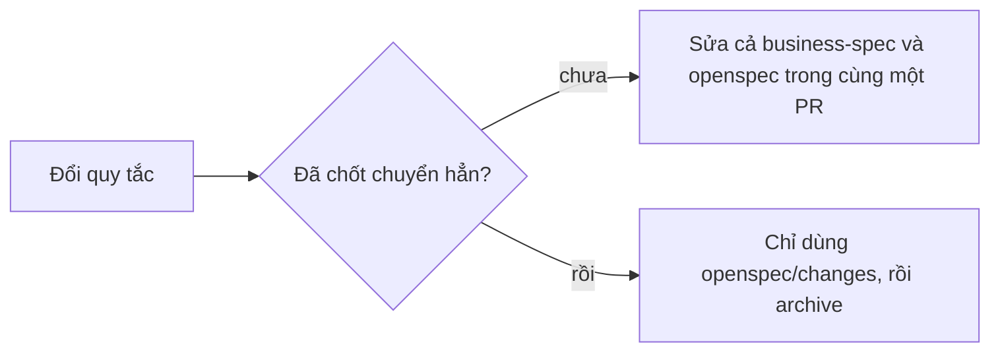

# Chuyển quy tắc nghiệp vụ sang OpenSpec

> Bắt đầu 24/10/2026. Nhánh `docs/openspec-baseline`, từ `main` tại `14d33f64` (PR #369).

## 1. Đã làm gì

Lần này chỉ **thêm file mới**. Không file cũ nào bị sửa, xóa hay đổi tên.

| File mới | Nội dung | Chép từ |
| --- | --- | --- |
| `openspec/specs/market-report/spec.md` | R-M01 đến R-M32 | `docs/business-spec/business-rules/market.md` bản 1.0 |
| `openspec/specs/insight-report/spec.md` | R-I01 đến R-I28 | `docs/business-spec/business-rules/insight.md` bản 1.0 |
| `openspec/specs/report-language/spec.md` | R-L01 đến R-L19 | `docs/business-spec/business-rules/report-language.md` bản 1.0 |
| `openspec/specs/report-pipeline/spec.md` | Luồng mã của Market và Insight: file, hàm, cổng, cờ | Đọc mã tại `14d33f64` |
| `openspec/changes/market-owner-decisions-2210/` | Đề xuất: đưa quyết định của chủ ngày 22/10 vào quy tắc và mã | Quyết định của chủ 22/10 (quy chuẩn dữ liệu đầu vào 1.42, 1.43) |
| `openspec/config.yaml` | Ngữ cảnh dự án và luật viết cho agent | Mới |
| `.claude/`, `.agents/`, `.opencode/` | Lệnh `/opsx:*` và skill OpenSpec cho Claude, Codex, OpenCode | `openspec init` bản 1.15.0 |

Mã quy tắc (R-M…, R-I…, R-L…) giữ nguyên, để mọi link cũ vẫn đúng.

## 2. Chưa làm gì (cố ý)

- `docs/business-spec/` còn nguyên. README của nó vẫn ghi "business-spec thắng".
- `AGENTS.md`, `CLAUDE.md`, `docs/REPOSITORY_MAP.md` chưa sửa. REPOSITORY_MAP vẫn ghi "Không cài thêm Spec Kit/OAC/QMD/agent framework".
- `semantic-layer/`, `data-sources/`, `decisions/` chưa chuyển.
- Không đổi mã app, không đổi kiểm thử, không triển khai.

## 3. Trong giai đoạn chuyển

- Hai nơi nói khác nhau: báo cho chủ, không tự chọn.
- Quyết định mới của chủ: viết thành một change trong `openspec/changes/`, không sửa thẳng `openspec/specs/`.

## 4. Để chuyển hẳn (cần chủ duyệt, sẽ sửa file cũ)

1. `docs/business-spec/README.md`: đổi "business-spec thắng" thành "openspec/specs thắng"; các file `business-rules/*.md` thành stub có link.
2. `docs/REPOSITORY_MAP.md`: bỏ dòng cấm cài spec framework, thêm dòng `openspec/`.
3. `AGENTS.md`: thêm một đoạn "Quy tắc nghiệp vụ ở openspec/specs; việc mới bắt đầu bằng /opsx:propose".
4. Chụp bản cũ vào `docs/outdated/<ngày>/` theo luật hiện có.
5. Thêm một kiểm thử trong `npm test`: mọi file và hàm ghi ở dòng "Mã kiểm" của `openspec/specs` phải có thật trong mã (bắt lỗi kiểu R-M24 trỏ sai đường dẫn). Khoảng 1 giây.
6. Thêm một job CI nhỏ: PR đổi một trong 4 file luật bằng mã (`market-business-gate.ts`, `market-14-rules.ts`, `report-visible-text-lint.ts`, `reader-report/lint.ts`) mà không đổi `openspec/` thì trượt. Thoát bằng nhãn `skip-spec-drift` khi chỉ đổi tên hoặc sửa tốc độ. Khoảng 10 giây, chạy song song với `Check`.
7. Không thêm hook chặn commit (chỉ chặn được Claude) và không thêm cảnh báo chiều ngược (spec đổi mà mã không đổi): lợi ích nhỏ.

## 5. Cách quay lại

- Chưa gộp vào `main`: xóa nhánh `docs/openspec-baseline`. Không còn dấu vết.
- Đã gộp: xóa các thư mục `openspec/`, `.claude/`, `.agents/`, `.opencode/` (hoặc `git revert` commit gộp). Không file cũ nào phụ thuộc vào chúng.

## 6. Điểm lệch đã thấy khi chuyển

| Điểm | business-spec (21/10) | Chủ nói sau đó | Mã app |
| --- | --- | --- | --- |
| Cộng hai sàn | R-M07, R-M16, R-L04: cấm | 22/10: cho phép, "giờ tôi cho phép cộng như metric" | Còn cấm (`U32_NO_CROSS_PLATFORM_TOTAL`) |
| Mã chỉ số (DT-1, LB-1…) trong báo cáo | Không nói | 22/10: bỏ khỏi báo cáo gửi đọc | Chưa kiểm |
| Tên "giá thật" | Không nói | 22/10: đổi thành "giá bán trung bình" | Chưa đổi |

Ba điểm này nằm trong change `market-owner-decisions-2210`, ở trạng thái **đề xuất, chờ chủ duyệt**.
