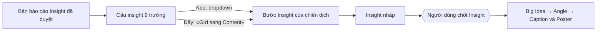

## Why

Ngày 29/10/2026 chủ muốn nối báo cáo Insight với Content Studio: «now i want to wire in insight report to content production. An insight finalize statement ship to content production» (F292). Chủ trả lời 25 câu hỏi (Q1–Q25) và chốt thiết kế bằng «đúng» cùng ngày.

Hôm nay hai bên chưa nối với nhau:
- Báo cáo Insight chỉ ra HTML và PDF. Báo cáo chưa có câu insight dạng có cấu trúc.
- Bước Insight của Content Studio có ba ô: Khách hàng, Nỗi đau, Insight. Nguồn là tự gõ (TYPED) hoặc từ STP.
- Mã Content Studio (Box 4) chưa đọc gì từ module phân tích (Box 2).

Quyết định của chủ ngày 29/10/2026 (F292). Chỉ phần trong «» là lời trích nguyên văn hoặc chữ trên màn hình.
- Q1, Q6, Q21: câu insight có cấu trúc, 9 trường. Viết theo Sự thật ngầm – Động lực – Xung đột; kiểm bằng 3C (Khách, Thương hiệu, Ngành). Khung lấy từ trang phương pháp Insight, mục 4.5.
- Q7, Q19: sau này AI viết bao nhiêu câu cũng được, miễn hợp lý và có số chứng minh; người dùng chọn câu. Bản 1 chỉ dùng câu giả trong kiểm thử.
- Q8, Q25: chỉ báo cáo đã được người duyệt mới hiện và mới gửi được.
- Q2, Q12, Q13, Q18: kéo — dropdown tên báo cáo ở bước Insight; chọn báo cáo thì hiện thẻ câu; chọn một câu thì app tự điền.
- Q3, Q9, Q20: đẩy — nút «Gửi sang Content» ở trang báo cáo; có ngay trong bản 1.
- Q11: Khách hàng ← Khách hàng; Nỗi đau ← Xung đột; Insight ← Câu insight. Các trường còn lại ở khung chỉ đọc và đi vào AI viết Big Idea, Angle.
- Q4, Q5, Q22: bản sao đóng băng, sửa được, có dấu «Đã sửa so với báo cáo»; «Có bản Insight mới» chỉ khi cùng báo cáo có bản duyệt mới hơn.
- Q14, Q16, Q23, Q24: D26 giữ nguyên; Insight đã chốt thì không thay; bản thật hiện trạng thái trống.
- Q15: bản 1 chỉ làm phía Content Studio.

Luồng:

## What Changes

- Thêm R-C01: câu insight có cấu trúc 9 trường, thuộc một bản báo cáo Insight; bản 1 chỉ có câu giả trong kiểm thử.
- Thêm R-C02: chỉ bản báo cáo Insight đã duyệt mới hiện và mới gửi được.
- Thêm R-C03: kéo ở bước Insight: dropdown, nhãn báo cáo, chọn một câu, lọc theo mức tin.
- Thêm R-C04: đẩy từ trang báo cáo bằng «Gửi sang Content».
- Thêm R-C05: cách điền ba ô, khung «Từ báo cáo», nguồn Insight mới, đầu vào cho AI.
- Thêm R-C06: Insight nháp thì thay sau khi xác nhận; đã chốt thì từ chối; D26 giữ nguyên.
- Thêm R-C07: bản sao đóng băng, sửa được, giữ bản gốc.
- Thêm R-C08: «Có bản Insight mới» chỉ khi cùng báo cáo có bản duyệt mới hơn.
- Thêm R-C09: bản thật hiện trạng thái trống khi chưa có câu insight.

## Capabilities

### New Capabilities
- `content-studio`: mã quy tắc R-C. Change này mở spec với phần nhận câu insight từ báo cáo.

### Modified Capabilities
- Không có.

## Impact

- Mã: chưa đổi. Nơi sẽ đổi:
  - Box 2: chỗ lưu câu insight theo bản báo cáo (`analysis_reader_report_revisions`, loại INSIGHT).
  - Box 4: `src/modules/flow/content-insight-service.ts`, `src/modules/flow/content-campaign-service.ts`.
  - API: `src/api/content-api.ts`, `src/api/report-api.ts`.
  - Giao diện Content Studio và trang danh sách báo cáo của lần chạy.
  - Một migration mới, lấy số kế tiếp.
- Bản 1 chạy với câu giả trong kiểm thử. Trên bản thật, dropdown và nút hiện «Chưa có báo cáo nào có câu insight» cho tới khi có bộ viết câu insight.
- Liên quan change `insight-method-v1`: R-I39 ở đó là luật viết câu insight. Change này không thực thi R-I39; change này chỉ nhận câu đã có.
- Không đổi R-M, R-I, R-L. D26 giữ nguyên.

Ba câu phạm vi (config.yaml):

| Khối | Phương pháp có cần không | Lợi ích đáng kể hay nhỏ | Đặt ở đâu |
|---|---|---|---|
| Câu insight có cấu trúc | Cần. Content Studio không đọc được HTML của báo cáo | Đáng kể: bỏ bước chép tay từ báo cáo sang chiến dịch | Box 2 lưu; Box 4 đọc qua giao diện truy vấn |
| Kéo ở bước Insight | Cần. Chủ chọn ở Q2 | Đáng kể: đây là đường chính | Bước Insight của chiến dịch |
| Đẩy từ trang báo cáo | Chủ chọn ở Q3 và Q20 | Nhỏ: bớt vài lần bấm | Trang danh sách báo cáo của lần chạy |

## Ngoài phạm vi

- Bộ viết câu insight bằng AI và luật bằng chứng của bộ viết (Q17). Luật viết đã nháp ở R-I39, change `insight-method-v1`.
- Mã hóa bình luận khách. Ngày 25/10/2026 bản thật chưa có dòng mã hóa nào.
- Nối báo cáo với sản phẩm; lọc dropdown theo sản phẩm.
- Chọn nhiều câu một lần, hoặc tạo nhiều chiến dịch một lần.
- Gọi nguồn trả phí. Triển khai chỉ khi chủ viết «deploy <SHA>». Không đổi cờ môi trường.

## Còn mở

Chủ chưa quyết. Không ai quyết thay chủ.

- Q25b: một chiến dịch thật đã lấy câu, rồi báo cáo bị từ chối. Hôm nay việc này không xảy ra: một bản đã duyệt không bỏ duyệt được, và chủ chọn chưa thêm cách bỏ duyệt (F293). Chốt nếu sau này có cách bỏ duyệt.
- Q17: «có số chứng minh» chặt đến đâu. Chốt cùng bộ viết câu insight (xem R-I39).
