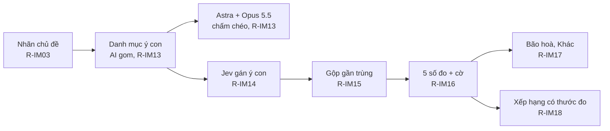

> Trạng thái: **đề xuất**. Chủ chốt 1A, 2B, 3A ngày 31/10/2026 (F322). Chạy thử ngoài app đã xong (tasks 1.1). Chưa viết mã app.

## Why

Hôm nay MCP Insight chỉ đếm tới mức nhãn: chủ đề và hướng (khen, chê, kể). Một nhãn như «Công dụng» có thể chứa nhiều ý khác nhau, ví dụ «xương chắc hơn», «đỡ chuột rút», «chưa thấy tác dụng». Báo cáo không nói được ý nào lặp lại, và không phân biệt được hai trường hợp:
- nhiều người tự nói giống nhau, tức tín hiệu thật;
- một câu mẫu bị chép lại, tức nhiễu.

Ngày 31/10/2026 chủ yêu cầu một phương pháp đo các lời lặp lại về cùng một điều (F319).

Chạy thử trên canxi (`outputs/ycon-3110/ket-qua-chay-thu-y-con.md`) cho thấy:
- Phép đo dùng được. Sau 3 bản, 81% đánh giá trong mẫu được hai máy chấm thống nhất là gán đúng và đủ.
- Phần lớn lời lặp lại là lời khen chung chung và dòng thuộc tính do sàn gợi ý. Văn mẫu chỉ chiếm 9/237 đánh giá Công dụng.

## What Changes

- **ADDED** R-IM13: danh mục ý con do AI gom. Astra và Opus 5.5 chấm 2 vòng. Danh mục đạt khi không còn ý con bị cả hai máy chấm là lỗi và ít nhất 80% đánh giá trong mẫu được gán đúng và đủ. Danh mục chưa đạt là nháp, và mức tin cao nhất của nó là Yếu.
- **ADDED** R-IM14: Jev gán ý con chỉ trên lời khách. Hệ thống bỏ dòng thuộc tính, lọc văn rác, và quyết định ý chung chung sau khi gán.
- **ADDED** R-IM15: lời gần trùng tính 1 bằng chứng. Bản ghi vẫn giữ, và báo cáo hiện cả hai số. Đây là ngoại lệ L1 trong quy chuẩn bản 1.49.
- **ADDED** R-IM16: 5 số đo cho mỗi ý con, gồm người viết, độ rải, lời cụ thể, gần trùng và dồn thời gian. Mỗi ý con có cờ và ngưỡng R-I33.
- **ADDED** R-IM17: đường bão hoà và phần «Khác» (luật E15).
- **ADDED** R-IM18: xếp ý con theo bằng chứng. Câu xếp hạng nói rõ thước đo, mẫu và kỳ.

## Quyết định của chủ về số đo 6

- Hai máy chấm cùng chỉ ra rằng ý Công dụng trộn **mục đích dùng hoặc lời quảng cáo** với **kết quả đã thấy**.
- Tôi đã đề xuất số đo 6 «giai đoạn dùng», dạng chung cho mọi ngành.
- Ngày 31/10/2026 chủ chốt **giữ 5 số đo** (F325). Số đo 6 nằm ngoài change này.

## Impact

- Mã: `tools/mcp-insight/insight_tools.py` (các công cụ mới), file dữ liệu danh mục ý con, `tools/mcp-insight/semantic/` (mô hình `claim_label`).
- Chi phí Jev: thêm khoảng 1 lượt gọi cho mỗi đánh giá trong mỗi chủ đề. Canxi, 2 chủ đề: khoảng 800 lượt, dưới 0,2 USD.
- Chấm chéo: 2 vòng × 2 máy cho mỗi danh mục mới, chạy bằng gói thuê bao. Không tốn tiền theo lượt.
- Quy chuẩn dữ liệu đầu vào bản 1.49: ngoại lệ L1.

## Ngoài phạm vi

- Sửa bước gán chủ đề phía trước. Chạy thử thấy bước này gán nhầm giao hàng và đóng gói vào chủ đề Vị. Việc sửa là change riêng.
- Sửa phạm vi sản phẩm của lần chạy. Lần chạy canxi lẫn sữa đậu nành vị socola.
- Mã người viết Shopee: change `shopee-public-review-writer-key` (R-I40).
