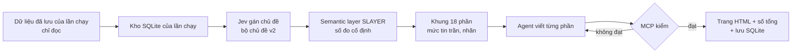

## Why

Ngày 25/10/2026 chủ hỏi: «chúng ta có thu thập dữ liệu + semantic layer → chuyển ra insight report liền luôn được không» (F195). Cùng ngày và ngày 26/10/2026, chủ đề xuất gói kho dữ liệu, semantic layer và bước chạy thành một MCP để mọi agent dùng được (bản thử `mcp-proto`). Ngày 26/10/2026 chủ chọn làm MCP Market trước, «SLAYER để sau cho Insight» (F268). MCP Market đã xong (`tools/mcp-market`, PR #418). Phía Insight chưa có gì.

Đã thử từng khúc ngoài app:
- SLAYER đếm khớp SQL trên lời khách canxi (25/10/2026, 4/4 truy vấn; 30/10/2026, 5/5 truy vấn chân dung khách).
- Jev gán chủ đề 1.233/1.248 đánh giá canxi trong khoảng 3 phút (26/10/2026). Bước gán chủ đề AI của app chỉ gán được 8/100 vì hết giờ 300 giây.
- Chưa có khúc nào biến số đếm thành báo cáo Insight theo phương pháp `insight-method-v1` (R-I30 đến R-I39).

Ngày 30/10/2026 chủ viết: «ok giờ thì hoàn thành ý tưởng của tôi đi, nếu có gì chưa chắc chắn thì hỏi ý kiến tôi. Nếu không còn gì chuyển thành flow openspec -> điều phối herdr qua firstmate để build» (F306). Cùng ngày chủ chọn 4 phương án (F306):
1. Gán chủ đề bằng Jev với bộ chủ đề v2.
2. Bản 1 nằm ngoài app: trang HTML, số tổng cho dashboard, lưu SQLite. Bản 2 mới đưa vào app.
3. Agent gọi MCP viết câu chữ; MCP kiểm từng câu.
4. Thử trên canxi và kẽm, chỉ dùng dữ liệu đã lưu.

## What Changes

Thêm công cụ MCP `tdn-insight` trong `tools/mcp-insight`, chạy cục bộ, theo đúng chuỗi chủ đề xuất:

- Thêm capability `insight-mcp`, mã R-IM01 đến R-IM12.
- Không sửa R-I01 đến R-I39. MCP áp dụng R-I30 đến R-I39 như spec `insight-report` và change `insight-method-v1` ghi.

## Capabilities

### New Capabilities
- `insight-mcp`: MCP dựng báo cáo Insight ngoài app từ dữ liệu đã lưu (R-IM01 đến R-IM12).

### Modified Capabilities
- Không có.

## Impact

- Mã mới chỉ nằm trong `tools/mcp-insight`. Không sửa `src/`, không thêm migration, không đổi cờ môi trường của app, không cần triển khai.
- MCP đọc CSDL của app ở chế độ chỉ đọc.
- Gọi Jev tốn lượt gọi. Lần chạy thật trên canxi và kẽm (khoảng 2.400 lượt) cần chủ đồng ý trước bằng một câu riêng.
- Bộ chủ đề v2 đang là bản nháp. Chủ chưa chấm 30 mẫu. Khi bộ chủ đề còn là bản nháp, câu kiểm 3 của R-I32 tính là thiếu.

## Ngoài phạm vi

- Đưa báo cáo vào app (bản báo cáo INSIGHT, Reader, PDF, duyệt, «Gửi sang Content»). Đây là bản 2, cần change riêng.
- Code app của `insight-method-v1` (task 2.1 đến 2.10).
- Gán chủ đề AI của app và lỗi hết giờ 300 giây.
- Thu dữ liệu mới, gọi nguồn trả phí khác, thêm sản phẩm thứ ba.
- Mở MCP ra internet hoặc nối connector claude.ai.

Ba câu hỏi phạm vi (config.yaml):
1. Phương pháp có cần không: có. Báo cáo Insight trong app chưa có câu insight nào (bảng câu insight trống từ 29/10/2026). Phương pháp R-I30 đến R-I39 đã duyệt nhưng chưa có mã.
2. Lợi ích đáng kể hay nhỏ: đáng kể. Một lời gọi MCP cho ra bản nháp 18 phần có mức tin từng ý, từ bất kỳ agent nào (Claude, Codex, OpenCode, pi).
3. Đặt ở đâu: `tools/mcp-insight`, cạnh `tools/mcp-market`. Spec mới `insight-mcp`. Không thêm khối hay nguồn mới vào báo cáo.
