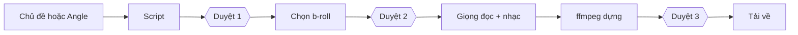

## Why

Chủ đã duyệt thiết kế Video Factory ngày 01/10/2026 và cập nhật ngày 25/10/2026. Các ý dưới đây tóm tắt quyết định. Chỉ phần trong «» là lời trích nguyên văn hoặc tên nút.

- 01/10/2026: chủ xác nhận toàn bộ §1 của brief 054 sau phỏng vấn từ 26/09. Mục nào không ghi Later (làm sau) là phạm vi v1.
- 01/10/2026: chủ đặt thứ tự làm — định nghĩa → giao diện nhấp được → triển khai sớm → chủ góp ý → phần chạy phía sau → lát cắt dọc đầu tiên. Bản mẫu 2.2 đã có, chỉ dùng dữ liệu demo.
- 01/10/2026: chủ duyệt cách tách kịch bản và cài đặt. «Tạo video» là biểu mẫu cài đặt; kịch bản thuộc video. Viết lại luôn dừng ở điểm duyệt 1.
- 01/10/2026: chủ từ chối mọi ý từ notivn/AIEV: căn chỉnh lời đọc bằng Whisper, cổng kiểm chất lượng, VieNeu-TTS và hiệu ứng âm thanh. Không đề xuất lại.
- 25/10/2026 (F172): «change the name to video factory». Tên cũ là Video Studio. Tên mới: Video Factory.
- 25/10/2026 (F175, O9): «O9 - definitely». Video Factory có change và spec OpenSpec riêng, mã quy tắc R-V.
- 25/10/2026 (F173, F175): GLM 5.3 Flash viết mã. Sol 6.1 xhigh viết kiểm thử ở phiên riêng. Một phiên Sol 6.1 xhigh mới khác rà soát. Cách chia việc này chỉ áp dụng khi xây Video Factory.
- 25/10/2026 (F176, F177, O1): chủ chọn «option A with the isolation protections (ffmpeg helper with limits, streamed files, per-call time limits, crash test).» Video chạy trong app; ffmpeg chạy con có giới hạn. File được đọc ghi từng phần; mỗi lời gọi có giới hạn thời gian; có kiểm thử khi tiến trình sập. Mục tiêu nguyên văn: «when a service down. I don't want the whole ship to sink with it». Chủ muốn lỗi một dịch vụ chỉ dừng việc đang gọi dịch vụ đó. Tại af53534a, app sập cứng làm khóa executor còn lại, nên app dừng cho tới khi quy trình gỡ khóa cũ trong runbook được chạy (cả báo cáo lẫn Content Studio đứng cùng lúc).
- 25/10/2026 (F183): chủ xác nhận lại phương án A và yêu cầu lát 1 thêm tự khởi động lại an toàn sau khi app sập cứng: sau nhiệm 055 app tự quay lại hoạt động, và 055 phải chứng minh tiến trình giữ khóa đã tắt trước khi nhận khóa (không bao giờ có hai bên ghi). Video của lát 1–2 mang nhãn «Chưa kiểm lời đọc»: cho tới lát 3 phép kiểm duy nhất là duyệt của chủ ở duyệt 1 và duyệt 3, và «Bỏ qua duyệt» chưa tồn tại. Lát 1 được kiểm với giọng giả trong CI; sau triển khai chủ dựng một video thật với ngân sách giọng nhỏ do chủ đặt lúc triển khai. Lời gọi script và viết lại hiện «n lượt AI»; model script cố định trong mã.
- 25/10/2026 (F185): trả lời cách «tự quay lại hoạt động» của F183 — chủ chọn phương án (a): lát 1 thêm một dịch vụ nền tự khởi động lại app sau khi app sập, như CLIProxy; chỉ cài trên Fedora khi chủ viết «deploy <SHA>». Unit systemd của người dùng với `Restart=on-failure` và giới hạn số lần khởi động; khóa cấp qua environment file của nhiệm 053 phương án (b).
- 25/10/2026 (F176, O2): «agree, wait for a click». Clip từ thư mục thả clip hiện «Chưa phân tích». Gemini chỉ chạy khi chủ bấm «Phân tích n clip (n lượt Gemini)».
- 25/10/2026 (F178): chủ yêu cầu «a simplest way, non over engineer but we still deliver work as my intended». Kế hoạch có 10 phần cắt giảm, ghi ở §5 brief 054.
- 25/10/2026 (F179): chủ duyệt cả 4 đơn giản hóa: prompt viết script cố định trong mã; viết lại thì chọn lại clip cho tới lát 3; xóa là ẩn; không có khay «Đang tạo» toàn cục trong v1.
- 25/10/2026 (F180, O7): «start Video Factory slice 0 (documents) now, in parallel with Market».

Luồng làm video:

## What Changes

- Thêm R-V01: Video Factory là máy làm video tự động, không phải trình dựng tay; 9:16 và tiếng Việt trước; nguồn là chủ đề tự do hoặc Angle chiến dịch; thương hiệu tùy chọn.
- Thêm R-V02: ba điểm duyệt — duyệt 1 (script), duyệt 2 (chọn cảnh), duyệt 3 (video cuối) — bật mặc định; có công tắc «Bỏ qua duyệt» cho từng video (ra mắt ở lát 3); yêu cầu viết lại luôn dừng ở duyệt 1.
- Thêm R-V03: từ lát 3, kiểm an toàn lời đọc (tuyên bố sức khỏe, pháp lý, sự thật thương hiệu) chạy cho mọi video; «Bỏ qua duyệt» không bao giờ bỏ qua nó; cho tới lát 3, phép kiểm duy nhất là duyệt của chủ ở duyệt 1 và duyệt 3, và video lát 1–2 mang nhãn «Chưa kiểm lời đọc» (F183).
- Thêm R-V04: thứ tự nguồn clip: thư viện của mình → stock (Pexels, Pixabay) → tạo bằng AI; tạo bằng AI chỉ là nút mờ trong v1.
- Thêm R-V05: clip stock đã dùng được thêm vào thư viện kèm nguồn và giấy phép; clip stock không giấy phép thì bị từ chối.
- Thêm R-V06: clip do AI tạo ở riêng các project của chúng, không bao giờ vào thư viện.
- Thêm R-V07: mỗi clip là Tổng hợp hoặc thuộc một thương hiệu; clip thương hiệu chỉ xuất hiện trong video của thương hiệu đó.
- Thêm R-V08: tập tin gốc không bao giờ bị thay đổi; tập tin từ thư mục thả clip được sao chép vào, không dời, không xóa; tập tin đã nhập (cùng vân tay) bị bỏ qua.
- Thêm R-V09: bài nhạc cần giấy phép đã ghi.
- Thêm R-V10: trước mọi lời gọi trả phí, app hiện số lượt; script và viết lại hiện «n lượt AI» (F183); Gemini chỉ đọc clip sau khi chủ bấm «Phân tích n clip (n lượt Gemini)», các phân tích theo stock được đếm bên trong lần bấm đó và không có phân tích nào chạy nếu thiếu lần bấm; một lô hiển thị một con số gộp trước khi chạy; không tự chạy lại, chủ bấm «Thử lại».
- Thêm R-V11: app không bao giờ tự chuyển sang nhà cung cấp hay tài khoản khác; chủ có thể chọn thủ công.
- Thêm R-V12: cảnh không có clip phù hợp: khi duyệt bật thì chặn duyệt và cảnh hiện «Chưa có cảnh phù hợp»; khi «Bỏ qua duyệt» bật thì video thất bại kèm thông báo rõ, không bao giờ ra khung đen.
- Thêm R-V13: mỗi lần dựng giữ nguyên bản sao cài đặt đã dùng; đổi preset không đổi video đã có; cài đặt đã đổi đánh dấu video «Cần dựng lại».
- Thêm R-V14: cô lập lỗi: ffmpeg sập hay một dịch vụ ngoài sụp, chậm thì chỉ job đó thất bại (sau giới hạn thời gian) và app vẫn chạy; từ lát 1 (055), app tự khởi động lại an toàn sau khi sập cứng, chứng minh tiến trình giữ khóa đã tắt trước khi nhận khóa, không bao giờ có hai executor cùng quyền ghi (F183); job đang chạy hiện là gián đoạn và không bao giờ tự chạy lại.
- Thêm R-V15: sửa script: cảnh bị đổi mất lựa chọn clip của nó và bị đánh dấu; chỉ dựng lại giọng và video khi chủ khởi động, sau khi app hiện số ký tự (cho tới lát 3 mới có giữ lựa chọn cũ, F179).
- Thêm R-V16: xóa là «Ẩn» và có «Khôi phục»; v1 không tự dọn file.

## Capabilities

### New Capabilities
- `video-factory`.

### Modified Capabilities
- Không có.

## Impact

- Mã: chưa có. Code làm trong lát 1–3 (nhiệm vụ 055–057). Nhiệm vụ 058 chạy thử thật trên Fedora theo ngân sách chủ duyệt. Xem tasks.md.
- Lát 0 này chỉ thêm tài liệu: brief 054 bản mới (docs/tasks/054-video-factory-design.md), ADR 0007, và các sửa nhỏ ở openspec/config.yaml, AGENTS.md, INTENT.md.
- Không ảnh hưởng quy tắc R-M, R-I, R-L.

Ba câu phạm vi (config.yaml) cho mỗi khối và nguồn mới:

| Khối hoặc nguồn | Phương pháp có cần không | Lợi ích đáng kể hay nhỏ | Đặt ở đâu |
|---|---|---|---|
| Pexels | Cần. Thư viện riêng không đủ b-roll | Đáng kể: đa cảnh, có giấy phép rõ | Adapter stock của Video Factory, mã và quy tắc ở Box 4 Flow |
| Pixabay | Cần nguồn stock thứ hai theo thiết kế đã duyệt | Nhỏ ở video đầu; thêm lựa chọn khi Pexels thiếu cảnh | Bộ nối riêng trong Flow, lát 3, sau Pexels |
| Vbee | Cần nghe thử F2 để chủ chọn giọng tiếng Việt | Giọng đọc có lợi ích đáng kể; chất lượng Vbee còn chờ chủ nghe | Bộ nối giọng riêng trong Flow; nếu thắng F2 thì lát 1, nếu không thì lát 3 |
| ElevenLabs | Cần nghe thử F2, cùng văn bản với Vbee | Giọng đọc có lợi ích đáng kể; chất lượng ElevenLabs còn chờ chủ nghe | Bộ nối giọng riêng trong Flow; nếu thắng F2 thì lát 1, nếu không thì lát 3 |
| Gemini đọc clip | Cần để tự mô tả clip và gợi ý 3 clip từ lát 2 | Đáng kể: giảm việc chủ gắn nhãn và chọn từng cảnh; lát 1 vẫn tìm bằng nhãn tự gõ | Bộ nối video trong Flow, tái dùng hàm cần thiết từ module nghiên cứu; F1 chốt đường gọi, chủ bấm mới chạy |

## Ngoài phạm vi

- Sửa code, kiểm thử, migration, hợp đồng JSON, file package hay CI. Toàn bộ làm ở lát 1–3.
- Gọi nguồn trả phí. Không có lời gọi thật nào được ủy quyền trong lát 0.
- Triển khai. Chỉ khi chủ viết «deploy <SHA>».
- Đổi cờ môi trường nếu chủ chưa nói rõ.
- Phụ đề, biến thể hook, tạo clip bằng AI, tự đăng lên mạng xã hội, khung 16:9, đồ họa chuyển động (tất cả «Later» hoặc Phase 2–3).

## Còn mở

Chủ chưa quyết. Không ai quyết thay chủ.

- O3: không trần chi tiêu + lô + bỏ duyệt → có thể gọi trả phí khi không ai nhìn. Chốt trước lát 3.
- O4: video của thương hiệu thực phẩm bổ sung có được bỏ duyệt không. Chốt trước lát 3.
- F1: tài khoản nào mà CLIProxy trên Fedora dùng (quyết định đường đọc clip Gemini tái dùng CLIProxy hay cần khóa chính thức riêng). Kiểm tra chỉ đọc.
- F2: bài nghe thử giọng tiếng Việt giữa Vbee và ElevenLabs. Chủ nghe; lời gọi trả phí nhỏ cần chủ cho phép. Cần ghi kết quả trước khi 055 nối nhà cung cấp giọng thật ở điểm chốt cuối; nếu cần webhook thì hỏi chủ trước khi xây.
