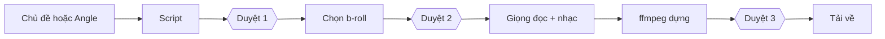

## Why

Chủ quyết định làm Video Factory từ phỏng vấn thiết kế và các câu trả lời ngày 25/10/2026. Mỗi quyết định dưới đây là câu của chủ, giữ nguyên ý:

- 26/09–01/10/2026: chủ phỏng vấn thiết kế và duyệt toàn bộ §1 của brief 054. Mục nào của §1 không ghi «Later» (Làm sau) là phạm vi v1.
- 01/10/2026: chủ đặt thứ tự làm — định nghĩa → giao diện nhấp được (bản mẫu 2.2, chỉ dữ liệu demo) → triển khai sớm → chủ góp ý → phần chạy phía sau → đoạn dọc đầu tiên.
- 01/10/2026: chủ duyệt cách chạy «script vs setup» (tạo video là biểu mẫu cài đặt; nội dung ghi thuộc video; viết lại luôn dừng ở điểm duyệt 1).
- 01/10/2026: chủ từ chối mọi ý từ notivn/AIEV (đo thẳng lời đọc, trạm kiểm chất lượng, giọng VieNeu-TTS, hiệu ứng âm). Không đề xuất lại.
- 25/10/2026 (F172): «change the name to video factory». Tên cũ là Video Studio. Tên mới: Video Factory.
- 25/10/2026 (F175, O9): «O9 - definitely». Video Factory có change và spec OpenSpec riêng, mã quy tắc R-V.
- 25/10/2026 (F173, F175): GLM 5.3 Flash viết mã. Sol 6.1 xhigh viết kiểm thử ở phiên riêng. Một phiên Sol mới khác rà soát.
- 25/10/2026 (F176, F177, O1): chủ chọn phương án A kèm bốn lớp bảo vệ (ffmpeg chạy con có giới hạn, đọc ghi file bằng luồng, giới hạn thời gian từng lời gọi, có kiểm thử crash). Mục tiêu: «khi một dịch vụ hỏng, tôi không muốn cả con tàu chìm theo». Rủi ro chấp nhận: lỗi của chính mã Video Factory có thể khởi động lại app.
- 25/10/2026 (F176, O2): «agree, wait for a click». Clip từ thư mục nhúng hiện «Chưa phân tích». Gemini chỉ chạy khi chủ bấm «Phân tích n clip (n lượt Gemini)».
- 25/10/2026 (F178): chủ yêu cầu «a simplest way, non over engineer but we still deliver work as my intended». Kế hoạch là simplest-plan-2510.md với 10 phần cắt giảm.
- 25/10/2026 (F179): chủ duyệt cả 4 đơn giản hóa: prompt viết script cố định trong mã; viết lại thì chọn lại clip cho tới lát 3; xóa là ẩn; không có khay «Đang tạo» toàn cục trong v1.
- 25/10/2026 (F180, O7): «start Video Factory slice 0 (documents) now, in parallel with Market».

Luồng làm video:

## What Changes

- Thêm R-V01: Video Factory là máy làm video tự động, không phải trình dựng tay; 9:16 và tiếng Việt trước; nguồn là chủ đề tự do hoặc Angle chiến dịch; thương hiệu tùy chọn.
- Thêm R-V02: ba điểm duyệt (script, chọn cảnh, video cuối), bật mặc định; có công tắc «Bỏ qua duyệt» cho từng video; yêu cầu viết lại luôn dừng ở điểm duyệt 1.
- Thêm R-V03: kiểm an toàn lời đọc (tuyên bố sức khỏe, pháp lý, sự thật thương hiệu) chạy cho mọi video; «Bỏ qua duyệt» không bao giờ bỏ qua nó.
- Thêm R-V04: thứ tự nguồn clip: thư viện của mình → stock (Pexels, Pixabay) → tạo bằng AI; tạo bằng AI chỉ là nút mờ trong v1.
- Thêm R-V05: clip stock đã dùng được thêm vào thư viện kèm nguồn và giấy phép; clip stock không giấy phép thì bị từ chối.
- Thêm R-V06: clip do AI tạo ở riêng các project của chúng, không bao giờ vào thư viện.
- Thêm R-V07: mỗi clip là Tổng hợp hoặc thuộc một thương hiệu; clip thương hiệu chỉ xuất hiện trong video của thương hiệu đó.
- Thêm R-V08: tập tin gốc không bao giờ bị thay đổi; tập tin từ thư mục nhúng được sao chép vào, không dời, không xóa; tập tin đã nhập (cùng vân tay) bị bỏ qua.
- Thêm R-V09: bài nhạc cần giấy phép đã ghi.
- Thêm R-V10: trước mọi lời gọi trả phí, app hiện số lượt; Gemini chỉ đọc clip sau khi chủ bấm «Phân tích n clip (n lượt Gemini)»; một lô hiển thị một con số gộp trước khi chạy; không tự chạy lại, chủ bấm «Thử lại».
- Thêm R-V11: app không bao giờ tự chuyển sang nhà cung cấp hay tài khoản khác; chủ có thể chọn thủ công.
- Thêm R-V12: cảnh không có clip phù hợp: khi duyệt bật thì chặn duyệt và cảnh hiện «Chưa có cảnh phù hợp»; khi «Bỏ qua duyệt» bật thì video thất bại kèm thông báo rõ, không bao giờ ra khung đen.
- Thêm R-V13: mỗi lần dựng giữ nguyên bản sao cài đặt đã dùng; đổi preset không đổi video đã có; cài đặt đã đổi đánh dấu video «Cần dựng lại».
- Thêm R-V14: cô lập lỗi: ffmpeg sập hay một dịch vụ ngoài sụp, chậm thì chỉ job đó thất bại (sau giới hạn thời gian) và app vẫn chạy; sau khi app khởi động lại, job đang chạy hiện là gián đoạn và không bao giờ tự chạy lại.
- Thêm R-V15: sửa script làm app chọn lại clip cho các cảnh đã đổi và dựng lại giọng, dựng lại video (cho tới lát 3 mới có giữ lựa chọn cũ).
- Thêm R-V16: xóa là «Ẩn» và có «Khôi phục»; v1 không tự dọn file.

## Capabilities

### New Capabilities
- `video-factory`.

### Modified Capabilities
- Không có.

## Impact

- Mã: chưa có. Code làm trong lát 1–3 (xem tasks.md: nhiệm vụ 055, 056, 057).
- Lát 0 này chỉ thêm tài liệu: brief 054 bản mới (docs/tasks/054-video-factory-design.md), ADR 0007, và các sửa nhỏ ở openspec/config.yaml, AGENTS.md, INTENT.md.
- Không ảnh hưởng quy tắc R-M, R-I, R-L.

Ba câu phạm vi (config.yaml) cho mỗi khối và nguồn mới:

| Khối hoặc nguồn | Phương pháp có cần không | Lợi ích đáng kể hay nhỏ | Đặt ở đâu |
|---|---|---|---|
| Pexels | Cần. Thư viện riêng không đủ b-roll | Đáng kể: đa cảnh, có giấy phép rõ | Adapter stock của Video Factory, mã và quy tắc ở Box 4 Flow |
| Pixabay | Cần thêm nguồn hai, phòng khi Pexels không có cảnh | Nhỏ ở lát 1, đáng kể khi danh mục rộng hơn | Cùng adapter stock, làm sau Pexels |
| Vbee | Cần ở lát 1: video tiếng Việt cần giọng đọc | Đáng kể: không có giọng thì không có video | Adapter giọng đọc của Video Factory |
| ElevenLabs | Cần như lựa chọn hai để chủ nghe thử (F2) | Đang mở: thắng hay thua sau bài nghe thử VIP | Cùng adapter giọng đọc; bên thắng làm trước |
| Gemini đọc clip | Cần cho việc hiểu clip và gợi ý 3 clip | Đáng kể: không mô tả clip thì tìm theo chữ không chạy được | Đường đọc clip tái dùng từ module nghiên cứu; chủ bấm mới chạy |

## Ngoài phạm vi

- Sửa code, kiểm thử, migration, hợp đồng JSON, file package hay CI. Toàn bộ làm ở lát 1–3.
- Gọi nguồn trả phí. Không có lời gọi thật nào được ủy quyền trong lát 0.
- Triển khai. Chỉ khi chủ viết «deploy <SHA>».
- Đổi cờ môi trường nếu chủ chưa nói rõ.
- Phụ đề, biến thể hook, tạo clip bằng AI, tự đăng lên mạng xã hội, khung 16:9, đồ họa chuyển động (tất cả «Later» hoặc Phase 2–3).

## Còn mở

Chủ chưa quyết. Không ai quyết thay chủ.

- O3: không trần chi tiêu + lô + bỏ duyệt → có thể gọi trả phí khi không ai nhìn. Chốt trước lát 3.
- O4: video bổ sung thương hiệu có được bỏ duyệt không. Chốt trước lát 3.
- F1: tài khoản nào mà CLIProxy trên Fedora dùng (quyết định đường đọc clip Gemini tái dùng CLIProxy hay cần khóa chính thức riêng). Kiểm tra chỉ đọc.
- F2: bài nghe thử giọng tiếng Việt giữa Vbee và ElevenLabs. Chủ nghe; lời gọi trả phí nhỏ cần chủ cho phép.
