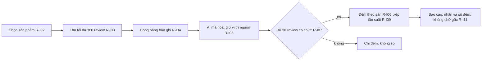

# insight-report Specification

## Purpose
Spec này giữ quy tắc của báo cáo Insight: đếm và chọn mẫu, cổng so sánh và nhận định, trình bày bình luận, tiếng nói người bán, đơn vị, đề xuất hành động và chân dung khách hàng (R-I01 đến R-I28). Nội dung chuyển từ docs/business-spec/business-rules/insight.md bản 1.0 (21/10/2026); mã R-I giữ nguyên. Insight chờ Market ổn định rồi mới chạy (chủ 17/10, 12/10). Quy tắc chung cho mọi báo cáo nằm ở spec report-language.

## Requirements

### Requirement: R-I01 Đơn vị đếm là bản ghi
Báo cáo Insight SHALL dùng "bản ghi" (một review hay một bình luận) làm đơn vị đếm, và bản ghi SHALL NOT được coi là người.

- Loại kiểm: Chưa ghi trong business-spec
- Mã kiểm: Chưa có mã kiểm
- Vì sao: Chưa ghi lý do trong business-spec

#### Scenario: Đếm bản ghi
- **WHEN** báo cáo nêu 120 review nhắc một chủ đề
- **THEN** báo cáo gọi đó là 120 bản ghi, không gọi là 120 người

#### Scenario: Gọi bản ghi là người
- **WHEN** báo cáo viết "120 người nhắc chủ đề này" từ 120 bản ghi
- **THEN** quy tắc R-I01 bị vi phạm

### Requirement: R-I02 Chọn sản phẩm từ nguồn S01
Báo cáo Insight SHALL chọn sản phẩm từ nguồn S01, cộng dồn đến ít nhất 50% doanh thu của nhóm lõi (ít nhất 80% khi cần phủ rộng), cần ít nhất 5 thương hiệu và trải đều giữa các thương hiệu.

- Loại kiểm: Chưa ghi trong business-spec
- Mã kiểm: Chưa có mã kiểm
- Vì sao: Chưa ghi lý do trong business-spec

#### Scenario: Đủ doanh thu và thương hiệu
- **WHEN** các sản phẩm chọn cộng dồn đạt 50% doanh thu nhóm lõi và có 5 thương hiệu trải đều
- **THEN** quy tắc R-I02 đạt

#### Scenario: Chỉ 4 thương hiệu
- **WHEN** các sản phẩm chọn chỉ thuộc 4 thương hiệu
- **THEN** quy tắc R-I02 chưa đạt

### Requirement: R-I03 Tối đa 300 review mỗi sản phẩm và hai cách dừng
Báo cáo Insight SHALL lấy tối đa 300 review mỗi sản phẩm. Việc thu SHALL dừng theo cách A (số cố định) hoặc cách B (lô 25 review có chữ, dừng khi một lô thêm không quá 5% mã chủ đề mới), cách nào tới trước.

- Loại kiểm: Chưa ghi trong business-spec
- Mã kiểm: Chưa có mã kiểm
- Vì sao: Chưa ghi lý do trong business-spec. Xem thêm R-M14 (300 bình luận mỗi sản phẩm, chủ 06/10).

#### Scenario: Dừng theo cách B
- **WHEN** một lô 25 review có chữ chỉ thêm không quá 5% mã chủ đề mới, trước khi đủ số cố định
- **THEN** việc thu dừng theo cách B

#### Scenario: Đủ 300 review
- **WHEN** sản phẩm đã có 300 review
- **THEN** việc thu dừng, không lấy thêm

### Requirement: R-I04 Đóng băng bộ bản ghi
Báo cáo Insight SHALL đóng băng bộ bản ghi, ghi ngày thu thập theo giờ Việt Nam, và đánh dấu bản ghi ngoài kỳ cùng bản ghi trùng nguyên văn.

- Loại kiểm: Chưa ghi trong business-spec
- Mã kiểm: Chưa có mã kiểm
- Vì sao: Chưa ghi lý do trong business-spec

#### Scenario: Bản ghi trùng
- **WHEN** hai bản ghi có nguyên văn giống nhau
- **THEN** cả hai được đánh dấu là bản ghi trùng nguyên văn

#### Scenario: Bản ghi ngoài kỳ
- **WHEN** một bản ghi nằm ngoài kỳ báo cáo
- **THEN** bản ghi đó được đánh dấu ngoài kỳ

### Requirement: R-I05 Mã hóa bằng AI dùng bộ mã có phiên bản
Việc mã hóa bằng AI trong Insight SHALL dùng bộ mã có phiên bản, và mỗi mã SHALL giữ vị trí nguồn (id bản ghi và đoạn chữ).

- Loại kiểm: Chưa ghi trong business-spec
- Mã kiểm: Chưa có mã kiểm
- Vì sao: Chưa ghi lý do trong business-spec

#### Scenario: Mã có vị trí nguồn
- **WHEN** AI gán một mã cho một bản ghi
- **THEN** mã đó giữ id bản ghi và đoạn chữ làm vị trí nguồn

#### Scenario: Mã thiếu vị trí nguồn
- **WHEN** một mã không có id bản ghi hoặc đoạn chữ
- **THEN** quy tắc R-I05 bị vi phạm

### Requirement: R-I06 Đếm bản ghi theo từng sàn
Báo cáo Insight SHALL đếm bản ghi theo từng sàn, mỗi sàn một cột, SHALL NOT cộng Shopee với TikTok Shop, và SHALL ghi n/N khi mẫu số đầy đủ. Khi một chủ đề có ở cả hai sàn, báo cáo SHALL ghi «có ở cả 2 sàn» và SHALL NOT ghi một con số gộp. Báo cáo Insight SHALL NOT nêu tổng tiền hay tổng lượt bán; hai tổng này chỉ có ở báo cáo Market (R-M16).

- Loại kiểm: Máy (một phần)
- Mã kiểm: Một phần: lint Reader W3 của Insight trong `lint` (`src/modules/analysis/reader-report/lint.ts`) trượt khi có cụm tổng hai sàn. Chưa có mã kiểm cho nhãn «có ở cả 2 sàn» và cho tổng tiền, tổng lượt bán.
- Vì sao: Chủ quyết định ngày 11/10/2026: không có tổng giữa các sàn (U-32). Ngày 24/10/2026 chủ giữ luật này cho Insight sau khi cho Market cộng hai sàn: «Insight không cộng 2 sàn. Mỗi sàn một cột. Chủ đề có ở cả 2 sàn thì ghi «có ở cả 2 sàn». Tổng tiền và tổng lượt bán chỉ có ở Market.»

#### Scenario: Đếm riêng từng sàn
- **WHEN** báo cáo nêu số bản ghi của Shopee và của TikTok Shop, mỗi sàn một cột
- **THEN** quy tắc R-I06 đạt

#### Scenario: Cộng hai sàn
- **WHEN** báo cáo nêu một số bản ghi bằng Shopee cộng TikTok Shop
- **THEN** quy tắc R-I06 bị vi phạm

#### Scenario: Chủ đề có ở cả hai sàn
- **WHEN** chủ đề "giao hàng chậm" có bản ghi ở cả Shopee và TikTok Shop
- **THEN** báo cáo ghi số của từng sàn ở cột riêng và ghi «có ở cả 2 sàn», không ghi số gộp

#### Scenario: Tổng tiền trong Insight
- **WHEN** báo cáo Insight nêu tổng doanh thu hoặc tổng lượt bán
- **THEN** quy tắc R-I06 bị vi phạm

### Requirement: R-I07 Chỉ so sản phẩm khi mỗi sản phẩm có ít nhất 30 review có chữ
Báo cáo Insight SHALL chỉ so giữa các sản phẩm khi mỗi sản phẩm có ít nhất 30 review có chữ.

- Loại kiểm: Chưa ghi trong business-spec
- Mã kiểm: Chưa có mã kiểm
- Vì sao: Chưa ghi lý do trong business-spec

#### Scenario: Đủ 30 review có chữ
- **WHEN** hai sản phẩm đều có ít nhất 30 review có chữ
- **THEN** báo cáo được so hai sản phẩm đó

#### Scenario: Một sản phẩm có 20 review có chữ
- **WHEN** một trong hai sản phẩm chỉ có 20 review có chữ
- **THEN** báo cáo chỉ đếm, không so

### Requirement: R-I08 Vấn đề của ngành hàng cần ít nhất 3 sản phẩm của các thương hiệu khác nhau
Báo cáo Insight SHALL gọi một vấn đề là "của ngành hàng" chỉ khi nó xuất hiện ở ít nhất 3 sản phẩm của các thương hiệu khác nhau; nếu không, SHALL gọi là "của sản phẩm".

- Loại kiểm: Chưa ghi trong business-spec
- Mã kiểm: Chưa có mã kiểm
- Vì sao: Chưa ghi lý do trong business-spec

#### Scenario: Ba thương hiệu khác nhau
- **WHEN** một vấn đề xuất hiện ở 3 sản phẩm của 3 thương hiệu khác nhau
- **THEN** báo cáo gọi đó là vấn đề "của ngành hàng"

#### Scenario: Cùng một thương hiệu
- **WHEN** một vấn đề xuất hiện ở 3 sản phẩm của cùng một thương hiệu
- **THEN** báo cáo gọi đó là vấn đề "của sản phẩm"

### Requirement: R-I09 Xếp hạng theo tần suất chủ đề và khen/chê
Báo cáo Insight SHALL xếp hạng theo tần suất là chủ đề × khen/chê, theo từng sàn. Một bình luận SHALL được tính một lần trong mỗi chủ đề. Chủ đề dưới 3 lần nhắc SHALL vào "Khác". Nếu "Khác" trên 20%, SHALL thu thêm một vòng (tối đa một vòng); vẫn trên 20% thì SHALL hiện nguyên. Xếp hạng SHALL nghiêm ngặt, không có hạng đồng.

- Loại kiểm: Chưa ghi trong business-spec
- Mã kiểm: Chưa có mã kiểm
- Vì sao: Chủ quyết định ngày 11/10/2026 (U-11): xếp hạng theo tần suất (chủ đề × khen/chê), một AI mã hóa; bước AI thứ hai kiểm chứng để sau.

#### Scenario: Chủ đề ít nhắc
- **WHEN** một chủ đề chỉ được nhắc 2 lần
- **THEN** chủ đề đó vào nhóm "Khác"

#### Scenario: Nhóm Khác vẫn trên 20% sau một vòng
- **WHEN** nhóm "Khác" trên 20% và đã thu thêm một vòng mà vẫn trên 20%
- **THEN** báo cáo hiện nguyên nhóm "Khác", không thu thêm vòng nữa

### Requirement: R-I10 Tần suất không bằng mức quan trọng
Báo cáo Insight SHALL NOT coi tần suất là mức quan trọng, và SHALL NOT thêm lại dòng "Đừng hiểu là: nhắc nhiều ≠ quan trọng".

- Loại kiểm: Chưa ghi trong business-spec
- Mã kiểm: Chưa có mã kiểm
- Vì sao: Chủ quyết định ngày 11/10/2026 (U-11) về xếp hạng theo tần suất. Business-spec không ghi riêng lý do bỏ dòng "Đừng hiểu là".

#### Scenario: Chủ đề nhắc nhiều
- **WHEN** một chủ đề được nhắc nhiều nhất
- **THEN** báo cáo không nói chủ đề đó quan trọng nhất chỉ vì được nhắc nhiều

#### Scenario: Thêm lại dòng cũ
- **WHEN** báo cáo thêm lại dòng "Đừng hiểu là: nhắc nhiều ≠ quan trọng"
- **THEN** quy tắc R-I10 bị vi phạm

### Requirement: R-I11 Hiện nhãn đã mã hóa và số đếm, không hiện bình luận gốc
Báo cáo Insight SHALL hiện nhãn đã mã hóa và số đếm, SHALL NOT hiện bình luận gốc của khách (chủ 19/10). Vị trí nguồn nằm ở I17. Trích dẫn đã mã hóa thì được; đổ nguyên khối chữ gốc thì cấm.

- Loại kiểm: Chưa ghi trong business-spec
- Mã kiểm: Chưa có mã kiểm
- Vì sao: Chủ quyết định ngày 19/10/2026: bình luận gốc phải được mã hóa, không hiện bình luận gốc trong báo cáo; chọn phương án A: bỏ nguồn S2, Market chỉ dùng nguồn đếm được. Xem R-L11.

#### Scenario: Nhãn và số đếm
- **WHEN** báo cáo nêu chủ đề đã mã hóa cùng số đếm
- **THEN** quy tắc R-I11 đạt

#### Scenario: Đổ nguyên khối chữ gốc
- **WHEN** báo cáo đổ nguyên khối bình luận gốc của khách
- **THEN** quy tắc R-I11 bị vi phạm

### Requirement: R-I12 Gắn nhãn tiếng nói của người bán
Báo cáo Insight SHALL gắn nhãn "người bán nói…" hoặc "người bán nhắm tới…" (L7) cho tiếng nói của người bán, và SHALL NOT trộn với tiếng nói khách hàng.

- Loại kiểm: Máy (một phần)
- Mã kiểm: Một phần: cổng `SELLER_VIDEO_NOT_CUSTOMER_OR_TOTAL` (xem R-M23)
- Vì sao: Chưa ghi lý do trong business-spec

#### Scenario: Có nhãn người bán
- **WHEN** báo cáo nêu nội dung từ video người bán
- **THEN** nội dung đó có nhãn "người bán nói…" hoặc "người bán nhắm tới…"

#### Scenario: Trộn với lời khách
- **WHEN** báo cáo xếp lời người bán chung một khối với lời khách hàng
- **THEN** quy tắc R-I12 bị vi phạm

### Requirement: R-I13 Giới hạn nguồn video và quảng cáo
Báo cáo Insight SHALL giới hạn: S14 tối đa 10 video (ưu tiên chú thích có sẵn), S17 tối đa 3 thương hiệu, S15 tối đa 2 thương hiệu. Một video SHALL chỉ đủ cho kết luận cấp video.

- Loại kiểm: Chưa ghi trong business-spec
- Mã kiểm: Chưa có mã kiểm
- Vì sao: Chủ quyết định ngày 17/10/2026: bỏ bình luận YouTube (áp dụng R-I13).

#### Scenario: Trong giới hạn
- **WHEN** nguồn S14 dùng 10 video, S17 dùng 3 thương hiệu và S15 dùng 2 thương hiệu
- **THEN** quy tắc R-I13 đạt

#### Scenario: Một video cho kết luận ngành hàng
- **WHEN** báo cáo rút kết luận cho cả ngành hàng từ một video
- **THEN** quy tắc R-I13 bị vi phạm

### Requirement: R-I14 Hồ sơ đơn vị cho mỗi ngành hàng
Mỗi ngành hàng trong Insight SHALL có hồ sơ đơn vị: đơn vị đếm, đơn vị so giá, nhóm quy cách. Hồ sơ SHALL được làm trước khi so hoặc lập bảng.

- Loại kiểm: Chưa ghi trong business-spec
- Mã kiểm: Chưa có mã kiểm. Có thể dùng lại `src/modules/analysis/reader-report/market-unit-prices.ts`
- Vì sao: Chủ quyết định ngày 20/10/2026: quy tắc đơn vị dùng cho mọi ngành hàng, không riêng thạch dừa (F11, F12). Ngày 21/10/2026: quy về một đơn vị trước khi so (F66, F67).

#### Scenario: Có hồ sơ trước khi so
- **WHEN** một ngành hàng đã có hồ sơ đơn vị
- **THEN** báo cáo được so hoặc lập bảng cho ngành hàng đó

#### Scenario: Chưa có hồ sơ
- **WHEN** một ngành hàng chưa có hồ sơ đơn vị
- **THEN** báo cáo chưa được so hoặc lập bảng (xem R-I15)

### Requirement: R-I15 Hàng bền chỉ so trong cùng nhóm quy cách
Với hàng bền, báo cáo Insight SHALL chỉ so trong cùng nhóm quy cách. Khi chưa có hồ sơ, báo cáo SHALL chỉ đếm, không so giá.

- Loại kiểm: Chưa ghi trong business-spec
- Mã kiểm: Chưa có mã kiểm
- Vì sao: Chủ quyết định ngày 20/10/2026 (F11, F12) và 21/10/2026 (F66, F67) về quy tắc đơn vị.

#### Scenario: Cùng nhóm quy cách
- **WHEN** hai hàng bền cùng nhóm quy cách
- **THEN** báo cáo được so hai hàng đó

#### Scenario: Chưa có hồ sơ
- **WHEN** một hàng bền chưa có hồ sơ đơn vị
- **THEN** báo cáo chỉ đếm, không so giá

### Requirement: R-I16 Không cộng đơn vị khác nhau
Báo cáo Insight SHALL NOT cộng các đơn vị khác nhau, và SHALL NOT đổi giữa các loại đơn vị.

- Loại kiểm: Chưa ghi trong business-spec
- Mã kiểm: Chưa có mã kiểm
- Vì sao: Chủ quyết định ngày 20/10/2026 (F11, F12) và 21/10/2026 (F66, F67) về quy tắc đơn vị.

#### Scenario: Cộng gam với ml
- **WHEN** báo cáo cộng một số theo gam với một số theo ml
- **THEN** quy tắc R-I16 bị vi phạm

#### Scenario: Cùng một đơn vị
- **WHEN** hai số cùng đơn vị đồng/100g
- **THEN** báo cáo được so hai số đó

### Requirement: R-I17 Tiêu đề cột ghi đơn vị
Tiêu đề cột trong báo cáo Insight SHALL ghi đơn vị, và báo cáo SHALL hiện số lượng "chưa quy đổi được".

- Loại kiểm: Chưa ghi trong business-spec
- Mã kiểm: Chưa có mã kiểm
- Vì sao: Chủ quyết định ngày 20/10/2026 (F11, F12) và 21/10/2026 (F66, F67) về quy tắc đơn vị.

#### Scenario: Cột có đơn vị và số chưa quy đổi
- **WHEN** bảng có cột "Đơn giá (đồng/100g)" và nêu 4 sản phẩm "chưa quy đổi được"
- **THEN** quy tắc R-I17 đạt

#### Scenario: Cột không có đơn vị
- **WHEN** tiêu đề một cột giá không ghi đơn vị
- **THEN** quy tắc R-I17 bị vi phạm

### Requirement: R-I18 Số review là số bản ghi, không phải số bán
Báo cáo Insight SHALL coi số review là số bản ghi, SHALL NOT coi là số bán.

- Loại kiểm: Chưa ghi trong business-spec
- Mã kiểm: Chưa có mã kiểm
- Vì sao: Chủ quyết định ngày 20/10/2026 (F11, F12) và 21/10/2026 (F66, F67) về quy tắc đơn vị.

#### Scenario: Số review gọi là bản ghi
- **WHEN** báo cáo nêu 300 review của một sản phẩm
- **THEN** báo cáo gọi đó là 300 bản ghi

#### Scenario: Số review dùng như số bán
- **WHEN** báo cáo dùng số review làm số đã bán
- **THEN** quy tắc R-I18 bị vi phạm

### Requirement: R-I19 Đọc quy cách từ tên sản phẩm theo R-M30
Báo cáo Insight SHALL đọc quy cách từ tên sản phẩm theo R-M30 (xem spec market-report). Mục 6.6.2 của tài liệu Insight đang nói ngược (không đoán từ tiêu đề); chủ cần sửa mục đó.

- Loại kiểm: Chưa ghi trong business-spec
- Mã kiểm: Chưa có mã kiểm
- Vì sao: Chủ quyết định ngày 21/10/2026 (F67): đọc quy cách từ tên chỉ khi tên có đúng một quy cách. Đây là điểm mâu thuẫn chờ chủ (xem mục "Điểm mở chờ chủ").

#### Scenario: Tên có đúng một quy cách
- **WHEN** tên sản phẩm có đúng một quy cách
- **THEN** Insight đọc quy cách đó theo R-M30

#### Scenario: Tài liệu cũ nói ngược
- **WHEN** mục 6.6.2 của tài liệu Insight vẫn ghi "không đoán quy cách từ tiêu đề"
- **THEN** quy tắc mới R-M30 thắng, và mục 6.6.2 cần sửa ở lần cập nhật sau

### Requirement: R-I20 Mỗi hành động trỏ tới một phát hiện đã đếm
Mỗi hành động trong báo cáo Insight SHALL trỏ tới ít nhất một phát hiện đã đếm.

- Loại kiểm: Chưa ghi trong business-spec
- Mã kiểm: Chưa có mã kiểm
- Vì sao: Chủ quyết định ngày 20/10/2026 (F10): dữ liệu thô tới quyết định, nêu rõ dữ liệu thô mong đợi, cách xử lý, ví dụ báo cáo và chiến lược hành động.

#### Scenario: Hành động có phát hiện
- **WHEN** một hành động trỏ tới một phát hiện đã đếm
- **THEN** quy tắc R-I20 đạt

#### Scenario: Hành động không có phát hiện
- **WHEN** một hành động không trỏ tới phát hiện đã đếm nào
- **THEN** quy tắc R-I20 bị vi phạm

### Requirement: R-I21 Tối đa 3 đề xuất ở I15
Mục I15 của báo cáo Insight SHALL có tối đa 3 đề xuất (E6).

- Loại kiểm: Chưa ghi trong business-spec
- Mã kiểm: Chưa có mã kiểm
- Vì sao: Chủ quyết định ngày 20/10/2026 (F10) về đường đi từ dữ liệu thô tới quyết định.

#### Scenario: Ba đề xuất
- **WHEN** I15 có 3 đề xuất
- **THEN** quy tắc R-I21 đạt

#### Scenario: Bốn đề xuất
- **WHEN** I15 có 4 đề xuất
- **THEN** quy tắc R-I21 bị vi phạm

### Requirement: R-I22 Không ý tưởng chiến dịch cảm xúc, không khuyên đối thủ, không đặt đơn thử
Báo cáo Insight SHALL NOT có ý tưởng chiến dịch quảng cáo cảm xúc, SHALL NOT đưa lời khuyên cho đối thủ, và SHALL NOT đặt đơn thử (L8).

- Loại kiểm: Chưa ghi trong business-spec
- Mã kiểm: Chưa có mã kiểm
- Vì sao: Chủ quyết định ngày 20/10/2026 (F8): Insight không làm insight cảm xúc hay sáng tạo về quảng cáo, vì hệ thống không làm được. Xem R-L12.

#### Scenario: Đề xuất bám phát hiện
- **WHEN** báo cáo đề xuất dựa trên phát hiện đã đếm
- **THEN** quy tắc R-I22 đạt

#### Scenario: Ý tưởng chiến dịch cảm xúc
- **WHEN** báo cáo đưa ra một ý tưởng chiến dịch quảng cáo cảm xúc
- **THEN** quy tắc R-I22 bị vi phạm

### Requirement: R-I23 Đề xuất về giá hoặc quy cách dùng đơn vị chuẩn
Đề xuất về giá hoặc quy cách trong báo cáo Insight SHALL dùng đơn vị chuẩn.

- Loại kiểm: Chưa ghi trong business-spec
- Mã kiểm: Chưa có mã kiểm
- Vì sao: Chủ quyết định ngày 20/10/2026 (F10) về đường đi từ dữ liệu thô tới quyết định, và quy tắc đơn vị (F11, F12; 21/10/2026, F66, F67).

#### Scenario: Đề xuất giá bằng đơn giá chuẩn
- **WHEN** đề xuất về giá nêu đơn giá bằng đồng/100g
- **THEN** quy tắc R-I23 đạt

#### Scenario: Đề xuất giá không đơn vị chuẩn
- **WHEN** đề xuất về giá nêu giá bán thô khác quy cách
- **THEN** quy tắc R-I23 bị vi phạm

### Requirement: R-I24 Gắn nhãn Đề xuất, chờ chủ duyệt
Mỗi đề xuất trong báo cáo Insight SHALL có nhãn "Đề xuất, chờ chủ duyệt".

- Loại kiểm: Máy (một phần)
- Mã kiểm: Một phần: cổng `M12_PROPOSAL_LABEL` chỉ kiểm M12 của Market
- Vì sao: Chủ quyết định ngày 05/10/2026: báo cáo được phép đề xuất, với nhãn "đề xuất, chờ chủ duyệt". Ngày 20/10/2026 (F10) về đường đi từ dữ liệu thô tới quyết định.

#### Scenario: Đề xuất có nhãn
- **WHEN** một đề xuất có nhãn "Đề xuất, chờ chủ duyệt"
- **THEN** quy tắc R-I24 đạt

#### Scenario: Đề xuất không nhãn
- **WHEN** một đề xuất không có nhãn
- **THEN** quy tắc R-I24 bị vi phạm

### Requirement: R-I25 Persona chỉ dùng khi có thẻ bằng chứng
Persona do AI tổng hợp SHALL chỉ được dùng khi có thẻ bằng chứng: ít nhất 3 thẻ và ít nhất 5 nội dung khác nhau (Shopee không có id tác giả). Mỗi thuộc tính SHALL trích một câu thật.

- Loại kiểm: Chưa ghi trong business-spec
- Mã kiểm: Chưa có mã kiểm
- Vì sao: Chủ quyết định ngày 07/10/2026: chân dung khách do AI tổng hợp được phép nếu mỗi thuộc tính trích bằng chứng thật.

#### Scenario: Đủ thẻ bằng chứng
- **WHEN** persona có 3 thẻ bằng chứng, 5 nội dung khác nhau và mỗi thuộc tính trích một câu thật
- **THEN** persona được dùng

#### Scenario: Thiếu thẻ
- **WHEN** persona chỉ có 2 thẻ bằng chứng
- **THEN** persona không được dùng

### Requirement: R-I26 Persona chỉ hiện nhân khẩu khi bài viết nói ra
Persona SHALL chỉ hiện nhân khẩu khi chính bài viết nói ra, SHALL có nhãn "do AI tổng hợp", và SHALL chỉ nêu cỡ mẫu dạng số trong mẫu.

- Loại kiểm: Chưa ghi trong business-spec
- Mã kiểm: Chưa có mã kiểm
- Vì sao: Chủ quyết định ngày 07/10/2026: chân dung khách do AI tổng hợp được phép nếu mỗi thuộc tính trích bằng chứng thật.

#### Scenario: Nhân khẩu do bài viết nói
- **WHEN** bài viết tự nói người viết là nữ, 30 tuổi
- **THEN** persona được hiện nhân khẩu đó, kèm nhãn "do AI tổng hợp"

#### Scenario: Nhân khẩu do suy đoán
- **WHEN** bài viết không nói tuổi mà persona vẫn ghi tuổi
- **THEN** quy tắc R-I26 bị vi phạm

### Requirement: R-I27 Cấm khảo sát giả lập và câu trích ngôi thứ nhất do mô hình viết
Báo cáo Insight SHALL NOT dùng trả lời khảo sát do mô hình giả lập, và SHALL NOT dùng câu trích ngôi thứ nhất do mô hình tự viết.

- Loại kiểm: Chưa ghi trong business-spec
- Mã kiểm: Chưa có mã kiểm
- Vì sao: Chủ quyết định ngày 07/10/2026: chân dung khách do AI tổng hợp được phép nếu mỗi thuộc tính trích bằng chứng thật.

#### Scenario: Câu trích thật
- **WHEN** persona trích một câu có thật của khách
- **THEN** quy tắc R-I27 đạt

#### Scenario: Câu ngôi thứ nhất do mô hình viết
- **WHEN** persona có câu "Tôi hay mua loại này vì…" do mô hình tự viết
- **THEN** quy tắc R-I27 bị vi phạm

### Requirement: R-I28 Thẻ nhân khẩu ở I02 có ba loại số
Thẻ nhân khẩu ở I02 SHALL có ba loại số: cả dân số, nhóm quan tâm, lời khách. Cột nhóm quan tâm SHALL ghi "Chưa có số" cho đến khi có tài khoản quảng cáo Meta. (Chủ 20/10, F25)

- Loại kiểm: Chưa ghi trong business-spec
- Mã kiểm: Chưa có mã kiểm
- Vì sao: Chủ quyết định ngày 20/10/2026: thẻ nhân khẩu có ba loại số (F22 đến F25); dân số mô phỏng chỉ làm mốc "toàn dân", không nêu tên nguồn trong báo cáo (xem R-L01); cần tài khoản quảng cáo Facebook và TikTok để có số "nhóm quan tâm" thật, đến lúc đó cột này ghi "Chưa có số" (F29).

#### Scenario: Chưa có tài khoản quảng cáo
- **WHEN** chưa có tài khoản quảng cáo Meta
- **THEN** cột nhóm quan tâm ghi "Chưa có số"

#### Scenario: Thiếu một loại số
- **WHEN** thẻ nhân khẩu ở I02 chỉ có hai loại số
- **THEN** quy tắc R-I28 bị vi phạm

### Requirement: R-I29 Insight tuân đầy đủ quy tắc không nêu tên R-L01
Báo cáo Insight SHALL tuân R-L01 với cùng danh sách tên đầy đủ như Market. Bản đọc Insight cuối cùng SHALL qua lint F1 và W6. Chữ chép từ nguồn có tên bị cấm thì chỉ ẩn mục đó; chữ do hệ thống viết có tên bị cấm thì báo cáo dừng.

- Loại kiểm: Máy
- Mã kiểm: lint F1 và W6 trong `src/modules/analysis/reader-report/lint.ts`, gọi khi dựng bản đọc Insight trong `src/modules/analysis/research-automation/reports.ts` (lỗi «INSIGHT_READER_NAME_REFUSED»); danh sách ở `src/modules/analysis/report-language/hidden-names.ts`
- Vì sao: Chủ quyết định ngày 24/10/2026 (c4 Q1): Insight cấm đủ tên như Market. Trước đó Insight chỉ kiểm 4 tên dữ liệu.

#### Scenario: Câu do hệ thống viết nêu tên AI
- **WHEN** chữ do hệ thống viết trong bản đọc Insight nêu "Gemini"
- **THEN** quy tắc R-I29 bị vi phạm và báo cáo dừng

#### Scenario: Trích review có tên bị cấm
- **WHEN** một câu trích review nêu "Google"
- **THEN** câu trích đó bị ẩn, báo cáo Insight vẫn được dựng

## Điểm mở chờ chủ

- R-I19: đọc quy cách từ tên sản phẩm theo R-M30, nhưng mục 6.6.2 của tài liệu Insight đang nói ngược (không đoán từ tiêu đề). Theo quy tắc xung đột của README, quy tắc mới của chủ (R-M30) thắng. Chủ cần sửa mục 6.6.2.
