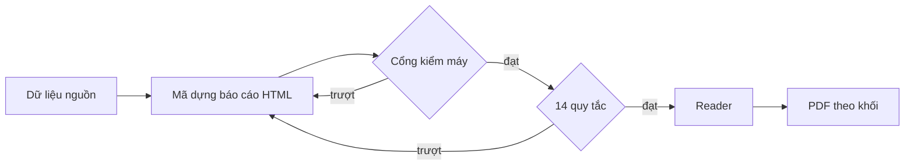
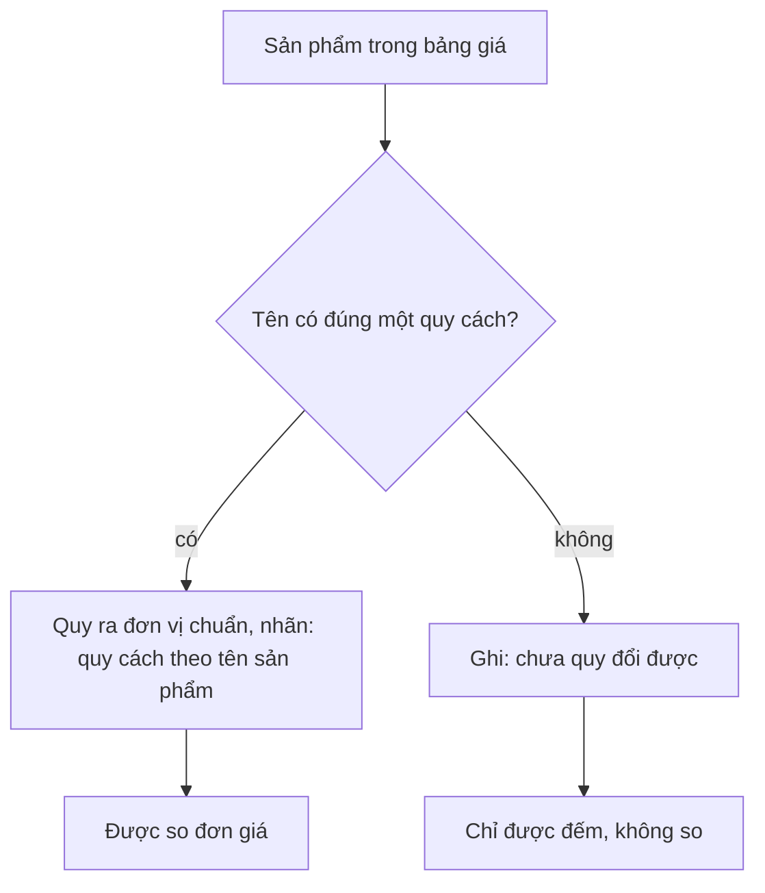

# market-report Specification

## Purpose
Spec này giữ quy tắc của báo cáo Market tự động: 14 quy tắc sửa tay đã thành quy tắc tự động (R-M01 đến R-M14), quy tắc của cổng kiểm (R-M15 đến R-M26) và quy tắc đơn vị (R-M27 đến R-M32). Nội dung chuyển từ docs/business-spec/business-rules/market.md bản 1.0 (21/10/2026); mã R-M giữ nguyên. Báo cáo Market tự động phải đạt 14/14 quy tắc. Máy sinh báo cáo, không ai sửa tay. Sửa tay chỉ để học, rồi đưa vào mã.

Mã kiểm của 14 quy tắc nằm ở `src/modules/analysis/research-automation/market-14-rules.ts`, hàm `auditMarket14`. Hàm `assertMarket14MachineRules` báo lỗi `MARKET_14_RULES_FAILED:<số quy tắc>` khi một quy tắc máy trượt. Ba quy tắc R-M06, R-M08, R-M14 chỉ có bằng chứng người đọc; chưa có hàm máy kiểm.

Hàm `auditMarketReportHtml` trong `src/modules/analysis/research-automation/market-business-gate.ts` chạy các quy tắc của cổng (R-M15 đến R-M26). Chế độ "presentation" thêm hai quy tắc về phần (R-M25, R-M26).

## Requirements

### Requirement: R-M01 Bảng thuật ngữ tiếng Việt đơn giản
Báo cáo Market SHALL giải thích mọi thuật ngữ khó bằng tiếng Việt đơn giản, trong một bảng thuật ngữ. Danh sách thuật ngữ và cách nhận ra một thuật ngữ SHALL nằm ở một chỗ, dùng chung cho bộ kiểm quy tắc 1 và bảng thuật ngữ của bản đọc: thuật ngữ được nhận ra theo cả từ, không phân biệt hoa thường, khoảng trắng bên trong có thể thiếu.

- Loại kiểm: Máy
- Mã kiểm: `src/modules/analysis/report-language/glossary.ts`: `MARKET_GLOSSARY`, `glossaryTermPattern`; `src/modules/analysis/research-automation/market-14-rules.ts`: `GLOSSARY`, `glossaryHtml`; `src/modules/analysis/research-automation/market-reader-glossary.ts`: `filterReaderGlossary`
- Vì sao: Một trong 14 quy tắc sửa tay của chủ trên báo cáo thạch dừa (05/10/2026). Ngày 12/10/2026 chủ yêu cầu mọi báo cáo Market tự động được thử với đủ 14 quy tắc sửa tay, không chỉ 9 quy tắc của cổng. Ngày 15/10/2026 chủ yêu cầu 14/14 đến từ luồng tự động và đều qua các lần sinh lại. Ngày 19/10/2026 chủ yêu cầu sửa lỗi tự động áp dụng cho cả hệ thống, không chỉnh riêng cho một lần chạy. Ngày 24/10/2026 chủ duyệt dùng một danh sách và một cách nhận thuật ngữ (rà kiến trúc c4, lỗi D7), để bộ kiểm và bảng thuật ngữ không quyết định khác nhau.

#### Scenario: Thuật ngữ khó có giải thích
- **WHEN** báo cáo dùng một thuật ngữ khó
- **THEN** bảng thuật ngữ giải thích thuật ngữ đó bằng tiếng Việt đơn giản

#### Scenario: Thuật ngữ khó không có giải thích
- **WHEN** báo cáo dùng một thuật ngữ khó mà bảng thuật ngữ không giải thích
- **THEN** quy tắc R-M01 trượt

#### Scenario: Viết liền vẫn là thuật ngữ
- **WHEN** báo cáo viết "peerset"
- **THEN** bộ kiểm quy tắc 1 đòi giải thích "peer set", và bảng thuật ngữ của bản đọc giữ dòng "peer set"

#### Scenario: Thuật ngữ dính số không tính
- **WHEN** báo cáo viết "P250" và không viết "P25"
- **THEN** bộ kiểm quy tắc 1 không đòi giải thích "P25", và bảng thuật ngữ của bản đọc bỏ dòng "P25"

### Requirement: R-M02 Nhãn phần và nhãn bảng phụ lục
Báo cáo Market SHALL dùng nhãn "Phần n" cho các phần, SHALL NOT để mã M trong thân báo cáo, và phụ lục SHALL dùng nhãn "Bảng PL.x".

- Loại kiểm: Máy
- Mã kiểm: `src/modules/analysis/research-automation/market-14-rules.ts`: kiểm nhãn
- Vì sao: Một trong 14 quy tắc sửa tay của chủ trên báo cáo thạch dừa (05/10/2026); từ 12/10/2026 mọi báo cáo Market tự động phải được thử với đủ 14 quy tắc (xem R-M01).

#### Scenario: Nhãn đúng
- **WHEN** thân báo cáo dùng "Phần 3" và phụ lục dùng "Bảng PL.1"
- **THEN** quy tắc R-M02 đạt

#### Scenario: Mã M lộ trong thân báo cáo
- **WHEN** thân báo cáo còn chữ "M12" làm nhãn phần
- **THEN** quy tắc R-M02 trượt

### Requirement: R-M03 Thân báo cáo không có chữ kỹ thuật
Thân báo cáo Market SHALL NOT chứa chữ kỹ thuật. Khi báo cáo có dấu vết kỹ thuật, dấu vết SHALL nằm ở file riêng, dạng HTML hoặc `.md`, không nằm trong thân báo cáo.

- Loại kiểm: Máy
- Mã kiểm: `src/modules/analysis/research-automation/market-14-rules.ts`: `technicalLeaks`
- Vì sao: Một trong 14 quy tắc sửa tay của chủ trên báo cáo thạch dừa (05/10/2026); từ 12/10/2026 mọi báo cáo Market tự động phải được thử với đủ 14 quy tắc (xem R-M01). Ngày 24/10/2026 chủ chấp nhận file dấu vết dạng HTML, như mã đang giữ (`traceHtml`, xem R-P06).

#### Scenario: Dấu vết kỹ thuật ở file riêng
- **WHEN** báo cáo cần ghi dấu vết kỹ thuật
- **THEN** dấu vết nằm ở file riêng, dạng HTML hoặc `.md`, không nằm trong thân báo cáo

#### Scenario: Chữ kỹ thuật trong thân
- **WHEN** thân báo cáo chứa chữ kỹ thuật
- **THEN** quy tắc R-M03 trượt

### Requirement: R-M04 Báo cáo không nêu tên nhà cung cấp, mô hình AI hay Google
Báo cáo Market SHALL NOT nêu tên nhà cung cấp dữ liệu, mô hình AI hoặc "Google". Chi tiết xem R-L01.

- Loại kiểm: Máy
- Mã kiểm: `src/modules/analysis/research-automation/market-14-rules.ts` và cổng `G08_PROVIDER_NAME` (xem R-M15)
- Vì sao: Chủ quyết định ngày 05/10/2026: báo cáo không nêu tên nhà cung cấp dữ liệu, tên sàn như Shopee thì được, chú thích đặt ở dòng riêng. Cũng là một trong 14 quy tắc sửa tay (05/10/2026).

#### Scenario: Chỉ nêu tên sàn
- **WHEN** báo cáo chỉ nêu tên sàn như Shopee
- **THEN** quy tắc R-M04 đạt

#### Scenario: Nêu tên mô hình AI
- **WHEN** báo cáo nêu tên một mô hình AI
- **THEN** quy tắc R-M04 trượt

### Requirement: R-M05 Giải thích ở dòng Chú thích riêng
Báo cáo Market SHALL đặt giải thích ở dòng "Chú thích:" riêng, và SHALL NOT chèn giải thích vào dòng "Nguồn:".

- Loại kiểm: Máy
- Mã kiểm: `src/modules/analysis/research-automation/market-14-rules.ts`: `noteProblems`
- Vì sao: Chủ quyết định ngày 05/10/2026 rằng chú thích đặt ở dòng riêng; cũng là một trong 14 quy tắc sửa tay (05/10/2026).

#### Scenario: Chú thích ở dòng riêng
- **WHEN** báo cáo cần giải thích một nguồn
- **THEN** giải thích nằm ở dòng "Chú thích:" riêng

#### Scenario: Giải thích chèn vào dòng Nguồn
- **WHEN** dòng "Nguồn:" có thêm câu giải thích
- **THEN** quy tắc R-M05 trượt

### Requirement: R-M06 Lời văn không rộng hơn con số
Lời văn trong báo cáo Market SHALL NOT rộng hơn con số đứng sau nó.

- Loại kiểm: Bằng chứng (người đọc soát)
- Mã kiểm: `src/modules/analysis/research-automation/market-14-rules.ts`: `evidenceDetail`. Chưa có mã kiểm tự động
- Vì sao: Một trong 14 quy tắc sửa tay của chủ trên báo cáo thạch dừa (05/10/2026); từ 12/10/2026 mọi báo cáo Market tự động phải được thử với đủ 14 quy tắc (xem R-M01).

#### Scenario: Lời văn khớp con số
- **WHEN** lời văn chỉ nói điều mà con số đứng sau nó đỡ được
- **THEN** người đọc soát xác nhận quy tắc R-M06 đạt

#### Scenario: Lời văn rộng hơn con số
- **WHEN** lời văn nói rộng hơn con số đứng sau nó
- **THEN** người đọc soát ghi quy tắc R-M06 trượt

### Requirement: R-M07 Con số là số trong mẫu, có ghi n
Báo cáo Market SHALL trình bày con số là số trong mẫu và ghi n; SHALL NOT nêu quy mô thị trường. Tổng hai sàn theo R-M16.

- Loại kiểm: Máy
- Mã kiểm: `src/modules/analysis/research-automation/market-14-rules.ts`: `sampleSizeIssues`, `zeroSampleSizeIssues`, `hasSampleStatement`, kiểm chữ "thị phần" và "quy mô thị trường". Quy tắc 7 không còn đọc kết quả U32.
- Vì sao: một trong 14 quy tắc sửa tay (05/10/2026). Vế "không cộng hai sàn" bị chủ bỏ ngày 22/10/2026 (F100).

#### Scenario: Số trong mẫu có n
- **WHEN** báo cáo nêu một con số lấy từ mẫu và ghi n
- **THEN** quy tắc R-M07 đạt

#### Scenario: Nêu quy mô thị trường
- **WHEN** báo cáo dùng chữ "quy mô thị trường" hoặc "thị phần" cho một con số
- **THEN** quy tắc R-M07 trượt

#### Scenario: Có ô Cộng 2 sàn đúng luật
- **WHEN** báo cáo có ô «Cộng 2 sàn» đạt R-M16 và mọi số có n
- **THEN** quy tắc R-M07 đạt

### Requirement: R-M08 Nhận định trỏ tới con số, hình hoặc bảng
Mỗi nhận định trong báo cáo Market SHALL trỏ tới một con số, một hình hoặc một bảng.

- Loại kiểm: Bằng chứng (người đọc soát)
- Mã kiểm: Chưa có mã kiểm tự động
- Vì sao: Một trong 14 quy tắc sửa tay của chủ trên báo cáo thạch dừa (05/10/2026); từ 12/10/2026 mọi báo cáo Market tự động phải được thử với đủ 14 quy tắc (xem R-M01).

#### Scenario: Nhận định có chỗ trỏ tới
- **WHEN** một nhận định trỏ tới một bảng của báo cáo
- **THEN** người đọc soát xác nhận quy tắc R-M08 đạt

#### Scenario: Nhận định không có chỗ trỏ tới
- **WHEN** một nhận định không trỏ tới con số, hình hay bảng nào
- **THEN** người đọc soát ghi quy tắc R-M08 trượt

### Requirement: R-M09 Phần M12 có ba phương án và một việc làm nhanh
Phần M12 của báo cáo Market SHALL có 3 phương án và một việc làm nhanh, và mỗi mục SHALL có người phụ trách, hạn dạng dd/mm/yyyy và nhãn "đề xuất, chờ chủ duyệt".

- Loại kiểm: Máy
- Mã kiểm: `src/modules/analysis/research-automation/market-14-rules.ts`: `hasM12ProposalRows`. Cổng `M12_PROPOSAL_LABEL`
- Vì sao: Chủ quyết định ngày 05/10/2026: báo cáo được phép đề xuất; M12 có ba phương án, người phụ trách, hạn, nhãn "đề xuất, chờ chủ duyệt"; chủ bỏ ý "AI không chọn hành động". Cũng là một trong 14 quy tắc sửa tay (05/10/2026).

#### Scenario: Mục đề xuất đủ thông tin
- **WHEN** một mục trong M12 có người phụ trách, hạn 31/10/2026 và nhãn "đề xuất, chờ chủ duyệt"
- **THEN** quy tắc R-M09 đạt cho mục đó

#### Scenario: Mục thiếu hạn
- **WHEN** một mục trong M12 không có hạn dạng dd/mm/yyyy
- **THEN** quy tắc R-M09 trượt

### Requirement: R-M10 Trang bìa có ảnh JPEG do AI tạo
Trang bìa báo cáo Market SHOULD có ảnh JPEG do AI tạo. Khi có ảnh bìa, ảnh SHALL nhúng dạng base64; ảnh trỏ ra ngoài hoặc sai dạng làm lần dựng lỗi. Ảnh tự nhận do AI tạo SHALL là JPEG có giới hạn dung lượng và có chữ thay thế (alt); nếu không, lần dựng lỗi. Khi không có lỗi ảnh ngoài hay sai dạng, thiếu ảnh bìa hoặc bìa nhúng không tự nhận do AI tạo SHALL NOT chặn báo cáo; kết quả kiểm chỉ để lại ghi chú cho người đọc soát. Báo cáo SHALL NOT đòi bằng chứng giấy phép ảnh (chủ bỏ 13/10).

- Loại kiểm: Máy (ảnh trỏ ra ngoài, sai dạng, ảnh tự nhận do AI tạo thiếu alt); Người đọc soát (thiếu ảnh bìa, bìa không tự nhận do AI tạo)
- Mã kiểm: `src/modules/analysis/research-automation/market-14-rules.ts`: `isAiCoverJpeg`, `coverBlock`
- Vì sao: Chủ yêu cầu ảnh bìa ngày 06/10/2026, sau khi lần chạy bình giữ nhiệt bỏ qua trang bìa. Ngày 13/10/2026 chủ quyết định không cần bằng chứng giấy phép ảnh bìa. Cũng là một trong 14 quy tắc sửa tay (05/10/2026). Ngày 24/10/2026 chủ nới quy tắc: thiếu ảnh bìa không chặn báo cáo, như mã đang làm.

#### Scenario: Bìa đủ điều kiện
- **WHEN** trang bìa có ảnh JPEG do AI tạo, nhúng base64 trong giới hạn dung lượng, có chữ alt
- **THEN** quy tắc R-M10 đạt, dù không có bằng chứng giấy phép ảnh

#### Scenario: Bìa thiếu chữ alt
- **WHEN** ảnh bìa tự nhận do AI tạo không có chữ thay thế (alt)
- **THEN** quy tắc R-M10 trượt và lần dựng lỗi

#### Scenario: Ảnh bìa trỏ ra ngoài
- **WHEN** ảnh bìa là link tới ảnh bên ngoài, không nhúng trong file
- **THEN** quy tắc R-M10 trượt và lần dựng lỗi

#### Scenario: Thiếu ảnh bìa
- **WHEN** báo cáo Market không có ảnh bìa
- **THEN** báo cáo vẫn được dựng, và kết quả kiểm R-M10 ghi chú cho người đọc soát

### Requirement: R-M11 Biểu tượng sàn và biểu đồ Flint
Báo cáo Market SHALL có biểu tượng sàn và biểu đồ Flint, ít nhất 3 biểu đồ, hoặc ít nhất 2 khi nguồn không ghi gian hàng.

- Loại kiểm: Máy
- Mã kiểm: `src/modules/analysis/research-automation/market-14-rules.ts`: `chartFragments`, `chartIssues`, `localIconCss`, đếm biểu tượng
- Vì sao: Chủ yêu cầu biểu tượng sàn và biểu đồ Flint ngày 06/10/2026, sau khi lần chạy bình giữ nhiệt bỏ qua phần này. Cũng là một trong 14 quy tắc sửa tay (05/10/2026).

#### Scenario: Đủ biểu đồ khi nguồn có gian hàng
- **WHEN** nguồn ghi gian hàng và báo cáo có 3 biểu đồ Flint cùng biểu tượng sàn
- **THEN** quy tắc R-M11 đạt

#### Scenario: Nguồn không ghi gian hàng
- **WHEN** nguồn không ghi gian hàng và báo cáo có 2 biểu đồ Flint cùng biểu tượng sàn
- **THEN** quy tắc R-M11 đạt

#### Scenario: Thiếu biểu đồ
- **WHEN** nguồn ghi gian hàng và báo cáo chỉ có 2 biểu đồ
- **THEN** quy tắc R-M11 trượt

### Requirement: R-M12 Mọi bảng ghi rõ sàn
Mọi bảng trong báo cáo Market SHALL ghi rõ Shopee hay TikTok Shop.

- Loại kiểm: Máy
- Mã kiểm: `src/modules/analysis/research-automation/market-14-rules.ts`: `platformTableIssues`
- Vì sao: Một trong 14 quy tắc sửa tay của chủ trên báo cáo thạch dừa (05/10/2026); từ 12/10/2026 mọi báo cáo Market tự động phải được thử với đủ 14 quy tắc (xem R-M01).

#### Scenario: Bảng ghi sàn
- **WHEN** một bảng ghi "Shopee" ở tiêu đề hoặc nhãn bảng
- **THEN** quy tắc R-M12 đạt cho bảng đó

#### Scenario: Bảng không ghi sàn
- **WHEN** một bảng không ghi Shopee hay TikTok Shop
- **THEN** quy tắc R-M12 trượt

### Requirement: R-M13 Bốn nhãn nguồn trung tính
Báo cáo Market SHALL dùng bốn nhãn nguồn trung tính cho bốn nguồn dữ liệu.

- Loại kiểm: Máy
- Mã kiểm: `src/modules/analysis/research-automation/market-14-rules.ts`: `sourceCoverage`
- Vì sao: Chủ yêu cầu bốn nguồn trong báo cáo Market ngày 06/10/2026 (khi duyệt PR #118). Cũng là một trong 14 quy tắc sửa tay (05/10/2026).

#### Scenario: Đủ bốn nhãn
- **WHEN** báo cáo dùng bốn nhãn nguồn trung tính cho bốn nguồn
- **THEN** quy tắc R-M13 đạt

#### Scenario: Thiếu một nhãn
- **WHEN** báo cáo chỉ có ba nhãn nguồn trung tính
- **THEN** quy tắc R-M13 trượt

### Requirement: R-M14 Link review đa dạng thương hiệu, 300 bình luận mỗi sản phẩm
Báo cáo Market SHALL dùng link review đa dạng thương hiệu và SHALL lấy 300 bình luận cho mỗi sản phẩm.

- Loại kiểm: Bằng chứng (người đọc soát)
- Mã kiểm: Chưa có mã kiểm tự động
- Vì sao: Chủ yêu cầu trong lần chạy bình giữ nhiệt (06/10/2026) và nói áp dụng rộng cho cả hệ thống. Cũng là một trong 14 quy tắc sửa tay (05/10/2026).

#### Scenario: Link review trải đều thương hiệu
- **WHEN** các link review của các sản phẩm thuộc nhiều thương hiệu khác nhau và có 300 bình luận mỗi sản phẩm
- **THEN** người đọc soát xác nhận quy tắc R-M14 đạt

#### Scenario: Link review chỉ một thương hiệu
- **WHEN** mọi link review thuộc một thương hiệu
- **THEN** người đọc soát ghi quy tắc R-M14 trượt

### Requirement: R-M15 Cổng không nêu tên nhà cung cấp, công cụ, mô hình AI hay Google
Cổng Market SHALL kiểm rằng báo cáo không nêu tên nhà cung cấp, công cụ, mô hình AI hay "Google". Tên sàn như Shopee thì được. Cổng SHALL đọc cả chữ ẩn (hidden, display:none, aria-hidden, alt/title/aria-label của phần tử ẩn), theo R-L01.

- Loại kiểm: Máy
- Mã kiểm: Cổng `G08_PROVIDER_NAME`: `providerMatches` trong `src/modules/analysis/research-automation/market-business-gate.ts`. Danh sách tên nằm ở `HIDDEN_NAMES` trong `src/modules/analysis/report-language/hidden-names.ts` (R-L01)
- Vì sao: Chủ quyết định ngày 05/10/2026: báo cáo không nêu tên nhà cung cấp dữ liệu; tên sàn như Shopee thì được. Ngày 12/10/2026 chủ yêu cầu thử với đủ 14 quy tắc sửa tay, không chỉ 9 quy tắc của cổng. Ngày 24/10/2026 chủ chốt chữ ẩn cũng tính (c4 Q5).

#### Scenario: Chỉ nêu tên sàn
- **WHEN** chữ nhìn thấy trong báo cáo chỉ nêu "Shopee"
- **THEN** cổng `G08_PROVIDER_NAME` đạt

#### Scenario: Nêu tên công cụ
- **WHEN** chữ nhìn thấy trong báo cáo nêu tên một công cụ trong danh sách cấm
- **THEN** cổng `G08_PROVIDER_NAME` trượt

#### Scenario: Tên trong chữ ẩn
- **WHEN** báo cáo có `
OpenAI
`
- **THEN** cổng `G08_PROVIDER_NAME` trượt

### Requirement: R-M16 Tổng hai sàn có nhãn và số từng sàn
Báo cáo Market MAY nêu tổng giữa Shopee và TikTok Shop, nhưng mỗi tổng SHALL có nhãn «Cộng 2 sàn», SHALL có số của từng sàn đứng cạnh, và SHALL đạt R-M18 (không tổng thiếu thành viên). Bản đọc v1/v1.1 SHALL giữ mảng lint W3 cũ trong claims và vẫn chạy cổng U32.

- Loại kiểm: Máy
- Mã kiểm: cổng `U32_NO_CROSS_PLATFORM_TOTAL` và lint Reader W3 của bản đọc Market, cùng gọi `crossPlatformTotalMatches` (`src/modules/analysis/report-language/cross-platform-total.ts`) trên cùng phần chữ nhìn thấy: trượt khi tổng hai sàn thiếu nhãn «Cộng 2 sàn» hoặc thiếu số Shopee và số TikTok Shop đứng cạnh. Ô «Cộng 2 sàn» ở Phần 1 do `buildMarketReportV2` (`src/modules/analysis/reader-report/market-template-v2.ts`) in, chỉ khi cả hai sàn có số.
- Vì sao: chủ 22/10/2026, «giờ tôi cho phép cộng như metric» (F100), thay U-32 ngày 11/10/2026. Chủ muốn con số tổng quen thuộc của trang gốc, cộng thêm phần tách từng sàn của ta.

#### Scenario: Hai sàn đứng cạnh nhau
- **WHEN** báo cáo nêu số của Shopee và số của TikTok Shop riêng từng sàn, không có tổng
- **THEN** cổng `U32_NO_CROSS_PLATFORM_TOTAL` đạt

#### Scenario: Ô Cộng 2 sàn có số từng sàn
- **WHEN** Phần 1 có ô «Cộng 2 sàn» và cạnh đó là ô Shopee và ô TikTok Shop
- **THEN** cổng `U32_NO_CROSS_PLATFORM_TOTAL` đạt

#### Scenario: Có tổng hai sàn
- **WHEN** báo cáo có cụm "tổng hai sàn" mà không có nhãn «Cộng 2 sàn» và không có số từng sàn đứng cạnh
- **THEN** cổng `U32_NO_CROSS_PLATFORM_TOTAL` trượt (nghĩa mới: trượt vì thiếu nhãn và thiếu số từng sàn, không phải vì có tổng)

#### Scenario: Một sàn thiếu số
- **WHEN** TikTok Shop thiếu số doanh thu của kỳ
- **THEN** báo cáo không nêu ô «Cộng 2 sàn» cho doanh thu, và cổng `PARTIAL_TOTAL_FORBIDDEN` (R-M18) trượt nếu ô đó có mặt

#### Scenario: Cùng cụm, cùng kết quả ở hai luồng
- **WHEN** bản nháp hoặc bản đọc viết "tổng cả hai sàn" mà không có nhãn «Cộng 2 sàn» và không có số từng sàn đứng cạnh
- **THEN** U32 ở bản nháp và W3 ở bản đọc cùng trượt

### Requirement: R-M17 Không xếp thứ tự theo doanh thu bằng lời cấm
Báo cáo Market SHALL NOT xếp thứ tự theo doanh thu bằng lời "Thứ tự theo doanh thu" hay "top 3". Chữ "xếp hạng" và "thị phần" SHALL bị cấm, trừ khi câu đó phủ định.

- Loại kiểm: Máy
- Mã kiểm: Cổng `E2_NO_REVENUE_ORDER`: `e2Matches` (trong `src/modules/analysis/research-automation/market-business-gate.ts`)
- Vì sao: Ngày 12/10/2026 chủ yêu cầu thử mọi báo cáo Market tự động với đủ quy tắc, kể cả quy tắc cổng. Chưa ghi lý do riêng cho quy tắc này trong business-spec. Xung đột với R-M27: xem mục "Điểm mở chờ chủ".

#### Scenario: Câu dùng chữ cấm
- **WHEN** một câu viết "top 3 theo doanh thu"
- **THEN** cổng `E2_NO_REVENUE_ORDER` trượt

#### Scenario: Câu phủ định
- **WHEN** một câu phủ định dùng chữ "thị phần", ví dụ "báo cáo này không nêu thị phần"
- **THEN** cổng `E2_NO_REVENUE_ORDER` không bắt câu đó

### Requirement: R-M18 Không nêu tổng khi thành viên thiếu
Báo cáo Market SHALL NOT nêu như tổng một tổng có thành viên thiếu.

- Loại kiểm: Máy
- Mã kiểm: Cổng `PARTIAL_TOTAL_FORBIDDEN`: `partialRowTotals`, `partialTotalMatches` (trong `src/modules/analysis/research-automation/market-business-gate.ts`)
- Vì sao: Ngày 12/10/2026 chủ yêu cầu thử mọi báo cáo Market tự động với đủ quy tắc, kể cả quy tắc cổng. Chưa ghi lý do riêng cho quy tắc này trong business-spec.

#### Scenario: Đủ thành viên
- **WHEN** mọi thành viên của một tổng đều có số
- **THEN** báo cáo được nêu tổng đó

#### Scenario: Thiếu thành viên
- **WHEN** một tổng có một thành viên thiếu số
- **THEN** cổng `PARTIAL_TOTAL_FORBIDDEN` trượt nếu báo cáo nêu số đó như tổng

### Requirement: R-M19 Báo cáo không lộ đường dẫn, email, khóa hay địa chỉ nội bộ
Báo cáo Market SHALL NOT lộ đường dẫn, địa chỉ email, khóa hay địa chỉ mạng nội bộ.

- Loại kiểm: Máy
- Mã kiểm: Cổng `NO_LEAK`: `noLeakMatches` (trong `src/modules/analysis/research-automation/market-business-gate.ts`)
- Vì sao: Ngày 12/10/2026 chủ yêu cầu thử mọi báo cáo Market tự động với đủ quy tắc, kể cả quy tắc cổng. Chưa ghi lý do riêng cho quy tắc này trong business-spec.

#### Scenario: Báo cáo sạch
- **WHEN** báo cáo không chứa đường dẫn, email, khóa hay địa chỉ mạng nội bộ
- **THEN** cổng `NO_LEAK` đạt

#### Scenario: Lộ địa chỉ email
- **WHEN** báo cáo chứa một địa chỉ email
- **THEN** cổng `NO_LEAK` trượt

### Requirement: R-M20 Mức quan tâm tìm kiếm không phải số đếm
Báo cáo Market SHALL NOT dùng mức quan tâm tìm kiếm như một số đếm.

- Loại kiểm: Máy
- Mã kiểm: Cổng `SEARCH_INTEREST_NOT_COUNT`: `searchInterestMisuse` (trong `src/modules/analysis/research-automation/market-business-gate.ts`)
- Vì sao: Ngày 12/10/2026 chủ yêu cầu thử mọi báo cáo Market tự động với đủ quy tắc, kể cả quy tắc cổng. Chưa ghi lý do riêng cho quy tắc này trong business-spec.

#### Scenario: Dùng đúng
- **WHEN** báo cáo nêu mức quan tâm tìm kiếm như một mức
- **THEN** cổng `SEARCH_INTEREST_NOT_COUNT` đạt

#### Scenario: Dùng như số đếm
- **WHEN** báo cáo nêu mức quan tâm tìm kiếm như số lượt hay số người
- **THEN** cổng `SEARCH_INTEREST_NOT_COUNT` trượt

### Requirement: R-M21 Số vĩ mô World Bank không dùng để tính với số mẫu
Báo cáo Market SHALL NOT dùng số vĩ mô của World Bank để tính số học với số mẫu. Cổng chỉ kiểm khi khối vĩ mô được vẽ.

- Loại kiểm: Máy
- Mã kiểm: Cổng `WORLD_BANK_NOT_ARITHMETIC`: `worldBankMisuse` (trong `src/modules/analysis/research-automation/market-business-gate.ts`)
- Vì sao: Ngày 12/10/2026 chủ yêu cầu thử mọi báo cáo Market tự động với đủ quy tắc, kể cả quy tắc cổng. Chưa ghi lý do riêng cho quy tắc này trong business-spec.

#### Scenario: Khối vĩ mô đứng riêng
- **WHEN** khối vĩ mô được vẽ và số World Bank không bị đem tính với số mẫu
- **THEN** cổng `WORLD_BANK_NOT_ARITHMETIC` đạt

#### Scenario: Không vẽ khối vĩ mô
- **WHEN** báo cáo không vẽ khối vĩ mô
- **THEN** cổng `WORLD_BANK_NOT_ARITHMETIC` không kiểm

### Requirement: R-M22 Trích đoạn PDF không thành số thị trường
Báo cáo Market SHALL NOT biến trích đoạn PDF thành số thị trường. Cổng chỉ kiểm khi khối được vẽ.

- Loại kiểm: Máy
- Mã kiểm: Cổng `PDF_EXCERPT_NOT_MARKET_NUMBER`: `pdfExcerptMisuse` (trong `src/modules/analysis/research-automation/market-business-gate.ts`)
- Vì sao: Ngày 12/10/2026 chủ yêu cầu thử mọi báo cáo Market tự động với đủ quy tắc, kể cả quy tắc cổng. Chưa ghi lý do riêng cho quy tắc này trong business-spec.

#### Scenario: Trích đoạn chỉ là trích đoạn
- **WHEN** khối trích đoạn PDF được vẽ và con số trong đó không được nêu như số thị trường
- **THEN** cổng `PDF_EXCERPT_NOT_MARKET_NUMBER` đạt

#### Scenario: Trích đoạn thành số thị trường
- **WHEN** khối trích đoạn PDF được vẽ và một con số trong đó được nêu như số thị trường
- **THEN** cổng `PDF_EXCERPT_NOT_MARKET_NUMBER` trượt

### Requirement: R-M23 Video của người bán không thành tiếng nói khách hàng hay tổng
Báo cáo Market SHALL NOT dùng video của người bán như tiếng nói khách hàng hay như một tổng. Cổng chỉ kiểm khi khối được vẽ.

- Loại kiểm: Máy
- Mã kiểm: Cổng `SELLER_VIDEO_NOT_CUSTOMER_OR_TOTAL`: `sellerVideoMisuse` (trong `src/modules/analysis/research-automation/market-business-gate.ts`)
- Vì sao: Ngày 12/10/2026 chủ yêu cầu thử mọi báo cáo Market tự động với đủ quy tắc, kể cả quy tắc cổng. Chưa ghi lý do riêng cho quy tắc này trong business-spec.

#### Scenario: Video người bán đứng riêng
- **WHEN** khối video người bán được vẽ và được nêu là lời người bán
- **THEN** cổng `SELLER_VIDEO_NOT_CUSTOMER_OR_TOTAL` đạt

#### Scenario: Video người bán nêu như lời khách
- **WHEN** khối video người bán được vẽ và được nêu như tiếng nói khách hàng
- **THEN** cổng `SELLER_VIDEO_NOT_CUSTOMER_OR_TOTAL` trượt

### Requirement: R-M24 Không dùng so sánh cao nhất, ưu tiên hay số đang chờ
Chữ nhìn thấy trong báo cáo Market SHALL NOT dùng so sánh cao nhất, ưu tiên hay "số đang chờ".

- Loại kiểm: Máy
- Mã kiểm: Cổng `U13_SUPERLATIVE`, `U13_PRIORITY`, `U13_PENDING_NUMBER`: `lintVisibleReportText` trong `src/modules/analysis/report-visible-text-lint.ts` (business-spec ghi nhầm đường dẫn dưới `research-automation/`; sửa khi chuyển, 24/10/2026)
- Vì sao: Ngày 12/10/2026 chủ yêu cầu thử mọi báo cáo Market tự động với đủ quy tắc, kể cả quy tắc cổng. Chưa ghi lý do riêng cho quy tắc này trong business-spec.

#### Scenario: Chữ nhìn thấy trung tính
- **WHEN** chữ nhìn thấy không có so sánh cao nhất, ưu tiên hay "số đang chờ"
- **THEN** các cổng `U13_SUPERLATIVE`, `U13_PRIORITY`, `U13_PENDING_NUMBER` đạt

#### Scenario: Có số đang chờ
- **WHEN** chữ nhìn thấy có cụm "số đang chờ"
- **THEN** cổng `U13_PENDING_NUMBER` trượt

### Requirement: R-M25 Chế độ trình bày có M01 đến M13, mỗi phần đúng một lần
Ở chế độ trình bày (presentation), báo cáo Market SHALL có các phần M01 đến M13, mỗi phần đúng một lần.

- Loại kiểm: Máy
- Mã kiểm: Cổng `SECTIONS_PRESENT`: `src/modules/analysis/research-automation/market-business-gate.ts` (chỉ chế độ presentation)
- Vì sao: Ngày 12/10/2026 chủ yêu cầu thử mọi báo cáo Market tự động với đủ quy tắc, kể cả quy tắc cổng. Chưa ghi lý do riêng cho quy tắc này trong business-spec.

#### Scenario: Đủ 13 phần
- **WHEN** báo cáo ở chế độ trình bày có M01 đến M13, mỗi phần một lần
- **THEN** cổng `SECTIONS_PRESENT` đạt

#### Scenario: Phần lặp hoặc thiếu
- **WHEN** báo cáo ở chế độ trình bày thiếu M07 hoặc có M07 hai lần
- **THEN** cổng `SECTIONS_PRESENT` trượt

### Requirement: R-M26 Chế độ trình bày có chữ đề xuất trong M12
Ở chế độ trình bày (presentation), chữ đề xuất trong M12 SHALL có nhãn "đề xuất, chờ chủ duyệt".

- Loại kiểm: Máy
- Mã kiểm: Cổng `M12_PROPOSAL_LABEL`: `src/modules/analysis/research-automation/market-business-gate.ts` (chỉ chế độ presentation)
- Vì sao: Ngày 12/10/2026 chủ yêu cầu thử mọi báo cáo Market tự động với đủ quy tắc, kể cả quy tắc cổng. Chủ cho phép đề xuất ngày 05/10/2026 với nhãn "đề xuất, chờ chủ duyệt" (xem R-M09). Ngày 24/10/2026 (Q4): nhãn đầy đủ ở mọi nơi (R-L14).

#### Scenario: Có nhãn đầy đủ
- **WHEN** báo cáo ở chế độ trình bày và mục đề xuất trong M12 có "đề xuất, chờ chủ duyệt"
- **THEN** cổng `M12_PROPOSAL_LABEL` đạt

#### Scenario: Chỉ có chữ đề xuất
- **WHEN** báo cáo ở chế độ trình bày và một mục đề xuất trong M12 chỉ có chữ "đề xuất"
- **THEN** cổng `M12_PROPOSAL_LABEL` trượt

### Requirement: R-M27 Doanh thu không có đơn vị đếm
Báo cáo Market SHALL NOT gắn đơn vị đếm cho doanh thu (đồng). Xếp theo doanh thu và tỷ trọng doanh thu SHALL được giữ.

- Loại kiểm: Chưa ghi trong business-spec
- Mã kiểm: Chưa có mã kiểm riêng
- Vì sao: Chủ quyết định ngày 21/10/2026 (F66, F67): doanh thu giữ vì là tiền. Quy tắc đơn vị dùng cho mọi ngành hàng (20/10/2026, F11, F12). Xung đột với R-M17: xem mục "Điểm mở chờ chủ".

#### Scenario: Cột doanh thu
- **WHEN** bảng có cột doanh thu (đồng)
- **THEN** cột đó không có đơn vị đếm, và báo cáo vẫn xếp theo doanh thu và nêu tỷ trọng doanh thu

#### Scenario: Gắn đơn vị đếm cho doanh thu
- **WHEN** bảng gắn đơn vị đếm cho cột doanh thu
- **THEN** quy tắc R-M27 bị vi phạm

### Requirement: R-M28 Không cộng số lượng đã bán giữa các sản phẩm
Báo cáo Market SHALL NOT cộng số lượng đã bán giữa các sản phẩm.

- Loại kiểm: Chưa ghi trong business-spec
- Mã kiểm: Chưa có mã kiểm
- Vì sao: Chủ quyết định ngày 21/10/2026 (F66, F67): không cộng số lượng bán giữa các sản phẩm. Quy tắc đơn vị dùng cho mọi ngành hàng (20/10/2026, F11, F12).

#### Scenario: Số lượng từng sản phẩm riêng
- **WHEN** bảng nêu số lượng đã bán của từng sản phẩm, không có dòng cộng chung
- **THEN** quy tắc R-M28 đạt

#### Scenario: Dòng cộng số lượng
- **WHEN** báo cáo có một dòng cộng số lượng đã bán của nhiều sản phẩm
- **THEN** quy tắc R-M28 bị vi phạm

### Requirement: R-M29 Chỉ so giá bằng đơn giá trong một đơn vị chuẩn
Báo cáo Market SHALL chỉ so giá giữa các sản phẩm bằng đơn giá trong một đơn vị chuẩn: đồng/100g, đồng/100ml, đồng/<từ đếm> hoặc đồng/sản phẩm.

- Loại kiểm: Chưa ghi trong business-spec
- Mã kiểm: Một phần: `projectMarketUnitPrices` trong `src/modules/analysis/reader-report/market-unit-prices.ts` gắn đơn giá với bằng chứng đã giữ và đòi `contractVersion` 1.4.0. Chưa có mã kiểm cho đơn vị chuẩn
- Vì sao: Chủ quyết định ngày 21/10/2026 (F66, F67): chỉ so đơn giá trong một đơn vị chuẩn. Quy tắc đơn vị dùng cho mọi ngành hàng (20/10/2026, F11, F12).

#### Scenario: So bằng đồng/100g
- **WHEN** hai sản phẩm đã quy về đồng/100g
- **THEN** báo cáo được so giá hai sản phẩm đó

#### Scenario: So giá bán thô
- **WHEN** hai sản phẩm khác quy cách được so bằng giá bán thô, không quy về đơn vị chuẩn
- **THEN** quy tắc R-M29 bị vi phạm

### Requirement: R-M30 Chỉ đọc quy cách từ tên khi tên có đúng một quy cách
Báo cáo Market SHALL chỉ đọc quy cách từ tên sản phẩm khi tên có đúng một quy cách, và SHALL ghi nhãn "quy cách theo tên sản phẩm".

- Loại kiểm: Chưa ghi trong business-spec
- Mã kiểm: Chưa có mã kiểm (đang làm, việc F67)
- Vì sao: Chủ quyết định ngày 21/10/2026 (F67): đọc quy cách từ tên chỉ khi tên có đúng một quy cách, gắn nhãn "quy cách theo tên sản phẩm". Mâu thuẫn với mục 6.6.2 của tài liệu Insight: xem mục "Điểm mở chờ chủ".

#### Scenario: Tên có một quy cách
- **WHEN** tên sản phẩm có đúng một quy cách, ví dụ một khối lượng
- **THEN** báo cáo đọc quy cách đó và ghi nhãn "quy cách theo tên sản phẩm"

#### Scenario: Tên có nhiều quy cách
- **WHEN** tên sản phẩm có hai quy cách trở lên
- **THEN** báo cáo không đọc quy cách từ tên (xem R-M31)

### Requirement: R-M31 Ghi chưa quy đổi được khi không đọc được đúng một quy cách
Khi không đọc được đúng một quy cách, báo cáo Market SHALL ghi "chưa quy đổi được". Sản phẩm đó SHALL được đếm nhưng SHALL NOT đem so.

- Loại kiểm: Chưa ghi trong business-spec
- Mã kiểm: Chưa có mã kiểm
- Vì sao: Chủ quyết định ngày 21/10/2026 (F67): còn lại ghi "chưa quy đổi được". Quy tắc đơn vị dùng cho mọi ngành hàng (20/10/2026, F11, F12).

#### Scenario: Không đọc được quy cách
- **WHEN** tên sản phẩm không có quy cách nào
- **THEN** báo cáo ghi "chưa quy đổi được", đếm sản phẩm đó và không đem so đơn giá

#### Scenario: Đem so sản phẩm chưa quy đổi
- **WHEN** báo cáo đem so đơn giá của sản phẩm ghi "chưa quy đổi được"
- **THEN** quy tắc R-M31 bị vi phạm

### Requirement: R-M32 Mọi cột giá ghi đơn vị ở tiêu đề cột
Báo cáo Market SHALL ghi đơn vị ngay ở tiêu đề của mọi cột giá.

- Loại kiểm: Chưa ghi trong business-spec
- Mã kiểm: Chưa có mã kiểm
- Vì sao: Chủ quyết định ngày 21/10/2026 (F66, F67) về quy tắc đơn vị cho mọi ngành hàng; business-spec không ghi riêng lý do cho quy tắc này.

#### Scenario: Tiêu đề có đơn vị
- **WHEN** một cột giá có tiêu đề "Đơn giá (đồng/100g)"
- **THEN** quy tắc R-M32 đạt cho cột đó

#### Scenario: Tiêu đề thiếu đơn vị
- **WHEN** một cột giá có tiêu đề "Đơn giá" không ghi đơn vị
- **THEN** quy tắc R-M32 bị vi phạm

### Requirement: R-M33 Không hiện mã chỉ số trong báo cáo gửi đọc
Báo cáo Market SHALL NOT hiện mã chỉ số (ví dụ DT-1, LB-1, GIA-2, SS-1) trong phần chữ nhìn thấy. Báo cáo chỉ ghi tên chỉ số và cách tính.

- Loại kiểm: Máy
- Mã kiểm: `lintVisibleReportText` (`src/modules/analysis/report-visible-text-lint.ts`), luật U13_METRIC_CODE: hai đến bốn chữ in hoa, gạch nối, một hoặc hai chữ số, ngoài phần trích dẫn và phần ẩn
- Vì sao: chủ 22/10/2026, «không cần mã chỉ số đâu». Mã chỉ số là nhiễu với người đọc không chuyên.

#### Scenario: Mã chỉ số trong bảng
- **WHEN** một bảng của báo cáo có tiêu đề cột "DT-1"
- **THEN** kiểm chữ nhìn thấy trượt

#### Scenario: Mã chỉ số trong file dấu vết
- **WHEN** mã "DT-1" chỉ nằm trong file dấu vết kỹ thuật
- **THEN** kiểm chữ nhìn thấy đạt

### Requirement: R-M34 Chỉ số giá tên là giá bán trung bình
Báo cáo Market SHALL gọi chỉ số doanh số chia lượt bán trong kỳ là «giá bán trung bình», và SHALL kèm chú thích: tính theo lượt bán từng ngày, không phải giá người mua trả sau voucher. Báo cáo SHALL NOT dùng chữ «giá thật».

- Loại kiểm: Máy (một phần)
- Mã kiểm: `lintVisibleReportText` (`src/modules/analysis/report-visible-text-lint.ts`), luật U13_REAL_PRICE cho chữ «giá thật». Nhãn «giá bán trung bình» và dòng «Chú thích:» do `buildMarketReportV2` (`src/modules/analysis/reader-report/market-template-v2.ts`) in; chưa có mã kiểm cho nhãn và chú thích.
- Vì sao: chủ 22/10/2026 hỏi «giá thật» lấy từ đâu (F106), rồi duyệt đổi tên (F107). Quy chuẩn dữ liệu đầu vào 1.43, L5a.

#### Scenario: Dùng chữ giá thật
- **WHEN** báo cáo có chữ «giá thật»
- **THEN** kiểm chữ nhìn thấy trượt

#### Scenario: Có tên mới và chú thích
- **WHEN** ô giá ghi «giá bán trung bình» và dòng «Chú thích:» nêu cách tính
- **THEN** quy tắc R-M34 đạt

### Requirement: R-M35 Mỗi phép so có chú thích chỉ số và kỳ
Mỗi phép so, tỷ lệ, tăng hoặc giảm trong báo cáo Market SHALL có chú thích nói (1) chỉ số hoặc đơn vị được so và (2) so với kỳ nào, kèm ngày dạng dd/mm–dd/mm/yyyy.

- Loại kiểm: Bằng chứng (người đọc soát); đề xuất kiểm máy cho dấu "▲", "▼" và "%" không có chú thích đi kèm
- Mã kiểm: chưa có mã kiểm. Chú thích do `buildMarketReportV2` (`src/modules/analysis/reader-report/market-template-v2.ts`) in (hàm `compareNote`).
- Vì sao: chủ 22/10/2026: "▼ −13%", "gấp 3,5 lần" không có chú thích làm người đọc không chuyên hiểu sai.

#### Scenario: Phần trăm trần
- **WHEN** ô số ghi "▼ −13%" và không có chú thích kỳ so
- **THEN** quy tắc R-M35 trượt

#### Scenario: Phần trăm có chú thích
- **WHEN** ô số ghi "▼ −13% (doanh số kỳ 20/09–19/10/2026 so với kỳ 21/08–19/09/2026)"
- **THEN** quy tắc R-M35 đạt

### Requirement: R-M36 Biểu đồ đường không có đường tổng
Biểu đồ đường của báo cáo Market (theo tuần, theo 12 tháng) SHALL chỉ có đường Shopee và đường TikTok Shop. Biểu đồ đường SHALL NOT có đường «Cộng 2 sàn». Tổng chỉ nằm ở ô số, bảng thương hiệu và chữ.

- Loại kiểm: Máy (đề xuất, kiểm trên spec biểu đồ Flint)
- Mã kiểm: chưa có mã kiểm. Biểu đồ đường theo tháng vẽ một đường mỗi sàn trong `buildMarketReportV2` (`src/modules/analysis/reader-report/market-template-v2.ts`).
- Vì sao: chủ 22/10/2026, «chart thì không cần làm line của cộng 2 sàn đâu» (F116).

#### Scenario: Biểu đồ tuần có đường tổng
- **WHEN** biểu đồ doanh số theo tuần có ba đường, trong đó có đường tổng
- **THEN** quy tắc R-M36 trượt

### Requirement: R-M37 Bảng thương hiệu một dòng mỗi thương hiệu
Bảng thương hiệu đứng đầu của báo cáo Market SHALL có một dòng cho mỗi thương hiệu, với cột «Cộng 2 sàn» và cột Shopee, cột TikTok Shop đứng cạnh. Hai dòng SHALL chỉ gộp khi tên thương hiệu trùng hẳn.

- Loại kiểm: Máy (đề xuất)
- Mã kiểm: chưa có mã kiểm. Bảng do `buildMarketReportV2` (`src/modules/analysis/reader-report/market-template-v2.ts`) dựng: gộp khi chuỗi tên thương hiệu bằng nhau hẳn, sau bước gộp khoảng trắng và bí danh hồ sơ đã có; phân biệt hoa thường và dấu.
- Vì sao: chủ 22/10/2026 thấy một thương hiệu xuất hiện hai lần và yêu cầu cộng dồn; chủ giữ "Now" và "Now Food" là hai thương hiệu.

#### Scenario: Cùng thương hiệu trên hai sàn
- **WHEN** thương hiệu A có doanh thu ở cả Shopee và TikTok Shop
- **THEN** bảng có một dòng A, cột «Cộng 2 sàn» bằng tổng hai cột sàn

#### Scenario: Tên gần giống
- **WHEN** hai thương hiệu tên "Now" và "Now Food"
- **THEN** bảng giữ hai dòng riêng

## Điểm mở chờ chủ

Hai điểm xung đột sau chưa xử lý. Bản này ghi lại, không tự chọn.

- Mục 6.6.2 của tài liệu Insight ghi "không đoán quy cách từ tiêu đề". Quy tắc R-M30 (21/10) cho đọc quy cách từ tên khi tên có đúng một quy cách. Hai điều này mâu thuẫn. Theo quy tắc xung đột của README, quy tắc mới của chủ (R-M30) thắng. Mục 6.6.2 cần sửa ở lần cập nhật sau.
- R-M17 (`E2_NO_REVENUE_ORDER`) cấm "Thứ tự theo doanh thu", "top 3", "xếp hạng", "thị phần". R-M27 giữ xếp theo doanh thu và tỷ trọng. Cần chủ nói rõ câu chữ nào được dùng khi xếp theo doanh thu, để cổng và quy tắc đơn vị không chặn nhau.
- Khoảng trống: kho này không có bản văn gốc của 14 quy tắc ngoài mã. Bảng ở mục 2 của market.md được dựng từ mã `src/modules/analysis/research-automation/market-14-rules.ts` và từ quyết định của chủ. Khi chủ duyệt bản văn, thay bảng này.
