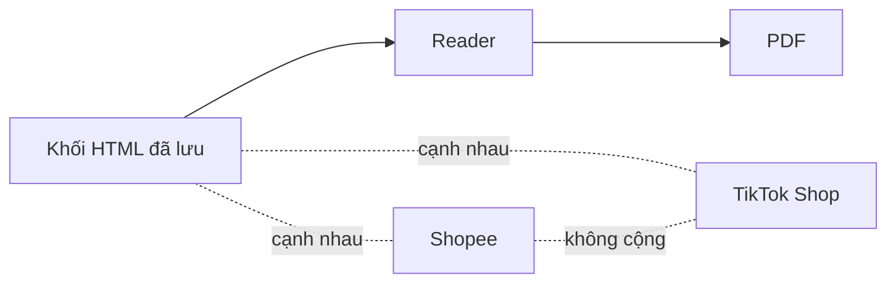

# report-language Specification

## Purpose
Spec này giữ quy tắc ngôn ngữ và cách trình bày chung, áp dụng cho cả báo cáo Market và báo cáo Insight (R-L01 đến R-L19). Nội dung chuyển từ docs/business-spec/business-rules/report-language.md bản 1.0 (21/10/2026); mã R-L giữ nguyên. Quy tắc riêng của từng báo cáo nằm ở spec market-report và insight-report.

## Requirements

### Requirement: R-L01 Không nêu tên nhà cung cấp, công cụ, mô hình AI hay Google
Báo cáo SHALL NOT nêu tên nhà cung cấp dữ liệu, công cụ, mô hình AI hay "Google". Tên sàn như Shopee và TikTok Shop thì được. Báo cáo SHALL dùng lời trung tính, ví dụ "dữ liệu bán hàng ước tính", "review công khai trên Shopee". File dấu vết kỹ thuật (.md riêng) được nêu tên công cụ.

Quy tắc áp dụng cho cả Market và Insight, với cùng một danh sách tên đầy đủ. Tên công cụ thu review công khai bị cấm ở mọi báo cáo. Chữ thường "metric" được phép; "Metric" và "METRIC" bị cấm. Tên trong chữ ẩn cũng tính là lộ tên: thuộc tính hidden, display:none, aria-hidden, alt/title/aria-label, `<title>`, chữ trong SVG. Địa chỉ liên kết (href) không tính. Chữ chép từ nguồn (trích review, tiêu đề web, đoạn PDF, chữ quảng cáo) có tên bị cấm thì chỉ ẩn mục đó. Chữ do hệ thống tự viết có tên bị cấm thì báo cáo dừng.

- Loại kiểm: Máy
- Mã kiểm: Danh sách và cách so khớp: `HIDDEN_NAMES`, `findHiddenNames` trong `src/modules/analysis/report-language/hidden-names.ts`. Market: cổng `G08_PROVIDER_NAME` (xem R-M15). Cả hai báo cáo: lint F1 và W6 trong `src/modules/analysis/reader-report/lint.ts`
- Vì sao: Chủ quyết định ngày 05/10/2026: báo cáo không nêu tên nhà cung cấp dữ liệu, tên sàn như Shopee thì được, chú thích đặt ở dòng riêng. Ngày 20/10/2026 chủ dùng "toàn dân" làm mốc so, không nêu tên nguồn dữ liệu mô phỏng (F22 đến F25). Ngày 24/10/2026 chủ chốt c4 Q1 đến Q5: Insight cấm đủ tên như Market; chữ thường "metric" được phép; chữ chép từ nguồn chỉ bị ẩn; tên công cụ review công khai luôn bị cấm; chữ ẩn cũng tính.

#### Scenario: Lời trung tính
- **WHEN** báo cáo nêu nguồn là "review công khai trên Shopee"
- **THEN** quy tắc R-L01 đạt

#### Scenario: Nêu tên công cụ trong thân báo cáo
- **WHEN** thân báo cáo nêu tên một công cụ thu dữ liệu
- **THEN** quy tắc R-L01 bị vi phạm, còn file dấu vết kỹ thuật .md riêng được nêu tên công cụ

#### Scenario: Chữ thường "metric"
- **WHEN** báo cáo viết "metric tons"
- **THEN** tên "Metric" không bị tính; chỉ "Metric" và "METRIC" bị cấm

#### Scenario: Tên trong chữ ẩn
- **WHEN** báo cáo có `
OpenAI
` hoặc `alt="Kalodata"`
- **THEN** quy tắc R-L01 bị vi phạm

#### Scenario: Tên trong địa chỉ liên kết
- **WHEN** tên chỉ nằm trong `href` của một liên kết
- **THEN** quy tắc R-L01 đạt

#### Scenario: Chữ chép từ nguồn có tên bị cấm
- **WHEN** tiêu đề một kết quả tìm kiếm có chữ "Google"
- **THEN** tiêu đề đó bị ẩn, báo cáo vẫn được dựng

#### Scenario: Insight nêu tên AI
- **WHEN** chữ do hệ thống viết trong báo cáo Insight nêu "OpenAI"
- **THEN** quy tắc R-L01 bị vi phạm và báo cáo dừng

### Requirement: R-L02 Giải thích ở dòng Chú thích riêng
Báo cáo SHALL đặt giải thích và chú thích ở dòng "Chú thích:" riêng, SHALL NOT chèn vào câu chính, và SHALL NOT chèn vào dòng "Nguồn:".

- Loại kiểm: Máy
- Mã kiểm: `noteProblems` trong `src/modules/analysis/research-automation/market-14-rules.ts`
- Vì sao: Chủ quyết định ngày 05/10/2026: chú thích đặt ở dòng riêng.

#### Scenario: Chú thích riêng
- **WHEN** báo cáo cần giải thích một nguồn
- **THEN** giải thích nằm ở dòng "Chú thích:" riêng

#### Scenario: Giải thích chèn vào câu chính
- **WHEN** một câu chính có thêm giải thích trong ngoặc
- **THEN** quy tắc R-L02 bị vi phạm

### Requirement: R-L03 Tiếng Việt đơn giản, bảng thuật ngữ, nhãn Phần n
Báo cáo SHALL viết bằng tiếng Việt đơn giản, thuật ngữ khó SHALL có bảng giải thích, và nhãn phần SHALL dùng "Phần n".

- Loại kiểm: Máy
- Mã kiểm: `src/modules/analysis/research-automation/market-14-rules.ts` (xem R-M01, R-M02)
- Vì sao: Chưa ghi lý do trong business-spec. Xem R-M01 và R-M02 (14 quy tắc sửa tay, 05/10/2026).

#### Scenario: Nhãn phần đúng
- **WHEN** báo cáo gọi các phần là "Phần 1", "Phần 2"
- **THEN** quy tắc R-L03 đạt

#### Scenario: Thuật ngữ khó không có giải thích
- **WHEN** báo cáo dùng thuật ngữ khó mà không có trong bảng giải thích
- **THEN** quy tắc R-L03 bị vi phạm

### Requirement: R-L04 Không cộng Shopee với TikTok Shop
Báo cáo SHALL NOT cộng Shopee với TikTok Shop, và hai sàn SHALL đứng cạnh nhau. (Chủ 11/10, U-32) Bản nháp và bản đọc SHALL chặn cùng một danh sách cụm tổng hai sàn.

- Loại kiểm: Máy
- Mã kiểm: Cổng `U32_NO_CROSS_PLATFORM_TOTAL` và lint Reader W3, cùng gọi `crossPlatformTotalMatches` (`src/modules/analysis/report-language/cross-platform-total.ts`)
- Vì sao: Chủ quyết định ngày 11/10/2026: không có tổng giữa các sàn (U-32). Bàn giao 24/10/2026: một danh sách là hợp của danh sách U32 và mẫu W3 cũ; tổng vẫn bị cấm.

W3 của Insight và mảng lint trong claims của bản đọc Market v1/v1.1 SHALL giữ nội dung và thứ tự cũ. Danh sách hợp áp dụng cho U32 và W3 của bản đọc Market v1.2; cổng U32 vẫn chặn tổng ở mọi phiên bản Market.

#### Scenario: Hai sàn cạnh nhau
- **WHEN** báo cáo đặt cột Shopee cạnh cột TikTok Shop và không có dòng tổng
- **THEN** quy tắc R-L04 đạt

#### Scenario: Có tổng hai sàn
- **WHEN** báo cáo có dòng "Tổng hai sàn"
- **THEN** cổng `U32_NO_CROSS_PLATFORM_TOTAL` trượt

#### Scenario: Cụm trước đây chỉ một bên chặn
- **WHEN** báo cáo viết "tổng cả hai sàn" hoặc "Shopee + TikTok"
- **THEN** cổng `U32_NO_CROSS_PLATFORM_TOTAL` và lint Reader W3 cùng trượt

### Requirement: R-L05 Không cộng các nước đối tác của dữ liệu thương mại
Báo cáo SHALL NOT cộng các nước đối tác của dữ liệu thương mại.

- Loại kiểm: Chưa ghi trong business-spec
- Mã kiểm: Chưa có mã kiểm
- Vì sao: Chưa ghi lý do trong business-spec

#### Scenario: Nước đối tác nêu riêng
- **WHEN** báo cáo nêu số của từng nước đối tác riêng
- **THEN** quy tắc R-L05 đạt

#### Scenario: Cộng các nước đối tác
- **WHEN** báo cáo cộng số của hai nước đối tác thành một tổng
- **THEN** quy tắc R-L05 bị vi phạm

### Requirement: R-L06 Không trộn các loại số khác nhau với số trong mẫu
Báo cáo SHALL NOT trộn số vĩ mô, số thương mại, số chính thức, số video, số quảng cáo với số trong mẫu.

- Loại kiểm: Máy (một phần)
- Mã kiểm: Một phần: cổng `WORLD_BANK_NOT_ARITHMETIC`, `PDF_EXCERPT_NOT_MARKET_NUMBER`, `SELLER_VIDEO_NOT_CUSTOMER_OR_TOTAL` (xem R-M21, R-M22, R-M23)
- Vì sao: Chưa ghi lý do trong business-spec. Xem R-L10 (từ điển chỉ số, 20/10/2026).

#### Scenario: Số vĩ mô đứng riêng
- **WHEN** báo cáo nêu số vĩ mô ở khối riêng, không đem tính với số trong mẫu
- **THEN** quy tắc R-L06 đạt

#### Scenario: Trộn số quảng cáo với số mẫu
- **WHEN** báo cáo cộng số quảng cáo với số trong mẫu
- **THEN** quy tắc R-L06 bị vi phạm

### Requirement: R-L07 Số thiếu là thiếu, không phải 0
Báo cáo SHALL ghi số thiếu là "thiếu", SHALL NOT ghi là 0, và SHALL NOT ghi tổng khi một thành viên thiếu.

- Loại kiểm: Máy
- Mã kiểm: Cổng `PARTIAL_TOTAL_FORBIDDEN` (xem R-M18)
- Vì sao: Chưa ghi lý do trong business-spec

#### Scenario: Số thiếu
- **WHEN** một ô không có số
- **THEN** ô đó ghi "thiếu", không ghi 0

#### Scenario: Tổng có thành viên thiếu
- **WHEN** một tổng có một thành viên thiếu mà báo cáo vẫn ghi tổng
- **THEN** cổng `PARTIAL_TOTAL_FORBIDDEN` trượt

### Requirement: R-L08 Số trong báo cáo do mã tính và lần được về bản gốc
Mọi số trong báo cáo SHALL do mã tính và SHALL lần được về bản gốc.

- Loại kiểm: Chưa ghi trong business-spec
- Mã kiểm: Chưa có mã kiểm chung
- Vì sao: Chưa ghi lý do trong business-spec

#### Scenario: Số lần được về bản gốc
- **WHEN** một số trong báo cáo do mã tính và có đường lần về bản gốc
- **THEN** quy tắc R-L08 đạt

#### Scenario: Số gõ tay
- **WHEN** một số trong báo cáo không do mã tính và không lần được về bản gốc
- **THEN** quy tắc R-L08 bị vi phạm

### Requirement: R-L09 Con số là số trong mẫu, có ghi n
Con số trong báo cáo SHALL là số trong mẫu và có ghi n; báo cáo SHALL NOT nêu quy mô thị trường.

- Loại kiểm: Máy
- Mã kiểm: `sampleSizeIssues` trong `src/modules/analysis/research-automation/market-14-rules.ts` (xem R-M07)
- Vì sao: Chưa ghi lý do trong business-spec. Xem R-M07.

#### Scenario: Số có n
- **WHEN** báo cáo nêu một số kèm n của mẫu
- **THEN** quy tắc R-L09 đạt

#### Scenario: Nêu quy mô thị trường
- **WHEN** báo cáo nêu một con số như quy mô thị trường
- **THEN** quy tắc R-L09 bị vi phạm

### Requirement: R-L10 Chỉ so hoặc cộng khi cùng thước đo, sàn, kỳ, đơn vị
Báo cáo SHALL chỉ so hoặc cộng khi cùng thước đo, cùng sàn, cùng kỳ, cùng đơn vị. Số quảng cáo SHALL NOT được trình bày như nguyên nhân của doanh thu. Chi tiết ở `docs/business-spec/semantic-layer/metrics.md`, mục 7.4.

- Loại kiểm: Chưa ghi trong business-spec
- Mã kiểm: Chưa có mã kiểm
- Vì sao: Chủ quyết định ngày 20/10/2026: làm từ điển chỉ số (semantic layer), mỗi con số có một định nghĩa chung và ghi cách đo của từng nguồn; không so hoặc cộng hai cách đo khác nhau (F14, F16).

#### Scenario: Cùng thước đo, sàn, kỳ, đơn vị
- **WHEN** hai số cùng thước đo, cùng sàn, cùng kỳ và cùng đơn vị
- **THEN** báo cáo được so hoặc cộng hai số đó

#### Scenario: Số quảng cáo làm nguyên nhân
- **WHEN** báo cáo viết số quảng cáo là nguyên nhân của doanh thu
- **THEN** quy tắc R-L10 bị vi phạm

### Requirement: R-L11 Không hiện bình luận gốc của khách
Báo cáo SHALL NOT hiện bình luận gốc của khách, và SHALL chỉ hiện nhãn đã mã hóa và số đếm. (Chủ 19/10)

- Loại kiểm: Chưa ghi trong business-spec
- Mã kiểm: Chưa có mã kiểm
- Vì sao: Chủ quyết định ngày 19/10/2026: bình luận gốc phải được mã hóa, không hiện bình luận gốc trong báo cáo; chọn phương án A: bỏ nguồn S2, Market chỉ dùng nguồn đếm được.

#### Scenario: Nhãn và số đếm
- **WHEN** báo cáo nêu nhãn đã mã hóa kèm số đếm
- **THEN** quy tắc R-L11 đạt

#### Scenario: Bình luận gốc
- **WHEN** báo cáo hiện nguyên văn bình luận gốc của khách
- **THEN** quy tắc R-L11 bị vi phạm

### Requirement: R-L12 Insight không bịa insight sáng tạo hay cảm xúc về quảng cáo
Insight SHALL NOT bịa insight sáng tạo hay cảm xúc về quảng cáo (ví dụ chiến dịch KFC, trà Tết), và SHALL chỉ đọc bình luận và video. (Chủ 20/10)

- Loại kiểm: Chưa ghi trong business-spec
- Mã kiểm: Chưa có mã kiểm
- Vì sao: Chủ quyết định ngày 20/10/2026 (F8): Insight không làm insight cảm xúc hay sáng tạo về quảng cáo, vì hệ thống không làm được.

#### Scenario: Chỉ đọc bình luận và video
- **WHEN** Insight rút kết luận từ bình luận và video
- **THEN** quy tắc R-L12 đạt

#### Scenario: Insight cảm xúc về chiến dịch
- **WHEN** Insight viết một insight cảm xúc về chiến dịch quảng cáo mà không có trong bình luận hay video
- **THEN** quy tắc R-L12 bị vi phạm

### Requirement: R-L13 Bản ghi không phải người, tần suất không bằng mức quan trọng
Báo cáo SHALL coi bản ghi không phải người, và SHALL coi tần suất không bằng mức quan trọng.

- Loại kiểm: Chưa ghi trong business-spec
- Mã kiểm: Chưa có mã kiểm
- Vì sao: Chưa ghi lý do trong business-spec. Xem R-I01 và R-I10.

#### Scenario: Gọi đúng đơn vị
- **WHEN** báo cáo nêu 50 bản ghi nhắc một chủ đề
- **THEN** báo cáo không gọi đó là 50 người

#### Scenario: Tần suất thành mức quan trọng
- **WHEN** báo cáo viết "nhắc nhiều nên quan trọng nhất"
- **THEN** quy tắc R-L13 bị vi phạm

### Requirement: R-L14 Đề xuất hành động có người phụ trách, hạn và nhãn
Đề xuất hành động SHALL được phép, nhưng SHALL có người phụ trách, hạn dd/mm/yyyy và nhãn "đề xuất, chờ chủ duyệt". Nhãn SHALL là nhãn đầy đủ ở mọi nơi kiểm, kể cả cổng nháp; chữ "đề xuất" đứng một mình không đủ. Con số làm căn cứ SHALL chỉ là doanh thu quan sát trong mẫu. Báo cáo SHALL NOT bịa ngân sách hay mức tăng. (Chủ 05/10)

- Loại kiểm: Máy
- Mã kiểm: `hasM12ProposalRows` (xem R-M09); cổng `M12_PROPOSAL_LABEL` (xem R-M26)
- Vì sao: Chủ quyết định ngày 05/10/2026: báo cáo được phép đề xuất; M12 có ba phương án, người phụ trách, hạn, nhãn "đề xuất, chờ chủ duyệt"; chủ bỏ ý "AI không chọn hành động". Ngày 24/10/2026 (Q4): nhãn đầy đủ ở mọi nơi.

#### Scenario: Đề xuất đủ thông tin
- **WHEN** một đề xuất có người phụ trách, hạn 31/10/2026, nhãn "đề xuất, chờ chủ duyệt" và căn cứ là doanh thu quan sát trong mẫu
- **THEN** quy tắc R-L14 đạt

#### Scenario: Bịa mức tăng
- **WHEN** đề xuất nêu mức tăng doanh thu không có trong dữ liệu
- **THEN** quy tắc R-L14 bị vi phạm

#### Scenario: Nhãn ngắn
- **WHEN** phương án trong M12 chỉ ghi "đề xuất"
- **THEN** quy tắc R-L14 bị vi phạm

### Requirement: R-L15 Chân dung khách do AI tổng hợp có thẻ bằng chứng và nhãn
Chân dung khách do AI tổng hợp SHALL có thẻ bằng chứng và nhãn "do AI tổng hợp". Xem R-I25 đến R-I27.

- Loại kiểm: Chưa ghi trong business-spec
- Mã kiểm: Chưa có mã kiểm
- Vì sao: Chủ quyết định ngày 07/10/2026: chân dung khách do AI tổng hợp được phép nếu mỗi thuộc tính trích bằng chứng thật.

#### Scenario: Có thẻ và nhãn
- **WHEN** một chân dung khách có thẻ bằng chứng và nhãn "do AI tổng hợp"
- **THEN** quy tắc R-L15 đạt

#### Scenario: Thiếu nhãn
- **WHEN** một chân dung khách do AI tổng hợp không có nhãn "do AI tổng hợp"
- **THEN** quy tắc R-L15 bị vi phạm

### Requirement: R-L16 Báo cáo là sản phẩm, không phải bảng điều khiển
Báo cáo SHALL là sản phẩm: các khối HTML đã lưu, qua Reader, ra PDF. Giao diện tổng hợp SHALL NOT là bảng điều khiển. Hai sàn TikTok và Shopee SHALL đứng cạnh nhau. (Chủ 11/10)

- Loại kiểm: Chưa ghi trong business-spec
- Mã kiểm: Chưa có mã kiểm
- Vì sao: Chủ quyết định ngày 11/10/2026: báo cáo là ranh giới sản phẩm, gồm khối HTML đã lưu, qua Reader, ra PDF; không phải bảng điều khiển.

#### Scenario: Luồng khối HTML đến PDF
- **WHEN** báo cáo được tạo
- **THEN** báo cáo gồm các khối HTML đã lưu, qua Reader, rồi ra PDF

#### Scenario: Giao diện thành bảng điều khiển
- **WHEN** giao diện tổng hợp được làm như một bảng điều khiển
- **THEN** quy tắc R-L16 bị vi phạm

### Requirement: R-L17 Không hiện thanh phần trăm tiến độ
Giao diện chạy SHALL NOT hiện thanh phần trăm tiến độ.

- Loại kiểm: Chưa ghi trong business-spec
- Mã kiểm: Chưa có mã kiểm
- Vì sao: Chủ quyết định ngày 11/10/2026: báo cáo là ranh giới sản phẩm; không hiện % tiến độ.

#### Scenario: Giao diện chạy không có thanh phần trăm
- **WHEN** một lần chạy đang diễn ra
- **THEN** giao diện không hiện thanh phần trăm tiến độ

#### Scenario: Có thanh phần trăm
- **WHEN** giao diện chạy hiện thanh "45%"
- **THEN** quy tắc R-L17 bị vi phạm

### Requirement: R-L18 Trạng thái rỗng nói rõ vì sao rỗng
Trạng thái rỗng SHALL NOT chỉ ghi "0"; trạng thái rỗng SHALL nói rõ vì sao rỗng (thiếu, chưa lấy, hay đã lấy mà bằng không).

- Loại kiểm: Chưa ghi trong business-spec
- Mã kiểm: Chưa có mã kiểm
- Vì sao: Chưa ghi lý do trong business-spec

#### Scenario: Rỗng có lý do
- **WHEN** một ô rỗng vì dữ liệu chưa được lấy
- **THEN** ô đó ghi rõ "chưa lấy"

#### Scenario: Chỉ ghi 0
- **WHEN** một ô rỗng chỉ ghi "0" và không nói lý do
- **THEN** quy tắc R-L18 bị vi phạm

### Requirement: R-L19 Khối có kết luận mang ba nhãn
Mỗi khối mang kết luận SHALL có ba nhãn "Thấy gì / Dùng để / Đừng hiểu là".

- Loại kiểm: Chưa ghi trong business-spec
- Mã kiểm: Chưa có mã kiểm
- Vì sao: Chưa ghi lý do trong business-spec

#### Scenario: Khối kết luận đủ ba nhãn
- **WHEN** một khối mang kết luận có "Thấy gì", "Dùng để" và "Đừng hiểu là"
- **THEN** quy tắc R-L19 đạt

#### Scenario: Khối kết luận thiếu nhãn
- **WHEN** một khối mang kết luận thiếu nhãn "Đừng hiểu là"
- **THEN** quy tắc R-L19 bị vi phạm

### Requirement: R-L21 Chữ ẩn không tính cho luật câu chữ
Chữ ẩn trên trang SHALL NOT làm trượt luật câu chữ: U13 (R-M24), E2 (R-M17), U32 (R-M16, R-L04), M12 (R-M26), tổng thiếu thành phần và luật câu của các khối nguồn (R-M20 đến R-M23). Chữ ẩn là chữ trong phần tử có thuộc tính `hidden`, `aria-hidden` bằng true, 1 hoặc hidden, kiểu `display:none` hoặc `visibility:hidden`, hoặc nằm trong script, style, noscript, template. Tên nhà cung cấp (R-L01) SHALL vẫn bị tính cả trong chữ ẩn. Áp dụng cho cả Market và Insight.

- Loại kiểm: Máy
- Mã kiểm: `src/modules/analysis/report-visible-text.ts` (`hiddenElement`, `withoutHiddenText`, `balancedOpenings`); dùng ở `market-business-gate.ts` và `report-visible-text-lint.ts`
- Vì sao: Chủ quyết định ngày 24/10/2026 (Q3): người đọc không thấy chữ ẩn, nên chữ ẩn không làm trượt luật câu chữ. Lint Reader cũ F2–F8, W1–W5 giữ nguyên như trước (RR `lint.ts`: "historical gates remain byte-identical").

#### Scenario: So sánh nhất trong chữ ẩn
- **WHEN** trang có `Sản phẩm tốt nhất.`
- **THEN** U13 đạt ở cổng, ở lint chữ nhìn thấy và ở bản đọc

#### Scenario: Cùng câu, không ẩn
- **WHEN** trang có `
Sản phẩm tốt nhất.
`
- **THEN** U13 trượt

#### Scenario: Tên nhà cung cấp trong chữ ẩn
- **WHEN** trang có `
Metric
`
- **THEN** cổng `G08_PROVIDER_NAME` trượt
