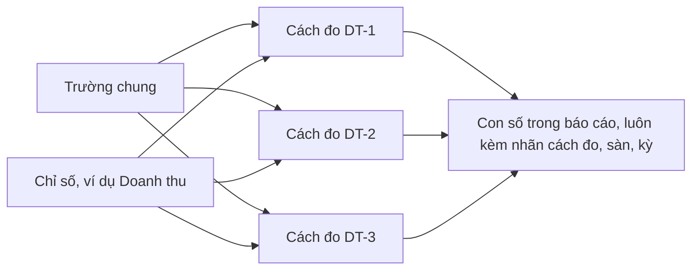

# report-metrics Specification

## Purpose
Spec này giữ từ điển chỉ số và cách đo của báo cáo (semantic layer): 13 chỉ số (DT, LB, GIA, DG, SAO, NH, XEM, QT, QC, TL, VM, TM, TK) và 29 cách đo (DT-1 đến TK-2), cùng quy tắc so và cộng. Nội dung chuyển từ docs/business-spec/semantic-layer/metrics.md (Phần 7, bản 21/10/2026). Mã chỉ số và mã cách đo giữ nguyên. Chữ sau mã trong tiêu đề requirement là nhãn ngắn của spec này. Câu quy tắc lấy từ các ô của bảng gốc, không thêm quy tắc mới.

Một chỉ số có thể được đo theo nhiều cách. Mỗi con số trong báo cáo gắn với một chỉ số (định nghĩa chung) và một cách đo (nguồn và cách tính). Chỉ so hoặc cộng các số cùng cách đo.

Hai tầng nối nhau. Từ điển trường (mục 6.2, file fields.md) nói một bản ghi có trường gì. Từ điển chỉ số nói con số nghĩa là gì và so hoặc cộng với số nào. Mỗi cách đo ghi rõ nó đọc trường nào.

Hạng nguồn (A, B, C) và mức đại diện (Cao, Vừa, Thấp) lấy từ quy chuẩn dữ liệu đầu vào. Từ điển viết dạng tài liệu trước. Chưa dùng Cube (quyết định 20/10/2026). Xem lại khi có dashboard hoặc nhiều nơi cùng đọc số.

Chưa có mã kiểm cho spec này. Mục 7.8 của metrics.md ghi việc đưa từ điển vào mã là việc sau. Các điểm chưa rõ và điểm lệch nằm ở cuối file, mục "Điểm mở".

## Requirements

### Requirement: Mỗi con số gắn một chỉ số và một cách đo
Mỗi con số trong báo cáo SHALL gắn với một chỉ số và một cách đo, và báo cáo SHALL chỉ so hoặc cộng các số cùng cách đo.

- Mục gốc: 7.1
- Loại kiểm: Chưa ghi trong business-spec
- Mã kiểm: Chưa có mã kiểm
- Vì sao: Từ điển chỉ số ngày 21/10/2026 (metrics.md), mục 7.1: ba số cùng tên "doanh thu" (S01, S02 và S14, S12) khác cách đo, khác kỳ, khác phạm vi; nếu chỉ ghi "doanh thu" thì người đọc sẽ so hoặc cộng nhầm.

#### Scenario: Số có chỉ số và cách đo
- **WHEN** báo cáo nêu một con số doanh thu kèm cách đo DT-1
- **THEN** quy tắc đạt

#### Scenario: Số chỉ ghi tên chung
- **WHEN** báo cáo chỉ ghi "doanh thu" mà không nói cách đo
- **THEN** quy tắc bị vi phạm

### Requirement: Khai báo một chỉ số và một cách đo
Từ điển SHALL khai báo mỗi chỉ số gồm sáu ô (Mã, Tên trong báo cáo, Định nghĩa chung, Đơn vị, Chiều phân tích được phép, Cấm) và mỗi cách đo gồm mười ô (Mã cách đo, Nguồn, Trường đọc, Hạng và đại diện, Cách tính, Kỳ, Phạm vi, Tính hoặc không tính, Nhãn trong báo cáo, So hoặc cộng được với).

- Mục gốc: 7.2
- Ô của chỉ số: Mã (mã ngắn, không đổi); Tên trong báo cáo (chữ người đọc thấy); Định nghĩa chung (một câu, không nói nguồn); Đơn vị (theo hồ sơ đơn vị, mục 6.6); Chiều phân tích được phép (cách chia số); Cấm (cách dùng không được phép)
- Ô của cách đo: Mã cách đo (mã chỉ số và số thứ tự); Nguồn (mã nguồn); Trường đọc (trường chung ở mục 6.2); Hạng và đại diện (theo quy chuẩn dữ liệu đầu vào); Cách tính (nguồn tự tính hay mình tính, tính thế nào); Kỳ (từ ngày, tới ngày, múi giờ); Phạm vi (sàn, mẫu); Tính hoặc không tính (đơn hoàn, voucher, phí ship); Nhãn trong báo cáo (chữ ghi cạnh con số); So hoặc cộng được với (cách đo nào)
- Loại kiểm: Chưa ghi trong business-spec
- Mã kiểm: Chưa có mã kiểm
- Vì sao: Từ điển chỉ số ngày 21/10/2026 (metrics.md), mục 7.2 (mẫu khai báo). Bảng 7.3 hiện chỉ điền các ô Mã, Nguồn, Trường đọc, Hạng, Cách tính, Phạm vi hoặc kỳ, Nhãn, So hoặc cộng được với; hai ô "Chiều phân tích được phép" và "Cấm" của chỉ số chưa điền riêng cho từng chỉ số (xem mục Điểm mở).

#### Scenario: Cách đo đủ ô
- **WHEN** một cách đo mới được thêm vào từ điển
- **THEN** cách đo đó khai báo đủ các ô của mẫu 7.2

#### Scenario: Cách đo thiếu ô
- **WHEN** một cách đo không ghi nguồn hoặc nhãn
- **THEN** mẫu khai báo bị vi phạm

### Requirement: Quy tắc so và cộng
Báo cáo SHALL tuân theo bảng quy tắc so và cộng: chỉ so hoặc cộng khi cùng cách đo, cùng sàn, cùng kỳ, cùng đơn vị; các trường hợp khác SHALL theo tám dòng của bảng 7.4.

- Mục gốc: 7.4
- Cùng cách đo, cùng sàn, cùng kỳ, cùng đơn vị: so, cộng (nếu không thiếu thành viên nào)
- Cùng cách đo, khác sàn: đặt cạnh, không cộng
- Cùng cách đo, khác kỳ: so xu hướng, ghi rõ hai kỳ, không cộng
- Cùng chỉ số, khác cách đo: đặt cạnh, ghi nhãn từng số, giải thích vì sao khác, không cộng, không tính tỉ lệ giữa hai số
- Khác chỉ số: chỉ ghép khi có công thức khai báo trong từ điển (ví dụ GIA-2 = DT-1 / LB-1)
- Số nền với số mẫu: đặt ở hai phần riêng, không ghép công thức, không tính "phần của thị trường"
- Số quảng cáo với số bán: đặt cạnh, không nói quảng cáo gây ra doanh thu
- Một số bị thiếu: ghi "thiếu", không đổi thành 0, không nêu tổng
- Loại kiểm: Chưa ghi trong business-spec
- Mã kiểm: Chưa có mã kiểm
- Vì sao: Từ điển chỉ số ngày 21/10/2026 (metrics.md), mục 7.4.

#### Scenario: Cùng cách đo, cùng sàn, cùng kỳ
- **WHEN** hai con số cùng cách đo DT-1, cùng sàn, cùng kỳ, cùng đơn vị, không thiếu thành viên nào
- **THEN** báo cáo được so hoặc cộng hai số đó

#### Scenario: Cùng cách đo, khác sàn
- **WHEN** hai con số cùng cách đo nhưng khác sàn
- **THEN** báo cáo đặt hai số cạnh nhau và không cộng

#### Scenario: Cùng cách đo, khác kỳ
- **WHEN** hai con số cùng cách đo nhưng khác kỳ
- **THEN** báo cáo so xu hướng, ghi rõ hai kỳ, và không cộng

#### Scenario: Cùng chỉ số, khác cách đo
- **WHEN** hai con số cùng chỉ số doanh thu nhưng khác cách đo (DT-2 và DT-1)
- **THEN** báo cáo ghi nhãn từng số, giải thích vì sao khác, không cộng và không tính tỉ lệ giữa hai số

#### Scenario: Khác chỉ số có công thức
- **WHEN** hai con số khác chỉ số và từ điển khai báo công thức GIA-2 = DT-1 / LB-1
- **THEN** báo cáo được ghép hai số theo công thức đó

#### Scenario: Số nền với số mẫu
- **WHEN** báo cáo có số nền (ví dụ TM-1) và số mẫu (ví dụ DT-1)
- **THEN** hai số nằm ở hai phần riêng, không ghép công thức và không có "phần của thị trường"

#### Scenario: Số quảng cáo với số bán
- **WHEN** báo cáo có số quảng cáo và số bán
- **THEN** hai số đặt cạnh nhau và báo cáo không nói quảng cáo gây ra doanh thu

#### Scenario: Số bị thiếu
- **WHEN** một số bị thiếu
- **THEN** báo cáo ghi "thiếu", không đổi thành 0 và không nêu tổng

#### Scenario: Ví dụ sai: chia hai cách đo
- **WHEN** báo cáo viết "Video A mang lại 12% doanh thu của sản phẩm" (DT-2 chia DT-1)
- **THEN** quy tắc bị vi phạm vì hai cách đo khác nhau

#### Scenario: Ví dụ đúng: đặt cạnh
- **WHEN** báo cáo viết "Video A gắn với khoảng 18 triệu đồng doanh thu ước tính trong 30 ngày. Sản phẩm có khoảng 150 triệu đồng doanh thu ước tính trong mẫu Shopee. Hai số đo theo hai cách khác nhau nên không chia cho nhau."
- **THEN** quy tắc đạt

#### Scenario: Ví dụ sai: số mẫu chia số nền
- **WHEN** báo cáo viết "Mẫu chiếm 3% kim ngạch nhập khẩu" (DT-1 chia TM-1)
- **THEN** quy tắc bị vi phạm vì đây là số mẫu chia số nền

### Requirement: Cách hiện nhãn cách đo trong báo cáo
Mỗi con số SHALL có nhãn cách đo ngay cạnh hoặc ở tiêu đề cột, nhãn SHALL dùng tên nguồn trung tính và SHALL NOT nêu tên công cụ, số hạng C SHALL luôn có chữ "ước tính", số có đại diện Thấp SHALL luôn có chữ "trong mẫu", và cuối báo cáo SHALL có bảng "Chỉ số đã dùng".

- Mục gốc: 7.5
- Ví dụ nhãn ở tiêu đề cột: "Doanh thu (ước tính, trong mẫu, Shopee, 30 ngày, đồng)"
- Tên nguồn trung tính, ví dụ: "dữ liệu số bán", "dữ liệu đánh giá"
- Số nền ghi tên cơ quan công bố theo bảng nguồn
- Bảng "Chỉ số đã dùng" nằm ở cuối báo cáo (I03 hoặc phụ lục) và gồm: mã cách đo, nhãn, nguồn trung tính, kỳ
- Loại kiểm: Chưa ghi trong business-spec
- Mã kiểm: Chưa có mã kiểm
- Vì sao: Từ điển chỉ số ngày 21/10/2026 (metrics.md), mục 7.5. Quy tắc không nêu tên công cụ khớp R-L01 (report-language).

#### Scenario: Nhãn ở tiêu đề cột
- **WHEN** một cột doanh thu có tiêu đề "Doanh thu (ước tính, trong mẫu, Shopee, 30 ngày, đồng)"
- **THEN** quy tắc đạt cho cột đó

#### Scenario: Số hạng C thiếu chữ ước tính
- **WHEN** báo cáo ghi một số hạng C mà không có chữ "ước tính"
- **THEN** quy tắc bị vi phạm

#### Scenario: Số đại diện Thấp thiếu chữ trong mẫu
- **WHEN** báo cáo ghi một số đại diện Thấp mà không có chữ "trong mẫu"
- **THEN** quy tắc bị vi phạm

#### Scenario: Nhãn nêu tên công cụ
- **WHEN** một nhãn nêu tên công cụ thu dữ liệu
- **THEN** quy tắc bị vi phạm

#### Scenario: Thiếu bảng Chỉ số đã dùng
- **WHEN** báo cáo không có bảng "Chỉ số đã dùng" ở cuối
- **THEN** quy tắc bị vi phạm

### Requirement: Chỉ số dùng ở từng section Insight
Báo cáo Insight SHALL dùng các chỉ số theo bảng áp vào section: mỗi section chỉ dùng các chỉ số được liệt kê cho section đó.

- Mục gốc: 7.6
- I02 Bối cảnh: DT-1, LB-1 (chọn sản phẩm), QT-1, QT-2; số nền VM-1, TM-1, TK-1, TK-2 ở phần riêng
- I03 Phạm vi và giới hạn: bảng "Chỉ số đã dùng", DG-1, DG-2
- I04 đến I10 Lời khách: NH-1, SAO-1, DG-2
- I07 và I13 Giá và thương hiệu: GIA-2 (theo nhóm quy cách), GIA-1 khi cần giá một thời điểm
- I12 Điểm tiếp xúc: DT-2, LB-2, XEM-1, NH-3, QC-1, QC-3, TL-1
- I13 Thương hiệu và đối thủ: QC-1 đến QC-4, NH-4
- I14 và I15 Đề xuất: mỗi đề xuất ghi mã cách đo của phát hiện nó dựa vào
- I16 Kết quả sau khi làm: DT-3 khi có S12; chưa có thì ghi "chưa đo được"
- Loại kiểm: Chưa ghi trong business-spec
- Mã kiểm: Chưa có mã kiểm
- Vì sao: Từ điển chỉ số ngày 21/10/2026 (metrics.md), mục 7.6.

#### Scenario: Đề xuất ghi mã cách đo
- **WHEN** một đề xuất ở I14 ghi mã cách đo của phát hiện nó dựa vào
- **THEN** quy tắc đạt

#### Scenario: Đề xuất không ghi mã cách đo
- **WHEN** một đề xuất ở I15 không ghi mã cách đo
- **THEN** quy tắc bị vi phạm

#### Scenario: I16 chưa có S12
- **WHEN** chưa có nguồn S12
- **THEN** I16 ghi "chưa đo được"

### Requirement: Số quảng cáo không nói chi tiêu hay hiệu quả
Báo cáo SHALL NOT dùng số quảng cáo (nhóm QC và TL) để nói chi tiêu, ngân sách, tỉ lệ chuyển đổi hay hiệu quả, và SHALL NOT cộng hai thư viện quảng cáo.

- Mục gốc: 7.3.2
- Số quảng cáo cho biết thương hiệu đang làm gì. Số này không cho biết chi tiêu hay hiệu quả.
- Loại kiểm: Chưa ghi trong business-spec
- Mã kiểm: Chưa có mã kiểm
- Vì sao: Từ điển chỉ số ngày 21/10/2026 (metrics.md), mục 7.3.2 ("Cấm cho mọi số quảng cáo").

#### Scenario: Nói hiệu quả từ số quảng cáo
- **WHEN** báo cáo viết rằng một thương hiệu có hiệu quả quảng cáo cao vì có nhiều quảng cáo đang chạy
- **THEN** quy tắc bị vi phạm

#### Scenario: Cộng hai thư viện
- **WHEN** báo cáo cộng QC-1 (S15) với QC-3 (S17)
- **THEN** quy tắc bị vi phạm vì hai thư viện khác nhau

#### Scenario: Chỉ nói thương hiệu đang làm gì
- **WHEN** báo cáo viết số quảng cáo đang chạy kèm nhãn của QC-1
- **THEN** quy tắc đạt

### Requirement: Số nền ở phần riêng
Báo cáo SHALL đặt số nền (VM, TM, TK; hạng A, đại diện Cao) ở phần riêng, và số nền SHALL mô tả thị trường chung, không mô tả mẫu sản phẩm.

- Mục gốc: 7.3.3
- Số nền là chỉ tiêu vĩ mô (VM), kim ngạch thương mại (TM) và số thống kê nhà nước (TK)
- Loại kiểm: Chưa ghi trong business-spec
- Mã kiểm: Chưa có mã kiểm
- Vì sao: Từ điển chỉ số ngày 21/10/2026 (metrics.md), mục 7.3.3 và mục 7.4 (số nền với số mẫu).

#### Scenario: Số nền ở phần riêng
- **WHEN** báo cáo có một phần riêng cho VM-1, TM-1, TK-1, TK-2
- **THEN** quy tắc đạt

#### Scenario: Số nền lẫn trong bảng mẫu
- **WHEN** một bảng số mẫu có chèn một dòng số nền
- **THEN** quy tắc bị vi phạm

### Requirement: DT Doanh thu
Chỉ số DT (Doanh thu) SHALL chỉ được đưa vào báo cáo qua một trong các cách đo DT-1, DT-2, DT-3, và mỗi con số SHALL có nhãn cách đo ngay cạnh hoặc ở tiêu đề cột (mục 7.5). Bảng "Chỉ số đã dùng" cuối báo cáo ghi mã cách đo.

- Định nghĩa chung: tiền bán được của sản phẩm trong một kỳ.
- Đơn vị: đồng.
- Cách đo: DT-1, DT-2, DT-3
- Loại kiểm: Chưa ghi trong business-spec
- Mã kiểm: Chưa có mã kiểm
- Vì sao: Từ điển chỉ số ngày 21/10/2026 (metrics.md), mục 7.3. Định nghĩa (và đơn vị, nếu bản gốc có ghi) lấy nguyên từ dòng đầu của chỉ số.

#### Scenario: Số có cách đo
- **WHEN** báo cáo nêu một số của chỉ số DT kèm nhãn cách đo của DT-1, ở cạnh số hoặc ở tiêu đề cột
- **THEN** quy tắc đạt

#### Scenario: Số không có cách đo
- **WHEN** báo cáo nêu một số của chỉ số DT mà không nói cách đo
- **THEN** quy tắc bị vi phạm

### Requirement: DT-1 Doanh thu ước tính từ trang kết quả
Số theo cách đo DT-1 SHALL mang nhãn "ước tính, trong mẫu, <sàn>, 30 ngày", SHALL chỉ so hoặc cộng với DT-1 cùng sàn, cùng kỳ, và SHALL NOT so với số đơn của kênh người bán.

- Chỉ số: DT Doanh thu
- Nguồn: S01
- Trường đọc: `giaTri`, `donVi` = đồng, `san`, `ky`
- Hạng: C
- Cách tính: Nguồn ước tính từ số "đã bán" công khai và giá ghi nhận từng ngày. Không tính đơn hoàn (theo mô tả của nguồn, chưa tự kiểm).
- Phạm vi, kỳ: Từng sàn, trong mẫu kết quả tìm kiếm. 30 ngày liên tục, theo lần thu.
- Nhãn trong báo cáo: "ước tính, trong mẫu, <sàn>, 30 ngày"
- So hoặc cộng được với: DT-1 cùng sàn, cùng kỳ. Không so với số đơn của kênh người bán.
- Loại kiểm: Chưa ghi trong business-spec
- Mã kiểm: Chưa có mã kiểm
- Vì sao: Từ điển chỉ số ngày 21/10/2026 (metrics.md), mục 7.3.1. Kết quả kiểm 21/10/2026 (mục 7.7): kỳ là 30 ngày liên tục theo từng lần thu (điểm 1); mã không xử lý đơn hoàn, huỷ, còn tài liệu nguồn nói số là đơn đã nhận và không hoàn (điểm 2, đã sửa vào nhãn DT-1).

#### Scenario: Nhãn đúng
- **WHEN** báo cáo ghi doanh thu của một sản phẩm Shopee với nhãn "ước tính, trong mẫu, Shopee, 30 ngày"
- **THEN** quy tắc DT-1 đạt

#### Scenario: So với số đơn của kênh người bán
- **WHEN** báo cáo so DT-1 với số đơn của kênh người bán
- **THEN** quy tắc DT-1 bị vi phạm

### Requirement: DT-2 Doanh thu ước tính gắn với video
Số theo cách đo DT-2 SHALL mang nhãn "ước tính, gắn với video, <kỳ>", SHALL chỉ so với DT-2 cùng kỳ, SHALL NOT lấy làm phần của DT-1, và khi thiếu kỳ SHALL ghi "kỳ không rõ" và SHALL NOT so giữa các lần lấy.

- Chỉ số: DT Doanh thu
- Nguồn: S02, S14
- Trường đọc: `giaTri`, `ky`, `maBanGhi` (sản phẩm)
- Hạng: C
- Cách tính: Nguồn ước tính số bán gắn với một video.
- Phạm vi, kỳ: TikTok Shop, từng video. Kỳ = khoảng ngày khi xuất.
- Nhãn trong báo cáo: "ước tính, gắn với video, <kỳ>"
- So hoặc cộng được với: DT-2 cùng kỳ. Không lấy làm phần của DT-1. Thiếu kỳ thì ghi "kỳ không rõ" và không so giữa các lần lấy.
- Loại kiểm: Chưa ghi trong business-spec
- Mã kiểm: Chưa có mã kiểm
- Vì sao: Từ điển chỉ số ngày 21/10/2026 (metrics.md), mục 7.3.1. Kết quả kiểm 21/10/2026 (mục 7.7, điểm 5): mã không ghi kỳ; đường API có khoảng ngày; tệp tải tay phụ thuộc lúc xuất.

#### Scenario: Nhãn đúng
- **WHEN** báo cáo ghi doanh thu của một video với nhãn "ước tính, gắn với video, <kỳ>" và kỳ rõ
- **THEN** quy tắc DT-2 đạt

#### Scenario: Lấy làm phần của DT-1
- **WHEN** báo cáo viết DT-2 là một phần của DT-1
- **THEN** quy tắc DT-2 bị vi phạm

#### Scenario: Thiếu kỳ
- **WHEN** số video không có kỳ
- **THEN** báo cáo ghi "kỳ không rõ" và không so giữa các lần lấy

### Requirement: DT-3 Doanh thu thật của shop chủ
Số theo cách đo DT-3 SHALL mang nhãn "số của shop" và SHALL chỉ so với DT-3; cách đo này chưa có đường thu.

- Chỉ số: DT Doanh thu
- Nguồn: S12
- Trường đọc: —
- Hạng: A
- Cách tính: Số thật của shop chủ.
- Phạm vi, kỳ: Shop chủ.
- Nhãn trong báo cáo: "số của shop"
- So hoặc cộng được với: DT-3. Chưa có đường thu.
- Loại kiểm: Chưa ghi trong business-spec
- Mã kiểm: Chưa có mã kiểm
- Vì sao: Từ điển chỉ số ngày 21/10/2026 (metrics.md), mục 7.3.

#### Scenario: Nhãn đúng
- **WHEN** báo cáo có số DT-3 của shop chủ
- **THEN** số mang nhãn "số của shop"

#### Scenario: Chưa có đường thu
- **WHEN** chưa có nguồn S12
- **THEN** báo cáo không nêu số DT-3

### Requirement: LB Lượt bán
Chỉ số LB (Lượt bán) SHALL chỉ được đưa vào báo cáo qua một trong các cách đo LB-1, LB-2, LB-3, và mỗi con số SHALL có nhãn cách đo ngay cạnh hoặc ở tiêu đề cột (mục 7.5). Bảng "Chỉ số đã dùng" cuối báo cáo ghi mã cách đo.

- Định nghĩa chung: số đơn vị hàng bán được trong một kỳ.
- Đơn vị: đơn vị đếm của hồ sơ đơn vị (mục 6.6).
- Cách đo: LB-1, LB-2, LB-3
- Loại kiểm: Chưa ghi trong business-spec
- Mã kiểm: Chưa có mã kiểm
- Vì sao: Từ điển chỉ số ngày 21/10/2026 (metrics.md), mục 7.3. Định nghĩa (và đơn vị, nếu bản gốc có ghi) lấy nguyên từ dòng đầu của chỉ số.

#### Scenario: Số có cách đo
- **WHEN** báo cáo nêu một số của chỉ số LB kèm nhãn cách đo của LB-1, ở cạnh số hoặc ở tiêu đề cột
- **THEN** quy tắc đạt

#### Scenario: Số không có cách đo
- **WHEN** báo cáo nêu một số của chỉ số LB mà không nói cách đo
- **THEN** quy tắc bị vi phạm

### Requirement: LB-1 Lượt bán ước tính từ trang kết quả
Số theo cách đo LB-1 SHALL mang nhãn "ước tính, trong mẫu, <sàn>, 30 ngày" và SHALL chỉ so hoặc cộng với LB-1 cùng sàn, cùng kỳ, cùng đơn vị đếm.

- Chỉ số: LB Lượt bán
- Nguồn: S01
- Trường đọc: `giaTri`, `donVi` = đếm, `san`, `ky`
- Hạng: C
- Cách tính: Nguồn ước tính: "đã bán" cuối kỳ trừ "đã bán" đầu kỳ.
- Phạm vi, kỳ: Từng sàn, trong mẫu. 30 ngày.
- Nhãn trong báo cáo: "ước tính, trong mẫu, <sàn>, 30 ngày"
- So hoặc cộng được với: LB-1 cùng sàn, cùng kỳ, cùng đơn vị đếm.
- Loại kiểm: Chưa ghi trong business-spec
- Mã kiểm: Chưa có mã kiểm
- Vì sao: Từ điển chỉ số ngày 21/10/2026 (metrics.md), mục 7.3.1. Kết quả kiểm 21/10/2026 (mục 7.7, điểm 1): kỳ là 30 ngày liên tục theo từng lần thu.

#### Scenario: Nhãn đúng
- **WHEN** báo cáo ghi lượt bán một sản phẩm Shopee với nhãn "ước tính, trong mẫu, Shopee, 30 ngày"
- **THEN** quy tắc LB-1 đạt

#### Scenario: Khác đơn vị đếm
- **WHEN** báo cáo so hai số LB-1 khác đơn vị đếm
- **THEN** quy tắc LB-1 bị vi phạm

### Requirement: LB-2 Lượt bán gắn với video
Số theo cách đo LB-2 SHALL mang nhãn "ước tính, gắn với video, <kỳ>" và SHALL chỉ so với LB-2 cùng kỳ.

- Chỉ số: LB Lượt bán
- Nguồn: S02, S14
- Trường đọc: `giaTri`, `ky`
- Hạng: C
- Cách tính: Số bán gắn với video.
- Phạm vi, kỳ: Từng video. Kỳ như DT-2.
- Nhãn trong báo cáo: "ước tính, gắn với video, <kỳ>"
- So hoặc cộng được với: LB-2 cùng kỳ.
- Loại kiểm: Chưa ghi trong business-spec
- Mã kiểm: Chưa có mã kiểm
- Vì sao: Từ điển chỉ số ngày 21/10/2026 (metrics.md), mục 7.3.1. Kết quả kiểm 21/10/2026 (mục 7.7, điểm 5): kỳ của số video như DT-2.

#### Scenario: Nhãn đúng
- **WHEN** báo cáo ghi lượt bán gắn với một video kèm kỳ
- **THEN** quy tắc LB-2 đạt

#### Scenario: Khác kỳ
- **WHEN** báo cáo so hai số LB-2 khác kỳ như số cùng kỳ
- **THEN** quy tắc LB-2 bị vi phạm

### Requirement: LB-3 Số đã bán cộng dồn trên sàn
Số theo cách đo LB-3 SHALL mang nhãn "đã bán, cộng dồn tới <ngày lấy>, theo số công khai trên sàn", SHALL NOT so với LB-1 hay LB-2, và SHALL NOT ghi "đã trừ hoàn, huỷ".

- Chỉ số: LB Lượt bán
- Nguồn: S01 (ô tên sản phẩm)
- Trường đọc: `chuHienThi`, `giaTri`
- Hạng: B
- Cách tính: Số "đã bán" công khai trên sàn, cộng dồn từ lúc đăng.
- Phạm vi, kỳ: Từng sản phẩm, không có kỳ.
- Nhãn trong báo cáo: "đã bán, cộng dồn tới <ngày lấy>, theo số công khai trên sàn"
- So hoặc cộng được với: Không so với LB-1 hay LB-2. Không ghi "đã trừ hoàn, huỷ".
- Loại kiểm: Chưa ghi trong business-spec
- Mã kiểm: Chưa có mã kiểm
- Vì sao: Từ điển chỉ số ngày 21/10/2026 (metrics.md), mục 7.3.1. Kết quả kiểm 21/10/2026 (mục 7.7, điểm 4): trang sản phẩm không có bộ thu riêng; "đã bán" tách từ ô tên của S01; LB-3 đổi nguồn.

#### Scenario: Nhãn đúng
- **WHEN** báo cáo ghi số đã bán của một sản phẩm kèm ngày lấy
- **THEN** quy tắc LB-3 đạt

#### Scenario: So với LB-1
- **WHEN** báo cáo so LB-3 với LB-1
- **THEN** quy tắc LB-3 bị vi phạm

#### Scenario: Ghi đã trừ hoàn huỷ
- **WHEN** báo cáo ghi LB-3 là "đã trừ hoàn, huỷ"
- **THEN** quy tắc LB-3 bị vi phạm

### Requirement: GIA Giá
Chỉ số GIA (Giá) SHALL chỉ được đưa vào báo cáo qua một trong các cách đo GIA-1, GIA-2, GIA-3, và mỗi con số SHALL có nhãn cách đo ngay cạnh hoặc ở tiêu đề cột (mục 7.5). Bảng "Chỉ số đã dùng" cuối báo cáo ghi mã cách đo.

- Định nghĩa chung: tiền khách trả cho một đơn vị so giá.
- Đơn vị: đồng mỗi đơn vị so giá (mục 6.6).
- Cách đo: GIA-1, GIA-2, GIA-3
- Loại kiểm: Chưa ghi trong business-spec
- Mã kiểm: Chưa có mã kiểm
- Vì sao: Từ điển chỉ số ngày 21/10/2026 (metrics.md), mục 7.3. Định nghĩa (và đơn vị, nếu bản gốc có ghi) lấy nguyên từ dòng đầu của chỉ số.

#### Scenario: Số có cách đo
- **WHEN** báo cáo nêu một số của chỉ số GIA kèm nhãn cách đo của GIA-1, ở cạnh số hoặc ở tiêu đề cột
- **THEN** quy tắc đạt

#### Scenario: Số không có cách đo
- **WHEN** báo cáo nêu một số của chỉ số GIA mà không nói cách đo
- **THEN** quy tắc bị vi phạm

### Requirement: GIA-1 Giá hiển thị
Số theo cách đo GIA-1 SHALL mang nhãn "giá hiển thị, loại chưa rõ, ngày <ngày>", SHALL chỉ so với GIA-1 cùng nhóm quy cách, cùng ngày lấy, và SHALL NOT cộng.

- Chỉ số: GIA Giá
- Nguồn: S01 (ô giá)
- Trường đọc: `giaTri`, `chuHienThi`, `ngayLay`
- Hạng: C
- Cách tính: Một ô giá mỗi sản phẩm. Loại giá (niêm yết hay sau giảm) chưa rõ.
- Phạm vi, kỳ: Từng sản phẩm, một thời điểm.
- Nhãn trong báo cáo: "giá hiển thị, loại chưa rõ, ngày <ngày>"
- So hoặc cộng được với: GIA-1 cùng nhóm quy cách, cùng ngày lấy. Không cộng.
- Loại kiểm: Chưa ghi trong business-spec
- Mã kiểm: Chưa có mã kiểm
- Vì sao: Từ điển chỉ số ngày 21/10/2026 (metrics.md), mục 7.3.1. Kết quả kiểm 21/10/2026 (mục 7.7, điểm 3): một ô giá, không tách niêm yết và sau giảm; ưu tiên GIA-2.

#### Scenario: Nhãn đúng
- **WHEN** báo cáo ghi giá của một sản phẩm kèm ngày lấy và chữ "loại chưa rõ"
- **THEN** quy tắc GIA-1 đạt

#### Scenario: Cộng giá
- **WHEN** báo cáo cộng các số GIA-1
- **THEN** quy tắc GIA-1 bị vi phạm

### Requirement: GIA-2 Giá bình quân ước tính
Số theo cách đo GIA-2 SHALL bằng DT-1 chia LB-1, SHALL mang nhãn "giá bình quân ước tính, mỗi <đơn vị>", SHALL chỉ so với GIA-2 cùng nhóm quy cách, và SHALL NOT so với GIA-1; khi cần so giá thì nên dùng GIA-2.

- Chỉ số: GIA Giá
- Nguồn: S01
- Trường đọc: DT-1, LB-1
- Hạng: C
- Cách tính: DT-1 chia LB-1: giá bình quân trong kỳ.
- Phạm vi, kỳ: Trong mẫu, 30 ngày.
- Nhãn trong báo cáo: "giá bình quân ước tính, mỗi <đơn vị>"
- So hoặc cộng được với: GIA-2 cùng nhóm quy cách. Nên dùng GIA-2 để so. Không so với GIA-1.
- Loại kiểm: Chưa ghi trong business-spec
- Mã kiểm: Chưa có mã kiểm
- Vì sao: Từ điển chỉ số ngày 21/10/2026 (metrics.md), mục 7.3.1 và mục 7.4 (ví dụ công thức khai báo GIA-2 = DT-1 / LB-1). Mục 7.7 điểm 3: ưu tiên GIA-2.

#### Scenario: Nhãn đúng
- **WHEN** báo cáo so giá hai sản phẩm cùng nhóm quy cách bằng GIA-2
- **THEN** quy tắc GIA-2 đạt

#### Scenario: So với GIA-1
- **WHEN** báo cáo so GIA-2 với GIA-1
- **THEN** quy tắc GIA-2 bị vi phạm

### Requirement: GIA-3 Giá khách nhắc trong review
Cách đo GIA-3 SHALL NOT cho ra con số giá, và SHALL chỉ đếm số lần khách nhắc "đắt", "rẻ" theo chỉ số NH.

- Chỉ số: GIA Giá
- Nguồn: S05
- Trường đọc: `chu`
- Hạng: B
- Cách tính: Giá khách nhắc trong review.
- Phạm vi, kỳ: Câu khách nói.
- Nhãn trong báo cáo: Không ra con số. Chỉ đếm số lần nhắc "đắt", "rẻ" (chỉ số NH).
- So hoặc cộng được với: —
- Loại kiểm: Chưa ghi trong business-spec
- Mã kiểm: Chưa có mã kiểm
- Vì sao: Từ điển chỉ số ngày 21/10/2026 (metrics.md), mục 7.3.

#### Scenario: Đếm lần nhắc
- **WHEN** review của khách nhắc "đắt" hoặc "rẻ"
- **THEN** báo cáo chỉ đếm số lần nhắc theo chỉ số NH

#### Scenario: Lấy giá khách nói làm con số giá
- **WHEN** báo cáo dùng giá khách nhắc trong review làm một con số giá
- **THEN** quy tắc GIA-3 bị vi phạm

### Requirement: DG Số đánh giá
Chỉ số DG (Số đánh giá) SHALL chỉ được đưa vào báo cáo qua một trong các cách đo DG-1, DG-2, DG-3, và mỗi con số SHALL có nhãn cách đo ngay cạnh hoặc ở tiêu đề cột (mục 7.5). Bảng "Chỉ số đã dùng" cuối báo cáo ghi mã cách đo.

- Định nghĩa chung: số bản ghi đánh giá.
- Đơn vị: bản ghi (không phải người, không phải đơn hàng).
- Cách đo: DG-1, DG-2, DG-3
- Loại kiểm: Chưa ghi trong business-spec
- Mã kiểm: Chưa có mã kiểm
- Vì sao: Từ điển chỉ số ngày 21/10/2026 (metrics.md), mục 7.3. Định nghĩa (và đơn vị, nếu bản gốc có ghi) lấy nguyên từ dòng đầu của chỉ số.

#### Scenario: Số có cách đo
- **WHEN** báo cáo nêu một số của chỉ số DG kèm nhãn cách đo của DG-1, ở cạnh số hoặc ở tiêu đề cột
- **THEN** quy tắc đạt

#### Scenario: Số không có cách đo
- **WHEN** báo cáo nêu một số của chỉ số DG mà không nói cách đo
- **THEN** quy tắc bị vi phạm

### Requirement: DG-1 Đánh giá đã thu
Số theo cách đo DG-1 SHALL mang nhãn "đánh giá đã thu, Shopee" và SHALL chỉ so với DG-1 cùng mốc thu.

- Chỉ số: DG Số đánh giá
- Nguồn: S05
- Trường đọc: `maBanGhi`, `trangThai`
- Hạng: B
- Cách tính: Đếm bản ghi đã thu sau lọc nghĩa.
- Phạm vi, kỳ: Shopee, tối đa 300 mỗi sản phẩm.
- Nhãn trong báo cáo: "đánh giá đã thu, Shopee"
- So hoặc cộng được với: DG-1 cùng mốc thu.
- Loại kiểm: Chưa ghi trong business-spec
- Mã kiểm: Chưa có mã kiểm
- Vì sao: Từ điển chỉ số ngày 21/10/2026 (metrics.md), mục 7.3.

#### Scenario: Nhãn đúng
- **WHEN** báo cáo ghi số bản ghi đánh giá đã thu của một sản phẩm Shopee
- **THEN** quy tắc DG-1 đạt

#### Scenario: Gọi là số người
- **WHEN** báo cáo gọi DG-1 là số người hoặc số đơn hàng
- **THEN** quy tắc DG-1 bị vi phạm vì đơn vị là bản ghi

### Requirement: DG-2 Đánh giá có chữ
Số theo cách đo DG-2 SHALL mang nhãn "đánh giá có chữ", SHALL là mẫu số cho chỉ số NH, và chỉ khi mỗi bên có từ 30 bản ghi trở lên thì báo cáo SHALL so hai sản phẩm.

- Chỉ số: DG Số đánh giá
- Nguồn: S05
- Trường đọc: `trangThaiChu` = đọc được
- Hạng: B
- Cách tính: DG-1, chỉ bản ghi có chữ.
- Phạm vi, kỳ: Như DG-1.
- Nhãn trong báo cáo: "đánh giá có chữ"
- So hoặc cộng được với: Mẫu số cho chỉ số NH. So hai sản phẩm khi mỗi bên ≥30.
- Loại kiểm: Chưa ghi trong business-spec
- Mã kiểm: Chưa có mã kiểm
- Vì sao: Từ điển chỉ số ngày 21/10/2026 (metrics.md), mục 7.3.

#### Scenario: Mỗi bên đủ 30
- **WHEN** hai sản phẩm đều có DG-2 từ 30 trở lên
- **THEN** báo cáo được so hai sản phẩm

#### Scenario: Một bên dưới 30
- **WHEN** một sản phẩm có DG-2 dưới 30
- **THEN** báo cáo không so hai sản phẩm theo DG-2

### Requirement: DG-3 Tổng đánh giá sàn hiển thị
Số theo cách đo DG-3 SHALL mang nhãn "sàn hiển thị" và SHALL NOT so với DG-1.

- Chỉ số: DG Số đánh giá
- Nguồn: S01 (ô tên sản phẩm)
- Trường đọc: `giaTri`
- Hạng: B
- Cách tính: Tổng số đánh giá sàn hiển thị.
- Phạm vi, kỳ: Từng sản phẩm.
- Nhãn trong báo cáo: "sàn hiển thị"
- So hoặc cộng được với: Không so với DG-1.
- Loại kiểm: Chưa ghi trong business-spec
- Mã kiểm: Chưa có mã kiểm
- Vì sao: Từ điển chỉ số ngày 21/10/2026 (metrics.md), mục 7.3.1. Kết quả kiểm 21/10/2026 (mục 7.7, điểm 4): số đánh giá tách từ ô tên của S01; DG-3 đổi nguồn.

#### Scenario: Nhãn đúng
- **WHEN** báo cáo ghi tổng đánh giá sàn hiển thị cho một sản phẩm
- **THEN** quy tắc DG-3 đạt

#### Scenario: So với DG-1
- **WHEN** báo cáo so DG-3 với DG-1
- **THEN** quy tắc DG-3 bị vi phạm

### Requirement: SAO Điểm sao
Chỉ số SAO (Điểm sao) SHALL chỉ được đưa vào báo cáo qua một trong các cách đo SAO-1, và mỗi con số SHALL có nhãn cách đo ngay cạnh hoặc ở tiêu đề cột (mục 7.5). Bảng "Chỉ số đã dùng" cuối báo cáo ghi mã cách đo.

- Định nghĩa chung: mức sao khách cho, từ 1 tới 5.
- Cách đo: SAO-1
- Cách đo SAO-2 (điểm trung bình sàn hiển thị) đã bỏ vì không nguồn nào có trường này
- Loại kiểm: Chưa ghi trong business-spec
- Mã kiểm: Chưa có mã kiểm
- Vì sao: Từ điển chỉ số ngày 21/10/2026 (metrics.md), mục 7.3. Định nghĩa (và đơn vị, nếu bản gốc có ghi) lấy nguyên từ dòng đầu của chỉ số. SAO-2 bỏ ở bản 21/10/2026 (mục 7.7, điểm 4).

#### Scenario: Số có cách đo
- **WHEN** báo cáo nêu một số của chỉ số SAO kèm nhãn cách đo của SAO-1, ở cạnh số hoặc ở tiêu đề cột
- **THEN** quy tắc đạt

#### Scenario: Số không có cách đo
- **WHEN** báo cáo nêu một số của chỉ số SAO mà không nói cách đo
- **THEN** quy tắc bị vi phạm

### Requirement: SAO-1 Phân bố điểm sao
Số theo cách đo SAO-1 SHALL là phân bố số bản ghi theo 1 đến 5 sao, SHALL mang nhãn "trong <n> đánh giá đã thu", SHALL chỉ so với SAO-1 cùng sàn, và SHALL NOT tính trung bình thay cho phân bố.

- Chỉ số: SAO Điểm sao
- Nguồn: S05
- Trường đọc: `giaTri` (số sao, chỉ trạng thái hợp lệ)
- Hạng: B
- Cách tính: Phân bố số bản ghi theo 1–5 sao (L6: tách riêng, không gộp với chủ đề).
- Phạm vi, kỳ: Bản ghi đã thu.
- Nhãn trong báo cáo: "trong <n> đánh giá đã thu"
- So hoặc cộng được với: SAO-1 cùng sàn. Không tính trung bình thay cho phân bố.
- Loại kiểm: Chưa ghi trong business-spec
- Mã kiểm: Chưa có mã kiểm
- Vì sao: Từ điển chỉ số ngày 21/10/2026 (metrics.md), mục 7.3.1. Quy tắc L6 (tách riêng, không gộp với chủ đề) là mã trong tài liệu Insight, chưa chép vào đây.

#### Scenario: Nhãn đúng
- **WHEN** báo cáo ghi phân bố số bản ghi theo 1 đến 5 sao với nhãn "trong 300 đánh giá đã thu"
- **THEN** quy tắc SAO-1 đạt

#### Scenario: Thay phân bố bằng trung bình
- **WHEN** báo cáo chỉ ghi điểm sao trung bình thay cho phân bố
- **THEN** quy tắc SAO-1 bị vi phạm

### Requirement: NH Tỉ lệ nhắc chủ đề
Chỉ số NH (Tỉ lệ nhắc chủ đề) SHALL chỉ được đưa vào báo cáo qua một trong các cách đo NH-1, NH-2, NH-3, NH-4, và mỗi con số SHALL có nhãn cách đo ngay cạnh hoặc ở tiêu đề cột (mục 7.5). Bảng "Chỉ số đã dùng" cuối báo cáo ghi mã cách đo.

- Định nghĩa chung: phần bản ghi có nhắc một chủ đề đã duyệt.
- Đơn vị: n/N bản ghi. Đây là chỉ số chính của Insight.
- Cách đo: NH-1, NH-2, NH-3, NH-4
- Loại kiểm: Chưa ghi trong business-spec
- Mã kiểm: Chưa có mã kiểm
- Vì sao: Từ điển chỉ số ngày 21/10/2026 (metrics.md), mục 7.3. Định nghĩa (và đơn vị, nếu bản gốc có ghi) lấy nguyên từ dòng đầu của chỉ số.

#### Scenario: Số có cách đo
- **WHEN** báo cáo nêu một số của chỉ số NH kèm nhãn cách đo của NH-1, ở cạnh số hoặc ở tiêu đề cột
- **THEN** quy tắc đạt

#### Scenario: Số không có cách đo
- **WHEN** báo cáo nêu một số của chỉ số NH mà không nói cách đo
- **THEN** quy tắc bị vi phạm

### Requirement: NH-1 Tỉ lệ nhắc chủ đề trong review Shopee
Số theo cách đo NH-1 SHALL ghi dạng n/N với N là DG-2, SHALL mang nhãn "<n>/<N> đánh giá có chữ, Shopee", SHALL chỉ so với NH-1 cùng bộ mã, cùng sàn, và SHALL NOT đổi thành "% khách hàng".

- Chỉ số: NH Tỉ lệ nhắc chủ đề
- Nguồn: S05
- Trường đọc: `chu`, mã chủ đề
- Hạng: B, đại diện Thấp
- Cách tính: n = bản ghi có mã chủ đề; N = DG-2.
- Phạm vi, kỳ: Shopee, trong mẫu.
- Nhãn trong báo cáo: "<n>/<N> đánh giá có chữ, Shopee"
- So hoặc cộng được với: NH-1 cùng bộ mã, cùng sàn. Không đổi thành "% khách hàng".
- Loại kiểm: Chưa ghi trong business-spec
- Mã kiểm: Chưa có mã kiểm
- Vì sao: Từ điển chỉ số ngày 21/10/2026 (metrics.md), mục 7.3.

#### Scenario: Nhãn đúng
- **WHEN** báo cáo ghi "12/80 đánh giá có chữ, Shopee" cho một chủ đề
- **THEN** quy tắc NH-1 đạt

#### Scenario: Đổi thành phần trăm khách hàng
- **WHEN** báo cáo viết "15% khách hàng" từ NH-1
- **THEN** quy tắc NH-1 bị vi phạm

### Requirement: NH-2 Tỉ lệ nhắc chủ đề trong bình luận TikTok
Số theo cách đo NH-2 SHALL mang nhãn "<n>/<N> bình luận, TikTok" và SHALL NOT cộng với NH-1; cách đo này ghi trạng thái "Dừng vì tiền".

- Chỉ số: NH Tỉ lệ nhắc chủ đề
- Nguồn: S07
- Trường đọc: `chu`, mã chủ đề
- Hạng: B, đại diện Thấp
- Cách tính: Như NH-1, trên bình luận TikTok.
- Phạm vi, kỳ: TikTok.
- Nhãn trong báo cáo: "<n>/<N> bình luận, TikTok"
- So hoặc cộng được với: NH-2. **Dừng vì tiền.** Không cộng với NH-1.
- Loại kiểm: Chưa ghi trong business-spec
- Mã kiểm: Chưa có mã kiểm
- Vì sao: Từ điển chỉ số ngày 21/10/2026 (metrics.md), mục 7.3.

#### Scenario: Nhãn đúng
- **WHEN** báo cáo ghi NH-2 với nhãn "<n>/<N> bình luận, TikTok"
- **THEN** quy tắc NH-2 đạt

#### Scenario: Cộng với NH-1
- **WHEN** báo cáo cộng NH-2 với NH-1
- **THEN** quy tắc NH-2 bị vi phạm

### Requirement: NH-3 Tỉ lệ nhắc chủ đề trong lời người bán
Số theo cách đo NH-3 SHALL mang nhãn "<n>/<N> video, lời người bán" và SHALL NOT so với NH-1, vì lời người bán khác lời khách.

- Chỉ số: NH Tỉ lệ nhắc chủ đề
- Nguồn: S14
- Trường đọc: `chu`, `vaiNguoiNoi` = người bán
- Hạng: B
- Cách tính: Số video có nhắc chủ đề trong lời người bán.
- Phạm vi, kỳ: Video đã xem.
- Nhãn trong báo cáo: "<n>/<N> video, lời người bán"
- So hoặc cộng được với: NH-3. Không so với NH-1 (lời người bán khác lời khách, L7).
- Loại kiểm: Chưa ghi trong business-spec
- Mã kiểm: Chưa có mã kiểm
- Vì sao: Từ điển chỉ số ngày 21/10/2026 (metrics.md), mục 7.3.1. Quy tắc L7 (lời người bán khác lời khách) là mã trong tài liệu Insight, chưa chép vào đây.

#### Scenario: Nhãn đúng
- **WHEN** báo cáo ghi NH-3 với nhãn "<n>/<N> video, lời người bán"
- **THEN** quy tắc NH-3 đạt

#### Scenario: So với lời khách
- **WHEN** báo cáo so NH-3 với NH-1
- **THEN** quy tắc NH-3 bị vi phạm

### Requirement: NH-4 Tỉ lệ nhắc chủ đề trong lời nhà quảng cáo
Số theo cách đo NH-4 SHALL mang nhãn "<n>/<N> quảng cáo nổi bật, lời nhà quảng cáo" và SHALL NOT so với NH-1 hay NH-3.

- Chỉ số: NH Tỉ lệ nhắc chủ đề
- Nguồn: S16
- Trường đọc: `chu`, `vaiNguoiNoi` = nhà quảng cáo
- Hạng: B
- Cách tính: Số thẻ quảng cáo có nhắc chủ đề.
- Phạm vi, kỳ: Thẻ đúng chủ đề, Việt Nam, 30 ngày.
- Nhãn trong báo cáo: "<n>/<N> quảng cáo nổi bật, lời nhà quảng cáo"
- So hoặc cộng được với: NH-4. Không so với NH-1 hay NH-3.
- Loại kiểm: Chưa ghi trong business-spec
- Mã kiểm: Chưa có mã kiểm
- Vì sao: Từ điển chỉ số ngày 21/10/2026 (metrics.md), mục 7.3.

#### Scenario: Nhãn đúng
- **WHEN** báo cáo ghi NH-4 với nhãn "<n>/<N> quảng cáo nổi bật, lời nhà quảng cáo"
- **THEN** quy tắc NH-4 đạt

#### Scenario: So với NH-3
- **WHEN** báo cáo so NH-4 với NH-3
- **THEN** quy tắc NH-4 bị vi phạm

### Requirement: XEM Lượt xem
Chỉ số XEM (Lượt xem) SHALL chỉ được đưa vào báo cáo qua một trong các cách đo XEM-1, và mỗi con số SHALL có nhãn cách đo ngay cạnh hoặc ở tiêu đề cột (mục 7.5). Bảng "Chỉ số đã dùng" cuối báo cáo ghi mã cách đo.

- Định nghĩa chung: số lần video được xem.
- Cách đo: XEM-1
- Loại kiểm: Chưa ghi trong business-spec
- Mã kiểm: Chưa có mã kiểm
- Vì sao: Từ điển chỉ số ngày 21/10/2026 (metrics.md), mục 7.3. Định nghĩa (và đơn vị, nếu bản gốc có ghi) lấy nguyên từ dòng đầu của chỉ số.

#### Scenario: Số có cách đo
- **WHEN** báo cáo nêu một số của chỉ số XEM kèm nhãn cách đo của XEM-1, ở cạnh số hoặc ở tiêu đề cột
- **THEN** quy tắc đạt

#### Scenario: Số không có cách đo
- **WHEN** báo cáo nêu một số của chỉ số XEM mà không nói cách đo
- **THEN** quy tắc bị vi phạm

### Requirement: XEM-1 Lượt xem video
Số theo cách đo XEM-1 SHALL mang nhãn "lượt xem, <kỳ>", SHALL chỉ so với XEM-1 cùng kỳ, và SHALL NOT suy ra số người xem.

- Chỉ số: XEM Lượt xem
- Nguồn: S02, S14
- Trường đọc: `giaTri`, `ky`, `ngayLay`
- Hạng: C
- Cách tính: Nguồn ghi.
- Phạm vi, kỳ: Từng video. Kỳ như DT-2.
- Nhãn trong báo cáo: "lượt xem, <kỳ>"
- So hoặc cộng được với: XEM-1 cùng kỳ. Không suy ra số người xem.
- Loại kiểm: Chưa ghi trong business-spec
- Mã kiểm: Chưa có mã kiểm
- Vì sao: Từ điển chỉ số ngày 21/10/2026 (metrics.md), mục 7.3.1. Kết quả kiểm 21/10/2026 (mục 7.7, điểm 5): kỳ của số video như DT-2.

#### Scenario: Nhãn đúng
- **WHEN** báo cáo ghi lượt xem một video kèm kỳ
- **THEN** quy tắc XEM-1 đạt

#### Scenario: Suy ra số người xem
- **WHEN** báo cáo viết số người xem từ XEM-1
- **THEN** quy tắc XEM-1 bị vi phạm

### Requirement: QT Mức quan tâm tìm kiếm
Chỉ số QT (Mức quan tâm tìm kiếm) SHALL chỉ được đưa vào báo cáo qua một trong các cách đo QT-1, QT-2, và mỗi con số SHALL có nhãn cách đo ngay cạnh hoặc ở tiêu đề cột (mục 7.5). Bảng "Chỉ số đã dùng" cuối báo cáo ghi mã cách đo.

- Định nghĩa chung: mức tìm một từ khoá so với đỉnh của chính nó.
- Cách đo: QT-1, QT-2
- Loại kiểm: Chưa ghi trong business-spec
- Mã kiểm: Chưa có mã kiểm
- Vì sao: Từ điển chỉ số ngày 21/10/2026 (metrics.md), mục 7.3. Định nghĩa (và đơn vị, nếu bản gốc có ghi) lấy nguyên từ dòng đầu của chỉ số.

#### Scenario: Số có cách đo
- **WHEN** báo cáo nêu một số của chỉ số QT kèm nhãn cách đo của QT-1, ở cạnh số hoặc ở tiêu đề cột
- **THEN** quy tắc đạt

#### Scenario: Số không có cách đo
- **WHEN** báo cáo nêu một số của chỉ số QT mà không nói cách đo
- **THEN** quy tắc bị vi phạm

### Requirement: QT-1 Mức quan tâm theo kỳ
Số theo cách đo QT-1 SHALL mang nhãn "mức quan tâm tương đối (0–100)", SHALL chỉ so các kỳ trong cùng một lần lấy, và SHALL NOT nói thành số lượt tìm.

- Chỉ số: QT Mức quan tâm tìm kiếm
- Nguồn: S20
- Trường đọc: `chiSo`, `ky`, `tuKhoa`
- Hạng: B
- Cách tính: Chỉ số 0–100 theo kỳ.
- Phạm vi, kỳ: Một từ khoá, một vùng.
- Nhãn trong báo cáo: "mức quan tâm tương đối (0–100)"
- So hoặc cộng được với: Chỉ so các kỳ trong cùng một lần lấy. Không nói thành số lượt tìm.
- Loại kiểm: Chưa ghi trong business-spec
- Mã kiểm: Chưa có mã kiểm
- Vì sao: Từ điển chỉ số ngày 21/10/2026 (metrics.md), mục 7.3.

#### Scenario: Nhãn đúng
- **WHEN** báo cáo ghi mức quan tâm của một từ khoá theo kỳ với nhãn "mức quan tâm tương đối (0–100)"
- **THEN** quy tắc QT-1 đạt

#### Scenario: Nói thành số lượt tìm
- **WHEN** báo cáo viết QT-1 là số lượt tìm
- **THEN** quy tắc QT-1 bị vi phạm

### Requirement: QT-2 Mức quan tâm theo tỉnh
Số theo cách đo QT-2 SHALL mang nhãn "nơi tìm nhiều (0–100)", SHALL chỉ xếp các tỉnh trong cùng một lần lấy, và SHALL NOT ghi "nơi khách sống".

- Chỉ số: QT Mức quan tâm tìm kiếm
- Nguồn: S20
- Trường đọc: `chiSo`, `vung`
- Hạng: B
- Cách tính: Chỉ số 0–100 theo tỉnh.
- Phạm vi, kỳ: Một từ khoá.
- Nhãn trong báo cáo: "nơi tìm nhiều (0–100)"
- So hoặc cộng được với: Chỉ xếp các tỉnh trong cùng một lần lấy. Không ghi "nơi khách sống".
- Loại kiểm: Chưa ghi trong business-spec
- Mã kiểm: Chưa có mã kiểm
- Vì sao: Từ điển chỉ số ngày 21/10/2026 (metrics.md), mục 7.3.

#### Scenario: Nhãn đúng
- **WHEN** báo cáo xếp các tỉnh trong cùng một lần lấy với nhãn "nơi tìm nhiều (0–100)"
- **THEN** quy tắc QT-2 đạt

#### Scenario: Ghi nơi khách sống
- **WHEN** báo cáo viết QT-2 là "nơi khách sống"
- **THEN** quy tắc QT-2 bị vi phạm

### Requirement: QC Số quảng cáo
Chỉ số QC (Số quảng cáo) SHALL chỉ được đưa vào báo cáo qua một trong các cách đo QC-1, QC-2, QC-3, QC-4, và mỗi con số SHALL có nhãn cách đo ngay cạnh hoặc ở tiêu đề cột (mục 7.5). Bảng "Chỉ số đã dùng" cuối báo cáo ghi mã cách đo.

- Định nghĩa chung: số quảng cáo của một thương hiệu mà thư viện quảng cáo hiển thị.
- Đơn vị: quảng cáo.
- Cách đo: QC-1, QC-2, QC-3, QC-4
- Cấm cho mọi số quảng cáo: không nói chi tiêu, ngân sách, tỉ lệ chuyển đổi hay hiệu quả; không cộng hai thư viện (xem requirement "Số quảng cáo không nói chi tiêu hay hiệu quả")
- Loại kiểm: Chưa ghi trong business-spec
- Mã kiểm: Chưa có mã kiểm
- Vì sao: Từ điển chỉ số ngày 21/10/2026 (metrics.md), mục 7.3. Định nghĩa (và đơn vị, nếu bản gốc có ghi) lấy nguyên từ dòng đầu của chỉ số.

#### Scenario: Số có cách đo
- **WHEN** báo cáo nêu một số của chỉ số QC kèm nhãn cách đo của QC-1, ở cạnh số hoặc ở tiêu đề cột
- **THEN** quy tắc đạt

#### Scenario: Số không có cách đo
- **WHEN** báo cáo nêu một số của chỉ số QC mà không nói cách đo
- **THEN** quy tắc bị vi phạm

### Requirement: QC-1 Quảng cáo đang chạy
Số theo cách đo QC-1 SHALL mang nhãn "quảng cáo đang chạy trong thư viện quảng cáo công khai, tới <ngày lấy>", SHALL chỉ so QC-1 của các thương hiệu cùng ngày lấy, và SHALL ghi "trang khớp tên, chưa xác minh chủ sở hữu".

- Chỉ số: QC Số quảng cáo
- Nguồn: S15
- Trường đọc: `maBanGhi`, `trangThai` = đang chạy
- Hạng: B
- Cách tính: Đếm mã quảng cáo đang chạy của trang khớp đúng tên thương hiệu.
- Phạm vi, kỳ: Một trang, tới ngày lấy.
- Nhãn trong báo cáo: "quảng cáo đang chạy trong thư viện quảng cáo công khai, tới <ngày lấy>"
- So hoặc cộng được với: QC-1 các thương hiệu cùng ngày lấy. Ghi "trang khớp tên, chưa xác minh chủ sở hữu".
- Loại kiểm: Chưa ghi trong business-spec
- Mã kiểm: Chưa có mã kiểm
- Vì sao: Từ điển chỉ số ngày 21/10/2026 (metrics.md), mục 7.3.

#### Scenario: Nhãn đúng
- **WHEN** báo cáo ghi QC-1 của hai thương hiệu lấy cùng ngày kèm chữ "trang khớp tên, chưa xác minh chủ sở hữu"
- **THEN** quy tắc QC-1 đạt

#### Scenario: Thiếu ghi chú chủ sở hữu
- **WHEN** báo cáo ghi QC-1 mà không ghi "trang khớp tên, chưa xác minh chủ sở hữu"
- **THEN** quy tắc QC-1 bị vi phạm

### Requirement: QC-2 Số ngày quảng cáo đã chạy
Số theo cách đo QC-2 SHALL mang nhãn "đã chạy <n> ngày" và SHALL chỉ so với QC-2 cùng ngày lấy.

- Chỉ số: QC Số quảng cáo
- Nguồn: S15
- Trường đọc: `ky` (ngày bắt đầu)
- Hạng: B
- Cách tính: Số ngày từ ngày bắt đầu tới ngày lấy, từng quảng cáo.
- Phạm vi, kỳ: Quảng cáo đang chạy.
- Nhãn trong báo cáo: "đã chạy <n> ngày"
- So hoặc cộng được với: QC-2 cùng ngày lấy.
- Loại kiểm: Chưa ghi trong business-spec
- Mã kiểm: Chưa có mã kiểm
- Vì sao: Từ điển chỉ số ngày 21/10/2026 (metrics.md), mục 7.3.

#### Scenario: Nhãn đúng
- **WHEN** báo cáo ghi số ngày chạy của một quảng cáo với nhãn "đã chạy <n> ngày"
- **THEN** quy tắc QC-2 đạt

#### Scenario: Khác ngày lấy
- **WHEN** báo cáo so hai số QC-2 lấy khác ngày
- **THEN** quy tắc QC-2 bị vi phạm

### Requirement: QC-3 Mẫu quảng cáo trên công cụ tìm kiếm
Số theo cách đo QC-3 SHALL mang nhãn "mẫu quảng cáo trên công cụ tìm kiếm, <định dạng>", SHALL chỉ so với QC-3 cùng ngày lấy, và SHALL NOT cộng với QC-1.

- Chỉ số: QC Số quảng cáo
- Nguồn: S17
- Trường đọc: `giaTri` (số mẫu quảng cáo), định dạng
- Hạng: B
- Cách tính: Số mẫu quảng cáo theo tên miền thương hiệu, tách chữ, hình, video.
- Phạm vi, kỳ: Một tên miền, tối đa 3 thương hiệu.
- Nhãn trong báo cáo: "mẫu quảng cáo trên công cụ tìm kiếm, <định dạng>"
- So hoặc cộng được với: QC-3 cùng ngày lấy. Không cộng với QC-1 (hai thư viện khác nhau).
- Loại kiểm: Chưa ghi trong business-spec
- Mã kiểm: Chưa có mã kiểm
- Vì sao: Từ điển chỉ số ngày 21/10/2026 (metrics.md), mục 7.3.

#### Scenario: Nhãn đúng
- **WHEN** báo cáo ghi QC-3 theo định dạng chữ, hình, video
- **THEN** quy tắc QC-3 đạt

#### Scenario: Cộng với QC-1
- **WHEN** báo cáo cộng QC-3 với QC-1
- **THEN** quy tắc QC-3 bị vi phạm

### Requirement: QC-4 Số ngày hiện lâu nhất
Số theo cách đo QC-4 SHALL mang nhãn "hiện lâu nhất <n> ngày" và SHALL NOT so với QC-2.

- Chỉ số: QC Số quảng cáo
- Nguồn: S17
- Trường đọc: `ky` (lần hiện đầu, lần hiện cuối)
- Hạng: B
- Cách tính: Số ngày hiện lâu nhất.
- Phạm vi, kỳ: Một tên miền.
- Nhãn trong báo cáo: "hiện lâu nhất <n> ngày"
- So hoặc cộng được với: QC-4. Không so với QC-2.
- Loại kiểm: Chưa ghi trong business-spec
- Mã kiểm: Chưa có mã kiểm
- Vì sao: Từ điển chỉ số ngày 21/10/2026 (metrics.md), mục 7.3.

#### Scenario: Nhãn đúng
- **WHEN** báo cáo ghi QC-4 của một tên miền
- **THEN** quy tắc QC-4 đạt

#### Scenario: So với QC-2
- **WHEN** báo cáo so QC-4 với QC-2
- **THEN** quy tắc QC-4 bị vi phạm

### Requirement: TL Lượt thích quảng cáo
Chỉ số TL (Lượt thích quảng cáo) SHALL chỉ được đưa vào báo cáo qua một trong các cách đo TL-1, và mỗi con số SHALL có nhãn cách đo ngay cạnh hoặc ở tiêu đề cột (mục 7.5). Bảng "Chỉ số đã dùng" cuối báo cáo ghi mã cách đo.

- Định nghĩa chung: lượt thích trên một thẻ quảng cáo nổi bật.
- Cách đo: TL-1
- Cấm cho mọi số quảng cáo: không nói chi tiêu, ngân sách, tỉ lệ chuyển đổi hay hiệu quả; không cộng hai thư viện
- Loại kiểm: Chưa ghi trong business-spec
- Mã kiểm: Chưa có mã kiểm
- Vì sao: Từ điển chỉ số ngày 21/10/2026 (metrics.md), mục 7.3. Định nghĩa (và đơn vị, nếu bản gốc có ghi) lấy nguyên từ dòng đầu của chỉ số.

#### Scenario: Số có cách đo
- **WHEN** báo cáo nêu một số của chỉ số TL kèm nhãn cách đo của TL-1, ở cạnh số hoặc ở tiêu đề cột
- **THEN** quy tắc đạt

#### Scenario: Số không có cách đo
- **WHEN** báo cáo nêu một số của chỉ số TL mà không nói cách đo
- **THEN** quy tắc bị vi phạm

### Requirement: TL-1 Lượt thích quảng cáo nổi bật
Số theo cách đo TL-1 SHALL mang nhãn "lượt thích, quảng cáo nổi bật, 30 ngày", SHALL chỉ so với TL-1 cùng lần lấy, SHALL NOT so với lượt thích video thường, và SHALL NOT suy ra hiệu quả.

- Chỉ số: TL Lượt thích quảng cáo
- Nguồn: S16
- Trường đọc: `chuHienThi`, `giaTri`
- Hạng: B
- Cách tính: Nguồn ghi.
- Phạm vi, kỳ: Từng thẻ, Việt Nam, 30 ngày.
- Nhãn trong báo cáo: "lượt thích, quảng cáo nổi bật, 30 ngày"
- So hoặc cộng được với: TL-1 cùng lần lấy. Không so với lượt thích video thường. Không suy ra hiệu quả.
- Loại kiểm: Chưa ghi trong business-spec
- Mã kiểm: Chưa có mã kiểm
- Vì sao: Từ điển chỉ số ngày 21/10/2026 (metrics.md), mục 7.3.

#### Scenario: Nhãn đúng
- **WHEN** báo cáo ghi lượt thích của một thẻ quảng cáo nổi bật
- **THEN** quy tắc TL-1 đạt

#### Scenario: Suy ra hiệu quả
- **WHEN** báo cáo viết TL-1 cao nghĩa là quảng cáo hiệu quả
- **THEN** quy tắc TL-1 bị vi phạm

### Requirement: VM Chỉ tiêu vĩ mô
Chỉ số VM (Chỉ tiêu vĩ mô) SHALL chỉ được đưa vào báo cáo qua một trong các cách đo VM-1, và mỗi con số SHALL có nhãn cách đo ngay cạnh hoặc ở tiêu đề cột (mục 7.5). Bảng "Chỉ số đã dùng" cuối báo cáo ghi mã cách đo.

- Định nghĩa chung: giá trị một chỉ tiêu quốc gia trong một năm.
- Cách đo: VM-1
- Số nền: hạng A, đại diện Cao; báo cáo đặt số nền ở phần riêng
- Loại kiểm: Chưa ghi trong business-spec
- Mã kiểm: Chưa có mã kiểm
- Vì sao: Từ điển chỉ số ngày 21/10/2026 (metrics.md), mục 7.3. Định nghĩa (và đơn vị, nếu bản gốc có ghi) lấy nguyên từ dòng đầu của chỉ số.

#### Scenario: Số có cách đo
- **WHEN** báo cáo nêu một số của chỉ số VM kèm nhãn cách đo của VM-1, ở cạnh số hoặc ở tiêu đề cột
- **THEN** quy tắc đạt

#### Scenario: Số không có cách đo
- **WHEN** báo cáo nêu một số của chỉ số VM mà không nói cách đo
- **THEN** quy tắc bị vi phạm

### Requirement: VM-1 Chỉ tiêu vĩ mô theo năm
Số theo cách đo VM-1 SHALL mang nhãn "<tên chỉ tiêu>, <năm>, <đơn vị>, Ngân hàng Thế giới", SHALL chỉ so với VM-1 cùng chỉ tiêu khác năm (xu hướng), và SHALL NOT ghép với số mẫu.

- Chỉ số: VM Chỉ tiêu vĩ mô
- Nguồn: S23
- Trường đọc: `maChiTieu`, `giaTri`, `donVi`, `nam`, `trangThaiSo`
- Hạng: A
- Cách tính: Nguồn công bố.
- Phạm vi, kỳ: Việt Nam, một năm; chuỗi tối đa 10 năm.
- Nhãn trong báo cáo: "<tên chỉ tiêu>, <năm>, <đơn vị>, Ngân hàng Thế giới"
- So hoặc cộng được với: VM-1 cùng chỉ tiêu, khác năm (xu hướng). Không ghép với số mẫu.
- Loại kiểm: Chưa ghi trong business-spec
- Mã kiểm: Chưa có mã kiểm
- Vì sao: Từ điển chỉ số ngày 21/10/2026 (metrics.md), mục 7.3.

#### Scenario: Nhãn đúng
- **WHEN** báo cáo ghi một chỉ tiêu vĩ mô theo năm kèm đơn vị và tên cơ quan công bố
- **THEN** quy tắc VM-1 đạt

#### Scenario: Ghép với số mẫu
- **WHEN** báo cáo ghép VM-1 với DT-1 trong một công thức
- **THEN** quy tắc VM-1 bị vi phạm

### Requirement: TM Kim ngạch thương mại
Chỉ số TM (Kim ngạch thương mại) SHALL chỉ được đưa vào báo cáo qua một trong các cách đo TM-1, và mỗi con số SHALL có nhãn cách đo ngay cạnh hoặc ở tiêu đề cột (mục 7.5). Bảng "Chỉ số đã dùng" cuối báo cáo ghi mã cách đo.

- Định nghĩa chung: giá trị nhập hoặc xuất của một mã hàng HS.
- Cách đo: TM-1
- Số nền: hạng A, đại diện Cao; báo cáo đặt số nền ở phần riêng
- Loại kiểm: Chưa ghi trong business-spec
- Mã kiểm: Chưa có mã kiểm
- Vì sao: Từ điển chỉ số ngày 21/10/2026 (metrics.md), mục 7.3. Định nghĩa (và đơn vị, nếu bản gốc có ghi) lấy nguyên từ dòng đầu của chỉ số.

#### Scenario: Số có cách đo
- **WHEN** báo cáo nêu một số của chỉ số TM kèm nhãn cách đo của TM-1, ở cạnh số hoặc ở tiêu đề cột
- **THEN** quy tắc đạt

#### Scenario: Số không có cách đo
- **WHEN** báo cáo nêu một số của chỉ số TM mà không nói cách đo
- **THEN** quy tắc bị vi phạm

### Requirement: TM-1 Kim ngạch nhập hoặc xuất theo mã HS
Số theo cách đo TM-1 SHALL mang nhãn "kim ngạch <nhập/xuất>, mã HS <mã>, <năm>, USD", SHALL chỉ so với TM-1 cùng mã HS, cùng luồng, SHALL NOT cộng các đối tác, và SHALL NOT đổi sang đồng để so với DT.

- Chỉ số: TM Kim ngạch thương mại
- Nguồn: S24
- Trường đọc: `maChiTieu` (mã HS), `giaTri` (USD), luồng, nước, `nam`
- Hạng: A
- Cách tính: Nguồn công bố.
- Phạm vi, kỳ: Một mã HS, một nước, một luồng, một năm.
- Nhãn trong báo cáo: "kim ngạch <nhập/xuất>, mã HS <mã>, <năm>, USD"
- So hoặc cộng được với: TM-1 cùng mã HS, cùng luồng. **Không cộng các đối tác.** Không đổi sang đồng để so với DT.
- Loại kiểm: Chưa ghi trong business-spec
- Mã kiểm: Chưa có mã kiểm
- Vì sao: Từ điển chỉ số ngày 21/10/2026 (metrics.md), mục 7.3.

#### Scenario: Nhãn đúng
- **WHEN** báo cáo ghi kim ngạch nhập của một mã HS, một năm, đơn vị USD
- **THEN** quy tắc TM-1 đạt

#### Scenario: Cộng các đối tác
- **WHEN** báo cáo cộng TM-1 của nhiều nước đối tác
- **THEN** quy tắc TM-1 bị vi phạm

#### Scenario: Đổi sang đồng để so với DT
- **WHEN** báo cáo đổi TM-1 sang đồng để so với DT-1
- **THEN** quy tắc TM-1 bị vi phạm

### Requirement: TK Số thống kê nhà nước
Chỉ số TK (Số thống kê nhà nước) SHALL chỉ được đưa vào báo cáo qua một trong các cách đo TK-1, TK-2, và mỗi con số SHALL có nhãn cách đo ngay cạnh hoặc ở tiêu đề cột (mục 7.5). Bảng "Chỉ số đã dùng" cuối báo cáo ghi mã cách đo.

- Định nghĩa chung: số liệu Cục Thống kê công bố.
- Cách đo: TK-1, TK-2
- Số nền: hạng A, đại diện Cao; báo cáo đặt số nền ở phần riêng
- Loại kiểm: Chưa ghi trong business-spec
- Mã kiểm: Chưa có mã kiểm
- Vì sao: Từ điển chỉ số ngày 21/10/2026 (metrics.md), mục 7.3. Định nghĩa (và đơn vị, nếu bản gốc có ghi) lấy nguyên từ dòng đầu của chỉ số.

#### Scenario: Số có cách đo
- **WHEN** báo cáo nêu một số của chỉ số TK kèm nhãn cách đo của TK-1, ở cạnh số hoặc ở tiêu đề cột
- **THEN** quy tắc đạt

#### Scenario: Số không có cách đo
- **WHEN** báo cáo nêu một số của chỉ số TK mà không nói cách đo
- **THEN** quy tắc bị vi phạm

### Requirement: TK-1 Số thống kê theo mức
Số theo cách đo TK-1 SHALL mang nhãn "<nhãn>, <kỳ>, <ước tính/sơ bộ/chính thức>, Cục Thống kê" và SHALL chỉ so với TK-1 cùng nhãn, cùng trạng thái.

- Chỉ số: TK Số thống kê nhà nước
- Nguồn: S21, S22
- Trường đọc: `giaTri`, `donVi`, `ky`, `trangThaiSo`, loại số = mức
- Hạng: A
- Cách tính: Nguồn công bố.
- Phạm vi, kỳ: Cả nước hoặc từng tỉnh.
- Nhãn trong báo cáo: "<nhãn>, <kỳ>, <ước tính/sơ bộ/chính thức>, Cục Thống kê"
- So hoặc cộng được với: TK-1 cùng nhãn, cùng trạng thái.
- Loại kiểm: Chưa ghi trong business-spec
- Mã kiểm: Chưa có mã kiểm
- Vì sao: Từ điển chỉ số ngày 21/10/2026 (metrics.md), mục 7.3.

#### Scenario: Nhãn đúng
- **WHEN** báo cáo ghi một số thống kê kèm kỳ, trạng thái số và tên cơ quan công bố
- **THEN** quy tắc TK-1 đạt

#### Scenario: Khác trạng thái số
- **WHEN** báo cáo so hai số TK-1 khác trạng thái (sơ bộ và chính thức)
- **THEN** quy tắc TK-1 bị vi phạm

### Requirement: TK-2 Số thống kê theo chỉ số gốc
Số theo cách đo TK-2 SHALL mang nhãn "chỉ số <nhãn>, gốc <gốc>, <kỳ>", SHALL chỉ so với TK-2 cùng gốc, và SHALL NOT so với TK-1.

- Chỉ số: TK Số thống kê nhà nước
- Nguồn: S21, S22
- Trường đọc: `giaTri`, gốc so sánh, `ky`, loại số = chỉ số
- Hạng: A
- Cách tính: Nguồn công bố.
- Phạm vi, kỳ: Như TK-1.
- Nhãn trong báo cáo: "chỉ số <nhãn>, gốc <gốc>, <kỳ>"
- So hoặc cộng được với: TK-2 cùng gốc. Không so với TK-1.
- Loại kiểm: Chưa ghi trong business-spec
- Mã kiểm: Chưa có mã kiểm
- Vì sao: Từ điển chỉ số ngày 21/10/2026 (metrics.md), mục 7.3.

#### Scenario: Nhãn đúng
- **WHEN** báo cáo ghi chỉ số kèm gốc so sánh và kỳ
- **THEN** quy tắc TK-2 đạt

#### Scenario: So với TK-1
- **WHEN** báo cáo so TK-2 với TK-1
- **THEN** quy tắc TK-2 bị vi phạm

## Điểm mở

Các điểm dưới đây giữ nguyên lời của metrics.md hoặc của kho. Bản này ghi lại, không tự chọn.

**Điểm lệch với quyết định của chủ ngày 22/10/2026**

- Mục 7.1 của metrics.md ghi "Không cộng Shopee với TikTok Shop. Không xếp theo doanh thu, không thị phần", và bảng 7.4 ghi "Cùng cách đo, khác sàn: đặt cạnh, không cộng". Ngày 22/10/2026 chủ cho phép cộng hai sàn như metric (xem change market-owner-decisions-2210 và MIGRATION.md mục 6). Hai điều này mâu thuẫn. Spec giữ lời gốc. Cần chủ duyệt change rồi mới sửa.
- Nhãn chứa mã chỉ số (DT-1, LB-1 trong "Chỉ số đã dùng") và quyết định 22/10/2026 "bỏ mã chỉ số khỏi báo cáo gửi đọc" chưa khớp: bảng "Chỉ số đã dùng" ở cuối báo cáo có mã cách đo. Cần chủ nói rõ bảng này có nằm trong "báo cáo gửi đọc" hay không.

**Điểm chưa rõ trong bản gốc**

- Hồ sơ đơn vị (mục 6.6) và trường chung (mục 6.2) được nhắc ở nhiều ô nhưng không nằm trong metrics.md. Mục 6.2 nằm ở reference/fields.md. Mục 6.6 nằm trong tài liệu Insight đầy đủ (insight-cau-hoi-nghiep-vu.md). Mã L6, L7, E9 cũng nằm ở tài liệu đó.
- Bảng 7.3 chỉ điền một phần ô của mẫu 7.2. Hai ô "Chiều phân tích được phép" và "Cấm" cho từng chỉ số chưa điền (trừ nhóm quảng cáo có dòng "Cấm cho mọi số quảng cáo"). Các ô "Kỳ" và "Tính hoặc không tính" gộp vào cột "Phạm vi, kỳ" và "Cách tính".
- Dòng đầu của SAO, XEM, QT, TL, VM, TM, TK không ghi đơn vị. Spec không thêm đơn vị cho các chỉ số này. Cần chủ hoặc người giữ từ điển điền ô Đơn vị.
- NH-2: bản gốc ghi "Dừng vì tiền" mà không nói điều kiện mở lại. Spec giữ chữ gốc.
- DT-3: cách đo này "Chưa có đường thu" (S12). Spec giữ trạng thái đó. I16 ghi "chưa đo được" khi chưa có S12.
- TK-1 và TK-2: ô "loại số = mức" và "loại số = chỉ số" dùng thuật ngữ chưa được giải thích trong metrics.md. Spec giữ chữ gốc.
- GIA-3 "Không ra con số": bản gốc không nói báo cáo ghi gì khi khách không nhắc giá. Spec giữ chữ gốc.

**Còn mở (mục 7.7 của metrics.md)**

1. Loại giá của ô giá S01: niêm yết hay sau giảm.
2. Trường quy cách: chưa nguồn nào có (mục 6.2.3, điểm lệch 2).
3. Chữ quảng cáo S15: chưa tách. Chưa có NH cho quảng cáo Meta.
4. Tệp video tải tay: phải ghi khoảng ngày lúc xuất.

**Đưa vào mã (mục 7.8 của metrics.md, chưa làm)**

1. Đổi tên trường trong mã về tên chung (mục 6.2.1), làm dần theo từng nguồn.
2. Viết từ điển thành một tệp dữ liệu trong repo: mỗi chỉ số và cách đo là một mục, theo mẫu 7.2.
3. Mỗi con số mã tính ra mang mã cách đo (ví dụ DT-1).
4. Nhãn trong báo cáo lấy từ từ điển, không viết tay.
5. Thêm một luật vào cổng kiểm: con số không có mã cách đo thì chặn. Phép cộng hoặc chia giữa hai cách đo không được khai báo thì chặn.
6. Xem lại Cube khi có dashboard hoặc nhiều nơi cùng đọc số.

Vì chưa có mã, mọi requirement trong spec này ghi "Chưa có mã kiểm". Khi mục 7.8 được làm, thay bằng file và hàm thật.
