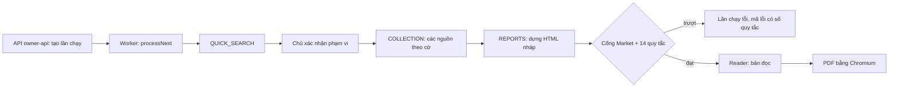

# report-pipeline Specification

## Purpose
Spec này mô tả mã hiện có sinh báo cáo Market và Insight: lần chạy bắt đầu ở đâu, nguồn được thu thế nào, cổng nào kiểm, và Reader ra PDF ra sao. Spec được dựng bằng cách đọc mã tại `main` `14d33f64` (24/10/2026). Quy tắc nghiệp vụ nằm ở `market-report`, `insight-report`, `report-language`. Spec này chỉ trỏ tới mã quy tắc, không chép lại.

Viết tắt: RA = `src/modules/analysis/research-automation`, RR = `src/modules/analysis/reader-report`.

Thư mục `src/worker/`, `src/web/routes/`, `src/platform/jobs/` chỉ có `.gitkeep`. Mã thật nằm ở `src/api/` và RA.

## Requirements

### Requirement: R-P01 Lần chạy bắt đầu qua owner-api
Hệ thống SHALL tạo và đổi lần chạy nghiên cứu chỉ qua lệnh POST dưới đường `owner-api`. Đường `api` chỉ đọc.

- Mã: `src/api/operator-app.ts` (`openOperatorApp`), `src/api/research-automation-api.ts` (`openResearchAutomationApi`). Đường: `/owner-api/workspaces/:ws/research-automation/runs[/:run/<hành động>]`.
- Hành động: tạo lần chạy, `confirm-scope`, `cancel`, `sources/*`, `report-revisions`, `reader-reports*`, `reports/(market|insight)[/pdf]`, `report-versions`, `report-attempts`, `auto-run/retry`.
- Vì sao: báo cáo là ranh giới sản phẩm; người có quyền mới được ghi (kiến trúc, AGENTS.md).

#### Scenario: Ghi qua đường chỉ đọc
- **WHEN** một yêu cầu POST tạo lần chạy đi vào đường `/api/...`
- **THEN** hệ thống không tạo lần chạy

#### Scenario: Lệnh ghi đánh thức worker
- **WHEN** một trong các lệnh sau thành công: tạo lần chạy, `confirm-scope`, `cancel`, `report-revisions` (kể cả hủy bản sửa), hoặc `auto-run/retry` không phải lần gửi lại y hệt
- **THEN** API gọi `worker.wake()` (`src/api/research-automation-api.ts`, khoảng dòng 1227–1243)

#### Scenario: Lệnh ghi khác không đánh thức worker
- **WHEN** một lệnh ghi khác dưới `owner-api` thành công, ví dụ dựng hay quyết định bản đọc Reader, `metric-rule-adoptions`, mã hóa Insight, hoặc `auto-run/retry` gửi lại y hệt (`exactRetry`)
- **THEN** API trả biên nhận mà không gọi `worker.wake()` trực tiếp

### Requirement: R-P02 Worker là máy trạng thái của lần chạy
Worker SHALL xử lý lần chạy qua ba bước `QUICK_SEARCH`, `COLLECTION`, `REPORTS`, theo thứ tự đó. Trạng thái cuối là một trong `DRAFT_READY`, `FAILED`, `CANCELLED`, `INTERRUPTED`.

- Mã: RA `worker.ts` (`ResearchAutomationWorker`), RA `service.ts` (`ResearchAutomationService.processNext`, `recoverOnStart`, `#executeSource`, `#executeReports`, `#persistSourceResult`), RA `model.ts` (`TERMINAL_STATUSES`).
- Bảng: `analysis_research_automation_runs`, `_requests`, `_steps`, `_captures`, `_usage`, `_outputs` (migration 0038).

#### Scenario: Khởi động lại giữa chừng
- **WHEN** ứng dụng khởi động lại khi một lần chạy đang ở giữa một bước
- **THEN** `recoverOnStart` xử lý lần chạy đó trước khi nhận việc mới

#### Scenario: Hủy lần chạy
- **WHEN** chủ gửi `cancel`
- **THEN** lần chạy về `CANCELLED`; dữ liệu đã thu và các dòng nhật ký chi phí được giữ lại, kể cả dữ liệu về muộn sau khi hủy (quyết định U-26 ngày 11/10/2026, chủ sửa ngày 24/10/2026: không xóa dữ liệu dở)

### Requirement: R-P03 Tự chạy Market chỉ khi bật cờ
Hệ thống SHALL chạy luồng tự động (thu, chuẩn bị, chọn link, xác nhận, chờ nháp, trình bày) chỉ khi `TDN_METRIC_OPENCLI_ENABLED=1`, cho lần chạy có `reports` chứa MARKET hoặc INSIGHT. Lần chạy chỉ Insight (có INSIGHT, không có MARKET) SHALL chạy các pha thu, chuẩn bị, chọn link, xác nhận, chờ nháp, rồi SHALL kết thúc ở `DONE` khi bản nháp sẵn sàng, không qua pha trình bày. Khi bước `QUICK_SEARCH` đã `FAILED`, luồng tự động SHALL dừng ở pha `CAPTURE` với đúng mã của bước đó, trước khi gọi nguồn trả phí và trước pha `PICK`; nó SHALL NOT báo `NO_PRINCIPAL_PRODUCTS` cho một lỗi nguồn.

- Mã: RA `service.ts` `#processAutorun`; các pha `WAITING_SCOPE, CAPTURE, PREPARE, PICK, CONFIRM, WAIT_DRAFT, PRESENT, DONE, STOPPED`. Chỗ chèn dòng auto-run khi tạo lần chạy; `#autorunWaitDraft` chọn `PRESENT` (có MARKET) hay `DONE` (chỉ Insight). Mã bước tìm sản phẩm được đọc trong `#autorunQuickSearchStopCode`, dùng ở pha thu, chuẩn bị và chọn link. Hàm phụ ở RA `autorun-derive.ts` (`pickShopeeLinks`, `buildCaptureSpec`, `buildRevisionValue`, `planCapturePeriod`, `AUTORUN_PICK_RULE_VERSION='autorun-pick-v3'`). Thu bằng RA `metric-capture-runner.ts` (`runMetricCapture`) qua `metric-opencli-executor.ts`.
- Bảng: `research_automation_autorun`, `research_automation_autorun_retries` (0055, 0056).
- Vì sao: chủ không bao giờ phải thu mẫu bằng tay (17/10/2026); 14/14 phải đến từ luồng tự động (15/10/2026). Chủ quyết định 25/10/2026: "nguồn nào mà vừa dùng cho cả insight, metric hoặc dùng riêng cho insight thì chạy trong lượt làm báo cáo insight (còn nguồn nào dùng riêng cho mỗi market thì không cần chạy)". Bước chọn link cho Insight link Shopee chính xác; tên Metric vào bản nháp từ khóa L9. Pha trình bày chỉ sửa báo cáo Market. Chủ báo lỗi 26/10/2026: lần chạy `b4c0540b` nhận HTTP 554 mà luồng tự động vẫn báo `NO_PRINCIPAL_PRODUCTS`.

#### Scenario: Cờ tắt
- **WHEN** `TDN_METRIC_OPENCLI_ENABLED` không bằng `1`
- **THEN** lần chạy không vào các pha tự chạy và chờ thao tác của chủ

#### Scenario: Pha trình bày
- **WHEN** lần chạy tự động có MARKET tới pha `PRESENT`
- **THEN** hệ thống gọi `requestReportRevision(buildRevisionValue(...))` để tạo bản trình bày của báo cáo Market

#### Scenario: Lần chạy chỉ Insight
- **WHEN** cờ bật, `reports` chỉ có INSIGHT, và bản nháp của lần chạy sẵn sàng (`DRAFT_READY`) sau khi luồng tự động đã xác nhận phạm vi
- **THEN** dòng auto-run chuyển từ `WAIT_DRAFT` sang `DONE`, không tạo bản sửa trình bày nào

#### Scenario: Câu hoàn tất trên giao diện
- **WHEN** thẻ auto-run hiện pha `DONE` của lần chạy chỉ Insight
- **THEN** thẻ chỉ nói bản nháp đã xong, không nói bìa hay biểu đồ; câu hoàn tất của lần chạy có MARKET giữ nguyên

#### Scenario: Lỗi thu trên lần chạy chỉ Insight
- **WHEN** lượt thu Metric của lần chạy chỉ Insight lỗi
- **THEN** dòng auto-run dừng `STOPPED` với mã dừng như lần chạy Market, chủ thử lại được theo cùng quy tắc, và lần chạy vẫn chờ chủ xác nhận phạm vi

#### Scenario: Bước tìm sản phẩm lỗi máy chủ nguồn
- **WHEN** bước `QUICK_SEARCH` dừng `FAILED` với mã `PROVIDER_UNAVAILABLE`
- **THEN** dòng auto-run dừng ở pha `CAPTURE` với mã `PROVIDER_UNAVAILABLE`, không gọi nguồn trả phí, không sang pha `PICK`, và không báo `NO_PRINCIPAL_PRODUCTS`

### Requirement: R-P04 Cờ bật tắt của các làn nguồn
Với làn nguồn có cờ bật tắt, bước `COLLECTION` SHALL chỉ gọi làn đó khi cờ bật. Cờ làn chỉ bật khi giá trị đúng bằng `1`; cờ `*_AI_ENABLED` và cờ PageIndex chỉ bật khi đúng bằng `true`. Các nguồn cơ sở trong `providers.ts` (dữ liệu bán hàng ước tính, tìm kiếm web, review trả phí) được cấu hình bằng thông tin truy cập và giới hạn tương ứng, không có cờ bật tắt riêng cho từng nguồn. Trên lần chạy chỉ Insight (có INSIGHT, không có MARKET), bước `COLLECTION` SHALL không gọi các làn chỉ Market đọc: xu hướng tìm kiếm, bản đồ tỉnh, World Bank, UN Comtrade (kể cả lượt gọi mô hình chọn mã HS), thống kê chính thức (kể cả lượt gọi mô hình), TikTok top ads, đọc video, thư viện quảng cáo Google, đọc tự động thư viện quảng cáo Meta. Làn bị bỏ không ghi dòng chi phí, không ghi tài liệu lỗi.

- Cờ đọc ở `src/api/operator-app.ts` (`operatorAppConfigurationFromEnvironment`).
- Cổng theo loại báo cáo: một dữ kiện `facts.market` (từ `reports.includes('MARKET')` ở RA `service.ts`), đọc ở RA `collection-lanes.ts` và `collection-lanes-save-step.ts`.
- Làn và mã:
  - Dữ liệu bán hàng ước tính: RA `provider-kalodata.ts`, `kalodata-replay.ts`, `kalodata-video-intake.ts`; RA `metric-source-intake.ts`, `metric-capture-intake.ts`.
  - Tìm kiếm web: RA `provider-serpapi.ts`, `providers.ts`, `source-binding.ts`, `expanded-search*.ts` (`TDN_RESEARCH_EXPANDED_SEARCH_ENABLED`).
  - Mức quan tâm tìm kiếm: RA `search-interest.ts`, `search-geo.ts` (`TDN_RESEARCH_SEARCH_TRENDS_ENABLED`, `_GEO_ENABLED`).
  - Review Shopee: `src/platform/collectors/{apify-shopee,shopee-public-reviews,shopee-private-intake}.ts`, RA `exact-shopee-bridge.ts`, `public-shopee-bridge.ts` (`TDN_RESEARCH_SHOPEE_PUBLIC_ENABLED`, trần 300 bình luận mỗi sản phẩm).
  - Bình luận TikTok: `src/platform/collectors/apify-tiktok-comments.ts`, RA `tiktok-comment-intake.ts`.
  - Vĩ mô, thương mại, thống kê chính thức: RA `world-bank-lane.ts`, `comtrade-lane.ts`, `official-statistics-lane.ts` (`TDN_RESEARCH_WORLD_BANK_ENABLED`, `_COMTRADE_ENABLED`, `_OFFICIAL_STATS_ENABLED`, `_OFFICIAL_STATS_PROVINCE_ENABLED`).
  - Quảng cáo: RA `google-ads-lane.ts`, `meta-auto-lane.ts`, `tiktok-top-ads-lane.ts` (`TDN_RESEARCH_GOOGLE_ADS_ENABLED`, `_META_AUTO_ENABLED`, `_TIKTOK_TOPADS_ENABLED`).
  - PDF: RA `pdf-discovery-lane.ts`, `pdf-excerpt.ts`, `src/modules/analysis/pageindex-*.ts` (`TDN_RESEARCH_PDF_DISCOVERY_ENABLED`, `TDN_PAGEINDEX_CLOUD_ENABLED`).
  - Video người bán: RA `video-watch-lane.ts`, `seller-video.ts` (`TDN_RESEARCH_VIDEO_WATCH_ENABLED`).
- Vì sao: một nguồn hỏng không được làm mất nguồn tốt; nguồn trả phí cần chủ cho phép (quy chuẩn dữ liệu đầu vào). Chủ quyết định 25/10/2026: nguồn chỉ Market dùng thì không chạy trong lượt làm báo cáo Insight.

#### Scenario: Cờ có giá trị lạ
- **WHEN** `TDN_RESEARCH_WORLD_BANK_ENABLED=yes`
- **THEN** làn World Bank không chạy

#### Scenario: Một làn lỗi
- **WHEN** một làn nguồn trả lỗi trong `COLLECTION`
- **THEN** kết quả của các làn khác vẫn được lưu qua `#persistSourceResult`

#### Scenario: Lần chạy chỉ Insight
- **WHEN** `reports` chỉ có INSIGHT và cờ của làn World Bank bật
- **THEN** làn World Bank không gọi nhà cung cấp, bước `COLLECTION` không có dòng chi phí hay tài liệu lỗi của làn đó, và báo cáo Insight không ghi làn đó là lỗi

### Requirement: R-P05 Bước AI chỉ chạy khi có tên mô hình rõ ràng
Hệ thống SHALL dừng lúc khởi động nếu một cờ `TDN_RESEARCH_*_AI_ENABLED=true` không có tên mô hình đi kèm. Bước AI độ liên quan chạy khi `TDN_RESEARCH_CAPTURE_RELEVANCE_AI_MODEL` có giá trị.

- Mã: `src/api/operator-app.ts`; RA `capture-relevance.ts` (`classifyCaptureRelevance`, lô 40, `CAPTURE_RELEVANCE_PROMPT_VERSION='capture-relevance-prompt-v1'`), gọi từ RA `metric-method-bridge.ts`. Mọi bước AI đi qua CLIProxy (`TDN_CLIPROXY_BASE_URL`, `TDN_CLIPROXY_API_KEY`).
- Cờ AI khác: `KEYWORD_DRAFT`, `I14`, `M11`, `M12`, `I15`, `INSIGHT_CODING`, `TIKTOK_CODING`, `SHOPEE_CODING`, `COVER` (mô hình bìa phải là `gpt-image-2`).
- Vì sao: tắt cờ AI độ liên quan thì quay về luật v2 (gói A, 19/10/2026).

#### Scenario: Thiếu tên mô hình
- **WHEN** `TDN_RESEARCH_M12_AI_ENABLED=true` và không có `TDN_RESEARCH_M12_AI_MODEL`
- **THEN** ứng dụng báo lỗi lúc khởi động và không chạy

#### Scenario: Độ liên quan tắt
- **WHEN** `TDN_RESEARCH_CAPTURE_RELEVANCE_AI_MODEL` không có giá trị
- **THEN** dòng dữ liệu thu được lọc bằng luật, không gọi AI

### Requirement: R-P06 Dựng báo cáo nháp
Bước `REPORTS` SHALL dựng HTML nháp cho mỗi loại báo cáo của lần chạy (`MARKET`, `INSIGHT`). Với báo cáo Market dạng trình bày (`marketPresentation`), bước này SHALL thử giữ thêm file dấu vết kỹ thuật riêng, là một artifact ẩn. Nếu dấu vết quá lớn hoặc lưu lỗi, báo cáo ghi `TRACE_HTML_TOO_LARGE` hoặc `TRACE_HTML_STORE_FAILED` thay cho artifact dấu vết. Các báo cáo khác không giữ file dấu vết riêng.

- Mã: RA `reports.ts` `buildResearchAutomationReport(input, 'MARKET'|'INSIGHT')` trả `{semantic, html, traceHtml}`; gọi từ RA `service.ts` `#executeReports`. Biểu đồ: RA `market-presentation-report.ts`, RR `market-charts.ts`, RR `macro-charts.ts`, RR `flint.ts`. Bìa: RA `market-cover.ts` (`buildMarketCover`), RA `cover-image-codec.ts`.
- Quy tắc liên quan: R-M03 (dấu vết kỹ thuật ở file riêng), R-M10, R-M11.

#### Scenario: Dấu vết kỹ thuật tách khỏi thân
- **WHEN** báo cáo Market dạng trình bày được dựng và `traceHtml` được lưu thành công
- **THEN** tên công cụ và chi tiết kỹ thuật nằm trong `traceHtml`, được giữ thành artifact ẩn riêng, và không nằm trong `html` (RA `service.ts` `#executeReports`: `traceHtml` chỉ giữ khi `kind === 'MARKET' && input.marketPresentation`)

#### Scenario: Báo cáo khác không có file dấu vết riêng
- **WHEN** báo cáo Insight hoặc báo cáo Market không ở dạng trình bày được dựng
- **THEN** bước `REPORTS` không giữ file dấu vết kỹ thuật riêng

### Requirement: R-P07 Cổng máy chặn báo cáo Market trượt
Hệ thống SHALL chạy cổng Market trên HTML nháp loại `MARKET` và trên bản đọc Market trước khi công bố, và SHALL làm lần dựng lỗi khi có quy tắc trượt: bản nháp với mã `MARKET_BUSINESS_GATE_FAILED:<các mã cổng>`; bản đọc với lỗi `ResearchAutomationValidationError` ghi lý do bằng tiếng Việt, không ghi mã (mã nằm trong `cause` của lỗi).

- Mã: một chỗ kiểm RA `market-report-check.ts` (`checkMarketReport`, `assertMarketReport`) chọn kiểm nào chạy và theo thứ tự nào. Bản nháp trình bày (RA `reports.ts`, ngữ cảnh `DRAFT_PRESENTATION`): kiểm chữ nhìn thấy, cổng Market, 14 quy tắc, rồi tên F1/W6 khi có review công khai. Bản nháp khác (`DRAFT_PLAIN`): chỉ tên F1/W6 khi có review công khai. Lần lưu (RA `service.ts` `#executeReports`, `STORED`, chỉ khi `kind === 'MARKET'`): cổng Market. Bản đọc (RA `reader-report-revisions.ts`, `READER` với `contractVersion`), theo bảng phiên bản:
  - `reader-report-build-v1`, `reader-report-build-v1.1`: cổng Market (không trình bày, có U13); không 14 quy tắc; lint Reader cũ (RR `build.ts` `publishReaderReport`, không U13).
  - `reader-report-build-v1.2`: cổng Market (không trình bày, có U13), rồi 14 quy tắc; U13 kiểm hai cách đọc thẻ nội dòng cũ trong một lần gọi. Cổng dùng kết quả nối từ; lint Reader dùng lại kết quả đọc HTML thô (`visibleTextResults`), giữ nguyên kết luận và nơi báo lỗi. U13 không chạy lại trong lint Reader.
  Lý do bằng lời: RA `market-check-reasons.ts` (`marketCheckReasons`, `readerLintReasons`), mỗi mã một câu. Cổng: RA `market-business-gate.ts` (`auditMarketReportHtml`, `assertMarketBusinessGate`). Lint chữ nhìn thấy: `src/modules/analysis/report-visible-text-lint.ts` (`lintVisibleReportText`), đọc chữ ẩn và trích dẫn qua `src/modules/analysis/report-visible-text.ts`. Danh sách tên cấm: `report-language` (R-L01).
- Mã kiểm: `src/modules/analysis/research-automation/market-report-check.ts` (`checkMarketReport`, `assertMarketReport`)
- Mã cổng và quy tắc: xem R-M15 đến R-M26.
- Kiểm thử: `tests/unit/gate-209-market-business.test.ts`, `tests/integration/gate-209-market-business.test.ts`, `tests/integration/gate-209-reader-revision.test.ts`, `tests/unit/c2-market-check-characterization.test.ts`.
- Vì sao: đánh giá kiến trúc c2, chủ duyệt 24/10/2026: một chỗ kiểm cho bản nháp và bản đọc; bản cũ giữ bộ kiểm cũ; chủ thấy lý do bằng lời (Q2).

#### Scenario: Báo cáo có tổng hai sàn
- **WHEN** HTML Market có cụm "tổng hai sàn"
- **THEN** lần dựng lỗi với mã chứa `U32_NO_CROSS_PLATFORM_TOTAL`

#### Scenario: Báo cáo Insight
- **WHEN** HTML nháp thuộc loại `INSIGHT`
- **THEN** chỗ kiểm Market không chạy; lint chữ nhìn thấy chỉ chạy khi có `insightPersona`, hoặc `draftInsight` với snapshot mã hóa v3, v4 hay v5 (RA `reports.ts`)

#### Scenario: Bản đọc trượt cổng
- **WHEN** bản đọc Market có tên nhà cung cấp
- **THEN** lỗi ghi "Trang có tên nhà cung cấp số liệu hoặc công cụ.", không ghi `G08_PROVIDER_NAME`; không có phiên bản mới nào được lưu

### Requirement: R-P08 Kiểm 14 quy tắc trên báo cáo Market
Hệ thống SHALL chạy `auditMarket14` trên báo cáo Market dạng trình bày (`marketPresentation`) và bản đọc Market phiên bản `reader-report-build-v1.2`, và SHALL làm lần dựng lỗi khi một quy tắc loại "Máy" trượt: bản nháp với mã `MARKET_14_RULES_FAILED:<số quy tắc>`, bản đọc với lý do bằng lời. Quy tắc loại "Bằng chứng" (6, 8, 14) luôn ghi "đạt" kèm chi tiết cho người đọc soát. Quy tắc 10 (ảnh bìa) là loại "Máy" khi bìa là ảnh ngoài, sai dạng, hoặc ảnh JPEG do AI tạo hợp lệ. Khi không có bìa AI hợp lệ và không có lỗi ảnh ngoài hay sai dạng, kể cả khi có bìa nhúng không phải do AI tạo, quy tắc 10 thành loại "Bằng chứng", ghi "chưa đạt" kèm chữ "READ" cho người đọc soát, và không làm lần dựng lỗi.

- Mã: RA `market-14-rules.ts` (`auditMarket14`, `assertMarket14MachineRules`). Số `result('1')` đến `result('14')` ứng với R-M01 đến R-M14. Bản nháp trình bày và bản đọc v1.2 gọi `auditMarket14` qua RA `market-report-check.ts` (`checkMarketReport`), truyền kết quả cổng Market đã tính để quy tắc 4 và 7 đọc lại; không có kết quả đó thì `auditMarket14` tự chạy cổng như cũ.
- Mã kiểm: `src/modules/analysis/research-automation/market-14-rules.ts` (`auditMarket14`, `assertMarket14MachineRules`); `src/modules/analysis/research-automation/market-report-check.ts` (`checkMarketReport`)
- Lệnh tay: `tsx scripts/audit-market-14.ts <report.html> [trace.md]` (không có trong npm scripts).
- Kiểm thử: `tests/unit/rules14-209-market-14.test.ts`, `market14-reader-only.test.ts`, `market14-pdf-citation.test.ts`.
- Vì sao: đánh giá kiến trúc c2, chủ duyệt 24/10/2026: cổng chạy một lần trong mỗi luồng; bản đọc v1 và v1.1 giữ bộ kiểm cũ.

#### Scenario: Ảnh bìa ngoài hoặc sai dạng
- **WHEN** bản đọc Market được kiểm 14 quy tắc có ảnh bìa trỏ ra ngoài, ảnh nhúng sai dạng, hoặc ảnh tự nhận do AI tạo không phải JPEG base64 có giới hạn và có chữ alt
- **THEN** lần dựng lỗi; bản nháp với `MARKET_14_RULES_FAILED:10`, bản đọc với lý do "Ảnh bìa không phải ảnh lưu sẵn hợp lệ."

#### Scenario: Thiếu ảnh bìa
- **WHEN** bản đọc Market không có ảnh bìa nhúng nào
- **THEN** quy tắc 10 có `kind: 'evidence'`, `ok: false`, chi tiết bắt đầu bằng "READ", và không làm lần dựng lỗi (RA `market-14-rules.ts`, `result('10', ...)`)

#### Scenario: Quy tắc bằng chứng
- **WHEN** `auditMarket14` chạy quy tắc 6
- **THEN** kết quả có `kind: 'evidence'` và không làm lần dựng lỗi

#### Scenario: Cổng chạy một lần trong bản nháp trình bày
- **WHEN** bản nháp Market trình bày được kiểm qua `checkMarketReport`
- **THEN** cổng Market chạy một lần và 14 quy tắc dùng kết quả đó; mã lỗi và thứ tự giống như trước

#### Scenario: Bản đọc cũ không chạy 14 quy tắc
- **WHEN** bản đọc phiên bản `reader-report-build-v1` hoặc `reader-report-build-v1.1` có nhãn kỹ thuật M01 trên trang
- **THEN** bản đọc vẫn được công bố; chỉ bản `reader-report-build-v1.2` trượt quy tắc 2

### Requirement: R-P09 Bản sửa và lần thử được lưu riêng
Hệ thống SHALL lưu mỗi lần sinh lại báo cáo (revision) thành một lần thử riêng, có HTML và PDF (hoặc mã lý do không có PDF), không ghi đè bản nháp đầu.

- Mã: RA `service.ts` (`requestReportRevision`, `cancelReportRevision`, `listReportAttempts`, `getReportRevision`); `src/modules/analysis/versioned-report-packet.ts`, `report-version-service.ts`.
- Bảng: `analysis_research_automation_attempts`, `_attempt_requests`, `_attempt_outputs` (0041; `pdf_sha256` hoặc `pdf_unavailable_code`).
- Ghi chú vận hành: khi chấm báo cáo tự động, chấm lần thử trong `attempt_outputs`, không chấm bản nháp v1 trong `runs/outputs`.

#### Scenario: Sinh lại báo cáo
- **WHEN** chủ yêu cầu một bản sửa cho báo cáo Market
- **THEN** một dòng mới xuất hiện trong `analysis_research_automation_attempt_outputs` và bản nháp cũ giữ nguyên

### Requirement: R-P10 Reader dựng bản đọc qua cổng
Reader SHALL dựng bản đọc Market chỉ khi bản đó qua kiểm biểu đồ Flint, cổng Market và lint của Reader, theo thứ tự đó. Khi `built.visibleTextRules` bật, Reader SHALL kiểm thêm 14 quy tắc máy sau cổng Market và trước lint của Reader. Biểu đồ số nền được phép dùng SVG dự phòng; `flint: false` là tùy chọn bỏ yêu cầu Flint trong kiểm thử.

- Mã: RA `reader-report-revisions.ts` (`AutomationReaderReports.build`, `buildInsight`, `buildTikTok`, `buildShopee`, `decide`). Insight, TikTok, Shopee: `publishInsightFamilyRevision` ở RA `reader-publish.ts` giữ thử lại theo mã yêu cầu, chặn khi bản mới nhất đã duyệt, giới hạn cỡ, gọi `publishReaderReport` và giao dịch lưu bản sửa. Market: `buildMarketReport` ở RR `market-template.ts`; khi có nguồn review công khai thì gọi `buildMarketReportV2` ở RR `market-template-v2.ts`. Sau đó `assertFlintCharts`; rồi `publishMarketRevision` ở RA `reader-publish.ts` gọi `assertMarketBusinessGate`, `assertMarket14MachineRules` khi `built.visibleTextRules` bật (qua `checkMarketReport`), rồi `publishReaderReport` ở RR `build.ts` (lỗi `ReaderReportGateError`, chạy RR `lint.ts`) và giao dịch lưu bản sửa.
- Phiên bản: `reader-report-market-v3` / `v4` / `v5`; Insight `reader-report-insight-v9`, TikTok `reader-report-insight-tiktok-v1`, Shopee `reader-report-insight-shopee-v1`.
- Bảng: `analysis_reader_report_revisions`, `analysis_reader_report_decisions` (0048, 0050).
- Quy tắc liên quan: R-L16.

#### Scenario: Biểu đồ không phải Flint
- **WHEN** bản đọc Market có biểu đồ mẫu SVG viết tay thay vì Flint và không bật tùy chọn kiểm thử `flint: false`
- **THEN** Reader không xuất bản bản đọc

### Requirement: R-P11 PDF in từ bản đọc đã lưu
Hệ thống SHALL in PDF từ HTML đã lưu bằng Chromium không giao diện, và SHALL chỉ trả bản web khi `TDN_RESEARCH_PDF_CHROMIUM` không có giá trị.

- Mã: RA `pdf.ts` (`createChromiumPdfRenderer`); CSS in `MARKET_READER_PRINT_CSS` ở RA `reports.ts`; đường GET `.../reader-reports/:id/pdf`, `.../reports/(market|insight)/pdf` ở `src/api/research-automation-api.ts`.
- Quy tắc liên quan: R-L16.

#### Scenario: Không có Chromium
- **WHEN** `TDN_RESEARCH_PDF_CHROMIUM` không có giá trị
- **THEN** lần thử ghi `pdf_unavailable_code` thay vì `pdf_sha256`

### Requirement: R-P12 Insight mã hóa bình luận trước khi báo cáo
Luồng Insight SHALL mã hóa bình luận (bằng luật và, khi bật cờ, bằng AI) và SHALL giữ vị trí nguồn của mỗi mã trước khi đếm và đưa vào báo cáo.

- Mã: luật `RA/literal-review-coding.ts` (`codeLiteralReviews`, `codeLiteralLocatedRecords`), RA `insight-literal-bridge.ts`; AI RA `insight-coding.ts`, `insight-model-execution.ts`, `shopee-coding.ts`, `tiktok-coding.ts`; đếm `src/modules/analysis/{insight-corpus-counts,insight-literal-evidence,i17-evidence-trace}.ts`. Chân dung: RA `insight-persona-*.ts`. Đối chiếu: RA `insight-crosscheck*.ts`.
- Mục I01 đến I17: RR `insight-projection.ts` (`INSIGHT_TITLES`, `INSIGHT_SECTION_IDS`). Bản đọc: RR `insight-build-v1.ts`, RR `insight-template.ts`.
- Bảng: `analysis_insight_coding_evidence`, `analysis_shopee_coding_executions`, `analysis_tiktok_coding_executions`.
- Quy tắc liên quan: R-I05, R-I11, R-L11.
- Trạng thái: Insight tạm dừng từ 19/10/2026, chờ Market ổn định. Chưa có cổng máy riêng cho Insight.

#### Scenario: Bình luận gốc
- **WHEN** bản đọc Insight được dựng
- **THEN** báo cáo hiện nhãn đã mã hóa và số đếm, còn vị trí nguồn nằm ở I17

### Requirement: R-P13 Thử nghiệm không tốn phí nguồn
Môi trường thử SHALL dùng lại dữ liệu đã thu khi có `TDN_RESEARCH_KALODATA_REPLAY_SOURCE_RUN_ID`. Chế độ review thử SHALL dùng `TDN_RESEARCH_AUTORUN_TEST_REVIEWS=1` cùng trần review đã cấu hình tối đa 20 mỗi sản phẩm; cờ không tự giảm trần. Với nguồn review công khai, trần trên 20 làm cấu hình lỗi; với nguồn trả phí, chỉ khi đã có token, trần phí và trần review không quá 20 thì cấu hình mới có `autorunTestReviewCap` (`providers.ts`).

- Mã: RA `kalodata-replay.ts`, `scripts/replay-test-instance.sh`.
- Vì sao: thử không tốn điểm nguồn trả phí (replay mode, 18/10/2026).

#### Scenario: Chạy thử bằng dữ liệu cũ
- **WHEN** biến replay trỏ tới một lần chạy cũ
- **THEN** làn dữ liệu bán hàng ước tính đọc dữ liệu đã lưu của lần chạy đó và không gọi nhà cung cấp

### Requirement: R-P14 Kiểm thử và cổng CI
Mỗi thay đổi mã SHALL qua `npm run check` trên CI Linux trước khi gộp. Trên máy, chỉ chạy kiểm thử của vùng bị đổi.

- Lệnh: `npm test` (`tests/unit/*.test.ts`, `tests/integration/*.test.ts`), `npm run typecheck`, `npm run check` (contracts + typecheck + frontend + test).
- Fixture: `tests/fixtures/`, `tests/golden/`, `tests/helpers/` (`autorun-harness.ts`, `market14-full-fixture.ts`, `insight-reader-fixture.ts`).
- Vì sao: CI là cổng cuối; kiểm thử theo dòng hợp đồng, có ca đối chứng âm (quy tắc làm việc 19/10/2026).

#### Scenario: Đổi cổng Market
- **WHEN** một thay đổi sửa `market-business-gate.ts`
- **THEN** người làm chạy `tests/unit/gate-209-market-business.test.ts` trên máy và CI chạy cả bộ

### Requirement: R-P15 PageIndex chỉ hỏi phần Market
Hệ thống SHALL lập và ước tính câu hỏi PageIndex chỉ cho phần M, và chỉ khi `reports` có MARKET. Câu hỏi phần M SHALL giữ y id, thứ tự, chữ và khóa cache như trước. Kế hoạch rỗng SHALL không gọi PageIndex và không làm bước lỗi.

Trên lần chạy có cả MARKET và INSIGHT, hệ thống SHALL giữ vị trí của câu phần M trong trần câu hỏi và cách ước tính số PDF còn được thu. Các chỗ phần I từng chiếm SHALL không được chuyển cho câu phần M khác; không có câu phần I nào được hỏi.

- Mã: RA `service.ts` (`#pageIndexPlanSections` giữ các chỗ trong trần; `#remainingCapturePdfSlots` ước tính số PDF còn được thu; `#processRunPdfs` chỉ hỏi câu phần M); `src/modules/analysis/pageindex-questions.ts` (`PAGEINDEX_ELIGIBLE_SECTIONS` giữ nguyên để câu hỏi phần I đã lưu vẫn hợp lệ); RA `pdf-excerpt.ts` (`NOT_MARKET_SECTION`).
- Vì sao: RA `pdf-excerpt.ts` bỏ mọi trích dẫn không thuộc phần M, nên câu hỏi phần I tốn tiền mà không đổi báo cáo. Chủ quyết định 25/10/2026: nguồn chỉ Market dùng thì không chạy trong lượt làm báo cáo Insight.

#### Scenario: Lần chạy chỉ Insight có PDF
- **WHEN** lần chạy chỉ Insight có PDF của chủ
- **THEN** kế hoạch câu hỏi rỗng, không có lượt gọi PageIndex, bước không lỗi

#### Scenario: Lần chạy có Market
- **WHEN** lần chạy có MARKET và INSIGHT có PDF
- **THEN** chỉ câu hỏi phần M được hỏi, với id và thứ tự như trước

### Requirement: R-P16 Lỗi máy chủ nguồn có mã riêng và giữ đầu mối HTTP
Khi bước thất bại vì lượt gọi dữ liệu của một cửa sổ truy vấn nhận HTTP từ 500 trở lên, hệ thống SHALL ghi mã bước `PROVIDER_UNAVAILABLE` và câu báo có mã HTTP thật, trừ khi lỗi đã được nhận là lỗi xác thực, hạn mức hay hết điểm. Lỗi của truy vấn số dư dùng để đo chi phí SHALL NOT thay kết quả tìm dữ liệu thành lỗi máy chủ nguồn hoặc thay mã lỗi 4xx của lượt gọi dữ liệu. Câu báo SHALL nói bước đã dừng, khả năng chỉ xảy ra một lần, và cách tạo lượt mới; câu này SHALL NOT nêu tên nhà cung cấp. Thay đổi này SHALL NOT thêm lần thử lại tự động hoặc đường thử lại trả phí; lỗi tìm nhanh SHALL có `canRetry=false`.

Bản ghi nguồn SHALL giữ một danh sách header phản hồi cho phép để phân biệt nguồn với CDN hay máy chắn giữa: `server`, `date`, `via`, `cf-ray`, `x-request-id`, `x-amzn-requestid`, `x-cache`, `content-type`, `content-length`, `retry-after`. Tên header SHALL viết thường. Giá trị đầy đủ SHALL được kiểm tra khóa bí mật trước khi cắt ngắn; giá trị chứa khóa SHALL bị bỏ. Giá trị được giữ SHALL bỏ ký tự điều khiển và dài tối đa 200 ký tự. Trường này SHALL là tùy chọn để bản ghi cũ vẫn đọc được; không lưu header ngoài danh sách, cookie hay thông tin cá nhân. Giá trị header SHALL NOT đi vào HTML/PDF cho người đọc, API cho người không có quyền chủ sở hữu, hoặc nhật ký.

- Mã: RA `provider-common.ts` (`safeResponseHeaders`, `safeCaptureHeaders`, `boundedRequest`, `CaptureLog.record`); các adapter `provider-kalodata.ts`, `provider-serpapi.ts`, `search-trends.ts`, `google-ads-lane.ts`, `video-watch-gemini.ts`, `comtrade-lane.ts`, `official-statistics-lane.ts`, `pdf-discovery-lane.ts`, `world-bank-lane.ts`; RA `providers.ts` (`ProviderRawCapture.responseHeaders`); RA `source-binding.ts` (`providerUnavailableLimitation`); RA `model.ts` (`PROVIDER_UNAVAILABLE`, `providerUnavailableMessage`); RA `service.ts` (mã bước, `stepMessage`, `#autorunQuickSearchStopCode`); giao diện `frontend/src/research-automation/run-status.ts`, `autorun-text.ts`, `RunView.tsx`.
- Kiểm thử: `tests/unit/research-automation-providers.test.ts`, `tests/integration/research-automation-credit-message.test.ts`, `tests/integration/research-automation-kalodata-replay.test.ts`, `frontend/tests/research-automation.test.ts`, `frontend/tests/research-autorun-card.test.ts`.
- Vì sao: chủ báo lỗi 26/10/2026; lần chạy `b4c0540b` nhận HTTP 554 thân rỗng mà không có đầu mối nào ngoài mã lỗi chung, và vẫn bị trừ 0,1 điểm.

#### Scenario: HTTP 554 thân rỗng
- **WHEN** lần gọi nguồn trả HTTP 554 và thân rỗng
- **THEN** bước ghi mã `PROVIDER_UNAVAILABLE`, câu bước có «HTTP 554», và bản ghi nguồn giữ các header cho phép của phản hồi

#### Scenario: Lỗi xác thực hoặc hết điểm
- **WHEN** lần gọi nguồn trả HTTP 401, 403, 429, hoặc nguồn báo hết điểm
- **THEN** mã bước giữ nguyên cách xử lý cũ, không đổi thành `PROVIDER_UNAVAILABLE`

#### Scenario: Header chứa khóa
- **WHEN** một header cho phép có giá trị chứa khóa bí mật
- **THEN** giá trị đó không được lưu trong bản ghi nguồn, kể cả khi khóa nằm qua hoặc sau giới hạn 200 ký tự

#### Scenario: Truy vấn số dư lỗi sau khi tìm dữ liệu
- **WHEN** lượt tìm dữ liệu thành công hoặc trả 401, 403, 429 hay lỗi 4xx khác, còn truy vấn số dư sau đó trả HTTP 503
- **THEN** kết quả tìm dữ liệu hoặc mã lỗi cũ được giữ nguyên, không thêm `PROVIDER_UNAVAILABLE`

#### Scenario: Bản ghi cũ
- **WHEN** đọc bản ghi nguồn không có `responseHeaders`
- **THEN** bản ghi vẫn đọc được và không lỗi

## Điểm chưa xác minh

- Giá trị đầy đủ của trạng thái lần chạy (chỉ đọc `TERMINAL_STATUSES` trong RA `model.ts`).
- Cách `reports.ts` chọn phiên bản bộ dựng `automation-report-kit-vNN`.
- Migration 0001–0004, 0008–0029, thư mục `contracts/` và `gates/` chưa đọc cho spec này.
- Tác dụng của `TDN_PYTHON` và `TDN_R2_*` mới suy từ tên.
