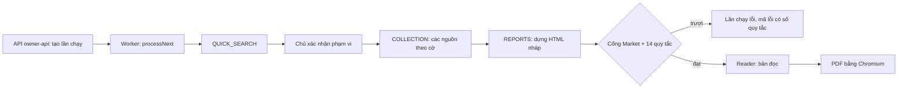

# report-pipeline Specification

## Purpose
Spec này mô tả mã hiện có sinh báo cáo Market và Insight: lần chạy bắt đầu ở đâu, nguồn được thu thế nào, cổng nào kiểm, và Reader ra PDF ra sao. Spec được dựng bằng cách đọc mã tại `main` `14d33f64` (24/10/2026). Quy tắc nghiệp vụ nằm ở `market-report`, `insight-report`, `report-language`. Spec này chỉ trỏ tới mã quy tắc, không chép lại.

Viết tắt: RA = `src/modules/analysis/research-automation`, RR = `src/modules/analysis/reader-report`.

Thư mục `src/worker/`, `src/web/routes/`, `src/platform/jobs/` chỉ có `.gitkeep`. Mã thật nằm ở `src/api/` và RA.

## Requirements

### Requirement: R-P01 Lần chạy bắt đầu qua owner-api
Hệ thống SHALL tạo và đổi lần chạy nghiên cứu chỉ qua lệnh POST dưới đường `owner-api`. Đường `api` chỉ đọc.

- Mã: `src/api/operator-app.ts` (`openOperatorApp`), `src/api/research-automation-api.ts` (`openResearchAutomationApi`). Đường: `/owner-api/workspaces/:ws/research-automation/runs[/:run/<hành động>]`.
- Hành động: tạo lần chạy, `confirm-scope`, `cancel`, `sources/*`, `report-revisions`, `reader-reports*`, `reports/(market|insight)[/pdf]`, `report-versions`, `report-attempts`, `auto-run/retry`.
- Vì sao: báo cáo là ranh giới sản phẩm; người có quyền mới được ghi (kiến trúc, AGENTS.md).

#### Scenario: Ghi qua đường chỉ đọc
- **WHEN** một yêu cầu POST tạo lần chạy đi vào đường `/api/...`
- **THEN** hệ thống không tạo lần chạy

#### Scenario: Mỗi lệnh ghi đánh thức worker
- **WHEN** một lệnh ghi dưới `owner-api` thành công
- **THEN** API gọi `worker.wake()`

### Requirement: R-P02 Worker là máy trạng thái của lần chạy
Worker SHALL xử lý lần chạy qua ba bước `QUICK_SEARCH`, `COLLECTION`, `REPORTS`, theo thứ tự đó. Trạng thái cuối là một trong `DRAFT_READY`, `FAILED`, `CANCELLED`, `INTERRUPTED`.

- Mã: RA `worker.ts` (`ResearchAutomationWorker`), RA `service.ts` (`ResearchAutomationService.processNext`, `recoverOnStart`, `#executeSource`, `#executeReports`, `#persistSourceResult`), RA `model.ts` (`TERMINAL_STATUSES`).
- Bảng: `analysis_research_automation_runs`, `_requests`, `_steps`, `_captures`, `_usage`, `_outputs` (migration 0038).

#### Scenario: Khởi động lại giữa chừng
- **WHEN** ứng dụng khởi động lại khi một lần chạy đang ở giữa một bước
- **THEN** `recoverOnStart` xử lý lần chạy đó trước khi nhận việc mới

#### Scenario: Hủy lần chạy
- **WHEN** chủ gửi `cancel`
- **THEN** lần chạy về `CANCELLED`, dữ liệu dở bị xóa và một dòng nhật ký chi phí được giữ (quyết định U-26, 11/10/2026)

### Requirement: R-P03 Tự chạy Market chỉ khi bật cờ
Hệ thống SHALL chạy luồng tự động Market (thu, chuẩn bị, chọn link, xác nhận, chờ nháp, trình bày) chỉ khi `TDN_METRIC_OPENCLI_ENABLED=1`.

- Mã: RA `service.ts` `#processAutorun`; các pha `WAITING_SCOPE, CAPTURE, PREPARE, PICK, CONFIRM, WAIT_DRAFT, PRESENT, DONE, STOPPED`. Hàm phụ ở RA `autorun-derive.ts` (`pickShopeeLinks`, `buildCaptureSpec`, `buildRevisionValue`, `planCapturePeriod`, `AUTORUN_PICK_RULE_VERSION='autorun-pick-v3'`). Thu bằng RA `metric-capture-runner.ts` (`runMetricCapture`) qua `metric-opencli-executor.ts`.
- Bảng: `research_automation_autorun`, `research_automation_autorun_retries` (0055, 0056).
- Vì sao: chủ không bao giờ phải thu mẫu bằng tay (17/10/2026); 14/14 phải đến từ luồng tự động (15/10/2026).

#### Scenario: Cờ tắt
- **WHEN** `TDN_METRIC_OPENCLI_ENABLED` không bằng `1`
- **THEN** lần chạy không vào các pha tự chạy và chờ thao tác của chủ

#### Scenario: Pha trình bày
- **WHEN** lần chạy tự động tới pha `PRESENT`
- **THEN** hệ thống gọi `requestReportRevision(buildRevisionValue(...))` để tạo bản trình bày của báo cáo Market

### Requirement: R-P04 Mỗi nguồn là một làn có cờ riêng
Bước `COLLECTION` SHALL chỉ gọi một làn nguồn khi cờ của làn đó bật. Cờ làn chỉ bật khi giá trị đúng bằng `1`; cờ `*_AI_ENABLED` và cờ PageIndex chỉ bật khi đúng bằng `true`.

- Cờ đọc ở `src/api/operator-app.ts` (`operatorAppConfigurationFromEnvironment`).
- Làn và mã:
  - Dữ liệu bán hàng ước tính: RA `provider-kalodata.ts`, `kalodata-replay.ts`, `kalodata-video-intake.ts`; RA `metric-source-intake.ts`, `metric-capture-intake.ts`.
  - Tìm kiếm web: RA `provider-serpapi.ts`, `providers.ts`, `source-binding.ts`, `expanded-search*.ts` (`TDN_RESEARCH_EXPANDED_SEARCH_ENABLED`).
  - Mức quan tâm tìm kiếm: RA `search-interest.ts`, `search-geo.ts` (`TDN_RESEARCH_SEARCH_TRENDS_ENABLED`, `_GEO_ENABLED`).
  - Review Shopee: `src/platform/collectors/{apify-shopee,shopee-public-reviews,shopee-private-intake}.ts`, RA `exact-shopee-bridge.ts`, `public-shopee-bridge.ts` (`TDN_RESEARCH_SHOPEE_PUBLIC_ENABLED`, trần 300 bình luận mỗi sản phẩm).
  - Bình luận TikTok: `src/platform/collectors/apify-tiktok-comments.ts`, RA `tiktok-comment-intake.ts`.
  - Vĩ mô, thương mại, thống kê chính thức: RA `world-bank-lane.ts`, `comtrade-lane.ts`, `official-statistics-lane.ts` (`TDN_RESEARCH_WORLD_BANK_ENABLED`, `_COMTRADE_ENABLED`, `_OFFICIAL_STATS_ENABLED`, `_OFFICIAL_STATS_PROVINCE_ENABLED`).
  - Quảng cáo: RA `google-ads-lane.ts`, `meta-auto-lane.ts`, `tiktok-top-ads-lane.ts` (`TDN_RESEARCH_GOOGLE_ADS_ENABLED`, `_META_AUTO_ENABLED`, `_TIKTOK_TOPADS_ENABLED`).
  - PDF: RA `pdf-discovery-lane.ts`, `pdf-excerpt.ts`, `src/modules/analysis/pageindex-*.ts` (`TDN_RESEARCH_PDF_DISCOVERY_ENABLED`, `TDN_PAGEINDEX_CLOUD_ENABLED`).
  - Video người bán: RA `video-watch-lane.ts`, `seller-video.ts` (`TDN_RESEARCH_VIDEO_WATCH_ENABLED`).
- Vì sao: một nguồn hỏng không được làm mất nguồn tốt; nguồn trả phí cần chủ cho phép (quy chuẩn dữ liệu đầu vào).

#### Scenario: Cờ có giá trị lạ
- **WHEN** `TDN_RESEARCH_WORLD_BANK_ENABLED=yes`
- **THEN** làn World Bank không chạy

#### Scenario: Một làn lỗi
- **WHEN** một làn nguồn trả lỗi trong `COLLECTION`
- **THEN** kết quả của các làn khác vẫn được lưu qua `#persistSourceResult`

### Requirement: R-P05 Bước AI chỉ chạy khi có tên mô hình rõ ràng
Hệ thống SHALL dừng lúc khởi động nếu một cờ `TDN_RESEARCH_*_AI_ENABLED=true` không có tên mô hình đi kèm. Bước AI độ liên quan chạy khi `TDN_RESEARCH_CAPTURE_RELEVANCE_AI_MODEL` có giá trị.

- Mã: `src/api/operator-app.ts`; RA `capture-relevance.ts` (`classifyCaptureRelevance`, lô 40, `CAPTURE_RELEVANCE_PROMPT_VERSION='capture-relevance-prompt-v1'`), gọi từ RA `metric-method-bridge.ts`. Mọi bước AI đi qua CLIProxy (`TDN_CLIPROXY_BASE_URL`, `TDN_CLIPROXY_API_KEY`).
- Cờ AI khác: `KEYWORD_DRAFT`, `I14`, `M11`, `M12`, `I15`, `INSIGHT_CODING`, `TIKTOK_CODING`, `SHOPEE_CODING`, `COVER` (mô hình bìa phải là `gpt-image-2`).
- Vì sao: tắt cờ AI độ liên quan thì quay về luật v2 (gói A, 19/10/2026).

#### Scenario: Thiếu tên mô hình
- **WHEN** `TDN_RESEARCH_M12_AI_ENABLED=true` và không có `TDN_RESEARCH_M12_AI_MODEL`
- **THEN** ứng dụng báo lỗi lúc khởi động và không chạy

#### Scenario: Độ liên quan tắt
- **WHEN** `TDN_RESEARCH_CAPTURE_RELEVANCE_AI_MODEL` không có giá trị
- **THEN** dòng dữ liệu thu được lọc bằng luật, không gọi AI

### Requirement: R-P06 Dựng báo cáo nháp
Bước `REPORTS` SHALL dựng HTML nháp và file dấu vết kỹ thuật riêng cho mỗi loại báo cáo của lần chạy (`MARKET`, `INSIGHT`).

- Mã: RA `reports.ts` `buildResearchAutomationReport(input, 'MARKET'|'INSIGHT')` trả `{semantic, html, traceHtml}`; gọi từ RA `service.ts` `#executeReports`. Biểu đồ: RA `market-presentation-report.ts`, RR `market-charts.ts`, RR `macro-charts.ts`, RR `flint.ts`. Bìa: RA `market-cover.ts` (`buildMarketCover`), RA `cover-image-codec.ts`.
- Quy tắc liên quan: R-M03 (dấu vết kỹ thuật ở file riêng), R-M10, R-M11.

#### Scenario: Dấu vết kỹ thuật tách khỏi thân
- **WHEN** báo cáo nháp được dựng
- **THEN** tên công cụ và chi tiết kỹ thuật nằm trong `traceHtml`, không nằm trong `html`

### Requirement: R-P07 Cổng máy chặn báo cáo Market trượt
Hệ thống SHALL chạy `assertMarketBusinessGate` trên HTML nháp loại `MARKET`, và SHALL làm lần dựng lỗi với mã `MARKET_BUSINESS_GATE_FAILED:<các mã cổng>` khi có quy tắc trượt.

- Mã: RA `market-business-gate.ts` (`auditMarketReportHtml`, `assertMarketBusinessGate`); gọi ở RA `service.ts` `#executeReports` (chỉ khi `kind === 'MARKET'`) và ở RA `reports.ts`. Lint chữ nhìn thấy: `src/modules/analysis/report-visible-text-lint.ts` (`lintVisibleReportText`). Danh sách tên cấm: RR `lint.ts` (`FORBIDDEN_PROVIDER_NAMES`, `CAPTURED_PROVIDER_NAMES`).
- Mã cổng và quy tắc: xem R-M15 đến R-M26.
- Kiểm thử: `tests/unit/gate-209-market-business.test.ts`, `tests/integration/gate-209-market-business.test.ts`.

#### Scenario: Báo cáo có tổng hai sàn
- **WHEN** HTML Market có cụm "tổng hai sàn"
- **THEN** lần dựng lỗi với mã chứa `U32_NO_CROSS_PLATFORM_TOTAL`

#### Scenario: Báo cáo Insight
- **WHEN** HTML nháp thuộc loại `INSIGHT`
- **THEN** `assertMarketBusinessGate` không chạy; chỉ lint chữ nhìn thấy chạy

### Requirement: R-P08 Kiểm 14 quy tắc trên báo cáo Market
Hệ thống SHALL chạy `auditMarket14` trên bản đọc Market, và SHALL làm lần dựng lỗi với mã `MARKET_14_RULES_FAILED:<số quy tắc>` khi một quy tắc loại "Máy" trượt. Quy tắc loại "Bằng chứng" (6, 8, 14) luôn ghi "đạt" kèm chi tiết cho người đọc soát.

- Mã: RA `market-14-rules.ts` (`auditMarket14`, `assertMarket14MachineRules`). Số `result('1')` đến `result('14')` ứng với R-M01 đến R-M14.
- Lệnh tay: `tsx scripts/audit-market-14.ts <report.html> [trace.md]` (không có trong npm scripts).
- Kiểm thử: `tests/unit/rules14-209-market-14.test.ts`, `market14-reader-only.test.ts`, `market14-pdf-citation.test.ts`.

#### Scenario: Thiếu ảnh bìa
- **WHEN** bản đọc Market không có ảnh bìa JPEG do AI tạo
- **THEN** lần dựng lỗi với `MARKET_14_RULES_FAILED:10`

#### Scenario: Quy tắc bằng chứng
- **WHEN** `auditMarket14` chạy quy tắc 6
- **THEN** kết quả có `kind: 'evidence'` và không làm lần dựng lỗi

### Requirement: R-P09 Bản sửa và lần thử được lưu riêng
Hệ thống SHALL lưu mỗi lần sinh lại báo cáo (revision) thành một lần thử riêng, có HTML và PDF (hoặc mã lý do không có PDF), không ghi đè bản nháp đầu.

- Mã: RA `service.ts` (`requestReportRevision`, `cancelReportRevision`, `listReportAttempts`, `getReportRevision`); `src/modules/analysis/versioned-report-packet.ts`, `report-version-service.ts`.
- Bảng: `analysis_research_automation_attempts`, `_attempt_requests`, `_attempt_outputs` (0041; `pdf_sha256` hoặc `pdf_unavailable_code`).
- Ghi chú vận hành: khi chấm báo cáo tự động, chấm lần thử trong `attempt_outputs`, không chấm bản nháp v1 trong `runs/outputs`.

#### Scenario: Sinh lại báo cáo
- **WHEN** chủ yêu cầu một bản sửa cho báo cáo Market
- **THEN** một dòng mới xuất hiện trong `analysis_research_automation_attempt_outputs` và bản nháp cũ giữ nguyên

### Requirement: R-P10 Reader dựng bản đọc qua cổng
Reader SHALL dựng bản đọc Market chỉ khi bản đó qua kiểm biểu đồ Flint, cổng Market, 14 quy tắc máy và lint của Reader, theo thứ tự đó.

- Mã: RA `reader-report-revisions.ts` (`AutomationReaderReports.build`, `buildInsight`, `buildTikTok`, `buildShopee`, `decide`). Market: `buildMarketReport` ở RR `market-template.ts`; khi có nguồn review công khai thì gọi `buildMarketReportV2` ở RR `market-template-v2.ts`. Sau đó `assertFlintCharts`, `assertMarketBusinessGate`, `assertMarket14MachineRules`, rồi `publishReaderReport` ở RR `build.ts` (lỗi `ReaderReportGateError`, chạy RR `lint.ts`).
- Phiên bản: `reader-report-market-v3` / `v4` / `v5`; Insight `reader-report-insight-v9`, TikTok `reader-report-insight-tiktok-v1`, Shopee `reader-report-insight-shopee-v1`.
- Bảng: `analysis_reader_report_revisions`, `analysis_reader_report_decisions` (0048, 0050).
- Quy tắc liên quan: R-L16.

#### Scenario: Biểu đồ không phải Flint
- **WHEN** bản đọc Market có biểu đồ SVG viết tay thay vì Flint
- **THEN** Reader không xuất bản bản đọc

### Requirement: R-P11 PDF in từ bản đọc đã lưu
Hệ thống SHALL in PDF từ HTML đã lưu bằng Chromium không giao diện, và SHALL chỉ trả bản web khi `TDN_RESEARCH_PDF_CHROMIUM` không có giá trị.

- Mã: RA `pdf.ts` (`createChromiumPdfRenderer`); CSS in `MARKET_READER_PRINT_CSS` ở RA `reports.ts`; đường GET `.../reader-reports/:id/pdf`, `.../reports/(market|insight)/pdf` ở `src/api/research-automation-api.ts`.
- Quy tắc liên quan: R-L16.

#### Scenario: Không có Chromium
- **WHEN** `TDN_RESEARCH_PDF_CHROMIUM` không có giá trị
- **THEN** lần thử ghi `pdf_unavailable_code` thay vì `pdf_sha256`

### Requirement: R-P12 Insight mã hóa bình luận trước khi báo cáo
Luồng Insight SHALL mã hóa bình luận (bằng luật và, khi bật cờ, bằng AI) và SHALL giữ vị trí nguồn của mỗi mã trước khi đếm và đưa vào báo cáo.

- Mã: luật `RA/literal-review-coding.ts` (`codeLiteralReviews`, `codeLiteralLocatedRecords`), RA `insight-literal-bridge.ts`; AI RA `insight-coding.ts`, `insight-model-execution.ts`, `shopee-coding.ts`, `tiktok-coding.ts`; đếm `src/modules/analysis/{insight-corpus-counts,insight-literal-evidence,i17-evidence-trace}.ts`. Chân dung: RA `insight-persona-*.ts`. Đối chiếu: RA `insight-crosscheck*.ts`.
- Mục I01 đến I17: RR `insight-projection.ts` (`INSIGHT_TITLES`, `INSIGHT_SECTION_IDS`). Bản đọc: RR `insight-build-v1.ts`, RR `insight-template.ts`.
- Bảng: `analysis_insight_coding_evidence`, `analysis_shopee_coding_executions`, `analysis_tiktok_coding_executions`.
- Quy tắc liên quan: R-I05, R-I11, R-L11.
- Trạng thái: Insight tạm dừng từ 19/10/2026, chờ Market ổn định. Chưa có cổng máy riêng cho Insight.

#### Scenario: Bình luận gốc
- **WHEN** bản đọc Insight được dựng
- **THEN** báo cáo hiện nhãn đã mã hóa và số đếm, còn vị trí nguồn nằm ở I17

### Requirement: R-P13 Thử nghiệm không tốn phí nguồn
Môi trường thử SHALL dùng lại dữ liệu đã thu khi có `TDN_RESEARCH_KALODATA_REPLAY_SOURCE_RUN_ID`, và SHALL giới hạn review tối đa 20 mỗi sản phẩm khi `TDN_RESEARCH_AUTORUN_TEST_REVIEWS=1`.

- Mã: RA `kalodata-replay.ts`, `scripts/replay-test-instance.sh`.
- Vì sao: thử không tốn điểm nguồn trả phí (replay mode, 18/10/2026).

#### Scenario: Chạy thử bằng dữ liệu cũ
- **WHEN** biến replay trỏ tới một lần chạy cũ
- **THEN** làn dữ liệu bán hàng ước tính đọc dữ liệu đã lưu của lần chạy đó và không gọi nhà cung cấp

### Requirement: R-P14 Kiểm thử và cổng CI
Mỗi thay đổi mã SHALL qua `npm run check` trên CI Linux trước khi gộp. Trên máy, chỉ chạy kiểm thử của vùng bị đổi.

- Lệnh: `npm test` (`tests/unit/*.test.ts`, `tests/integration/*.test.ts`), `npm run typecheck`, `npm run check` (contracts + typecheck + frontend + test).
- Fixture: `tests/fixtures/`, `tests/golden/`, `tests/helpers/` (`autorun-harness.ts`, `market14-full-fixture.ts`, `insight-reader-fixture.ts`).
- Vì sao: CI là cổng cuối; kiểm thử theo dòng hợp đồng, có ca đối chứng âm (quy tắc làm việc 19/10/2026).

#### Scenario: Đổi cổng Market
- **WHEN** một thay đổi sửa `market-business-gate.ts`
- **THEN** người làm chạy `tests/unit/gate-209-market-business.test.ts` trên máy và CI chạy cả bộ

## Điểm chưa xác minh
- Giá trị đầy đủ của trạng thái lần chạy (chỉ đọc `TERMINAL_STATUSES` trong RA `model.ts`).
- Cách `reports.ts` chọn phiên bản bộ dựng `automation-report-kit-vNN`.
- Migration 0001–0004, 0008–0029, thư mục `contracts/` và `gates/` chưa đọc cho spec này.
- Tác dụng của `TDN_PYTHON` và `TDN_R2_*` mới suy từ tên.
